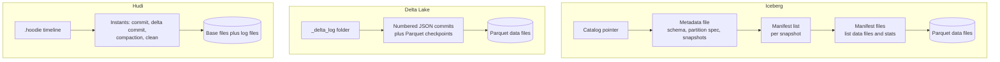
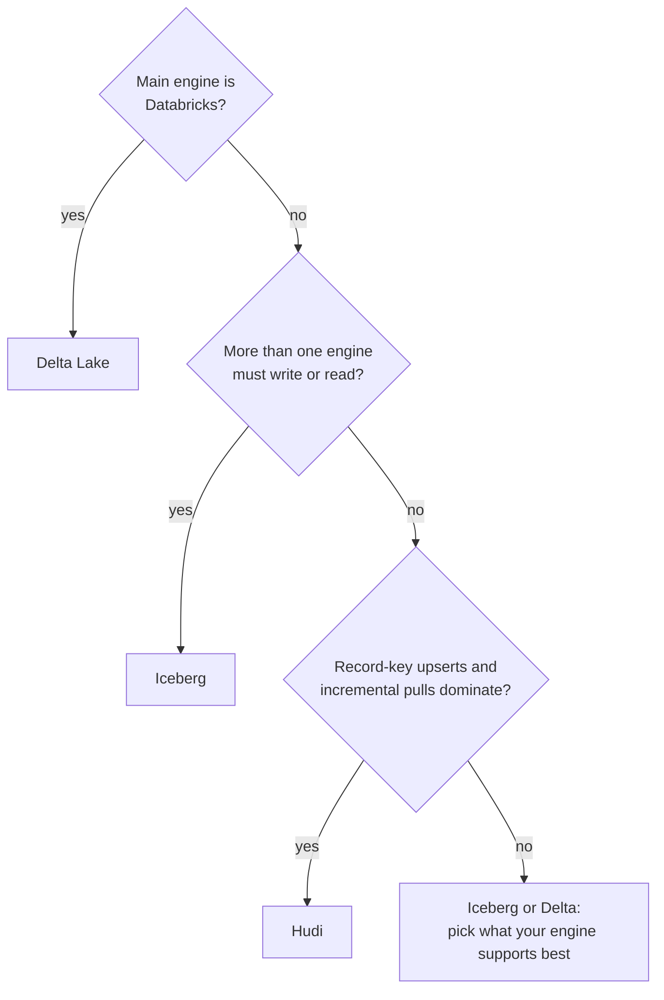

# Open table formats compared: Apache Iceberg vs Delta Lake vs Apache Hudi

> **12-minute read. What each format actually writes to storage, how it commits, and a decision rule for picking one.**

## The short answer

All three formats do the same core job: they turn a folder of immutable Parquet files into a table with atomic commits, snapshots, schema changes and row-level updates. They differ in **where they keep the list of files**, **how they handle updates**, and **who built the ecosystem around them**.

Pick by your situation, not by a feature table:

| Your situation | Lean towards |
|---|---|
| Databricks is your main engine | **Delta Lake** |
| Several engines must read and write the same tables (Spark, Trino, Flink, a warehouse) | **Apache Iceberg** |
| Heavy record-level upserts and incremental pulls from streaming or CDC, mostly on Spark or Flink | **Apache Hudi** |
| You are not sure, and want to keep options open | **Iceberg**, or Delta with Iceberg-compatible reads (see [Interoperability](#interoperability-you-may-not-have-to-choose)) |

The short [comparison table in the lakehouse page](./lakehouse-architecture.md) lists features. This page explains the mechanics underneath, because the mechanics are what decide cost, concurrency and lock-in. If you are new to the idea of a table format, read [Warehouses, lakes, and lakehouses](../../learn/concepts/warehouses-lakes-lakehouses.md) first.

## What each format writes to storage

A table format is mostly **metadata**. The data files are ordinary Parquet in the normal case for all three (Delta data files are Parquet only). What differs is the metadata layout.



How each format finds its files. Iceberg walks a tree from a catalog pointer down to manifests. Delta replays an ordered log of commits. Hudi keeps a timeline of actions and groups files by record key.

**Iceberg** keeps a tree. The catalog stores a pointer to the current metadata file. That file points to a manifest list for each snapshot, and the manifest list points to manifest files that list the data files with their column statistics. A commit writes new metadata and then atomically swaps the catalog's pointer. Because the table is defined by that pointer, any engine that can talk to the catalog sees the same table.

**Delta Lake** keeps a log. The `_delta_log` folder inside the table holds numbered JSON commit files, with periodic Parquet checkpoints so readers do not replay the whole history. A reader finds the current state by reading the latest checkpoint and the commits after it. Writers use optimistic concurrency: a commit is attempted as the next log number, and if another writer got there first, the loser checks for conflicts and retries or fails.

**Hudi** keeps a timeline. A `.hoodie` folder records every action on the table (commits, compactions, cleans) as an instant. Hudi is built around a **record key** and uses an index to find which file group a key lives in. That key-first design is why it is strong at upserts and at "give me only what changed since instant X" reads.

## Updates and deletes: copy-on-write or merge-on-read

Files are immutable, so changing one row means either rewriting the file or writing a small side file. The choice matters most for [CDC into a lakehouse](./cdc-to-lakehouse.md).

| Strategy | Write cost | Read cost | Good for |
|---|---|---|---|
| **Copy-on-write** | High: rewrite every file that holds a changed row | Low: plain Parquet | Read-heavy tables, infrequent updates |
| **Merge-on-read** | Low: append a delete or log file | Higher until compaction merges it | Frequent small updates, streaming |

How each format exposes it:

- **Iceberg** has `write.delete.mode`, `write.update.mode` and `write.merge.mode` properties that choose copy-on-write or merge-on-read per operation. Merge-on-read uses delete files (position deletes and equality deletes in format version 2). The version 3 spec adds deletion vectors. Which version your engine writes depends on the engine release, so check the spec and your engine docs.
- **Delta Lake** rewrites files by default. Deletion vectors let a delete or update mark rows as removed in a side structure instead; this is a table feature you enable, and reader support must match.
- **Hudi** makes the choice at table creation: table type `COPY_ON_WRITE` or `MERGE_ON_READ`. Merge-on-read tables write updates to row-based log files next to the base files and need compaction to merge them.

Either way, merge-on-read without scheduled compaction slowly makes reads worse. Budget for the maintenance job.

## Partitioning and layout

How you partition decides how much a query reads. See [File formats and partitioning](../../learn/concepts/file-formats-and-partitioning.md) for the general idea.

**Iceberg** has hidden partitioning: you declare a transform of a column, and queries on the raw column prune automatically. You can also change the partition spec later without rewriting old data. Spark SQL with the Iceberg extensions:

```sql
-- Apache Iceberg on Spark SQL
CREATE TABLE db.events (
  event_id BIGINT,
  user_id  BIGINT,
  event_ts TIMESTAMP
) USING iceberg
PARTITIONED BY (days(event_ts));

-- Later: add a second partition field. Old files keep the old layout.
ALTER TABLE db.events ADD PARTITION FIELD bucket(16, user_id);
```

A query with `WHERE event_ts >= '2026-11-01'` prunes by day without anyone writing a separate date column.

**Delta Lake** classic partitioning uses ordinary partition columns, so you add a derived column (such as an event date) yourself:

```sql
-- Delta Lake on Spark SQL
CREATE TABLE events (
  event_id   BIGINT,
  user_id    BIGINT,
  event_ts   TIMESTAMP,
  event_date DATE
) USING DELTA
PARTITIONED BY (event_date);
```

Changing the partition columns later means rewriting the table. Delta's newer answer is liquid clustering, which replaces partitioning and `ZORDER` with a clustering key you can change. Its availability depends on your Delta or Databricks Runtime version, so check the docs for yours.

**Hudi** partitions by a path, and records are placed by record key within it. Its Spark SQL declares the key and an ordering field:

```sql
-- Apache Hudi on Spark SQL
CREATE TABLE events (
  event_id BIGINT,
  user_id  BIGINT,
  ts       TIMESTAMP,
  dt       STRING
) USING hudi
PARTITIONED BY (dt)
TBLPROPERTIES (
  type = 'mor',
  primaryKey = 'event_id',
  preCombineField = 'ts'
);
```

When two incoming rows share a key, the one with the larger `preCombineField` wins. That rule is built into the table definition, which is handy for out-of-order CDC. Newer Hudi releases have renamed some of these settings, so confirm the names for your version.

## Concurrency and catalogs

All three use optimistic concurrency: writers do not lock, they commit and check for conflicts.

- Iceberg's atomicity lives in the **catalog**. The catalog must support an atomic swap of the metadata pointer. Common choices are a Hive Metastore, a REST catalog or a cloud service. The Iceberg REST catalog spec is what lets different engines share one catalog.
- Delta's atomicity lives in the **storage layer**: it needs the store to support atomic "put if absent" for the next log file. On stores without that, Delta needs extra coordination, which is why multi-cluster writes to S3 have needed special handling in the past. Read the storage page in the Delta docs for your store.
- Hudi uses a lock provider for multi-writer setups, configured separately.

Two writers hitting the same files will conflict in all three. Design so that streaming jobs write to different partitions, and run compaction on a schedule that does not collide with them.

## Interoperability: you may not have to choose

The three-way choice is less final than it used to be.

- Delta Lake UniForm writes Iceberg (and Hudi) metadata alongside the Delta log, so Iceberg readers can read a Delta table. See the Delta docs for supported versions and limits.
- Apache XTable (incubating at the time of writing) translates table metadata between formats without copying data files.
- Many warehouses and query engines read Iceberg natively, which is the main reason it is the safe default for a shared, multi-engine lake.

Translation layers have limits (for example, not every feature maps across formats), so test the specific features you rely on, such as deletes and schema changes. For the cloud services that host these tables, see the sibling site: [Cloud Zero to Hero](https://cloud.noblerworks.com/).

## A decision walk-through



A starting rule of thumb. Your engine's native support beats any feature list, so check what your platform supports before anything else.

Worked example. A team ingests orders from Postgres through CDC into S3 and queries them from Spark and Trino. The tables update often, so they want merge-on-read. Trino and Spark must both read them, which points to Iceberg with merge-on-read set for merges, plus a nightly compaction job. If the same team were all-in on Databricks, Delta with deletion vectors would be the natural choice and Trino would read it through UniForm or a connector.

## Common mistakes

- **Choosing on a feature table.** Features converge fast. Engine and catalog support are what you live with.
- **Skipping maintenance.** All three need compaction, snapshot expiry or cleaning, and removal of orphan files. Without it, storage grows and reads slow.
- **Over-partitioning.** Partitioning by a high-cardinality column creates many tiny files in every format.
- **Mixing writers across formats on one table.** Pick one writer path per table.
- **Assuming time travel is a backup.** Snapshot expiry removes old versions. See [Backup and point-in-time restore](../../learn/concepts/backup-and-point-in-time-restore.md).

I did not run any of these tools for this page; the behaviour described comes from the docs below. Verify version-specific features before you rely on them.

## Official docs

- **[📖 Apache Iceberg: Table spec](https://iceberg.apache.org/spec/)** - metadata files, manifests, snapshots, delete files and format versions
- **[📖 Apache Iceberg: Spark DDL](https://iceberg.apache.org/docs/latest/spark-ddl/)** - `PARTITIONED BY` transforms and `ADD PARTITION FIELD`
- **[📖 Delta Lake: Documentation](https://docs.delta.io/)** - the transaction log, deletion vectors, clustering and UniForm
- **[📖 Delta Lake protocol](https://github.com/delta-io/delta/blob/master/PROTOCOL.md)** - the log, checkpoints and table features in detail
- **[📖 Apache Hudi: Overview](https://hudi.apache.org/docs/overview)** - timeline, table types and record keys
- **[📖 Apache Hudi: Table and query types](https://hudi.apache.org/docs/table_types)** - copy-on-write versus merge-on-read
- **[📖 Apache XTable](https://xtable.apache.org/)** - metadata translation between table formats

## What to look at next

- **[Lakehouse Architecture](./lakehouse-architecture.md)** - where the table format sits in the whole design
- **[CDC into a Lakehouse](./cdc-to-lakehouse.md)** - merge-on-read in a real pipeline
- **[Transactions and ACID](../../learn/concepts/transactions-and-acid.md)** - what "atomic commit" means
- **[Medallion Architecture](./medallion-architecture.md)** - layering tables on top of a format

## Check yourself

Test your understanding. Click an answer to reveal it.

**1. Where does Iceberg's atomic commit happen, and where does Delta Lake's?**

<details markdown="1">
<summary>Answer</summary>

Iceberg swaps the catalog's pointer to a new metadata file. Delta adds the next numbered commit file to the `_delta_log` folder in storage. See: [Concurrency and catalogs](#concurrency-and-catalogs).

</details>

**2. A table gets many small updates every minute. Which write strategy fits, and what job must you also run?**

<details markdown="1">
<summary>Answer</summary>

Merge-on-read, which writes small delete or log files instead of rewriting data files. You must run compaction on a schedule, or reads slow down. See: [Updates and deletes](#updates-and-deletes-copy-on-write-or-merge-on-read).

</details>

**3. What does Iceberg's hidden partitioning let you do that classic Delta partitioning does not?**

<details markdown="1">
<summary>Answer</summary>

Declare a transform of a column (such as days of a timestamp) so queries on the raw column prune automatically, and change the partition spec later without rewriting old data. See: [Partitioning and layout](#partitioning-and-layout).

</details>

**4. Why is the choice between formats less final than it used to be?**

<details markdown="1">
<summary>Answer</summary>

Delta UniForm and Apache XTable can expose or translate one format's metadata as another, and many engines read Iceberg natively. Translation has feature limits, so test the ones you need. See: [Interoperability](#interoperability-you-may-not-have-to-choose).

</details>
