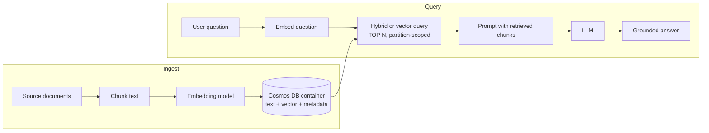

# AI Retrieval and Agent Memory in Azure Cosmos DB

> **Exam domain:** Implement AI and analytics capabilities in database solutions (20-25%), objectives "Design and implement AI retrieval" and "Design and implement agent memory stores". Both are new on the 2026-10-06 outline, so most third-party DP-420 material written before then does not cover them.

## Table of Contents

1. [Why a database exam now tests retrieval](#why-a-database-exam-now-tests-retrieval)
2. [Vector data: the container vector policy](#vector-data-the-container-vector-policy)
3. [Vector indexes: flat, quantizedFlat, diskANN](#vector-indexes-flat-quantizedflat-diskann)
4. [Sharded DiskANN and partitioning for vectors](#sharded-diskann-and-partitioning-for-vectors)
5. [Running and tuning a vector search](#running-and-tuning-a-vector-search)
6. [Full-text search](#full-text-search)
7. [Hybrid search with RRF](#hybrid-search-with-rrf)
8. [Retrieval-augmented generation end to end](#retrieval-augmented-generation-end-to-end)
9. [Agent memory stores](#agent-memory-stores)
10. [Worked scenarios](#worked-scenarios)
11. [How the exam tests this](#how-the-exam-tests-this)

---

## Why a database exam now tests retrieval

A large language model only knows what it was trained on and what you put in its prompt. Every useful AI application therefore has a retrieval step: given the user's question, find the handful of documents, product records or past conversation turns that should go into the prompt. That step is a database query, and it has all the usual database concerns - latency, cost per request, partitioning, freshness, security - plus one new one: the query matches on *meaning*, not on exact values.

The traditional answer was two systems: the operational database holds the record, and a separate vector store or search service holds an embedding of it. Every write has to reach both, the two drift, and every tenant boundary has to be enforced twice. Microsoft's pitch for Cosmos DB, and the reason DP-420 was re-scoped, is the **integrated vector database**: the embedding is just another property on the JSON document, indexed and queried by the same engine, under the same partition key, RBAC and backup as the rest of the item.

**[📖 Vector indexing and search in Azure Cosmos DB for NoSQL](https://learn.microsoft.com/en-us/azure/cosmos-db/vector-search)** - the primary reference for this note
**[📖 Vector databases for data engineers](../../../../learn/concepts/vector-databases-for-data-engineers.md)** - this site's plain-English primer on embeddings and ANN search

An embedding is an array of numbers produced by a model (for example an Azure OpenAI embedding model) such that texts with similar meaning land close together. "Refund my order" and "I want my money back" share no words but produce nearby vectors. A vector search takes the embedding of the question and returns the stored items whose vectors are closest to it.

---

## Vector data: the container vector policy

Before Cosmos DB will treat an array property as a vector, two things must be true. The account must have the vector search capability enabled (portal **Features > Vector Search for NoSQL API**, or `az cosmosdb update --capabilities EnableNoSQLVectorSearch`), and the container must declare a **vector embedding policy**. The policy tells the engine where vectors live and how to compare them:

```json
{
  "vectorEmbeddings": [
    {
      "path": "/contentVector",
      "dataType": "float32",
      "distanceFunction": "cosine",
      "dimensions": 1536
    }
  ]
}
```

Each field is a design decision the exam can probe:

- **path** - the property that holds the vector. Each path gets at most one policy entry; a container can hold several vector paths (for example a text embedding and an image embedding) with separate entries. Wildcards and vector paths nested inside arrays are not supported.
- **dataType** - `float32`, `float16`, `int8` or `uint8`. Most embedding models emit float32. Storing as float16 halves the storage footprint for a small recall cost on typical text workloads; int8 quarters it with a more noticeable recall cost. Microsoft's tuning guidance is to try float16 first and move to int8 only after measuring recall on your own test set.
- **dimensions** - the length of every vector at that path, default 1536. It must match the embedding model's output. Many current models let you choose a smaller output dimension; fewer dimensions mean cheaper inserts and searches but may miss fine distinctions.
- **distanceFunction** - `cosine` (default, range -1 to +1, higher is more similar), `dotproduct` (higher is more similar) or `euclidean` (0 is identical, higher is less similar). Use what the embedding model was trained for; for normalized text embeddings cosine is the usual choice.

The direction of the score matters when you read results: with cosine and dot product, bigger means closer; with Euclidean, smaller means closer. `ORDER BY VectorDistance(...)` handles this for you and returns the most similar first, but a question that asks you to filter on a threshold expects you to know which way the number runs.

**Policies are immutable in place.** You can add or remove a vector path, but you cannot change the settings of an existing vector embedding policy or vector index. To change dimensions or data type you drop and re-add the entry, which in practice usually means a new container and a copy job (see [the Fabric, fleets and resilience note](cosmos-db-fabric-fleets-resilience.md#container-copy-jobs)). Choose the model and dimensions before you load production data.

---

## Vector indexes: flat, quantizedFlat, diskANN

The embedding policy says what the vectors are. The **indexing policy** says how to search them fast. Without a vector index, `VectorDistance` still works, but every query compares the query vector with every stored vector - a full scan that costs RUs in proportion to the data.

| Index type | How it searches | Max dimensions | Fits |
|---|---|---|---|
| `flat` | Exact brute force over full-precision vectors stored in the regular index | 505 | Small, filtered searches where 100% recall is mandatory |
| `quantizedFlat` | Exact brute force over compressed (quantized) vectors | 4,096 | Searches scoped to roughly 50,000 vectors or fewer |
| `diskANN` | Approximate nearest neighbor over a graph index (Microsoft Research DiskANN) | 4,096 | Searches scoped to more than roughly 50,000 vectors |

```json
{
  "indexingMode": "consistent",
  "automatic": true,
  "includedPaths": [ { "path": "/*" } ],
  "excludedPaths": [
    { "path": "/_etag/?" },
    { "path": "/contentVector/*" }
  ],
  "vectorIndexes": [
    { "path": "/contentVector", "type": "diskANN" }
  ]
}
```

Notice the excluded path. A 1,536-element array would otherwise be added to the ordinary range index element by element, inflating write RUs and index size for no benefit. Excluding the vector path from the range index is one of Microsoft's standard performance tips and a likely "which change reduces insert RU" answer.

### Exact versus approximate, and why it matters

`flat` and `quantizedFlat` are both brute force: they look at every candidate vector in scope. `flat` gives exactly the true top K. `quantizedFlat` compresses each vector (product quantization by default, `spherical` as an option) so the comparison is cheaper; any small loss of accuracy comes from compression, not from skipping candidates.

`diskANN` is different in kind. It builds a navigable graph and walks it toward the query vector, examining a fraction of the data. That is why it stays fast at millions of vectors, and also why it is **approximate**: it returns most of the true nearest neighbors, not a guaranteed exact top K. Two consequences the exam likes:

- **Results can vary between runs** of the same query on unchanged data, because each replica builds its own index and any replica can answer. This is expected behaviour, not a bug.
- **Recall is tunable per query.** Raising `searchListSizeMultiplier` makes the graph walk consider more candidates, improving recall at higher RU cost and latency.

Both `quantizedFlat` and `diskANN` need **at least 1,000 vectors** in scope before the index is used, because quantization needs enough data to be accurate. Below that, the engine falls back to a full scan and RU charges can be higher than you expect - a classic "why is my small test container expensive" question.

**[📖 Tips for vector search performance](https://learn.microsoft.com/en-us/azure/cosmos-db/gen-ai/vector-search-performance-tips)** - index choice matrix, precision trade-offs, RU estimates, query-time options

### Rough cost shape

Microsoft's own estimates (rough, measure your own) give a feel for the trade-off: inserting a 1,536-dimension float32 item costs about 35 RUs with `quantizedFlat` and about 65 RUs with `diskANN`, because diskANN maintains a graph on write. A TOP 10 diskANN search scoped to one partition is up to about 45 RUs; the same search fanned out across N physical partitions costs up to about 45 RUs times N. The lesson repeats the oldest Cosmos DB lesson: **scope the query to a partition** and fan-out dominates nothing.

---

## Sharded DiskANN and partitioning for vectors

By default, a diskANN index is built per physical partition, over every vector in that partition. If your container holds many tenants, a query for tenant A still walks a graph containing tenant B's vectors and then filters them out. That costs RUs and can hurt recall, because the nearest neighbors the graph finds may belong to someone else and get discarded by the filter.

**Sharded DiskANN** fixes this. Add `vectorIndexShardKey` to the index entry and the engine builds a separate, smaller DiskANN index for each distinct value of that property:

```json
"vectorIndexes": [
  {
    "path": "/contentVector",
    "type": "diskANN",
    "vectorIndexShardKey": ["/tenantId"]
  }
]
```

A query that filters on the shard key value searches only that shard's index:

```sql
SELECT TOP 10 c.id, c.title
FROM c
WHERE c.tenantId = @tenantId
ORDER BY VectorDistance(c.contentVector, @queryVector)
```

Microsoft lists four benefits: lower latency (smaller graph), lower RU cost, **better recall** (the search is focused on relevant data), and isolation of vector data per shard value. Typical shard keys are a tenant, a user, or a category such as product line.

**[📖 Sharded DiskANN](https://learn.microsoft.com/en-us/azure/cosmos-db/gen-ai/sharded-diskann)** - configuration and use cases

### Shard key versus partition key

They solve different problems and are often, but not always, the same property.

- The **partition key** decides physical data placement, write distribution and the scope of transactions. Choose it for the whole workload: point reads, writes, and queries.
- The **vector index shard key** decides how the vector index is split. Choose it for the search pattern.

For a multi-tenant RAG app with a hierarchical partition key `["/tenantId", "/documentId"]`, Microsoft's agent memory guidance suggests setting the shard key to the first level, `/tenantId`, so each tenant's searches hit only its own index while documents still spread across partitions. A global (unsharded) index is simpler and lets you search everything at once; pick it when queries genuinely span all data.

**[📖 Multitenancy for vector search](https://learn.microsoft.com/en-us/azure/cosmos-db/nosql/multi-tenancy-vector-search)** - partition-key-per-tenant, account-per-tenant, and how hierarchical keys fit

---

## Running and tuning a vector search

The query surface is one system function, `VectorDistance`, used in both the projection and `ORDER BY`:

```sql
SELECT TOP 5 c.id, c.title,
       VectorDistance(c.contentVector, @queryVector) AS score
FROM c
WHERE c.category = @category
ORDER BY VectorDistance(c.contentVector, @queryVector)
```

Four habits separate a correct answer from a costly one:

1. **Always use `TOP N`.** Without it the engine tries to return far more results and burns RUs. Microsoft calls this out as "important" in the docs.
2. **Parameterize the query vector.** Pass it as `@queryVector` from the SDK; concatenating a 1,536-number literal into query text is slow and invites injection mistakes.
3. **Combine with filters and the partition key.** Vector search composes with ordinary `WHERE` clauses and indexes, so filters narrow the candidate set before or during the vector walk.
4. **Exclude the vector path from the range index** (see above).

The full signature has two optional arguments: `VectorDistance(vector1, vector2, bruteForce, options)`. Setting the third argument to `true` forces brute force (useful to compute exact ground truth when you measure recall). The options object accepts `distanceFunction` and `dataType` overrides, plus three tuning knobs:

| Option | What it does | Cost of raising it |
|---|---|---|
| `searchListSizeMultiplier` | Widens the DiskANN candidate list (typical 5, 10, 20) | More RUs and latency, higher recall |
| `quantizedVectorListMultiplier` | Widens the quantized candidate list | More RUs and latency, higher recall |
| `filterPriority` | 0.0-1.0; biases a filtered DiskANN search toward filter matches | Fewer RUs, small recall hit |

A worked trade-off: a write-heavy app stores int8 vectors to cut insert cost, and users report slightly weaker matches. Rather than rebuild with float32, raise `searchListSizeMultiplier` to 10 on the read path. You pay more per search but keep the cheap writes. That kind of "where do you take the cost" reasoning is what the exam's optimization objective ("Optimize full-text and vector performance") is after.

### Integrated embeddings

Keeping embeddings in step with changing text is normally your pipeline's job: watch for changes, call the embedding model, handle retries, write the vector back. **Integrated Embeddings** (preview, rolling out by region) moves that into the database: you name the source properties, a Microsoft Foundry embedding deployment (text-embedding-3-large, text-embedding-3-small or ada-002) and the target vector path, and Cosmos DB generates and refreshes embeddings asynchronously as items change. Prerequisites tell you how it works under the hood: vector search enabled, **all versions and deletes change feed** enabled, and a managed identity on the account that Cosmos DB uses to call Foundry. Because it is preview, treat it as a design option rather than a default exam answer.

**[📖 Integrated embeddings (preview)](https://learn.microsoft.com/en-us/azure/cosmos-db/integrated-embeddings)** - automatic embedding generation and refresh

---

## Full-text search

Vector search finds meaning; it is weak at exact tokens. A user who searches for the SKU "X-4471", a person's surname, or an error code wants the documents that contain that string. That is lexical search, and Cosmos DB for NoSQL now does it natively with a full-text index - no external search service for the basic case.

Two policies are needed, mirroring the vector setup:

```json
{
  "defaultLanguage": "en-US",
  "fullTextPaths": [ { "path": "/content", "language": "en-US" } ]
}
```

```json
"fullTextIndexes": [ { "path": "/content" } ]
```

The full-text policy declares which paths hold text and in what language; the full-text index in the indexing policy makes the search efficient. Queries run without the index but cost more RUs and run longer, so "define the full-text policy and index" is the expected fix for a slow full-text query. Indexing applies tokenization, stemming ("running" matches "run") and, for English, stop word removal. Other languages (German, Spanish, French, Italian, Portuguese) are in preview.

The query functions split into filters and scorers:

| Function | Use in | Returns |
|---|---|---|
| `FullTextContains(c.content, "red bicycle")` | `WHERE` | true if the phrase is present |
| `FullTextContainsAll(c.content, "red", "bicycle")` | `WHERE` | true if every term is present, anywhere |
| `FullTextContainsAny(c.content, "bicycle", "skateboard")` | `WHERE` | true if at least one term is present |
| `FullTextScore(c.content, "red", "bicycle")` | `ORDER BY RANK` only | BM25 relevance score |

`FullTextScore` uses **BM25**, which scores by term frequency, how rare the term is across the corpus (inverse document frequency) and document length. It can only appear in an `ORDER BY RANK` clause, not in the projection or a `WHERE` - a detail the exam can use to make a distractor.

**[📖 Full-text search](https://learn.microsoft.com/en-us/azure/cosmos-db/gen-ai/full-text-search)** - policies, index, functions, language support

---

## Hybrid search with RRF

Hybrid search runs a vector search and a full-text search and merges the two ranked lists. The merge function is **Reciprocal Rank Fusion (RRF)**: each document's fused score is built from its *rank* in each list rather than its raw score, which neatly sidesteps the fact that cosine similarities and BM25 scores live on unrelated scales.

```sql
SELECT TOP 10 c.id, c.title
FROM c
ORDER BY RANK RRF(
    VectorDistance(c.contentVector, @queryVector),
    FullTextScore(c.content, @term1, @term2)
)
```

An optional final array weights the components. `[2, 1]` makes the vector ranking count twice as much as BM25:

```sql
ORDER BY RANK RRF(VectorDistance(c.contentVector, @queryVector),
                  FullTextScore(c.content, @term1), [2, 1])
```

The container needs all four pieces: vector embedding policy, full-text policy, vector index and full-text index. Hybrid is usually the strongest default for RAG over business documents, because real questions mix concepts ("how do I cancel") with exact identifiers ("order 88213").

**[📖 Hybrid search](https://learn.microsoft.com/en-us/azure/cosmos-db/gen-ai/hybrid-search)** - configuration and weighted RRF

### Choosing a retrieval method

| Question shape | Best fit | Why |
|---|---|---|
| Paraphrased, conceptual ("what is your returns policy") | Vector | Matches meaning without shared words |
| Exact identifiers, names, codes | Full-text | BM25 rewards rare exact tokens |
| Mixed, or unknown in advance | Hybrid (RRF) | Each method covers the other's blind spot |
| Must return only one tenant's data | Any, plus partition key and shard key filter | Isolation is a filter and placement concern, not a ranking one |

---

## Retrieval-augmented generation end to end

RAG is the pattern that ties this together: retrieve relevant data, put it in the prompt, let the model answer from it. Microsoft's flow for Cosmos DB has four steps.



The diagram shows ingestion on the left (documents are chunked, embedded and stored with their text and metadata in one item) and the query path on the right (the question is embedded, the top matches are retrieved and placed in the prompt for the model).

Design decisions at each stage:

- **Chunking.** Store one item per chunk, not one per document. A 40-page PDF as a single item gives one blurry embedding and an item that may approach the size limit; 500-1,000 token chunks with a little overlap give precise retrieval. Keep the parent document ID and position on each chunk so you can cite sources and fetch neighbours.
- **Freshness.** Because the vector lives on the item, updating the item updates what retrieval sees, with no second system to sync. When the source of truth is elsewhere, the change feed is the natural trigger to re-embed changed items.
- **Isolation.** Put tenant ID in the partition key (or the first level of a hierarchical key) and the vector shard key, and always filter on it. Retrieval that leaks another tenant's chunk into a prompt is a data breach, not a relevance bug.
- **Cost.** Every question is an embedding call plus a search; scope searches to a partition, use `TOP N` with a small N (5-10 chunks is typical), and consider a **semantic cache** - store past question embeddings with their answers and return a cached answer when a new question is close enough, skipping the LLM call.

**[📖 RAG in Azure Cosmos DB](https://learn.microsoft.com/en-us/azure/cosmos-db/gen-ai/rag)** - Microsoft's RAG overview for Cosmos DB
**[📖 Semantic cache](https://learn.microsoft.com/en-us/azure/cosmos-db/gen-ai/semantic-cache)** - reusing answers for semantically similar questions

---

## Agent memory stores

An AI agent is a loop: the model reasons, calls tools, reads results, and responds, often over many turns and many sessions. Its prompt window is small and expensive, so the agent needs somewhere durable to keep what happened and to pull back only what matters now. The exam objective names three things: durable memory stores, conversation state, and semantic memory.

**[📖 Agent memories in Azure Cosmos DB](https://learn.microsoft.com/en-us/azure/cosmos-db/gen-ai/agentic-memories)** - the source for the patterns below

### Short-term and long-term memory

- **Short-term (working or episodic) memory** is recent context for the current task: the last several turns, intermediate tool results, partial plan state. It is valuable now and stale later, which makes **TTL** the natural lifecycle tool - set `ttl` on turn items so old ones expire without a cleanup job.
- **Long-term memory** accumulates across threads: user preferences ("prefers metric units"), summaries of long threads, facts the user confirmed. It is retrieved by meaning, so it carries an embedding and lives under a vector index. This is **semantic memory**.

The usual pipeline turns the first into the second: turns land as short-term items; a background process (Microsoft suggests the change feed with Azure Durable Functions) summarizes threads and extracts facts into long-term items; the raw turns then expire.

### Choosing the partition key

Microsoft walks through three options, and the reasoning is classic Cosmos DB:

| Partition key | Strength | Weakness | Fits |
|---|---|---|---|
| GUID per item | Perfect write distribution | Every thread query fans out | Write-heavy logging and analytics of agent turns |
| `/threadId` | All turns of a conversation co-located; "latest N" is single-partition | Must have enough threads to spread load | Most conversational agents and RAG chat |
| `["/tenantId", "/threadId"]` (hierarchical) | Thread locality plus tenant-level grouping, quotas and isolation | Slightly more design work | Multi-tenant SaaS with many concurrent conversations per tenant |

The hierarchical option also lets a tenant grow past the 20 GB logical partition limit, because the full key path is what defines a logical partition.

### Data model: one document per turn

Microsoft's recommended model stores **one item per turn**, where a turn is a complete exchange: the user's message and the agent's reply, or a tool call and its result. That unit is small, self-contained, cheap to write, easy to embed (one embedding per exchange is the right granularity for semantic recall and for a semantic cache) and easy to expire individually.

The two alternatives each fail in a predictable way:

- **One item per message** keeps things atomic but splits question from answer, so a retrieved message often lacks the context that made it useful, and it is a poor fit for semantic caching.
- **One item per thread** loads the whole conversation in one read, but every new turn rewrites a growing document (RU cost grows with item size), TTL can only expire the whole thread, item size heads toward the limit, and the single embedding becomes too coarse to find a specific moment.

### Retrieval patterns

All four patterns are ordinary queries, scoped to the thread (and tenant) by the partition key:

```sql
-- Recency: rebuild the recent conversation window
SELECT TOP @k c.content, c.timestamp
FROM c
WHERE c.threadId = @threadId
ORDER BY c.timestamp DESC

-- Semantic: turns most similar to the current question
SELECT TOP @k c.content, VectorDistance(c.embedding, @queryVector) AS dist
FROM c
WHERE c.threadId = @threadId
ORDER BY VectorDistance(c.embedding, @queryVector)

-- Hybrid: meaning plus exact terms
SELECT TOP @k c.content
FROM c
WHERE c.threadId = @threadId
ORDER BY RANK RRF(VectorDistance(c.embedding, @queryVector),
                  FullTextScore(c.content, @term))

-- Keyword: every turn that mentions a term
SELECT TOP @k c.content
FROM c
WHERE c.threadId = @threadId AND FullTextContains(c.content, @term)
```

A good agent typically combines them: the last few turns for continuity, plus the top few semantically similar long-term memories for the user, deduplicated, inside a token budget.

**[📖 Agent Memory Toolkit (preview)](https://learn.microsoft.com/en-us/azure/cosmos-db/gen-ai/agent-memory-toolkit)** - a Python SDK that implements turns, thread summaries, extracted facts and cross-thread user summaries on Cosmos DB

---

## Worked scenarios

### Scenario 1: A support bot that misses product codes

**Situation:** A RAG chatbot over 400,000 support articles uses pure vector search. Users asking about "error E-1173" get articles about generally similar errors, not the one that names E-1173.

**Reasoning:** Embeddings capture meaning; a rare alphanumeric code carries little semantic signal. BM25 rewards exactly such rare tokens.

**Answer:** Add a full-text policy and full-text index on the article text and switch the retrieval query to `ORDER BY RANK RRF(VectorDistance(...), FullTextScore(...))`. The vector index stays as diskANN because the search scope is well over 50,000 vectors.

### Scenario 2: A multi-tenant document assistant with high RU per search

**Situation:** 2,000 tenants share one container partitioned by `/documentId`. Each search filters `WHERE c.tenantId = @t` and costs far more RUs than expected; recall is mediocre for small tenants.

**Reasoning:** The partition key does not match the filter, so every search fans out to all physical partitions. Inside each partition the diskANN graph holds all tenants' vectors, so the walk finds neighbors that the filter then discards.

**Answer:** Move to a hierarchical partition key `["/tenantId", "/documentId"]` (a new container plus a copy job, since partition keys cannot change in place) and set `vectorIndexShardKey` to `/tenantId`. Searches become single-tenant in both placement and index.

### Scenario 3: A test container that costs more than production

**Situation:** A developer loads 600 sample vectors into a container with a quantizedFlat index and finds searches more expensive per item than in production.

**Answer:** quantizedFlat and diskANN need at least 1,000 vectors before the index is used; below that the engine does a full scan. Load a realistic volume (and realistic embeddings, not random vectors) before benchmarking.

### Scenario 4: Agent memory that grows without bound

**Situation:** An agent stores one item per conversation thread and appends every turn. Write RUs climb week over week and some long threads fail to update.

**Answer:** Switch to one item per turn with `/threadId` (or tenant plus thread) as the partition key, set a TTL on turn items, and summarize threads into long-term memory items via the change feed. Writes become small constant-size inserts, and expiry is per turn.

---

## How the exam tests this

- **Index choice from numbers.** Expect a scenario with a vector count and a recall requirement. Exact results required and small scope: flat (watch the 505-dimension limit). Up to roughly 50,000 vectors per search: quantizedFlat. Larger: diskANN.
- **"Why are results slightly different each run?"** diskANN is approximate and each replica builds its own index. Not a consistency-level problem.
- **Immutable vector settings.** Changing dimensions or data type means drop and re-add, typically a new container. Distractors suggest editing the policy in place.
- **What goes where.** `FullTextScore` only in `ORDER BY RANK`; `FullTextContains*` in `WHERE`; `RRF` wraps both scorers; weights are an optional last array.
- **Cost fixes.** `TOP N`, partition-scoped filters, excluding vector paths from the range index, a sharded DiskANN index for per-tenant search, lower precision (float16) for storage, query-time multipliers for recall.
- **Agent memory modeling.** One document per turn is the recommended model; thread ID or tenant-plus-thread is the usual partition key; TTL handles short-term expiry; embeddings on turns or summaries enable semantic recall.
- **Prerequisites.** Vector search must be enabled on the account; vector and full-text features apply to the API for NoSQL.

---

**Related notes:** [Data modeling and partitioning](cosmos-db-data-modeling-partitioning.md) · [Performance and operations](cosmos-db-performance-operations.md) · [Fabric, fleets and resilience](cosmos-db-fabric-fleets-resilience.md)
