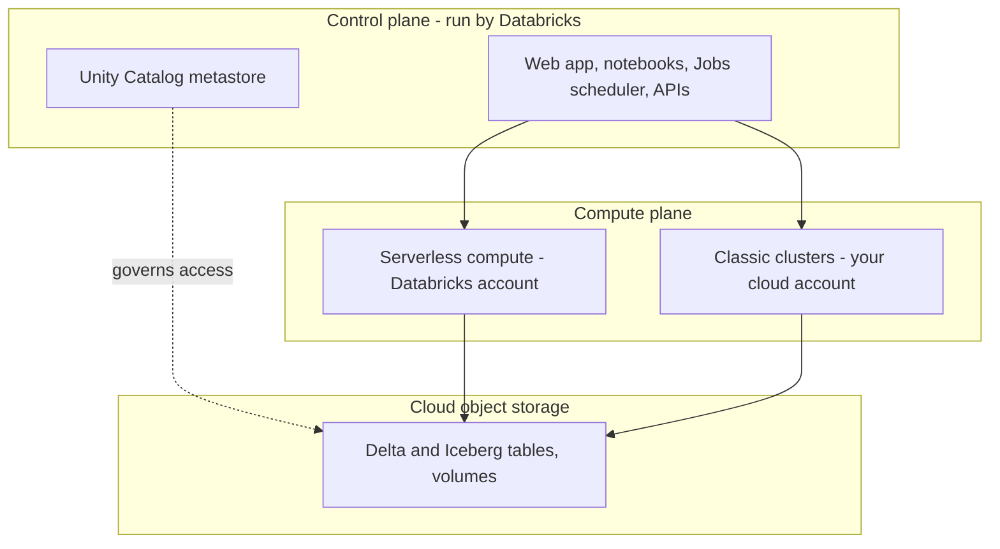
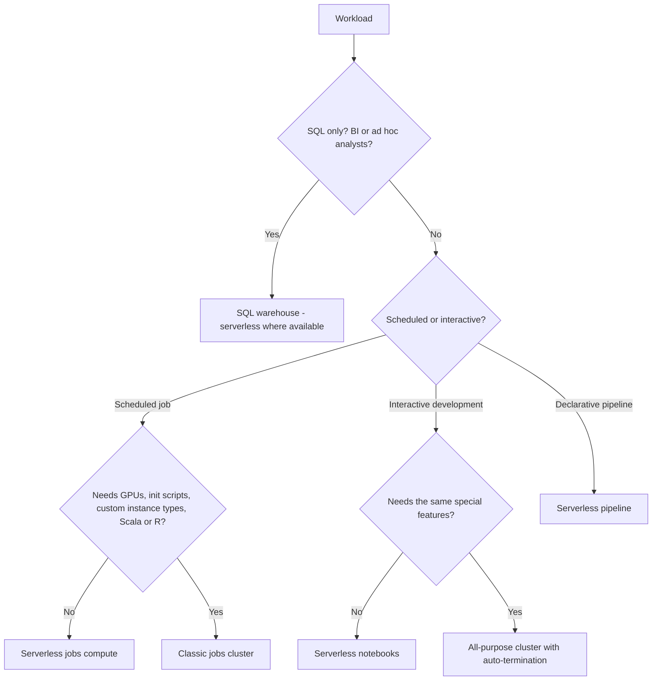

# Section 1: Databricks Intelligence Platform

Weighted **6%** in the May 2026 exam guide, so about three questions. The section is small, but everything else in the exam sits on top of it: if you know what the control plane, Delta Lake, Unity Catalog and each kind of compute are for, a lot of later questions answer themselves.

The guide lists two objectives:

- Understand the core components of the Data Intelligence Platform, such as its architecture, Delta Lake and Unity Catalog.
- Understand the platform's compute services, including their characteristics, limitations and cost models, and select the most suitable option for each workload.

Source: the **[📖 exam page](https://www.databricks.com/learn/certification/data-engineer-associate)** and its linked exam guide.

## Table of Contents

1. [The platform in one picture](#the-platform-in-one-picture)
2. [The lakehouse idea](#the-lakehouse-idea)
3. [Delta Lake: the storage layer](#delta-lake-the-storage-layer)
4. [Unity Catalog: the governance layer](#unity-catalog-the-governance-layer)
5. [Compute services](#compute-services)
6. [Choosing compute for a workload](#choosing-compute-for-a-workload)
7. [The workspace and notebooks](#the-workspace-and-notebooks)
8. [How the exam tests this section](#how-the-exam-tests-this-section)

---

## The platform in one picture

Databricks splits into two planes. The **control plane** is run by Databricks: the web app, the job scheduler, notebooks' source, the Unity Catalog metastore service and the APIs. The **compute plane** is where your data is actually processed. For **classic compute** the compute plane is virtual machines in *your* cloud account; for **serverless compute** it is machines Databricks runs in *its* account, inside a network boundary for your workspace. Your table data lives in cloud object storage (S3, ADLS or GCS) either way.



The diagram shows the split: the control plane orchestrates and governs, the compute plane does the work, and the data sits in object storage, governed by Unity Catalog whichever compute reads it.

**[📖 Databricks architecture overview](https://docs.databricks.com/aws/en/getting-started/overview)** - control plane, compute plane, storage
**[📖 Serverless compute plane networking](https://docs.databricks.com/aws/en/security/network/serverless-network-security/)** - how serverless is isolated per workspace

---

## The lakehouse idea

A **data lake** is cheap object storage holding files in open formats. It holds anything, but on its own it has no transactions, no reliable schema and weak governance, so two jobs writing at once can corrupt a dataset and nobody can say which version of a file a report used. A **data warehouse** gives you transactions, schemas and fast SQL, but stores data in a proprietary format, costs more per terabyte and is awkward for machine learning and unstructured data.

A **lakehouse** puts warehouse behaviour (ACID transactions, schemas, governance, fast SQL) on top of lake storage in open formats. One copy of the data serves BI, data engineering, streaming and AI. Databricks calls its version the **Data Intelligence Platform**: the lakehouse plus AI features that use your metadata (for example, AI-generated table comments and natural-language query tools).

| Need | Data lake | Data warehouse | Lakehouse |
|---|---|---|---|
| Store any data type cheaply | Yes | No | Yes |
| ACID transactions | No | Yes | Yes (Delta Lake, Iceberg) |
| Fine-grained governance | Weak | Strong | Strong (Unity Catalog) |
| Open file format | Yes | No | Yes |
| BI and ML on one copy | No | No | Yes |

The exam's second sample question is a good model: rapid iteration, rollback after a bad load, audit trails and one source of truth for AI and BI. Every one of those points at **Delta Lake transactions and time travel, governed by Unity Catalog**. Answers built on CSV files, manual copies or in-memory DataFrames fail at least one requirement.

**[📖 What is a data lakehouse?](https://docs.databricks.com/aws/en/lakehouse/)** - the architecture and its benefits
**[📖 Medallion architecture](https://docs.databricks.com/aws/en/lakehouse/medallion)** - bronze, silver and gold layers (covered in [Section 3](03-data-transformation-modeling.md))

---

## Delta Lake: the storage layer

**Delta Lake** is the default table format on Databricks. A Delta table is a folder of Parquet data files plus a **transaction log** (`_delta_log/`), an ordered list of JSON commits that says which files make up each version of the table. Everything Delta adds comes from that log:

- **ACID transactions.** A write either commits a new log entry or it doesn't. Readers never see half a write, and concurrent writers are checked for conflicts.
- **Schema enforcement.** A write whose columns or types don't match the table fails, instead of silently corrupting it. **Schema evolution** (`mergeSchema`, or `ALTER TABLE ... ADD COLUMNS`) lets you change the schema on purpose.
- **Time travel.** Every commit is a version. You can query an old version or restore it.
- **Audit history.** `DESCRIBE HISTORY` shows who changed what, when, with which operation.

```sql
-- What happened to this table?
DESCRIBE HISTORY main.sales.orders;

-- Query it as it was
SELECT * FROM main.sales.orders VERSION AS OF 42;
SELECT * FROM main.sales.orders TIMESTAMP AS OF '2026-10-01';

-- Roll back a bad load
RESTORE TABLE main.sales.orders TO VERSION AS OF 42;

-- Remove data files no version within the retention window needs (default 7 days)
VACUUM main.sales.orders;
```

Two facts the exam likes. First, time travel only reaches as far back as the data files still exist: after `VACUUM` removes files older than the retention period, versions that needed them can no longer be read. Second, Delta is Parquet underneath, so it stays an open format; **UniForm** can also write Iceberg metadata so Iceberg engines can read the same table, and Unity Catalog also supports managed **Apache Iceberg** tables.

**[📖 What is Delta Lake?](https://docs.databricks.com/aws/en/delta/)** - transaction log, features
**[📖 Delta table history and time travel](https://docs.databricks.com/aws/en/delta/history)** - `DESCRIBE HISTORY`, `VERSION AS OF`, `RESTORE`
**[📖 VACUUM](https://docs.databricks.com/aws/en/sql/language-manual/delta-vacuum)** - retention and its effect on time travel

---

## Unity Catalog: the governance layer

**Unity Catalog** is the single place where Databricks keeps metadata and permissions for data and AI assets: tables, views, volumes (files), functions, models. It sits in the control plane and is attached to every workspace in a region through one **metastore**.

Objects are addressed with a three-level name, `catalog.schema.object`, for example `main.sales.orders`. Permissions are granted with SQL (`GRANT SELECT ON TABLE ...`) and inherited downward from catalog to schema to object. Because every query from every kind of compute goes through Unity Catalog, you get the same access rules, an **audit log** and automatic **lineage** (which tables and columns fed which) no matter whether the reader is a notebook, a SQL warehouse, a pipeline or a BI tool.

For this section, know *what* Unity Catalog is and why it matters: one governance model across workspaces, clouds and compute types. The hands-on parts (managed vs external tables, `GRANT`, row filters, column masks, ABAC) are [Section 7](07-governance-security.md).

**[📖 What is Unity Catalog?](https://docs.databricks.com/aws/en/data-governance/unity-catalog/)** - object model, metastore, lineage

---

## Compute services

"Compute" on Databricks means several different products. They differ in who manages the machines, how fast they start, what they can run, and how you are billed. Billing is in **DBUs** (Databricks Units, a unit of processing per hour); with classic compute you *also* pay your cloud provider for the VMs, while serverless prices include the machines.

| Compute | What it is | Starts in | Good for | Limits to remember |
|---|---|---|---|---|
| **Serverless compute for notebooks** | Databricks-managed, no cluster config | Seconds | Interactive Python and SQL development | Python and SQL only; no init scripts, no custom instance types, no RDD APIs |
| **Serverless jobs compute** | Databricks-managed compute for Lakeflow Jobs tasks | Seconds (standard mode can take a few minutes) | Most scheduled production jobs | Same limits as serverless notebooks; dependencies go in an environment spec |
| **Serverless pipelines** | Compute for Lakeflow Spark Declarative Pipelines | Seconds | Declarative pipelines | Pipeline workloads only |
| **SQL warehouse** (serverless, pro, classic) | Compute for SQL only, with Photon | Seconds (serverless) to minutes (classic) | BI dashboards, ad hoc SQL, many concurrent analysts | SQL only; no Python notebooks |
| **All-purpose (classic) cluster** | VMs in your account you configure and share | Minutes | Interactive work that needs things serverless lacks (Scala, R, GPUs, init scripts) | You pay while it is up, even idle; set auto-termination |
| **Jobs (classic) cluster** | A cluster created for one job run and terminated after | Minutes | Scheduled jobs needing custom libraries, instance types or GPUs | Can't be used interactively; lower DBU rate than all-purpose |
| **Instance pools** | Idle VMs kept warm for clusters to grab | Faster cluster start | Reducing classic cluster start time | You pay the cloud for idle pool VMs |

Classic clusters also have settings the exam expects you to recognise:

- **Access mode.** **Standard** (formerly "shared") lets several users share one cluster with Unity Catalog isolation; **dedicated** (formerly "single user") is assigned to one user or group and supports the widest set of languages and APIs. Old questions say "high-concurrency cluster"; the modern meaning is a shared, multi-user cluster or, for SQL users, a SQL warehouse.
- **Autoscaling.** Workers scale between a minimum and maximum with load. Good for variable load; for steady, predictable jobs a fixed size can be cheaper.
- **Auto-termination.** Shuts down an idle all-purpose cluster after N minutes. The simplest cost control there is.
- **Spot instances.** Cheaper VMs that the cloud can reclaim; fine for workers in fault-tolerant jobs, risky for the driver.
- **Photon.** Databricks' vectorised C++ query engine. It speeds up SQL and DataFrame work (joins, aggregations, scans); it does little for Python UDFs or work waiting on I/O. It is on by default for SQL warehouses and serverless.
- **Databricks Runtime.** The versioned software image (Spark, Delta, libraries). Prefer an **LTS** (long-term support) version for production, and the **ML** runtime when you need ML libraries preinstalled.

**[📖 Compute](https://docs.databricks.com/aws/en/compute/)** - every compute type
**[📖 Serverless compute limitations](https://docs.databricks.com/aws/en/compute/serverless/limitations)** - what serverless can't do
**[📖 SQL warehouse types](https://docs.databricks.com/aws/en/compute/sql-warehouse/warehouse-types)** - serverless, pro and classic
**[📖 Access modes](https://docs.databricks.com/aws/en/compute/access-mode-limitations)** - standard and dedicated
**[📖 Photon](https://docs.databricks.com/aws/en/compute/photon)** - what it accelerates

---

## Choosing compute for a workload

Questions here describe a workload and ask which compute fits. Read for four things: **who** runs it (an analyst, a scheduler, a developer), **what language** (SQL only, or Python and Spark), **how often** (all day, nightly, on demand), and **any special need** (GPUs, init scripts, a JAR, a specific instance type).



The flowchart reads top down: SQL-only analyst work goes to a SQL warehouse; scheduled jobs go to serverless jobs compute unless they need something only classic clusters offer; interactive work follows the same split.

Worked examples:

- *"Many analysts run ad hoc SQL all day; need fast start, concurrency and cost control."* A **SQL warehouse** with autoscaling (more clusters for more concurrent users) and auto-stop. The exam's fourth sample question uses the old phrase "high-concurrency cluster with autoscaling" for the same idea; a single-node cluster or a fixed all-purpose cluster both fail on concurrency or cost.
- *"A nightly Python job; nobody watches it."* **Serverless jobs compute**, or a **jobs cluster** if it needs custom setup. Never an all-purpose cluster: it costs more per DBU and may sit idle.
- *"A workload runs 16 hours a day and is idle 8."* Anything that stops when idle: jobs compute per run, or auto-termination / auto-stop. A cluster left running 24/7 is the wrong answer.
- *"Training a deep learning model on GPUs."* Classic compute with GPU instances and the ML runtime.

**[📖 Compute configuration recommendations](https://docs.databricks.com/aws/en/compute/cluster-config-best-practices)** - sizing and cost guidance
**[📖 Serverless compute for jobs](https://docs.databricks.com/aws/en/jobs/run-serverless-jobs)** - standard vs performance optimized

---

## The workspace and notebooks

The **workspace** is the browser environment: a file tree of notebooks, files, Git folders, dashboards and queries, plus pages for Catalog Explorer, Jobs, Pipelines and compute. You don't need to memorise menus, but you should know the notebook basics:

- A notebook has a default language; **magic commands** switch a cell: `%sql`, `%python`, `%scala`, `%r`, `%md` (Markdown), `%sh` (shell on the driver), `%pip` (install a notebook-scoped library).
- `%run ./other_notebook` runs another notebook inline, sharing its variables. `dbutils.notebook.run()` runs it as a separate job with parameters and a return value.
- `dbutils` utilities: `dbutils.fs` (files), `dbutils.secrets.get(scope, key)` (secrets, redacted in output), `dbutils.widgets` (notebook parameters), `dbutils.jobs.taskValues` (pass values between job tasks).
- Files you work with live in **Unity Catalog volumes** at `/Volumes/<catalog>/<schema>/<volume>/...`. DBFS root and mounts are legacy; new designs use volumes and external locations.

To practise, **[📖 Databricks Free Edition](https://docs.databricks.com/aws/en/getting-started/free-edition)** gives a free serverless workspace with Unity Catalog, pipelines, jobs and SQL warehouses. It replaced Community Edition. It has usage quotas and serverless-only compute, so classic cluster settings are things to read about rather than click through.

**[📖 Databricks notebooks](https://docs.databricks.com/aws/en/notebooks/)** - languages, magic commands
**[📖 Databricks Utilities](https://docs.databricks.com/aws/en/dev-tools/databricks-utils)** - `dbutils` reference
**[📖 What are Unity Catalog volumes?](https://docs.databricks.com/aws/en/volumes/)** - governed file storage

---

## How the exam tests this section

- **Requirement lists that spell "Delta plus Unity Catalog".** Rollback, audit, one source of truth, ACID, governance: the answer is Delta Lake (transactions, time travel, history) governed by Unity Catalog. Distractors use CSV, manual versioning or DBFS copies.
- **"Which compute?"** Match who runs it and how often: analysts and SQL mean a SQL warehouse; scheduled jobs mean serverless jobs compute or a jobs cluster; development means serverless notebooks or an all-purpose cluster. The wrong answer usually leaves something running idle or picks a single-node cluster for many users.
- **Limitations as tiebreakers.** Serverless can't run init scripts, Scala, R or GPU work; SQL warehouses can't run Python; jobs clusters can't be shared interactively.
- **Cost model.** Classic compute is DBUs plus your cloud VM bill; serverless is DBUs only. Idle time is the biggest waste; auto-termination and per-run compute are the fixes.
- **Old names.** "High-concurrency cluster", "SQL endpoint", "Repos", "DLT" and "Workflows" still appear in older material. Translate them: shared cluster or SQL warehouse, SQL warehouse, Git folders, Lakeflow Spark Declarative Pipelines, Lakeflow Jobs.

Continue with [Section 2: Data Ingestion and Loading](02-data-ingestion-loading.md).
