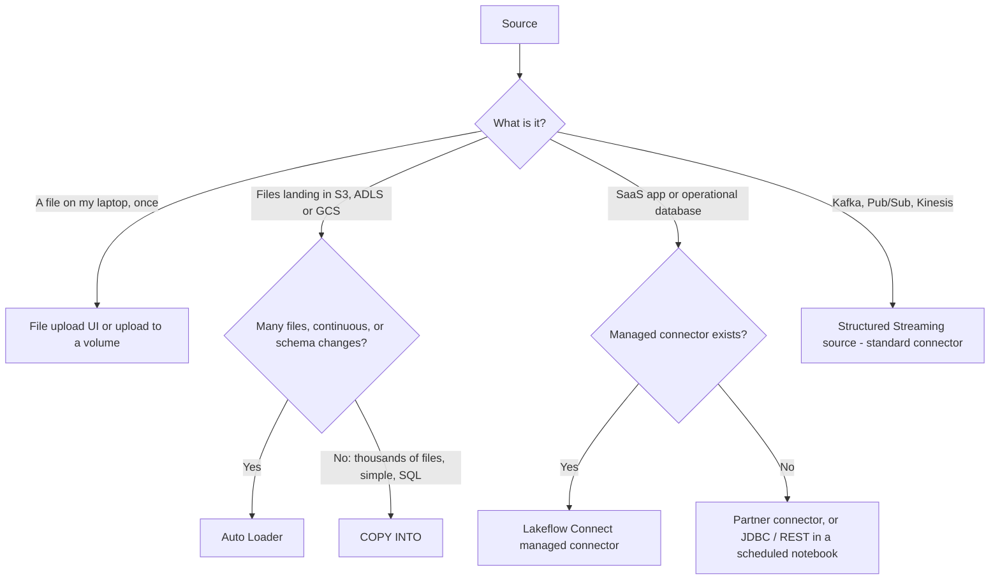

# Section 2: Data Ingestion and Loading

Weighted **21%** in the May 2026 exam guide, about nine or ten questions, and the second largest section. It is about getting data into Unity Catalog tables: which method to use for which source, and how to configure each one so that it loads every record exactly once and copes with changing schemas.

The guide's objectives, in plain words:

- Explain batch, streaming and incremental ingestion, and import data from local files, Lakeflow Connect **standard** connectors and Lakeflow Connect **managed** connectors.
- Use `COPY INTO` to load files incrementally from cloud object storage into Unity Catalog tables.
- Use Auto Loader with schema enforcement and evolution, in directory listing or file notification mode.
- Configure Lakeflow Connect to ingest from enterprise sources.
- Use JDBC/ODBC or REST clients in notebooks to land data, scheduled with Lakeflow Jobs.
- Choose between Auto Loader, Lakeflow Connect, partner connectors and other methods based on volume, frequency, data types and governance.
- Ingest semi-structured and nested data (such as JSON) into Delta tables.

Source: the **[📖 exam page](https://www.databricks.com/learn/certification/data-engineer-associate)** and its linked exam guide. The Professional guide goes deeper on message buses and CDC targets; see [Professional Section 2](../../data-engineer-professional/notes/02-data-ingestion-acquisition.md).

## Table of Contents

1. [Batch, streaming and incremental](#batch-streaming-and-incremental)
2. [The ingestion menu and how to choose](#the-ingestion-menu-and-how-to-choose)
3. [Local files and file upload](#local-files-and-file-upload)
4. [COPY INTO](#copy-into)
5. [Auto Loader](#auto-loader)
6. [Schema enforcement and evolution](#schema-enforcement-and-evolution)
7. [Structured Streaming basics you need for Auto Loader](#structured-streaming-basics-you-need-for-auto-loader)
8. [Lakeflow Connect managed connectors](#lakeflow-connect-managed-connectors)
9. [JDBC, ODBC and REST from notebooks](#jdbc-odbc-and-rest-from-notebooks)
10. [Semi-structured and nested data](#semi-structured-and-nested-data)
11. [How the exam tests this section](#how-the-exam-tests-this-section)

---

## Batch, streaming and incremental

Three words that the exam uses precisely:

- **Batch**: reads a whole dataset at once, on a schedule or on demand. Simple, but if it rereads everything each time, cost grows with total data, not with new data.
- **Streaming**: processes data continuously as it arrives, keeping state between runs. Lowest latency, but compute runs all the time.
- **Incremental**: processes only what is new since the last run. It can run as a batch on a schedule ("process new files, then stop") or as a continuous stream. This is what most ingestion should be.

The key idea is that **streaming APIs are the usual way to do incremental batch**. Auto Loader is a streaming source; run it with `trigger(availableNow=True)` from a scheduled job and it processes every new file since the last run and then stops. You get exactly-once incremental loading without paying for an always-on cluster.

---

## The ingestion menu and how to choose

Databricks groups its ingestion tools under **Lakeflow Connect**:

| Family | What it includes | You write | Best for |
|---|---|---|---|
| **Upload** | The "Create or modify table" file upload UI, uploads to a volume | Nothing | One-off small files from your laptop |
| **Standard connectors** | Auto Loader and `COPY INTO` for cloud object storage; streaming sources such as Kafka, Pub/Sub and Pulsar; SFTP | Some code (Python or SQL), full control | Files landing in storage, event streams |
| **Managed connectors** | Fully managed pipelines for SaaS apps (Salesforce, Workday, ServiceNow, HubSpot, Google Analytics...) and databases (SQL Server, MySQL, PostgreSQL), plus file sources such as SharePoint and Google Drive | Configuration only (UI, API or bundle) | Enterprise sources, with CDC and schema changes handled for you |
| **Partner connectors** | Third-party tools (Fivetran, Qlik, others) via Partner Connect | Configuration in the partner tool | Sources Lakeflow Connect doesn't cover, or a tool you already use |
| **Custom code** | JDBC/ODBC reads, REST API calls from notebooks, scheduled as jobs | All of it | Anything else, accepting that you own the maintenance |



The flowchart sorts sources into the method that fits: files go to Auto Loader or `COPY INTO`, enterprise apps and databases to managed connectors where they exist, message buses to streaming sources, and only what is left over to custom code.

The exam's tiebreakers, from the objective about prioritising methods:

- **Volume and file count.** Millions of files or a high arrival rate: Auto Loader (it scales; file notification mode avoids listing). Thousands of files: `COPY INTO` is fine.
- **Frequency.** Continuous or near real time: a streaming source or Auto Loader in a continuous pipeline. Daily: any incremental method on a schedule.
- **Data type.** Files of any format: Auto Loader. Database rows with updates and deletes: a CDC-capable managed connector. Records behind an API: managed connector, or REST in a notebook.
- **Governance.** Everything should land in **Unity Catalog** tables, with credentials in Unity Catalog connections or secrets, not in code.
- **Least effort.** If a managed connector exists for the source, it almost always beats custom code.

**[📖 Ingest data into a lakehouse](https://docs.databricks.com/aws/en/ingestion/)** - standard and managed connectors
**[📖 Lakeflow Connect managed connectors](https://docs.databricks.com/aws/en/ingestion/lakeflow-connect/)** - supported sources
**[📖 Partner Connect](https://docs.databricks.com/aws/en/partner-connect/)** - third-party ingestion partners

---

## Local files and file upload

For a small CSV, JSON, Parquet or Avro file on your own machine, the **Add data > Create or modify table** page uploads it, previews the inferred schema, lets you fix column names and types, and creates a managed Delta table in the catalog and schema you pick. To keep raw files instead, upload them to a **Unity Catalog volume** (Catalog Explorer, the CLI's `databricks fs cp`, or the Files API) and read them from `/Volumes/<catalog>/<schema>/<volume>/...`.

Upload is for one-off and small data. Anything recurring belongs in an automated method below.

**[📖 Create or modify a table using file upload](https://docs.databricks.com/aws/en/ingestion/file-upload/upload-data)** - formats and limits
**[📖 Upload files to a volume](https://docs.databricks.com/aws/en/ingestion/file-upload/upload-to-volume)** - for raw files

---

## COPY INTO

`COPY INTO` is a SQL command that loads files from a cloud storage path or volume into a Delta table. It is **idempotent**: it remembers which files it has already loaded, so running it again loads only new files. That makes it an easy incremental load for scheduled SQL.

```sql
-- Target can be created empty; COPY INTO can evolve its schema
CREATE TABLE IF NOT EXISTS main.raw.orders;

COPY INTO main.raw.orders
FROM 's3://acme-landing/orders/'            -- or '/Volumes/main/raw/landing/orders/'
FILEFORMAT = JSON
FORMAT_OPTIONS ('inferSchema' = 'true', 'mergeSchema' = 'true')
COPY_OPTIONS ('mergeSchema' = 'true');       -- add new source columns to the table
```

- Run it again tomorrow and only new files load. To reload files on purpose, use `COPY_OPTIONS ('force' = 'true')`.
- `PATTERN = '2026-10-*.json'` or `FILES = (...)` restrict which files are considered.
- Access to the path comes from a Unity Catalog **external location** (or a volume); you need `READ FILES` on it and `MODIFY` on the table.
- `VALIDATE 15 ROWS` checks the files parse, without loading.

**When to use it:** scheduled SQL loads from a location with up to thousands of files, where you want a single statement and no streaming checkpoint. **When not to:** millions of files, continuous arrival, or when you want rescued data and richer schema evolution; that is Auto Loader.

**[📖 Get started using COPY INTO](https://docs.databricks.com/aws/en/ingestion/cloud-object-storage/copy-into/)** - examples and when to use it
**[📖 COPY INTO reference](https://docs.databricks.com/aws/en/sql/language-manual/delta-copy-into)** - full syntax and options

---

## Auto Loader

**Auto Loader** is a Structured Streaming source, `format("cloudFiles")`, that discovers and processes new files in cloud storage. It records every file it has seen in its **checkpoint**, so each file is processed exactly once even across failures and restarts, and it scales to millions of files.

```python
(spark.readStream
    .format("cloudFiles")
    .option("cloudFiles.format", "json")                        # csv, json, parquet, avro, text, binaryFile, xml, orc
    .option("cloudFiles.schemaLocation", "/Volumes/main/raw/_meta/orders_schema")
    .option("cloudFiles.inferColumnTypes", "true")              # real types, not all strings
    .option("cloudFiles.schemaHints", "amount DECIMAL(12,2)")   # pin types you know
    .load("s3://acme-landing/orders/")
 .writeStream
    .option("checkpointLocation", "/Volumes/main/raw/_meta/orders_ckpt")
    .trigger(availableNow=True)                                 # process what's new, then stop
    .toTable("main.raw.orders"))
```

The same thing in SQL, as a streaming table (a Lakeflow pipeline object you can also create from Databricks SQL):

```sql
CREATE OR REFRESH STREAMING TABLE main.raw.orders
AS SELECT * FROM STREAM read_files(
  's3://acme-landing/orders/',
  format => 'json'
);
```

**File discovery modes** (the guide's "directory listing or file notification"):

| Mode | How it finds new files | Setup | Choose when |
|---|---|---|---|
| **Directory listing** (default) | Lists the input path each micro-batch | None | Getting started; moderate file counts |
| **File notification** | Subscribes to cloud storage events (SQS/SNS, Event Grid, Pub/Sub) | Permissions to create or read the queue; `cloudFiles.useNotifications = true` | Very large directories where listing is slow or costly |
| **Managed file events** | Uses file events set up once on a Unity Catalog external location | Enable file events on the external location | The recommended modern option: notification-style speed without per-stream queues |

**Auto Loader or COPY INTO?**

| | Auto Loader | COPY INTO |
|---|---|---|
| Interface | Python or SQL streaming (`cloudFiles`, `read_files` in a streaming table) | One SQL statement |
| File tracking | Checkpoint (RocksDB), scales to millions of files | Table metadata, best up to thousands |
| Schema changes | Inference, hints, evolution modes, rescued data | `mergeSchema` |
| Run as | Continuous stream or scheduled `availableNow` | Scheduled batch |
| Exam keyword | "Millions of files", "continuously", "schema drift" | "Simple", "idempotent SQL", "thousands of files" |

**[📖 What is Auto Loader?](https://docs.databricks.com/aws/en/ingestion/cloud-object-storage/auto-loader/)** - how it works, benefits over COPY INTO
**[📖 Auto Loader file detection modes](https://docs.databricks.com/aws/en/ingestion/cloud-object-storage/auto-loader/file-detection-modes)** - listing, notification, file events
**[📖 read_files](https://docs.databricks.com/aws/en/sql/language-manual/functions/read_files)** - the SQL table-valued function

---

## Schema enforcement and evolution

**Schema enforcement** means the target table rejects data that doesn't fit: a Delta write with an unexpected column or an incompatible type fails rather than corrupting the table. **Schema evolution** is the controlled way to let the schema change.

Auto Loader stores the inferred schema in `cloudFiles.schemaLocation` and lets you choose what happens when a new column appears with `cloudFiles.schemaEvolutionMode`:

| Mode | When a new column appears | Pick it when |
|---|---|---|
| `addNewColumns` (default when Auto Loader infers the schema) | The stream stops with an error, records the new schema; on restart the column is added | New columns are legitimate and you run it under a job with retries |
| `rescue` | Schema never changes; unexpected data goes into the `_rescued_data` column | The table must not change shape, but nothing may be lost |
| `failOnNewColumns` | The stream fails and stays failed until you change the schema | A human must approve every change |
| `none` | New columns are ignored | You truly don't want them (rare) |

The **`_rescued_data`** column is Auto Loader's safety net. Values that don't match the schema (a column not in the schema, a string where an integer was expected, a column name in different case) are kept there as JSON instead of being dropped. "Ingest without failing and without losing data when the source changes" points to **rescued data**.

For Delta writes outside Auto Loader, schema evolution is switched on per write with `.option("mergeSchema", "true")`, or in `MERGE` with `WITH SCHEMA EVOLUTION`.

**[📖 Configure schema inference and evolution in Auto Loader](https://docs.databricks.com/aws/en/ingestion/cloud-object-storage/auto-loader/schema)** - modes, hints, rescued data
**[📖 Update Delta table schema](https://docs.databricks.com/aws/en/delta/update-schema)** - enforcement and `mergeSchema`

---

## Structured Streaming basics you need for Auto Loader

Auto Loader is a stream, so a few Structured Streaming rules come with it:

- **Checkpoint.** Every streaming write needs its own `checkpointLocation`. It records which input has been processed (for Auto Loader, which files) and is what makes restarts exactly-once. Two streams must never share a checkpoint. Deleting it makes the stream start over from scratch.
- **Triggers.** Default (no trigger): run micro-batches back to back, continuously. `processingTime="1 minute"`: a micro-batch every minute, still continuous. `availableNow=True`: process everything available in as many batches as needed, then stop; this is the one for scheduled incremental loads. `once=True` is the deprecated older form.
- **Exactly-once** needs three things together: a replayable source (files, Kafka offsets), the checkpoint, and an idempotent sink (Delta).
- **Output modes** (append, update, complete) matter for aggregations; ingestion into bronze is almost always append.

A streaming job that crashes after four hours simply restarts and continues from its checkpoint. You don't track offsets yourself.

**[📖 Structured Streaming concepts](https://docs.databricks.com/aws/en/structured-streaming/concepts)** - micro-batches, checkpoints, exactly-once
**[📖 Configure trigger intervals](https://docs.databricks.com/aws/en/structured-streaming/triggers)** - `availableNow`, `processingTime`

---

## Lakeflow Connect managed connectors

A **managed connector** is a ready-made ingestion pipeline for a specific source. You supply a **Unity Catalog connection** (host and credentials, stored once and governed), pick the objects to ingest, choose a destination catalog and schema, and set a schedule. Databricks handles authentication, API paging and rate limits, incremental reads, CDC, schema changes, retries and connector upgrades. The result is a set of **streaming tables** in Unity Catalog, refreshed by a Lakeflow Spark Declarative Pipeline on serverless compute.

The configuration flow for a SaaS source:

1. Create a connection (Catalog Explorer > External data > Connections, or the API), for example OAuth to Salesforce. You need `CREATE CONNECTION` on the metastore, or reuse a connection you have `USE CONNECTION` on.
2. Add data > the connector > choose objects (tables, reports) and the destination `catalog.schema`.
3. Choose history tracking per table: **SCD Type 1** (keep only the current row) or **SCD Type 2** (keep history).
4. Schedule the pipeline (or add it as a pipeline task in a Lakeflow Job) and set failure notifications.

Database connectors (SQL Server, MySQL, PostgreSQL) add an **ingestion gateway** that runs close to the database and reads its change log, so **updates and deletes** arrive, not just inserts. The source database must have its change mechanism switched on (change tracking or CDC in SQL Server, row-format binlog in MySQL, logical replication in PostgreSQL); the Professional notes cover this in more depth: [Lakeflow Connect for databases](../../data-engineer-professional/notes/02-data-ingestion-acquisition.md#lakeflow-connect-for-sql-server-mysql-and-postgresql).

The exam's reasoning: "reliably ingest from Salesforce / Workday / SQL Server with minimal code and automatic handling of schema changes" is a Lakeflow Connect managed connector. A notebook calling the API, or nightly CSV exports picked up by Auto Loader, are the distractors: they work, but you build and maintain them, and exports lose deletes.

**[📖 Managed connectors in Lakeflow Connect](https://docs.databricks.com/aws/en/ingestion/lakeflow-connect/)** - sources, components, pricing
**[📖 Salesforce ingestion](https://docs.databricks.com/aws/en/ingestion/lakeflow-connect/salesforce-pipeline)** - a SaaS example end to end
**[📖 Manage connections](https://docs.databricks.com/aws/en/query-federation/connections)** - Unity Catalog connections

---

## JDBC, ODBC and REST from notebooks

When there is no connector, you write the ingestion yourself in a notebook and schedule it with a Lakeflow Job.

**JDBC** reads a table or query from any database with a driver:

```python
jdbc_url = "jdbc:postgresql://db.internal:5432/shop"
df = (spark.read.format("jdbc")
      .option("url", jdbc_url)
      .option("dbtable", "(SELECT * FROM orders WHERE updated_at > now() - interval '1 day') AS t")
      .option("user", dbutils.secrets.get("shop", "db_user"))
      .option("password", dbutils.secrets.get("shop", "db_password"))
      .option("partitionColumn", "order_id").option("lowerBound", 1)
      .option("upperBound", 50_000_000).option("numPartitions", 8)   # parallel reads
      .load())
df.write.mode("append").saveAsTable("main.raw.orders")
```

Credentials come from **secrets** (redacted in notebook output), never literals. `partitionColumn` with bounds and `numPartitions` split the read so Spark pulls in parallel; without them, one task reads the whole table. A filter on an updated-at column makes it incremental, but it still can't see rows that were **deleted** at the source; that is the reason managed CDC connectors exist. (ODBC is the same idea from tools that speak ODBC; the Databricks ODBC driver is also how outside tools connect *into* Databricks SQL.)

**REST APIs**: call with `requests` (or a client library), turn the JSON into a DataFrame, and write it to a table or land the raw JSON in a volume for Auto Loader to pick up:

```python
import requests, json
token = dbutils.secrets.get("crm", "api_token")
rows, url = [], "https://api.example.com/v1/contacts?updated_since=2026-10-21"
while url:
    r = requests.get(url, headers={"Authorization": f"Bearer {token}"}, timeout=30)
    r.raise_for_status()
    body = r.json()
    rows.extend(body["data"])
    url = body.get("next")          # follow pagination
spark.createDataFrame(rows).write.mode("append").saveAsTable("main.raw.contacts")
```

Landing raw responses as files in a volume, then reading them with Auto Loader, is often the sturdier pattern: the raw payload is kept for replay and Auto Loader handles schema evolution. Either way, the notebook runs as a task in a **Lakeflow Job** with a schedule, retries and failure notifications ([Section 4](04-lakeflow-jobs.md)).

The exam's third sample question shows another angle: before building ingestion on top of a feed (there, Databricks **audit logs** delivered to your own S3 bucket), find out its delivery format and behaviour. Audit log delivery writes **JSON** files, usually within about 15 minutes, and a later delivery can overwrite an existing file, which matters for how you configure the reader.

**[📖 Query databases using JDBC](https://docs.databricks.com/aws/en/connect/external-systems/jdbc)** - options, parallel reads
**[📖 Secret management](https://docs.databricks.com/aws/en/security/secrets/)** - scopes and redaction
**[📖 Audit log delivery](https://docs.databricks.com/aws/en/admin/account-settings/audit-log-delivery)** - format, latency and overwrite behaviour

---

## Semi-structured and nested data

JSON, XML and API payloads arrive nested: objects inside objects, arrays of objects. You have three ways to store them, and the right choice depends on how stable the shape is.

| Store as | How | Good when |
|---|---|---|
| **Typed columns, structs and arrays** | Let Auto Loader or `read_files` infer the schema (with `inferColumnTypes`), or give a schema | The shape is known and fairly stable |
| **`VARIANT`** | `parse_json(raw_string)`, or Auto Loader with `singleVariantColumn` | The shape changes often or differs per record; flexible but still fast to query |
| **Raw string** | Keep the payload as `STRING` | Archive only; querying means parsing every time |

Querying nested data in SQL:

```sql
-- Struct fields with dot notation
SELECT customer.id, customer.address.city FROM main.raw.orders;

-- Explode an array of line items into one row each
SELECT order_id, item.sku, item.qty
FROM main.raw.orders
LATERAL VIEW explode(items) AS item;

-- Pull fields out of a JSON string or VARIANT
SELECT raw:customer.id::string AS customer_id FROM main.raw.events;  -- colon path on a JSON string or VARIANT
SELECT from_json(raw, 'customer STRUCT<id: STRING>, total DOUBLE') AS parsed FROM main.raw.events;
```

Managed connectors land nested SaaS objects as structs and arrays in Delta tables automatically. The usual design is to keep bronze close to the source (nested, or `VARIANT`) and flatten into typed silver tables in [Section 3](03-data-transformation-modeling.md).

**[📖 Query semi-structured data](https://docs.databricks.com/aws/en/semi-structured/)** - JSON strings, structs, VARIANT
**[📖 VARIANT data type](https://docs.databricks.com/aws/en/semi-structured/variant)** - when and how to use it

---

## How the exam tests this section

- **Name the source, then pick the tool.** Laptop file: upload. Files in storage: Auto Loader (scale, continuous, schema drift) or `COPY INTO` (simple SQL, thousands of files). SaaS app or database: Lakeflow Connect managed connector. Message bus: a streaming source. Anything else: JDBC or REST in a scheduled notebook, or a partner tool.
- **"Least maintenance" and "handles schema changes automatically"** point to managed connectors or Auto Loader, never hand-written code.
- **Idempotency.** `COPY INTO` skips loaded files; Auto Loader's checkpoint does the same. Rerunning either is safe. `force = true` is the only way to reload.
- **Schema evolution modes.** "Never lose data, never change the table" is `rescue` and `_rescued_data`; "add new columns automatically" is `addNewColumns`, which stops the stream once and needs a restart.
- **Triggers.** Scheduled incremental loads use `availableNow`; continuous low latency uses the default or `processingTime`.
- **Deletes.** Snapshot or timestamp-based reads (JDBC with a filter, CSV exports) miss source deletes; CDC-based managed connectors keep them.
- **Credentials.** In secrets or Unity Catalog connections, never in code.

Continue with [Section 3: Data Transformation and Modeling](03-data-transformation-modeling.md).
