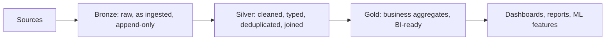

# Section 3: Data Transformation and Modeling

Weighted **22%** in the May 2026 exam guide, about ten questions, and the **largest section**. It is the hands-on core of data engineering on Databricks: turn raw bronze data into clean silver tables with PySpark or SQL, then build gold objects for BI and analytics, with quality checks along the way. Expect code in both PySpark and SQL.

The guide's objectives:

- Clean data: read bronze tables, handle nulls, standardise types, write silver tables.
- Combine DataFrames: inner, left, broadcast and cross joins, joins on multiple keys, `union` and `unionAll`.
- Manipulate columns, rows and tables: add, drop, split and rename columns, filter, explode arrays.
- Deduplicate and aggregate: count, approximate count distinct, mean, summary.
- Know the basic tuning parameters (`spark.sql.shuffle.partitions`, `spark.default.parallelism`, executor and driver memory, `spark.sql.autoBroadcastJoinThreshold`) and re-measure after changing them.
- Know the difference between, and how to build, gold objects: materialized views, views, streaming tables and tables.
- Apply data quality checks and validation rules to silver and gold.

Source: the **[📖 exam page](https://www.databricks.com/learn/certification/data-engineer-associate)** and its linked exam guide. For window functions at scale, `VARIANT`, AI functions and AUTO CDC, see [Professional Section 3](../../data-engineer-professional/notes/03-data-transformation-quality.md) and [Professional Section 1](../../data-engineer-professional/notes/01-developing-code-python-sql.md#cdc-with-auto-cdc-scd-type-1-and-type-2).

## Table of Contents

1. [The medallion architecture](#the-medallion-architecture)
2. [Bronze to silver: cleaning](#bronze-to-silver-cleaning)
3. [Working with columns and rows](#working-with-columns-and-rows)
4. [Joins and unions](#joins-and-unions)
5. [Deduplication and aggregation](#deduplication-and-aggregation)
6. [Writing results: CTAS, write modes and MERGE](#writing-results-ctas-write-modes-and-merge)
7. [Basic tuning parameters](#basic-tuning-parameters)
8. [Gold objects: tables, views, materialized views, streaming tables](#gold-objects-tables-views-materialized-views-streaming-tables)
9. [Lakeflow Spark Declarative Pipelines in brief](#lakeflow-spark-declarative-pipelines-in-brief)
10. [Data quality checks](#data-quality-checks)
11. [How the exam tests this section](#how-the-exam-tests-this-section)

---

## The medallion architecture

Databricks organises a lakehouse in three layers, each a set of Delta tables:



The diagram shows data flowing from sources through bronze, silver and gold to its consumers, getting cleaner and more business-shaped at each step.

- **Bronze**: keeps data as close to the source as possible, plus ingestion metadata (file name, load time). Its job is to be replayable: if a silver rule was wrong, you rebuild silver from bronze without going back to the source.
- **Silver**: the cleaned, conformed version: correct types, no duplicates, nulls handled, codes standardised, related sources joined. It is the layer data engineers and data scientists usually query.
- **Gold**: shaped for a use: aggregates, dimensional models, KPI tables. BI tools read gold.

Refresh cadence follows the same order. Bronze is usually loaded as soon as data arrives (incrementally); silver follows bronze; gold refreshes on the schedule the business needs, or on demand.

**[📖 What is the medallion lakehouse architecture?](https://docs.databricks.com/aws/en/lakehouse/medallion)** - layer purposes

---

## Bronze to silver: cleaning

A typical cleaning step reads bronze, fixes types, handles nulls and standardises values, then writes silver. The same logic in PySpark and SQL:

```python
from pyspark.sql import functions as F

bronze = spark.read.table("main.bronze.orders")

silver = (bronze
    .filter(F.col("order_id").isNotNull())                          # drop rows missing the key
    .withColumn("order_ts", F.to_timestamp("order_ts", "yyyy-MM-dd HH:mm:ss"))
    .withColumn("amount", F.col("amount").cast("decimal(12,2)"))    # standardise types
    .withColumn("country", F.upper(F.trim("country")))              # standardise values
    .fillna({"channel": "unknown", "discount": 0})                  # defaults for optional columns
    .dropDuplicates(["order_id"]))

silver.write.mode("overwrite").saveAsTable("main.silver.orders")
```

```sql
CREATE OR REPLACE TABLE main.silver.orders AS
SELECT DISTINCT
  order_id,
  to_timestamp(order_ts, 'yyyy-MM-dd HH:mm:ss') AS order_ts,
  CAST(amount AS DECIMAL(12,2))                 AS amount,
  upper(trim(country))                          AS country,
  coalesce(channel, 'unknown')                  AS channel,
  coalesce(discount, 0)                         AS discount
FROM main.bronze.orders
WHERE order_id IS NOT NULL;
```

Null handling choices, and when each fits:

| Function | Does | Use when |
|---|---|---|
| `filter(col.isNotNull())` / `WHERE x IS NOT NULL` | Drops rows | The column is required (a key) |
| `dropna(subset=[...])` | Drops rows with nulls in the listed columns | Several required columns |
| `fillna({...})` / `coalesce(x, default)` | Replaces nulls | A sensible default exists |
| `try_cast(x AS INT)` | Returns null instead of failing on bad values | Dirty input you want to keep and inspect |

Remember that `cast` on a bad value returns null (or fails under ANSI mode, which is on by default in Databricks SQL); `try_cast` always returns null. Counting nulls before and after a cleaning step is a quick validation.

**[📖 PySpark DataFrame tutorial](https://docs.databricks.com/aws/en/getting-started/dataframes)** - load, transform and save
**[📖 Built-in SQL functions](https://docs.databricks.com/aws/en/sql/language-manual/sql-ref-functions-builtin)** - cast, coalesce, string and date functions

---

## Working with columns and rows

| Task | PySpark | SQL |
|---|---|---|
| Add or replace a column | `df.withColumn("total", F.col("qty") * F.col("price"))` | `SELECT *, qty * price AS total` |
| Several at once | `df.withColumns({"a": ..., "b": ...})` | list them in `SELECT` |
| Rename | `df.withColumnRenamed("cust_id", "customer_id")` | `cust_id AS customer_id` |
| Drop | `df.drop("tmp1", "tmp2")` | `SELECT * EXCEPT (tmp1, tmp2)` |
| Split a string | `F.split("full_name", " ")[0]` | `split(full_name, ' ')[0]` |
| Filter rows | `df.filter("amount > 0")` or `df.where(F.col("amount") > 0)` | `WHERE amount > 0` |
| One row per array element | `df.select("order_id", F.explode("items").alias("item"))` | `LATERAL VIEW explode(items) AS item` or `SELECT explode(items)` |
| Keep rows with empty arrays | `F.explode_outer("items")` | `explode_outer(items)` |
| Struct field | `F.col("customer.address.city")` | `customer.address.city` |

`explode` drops rows whose array is null or empty; `explode_outer` keeps them with a null. Changing a table's structure in place uses DDL: `ALTER TABLE ... ADD COLUMNS`, `RENAME COLUMN` and `DROP COLUMN` (the last two need column mapping enabled on the Delta table).

**[📖 ALTER TABLE](https://docs.databricks.com/aws/en/sql/language-manual/sql-ref-syntax-ddl-alter-table)** - add, rename and drop columns
**[📖 explode](https://docs.databricks.com/aws/en/sql/language-manual/functions/explode)** - and `explode_outer`, `posexplode`

---

## Joins and unions

```python
orders.join(customers, on="customer_id", how="inner")                         # one key, same name
orders.join(customers, ["customer_id", "region"], "left")                    # multiple keys
orders.join(rates, (orders.currency == rates.ccy) & (orders.day == rates.day), "left")
orders.join(F.broadcast(countries), "country_code")                          # broadcast hint
sizes.crossJoin(colours)                                                     # every combination
```

| Join | Returns | Typical use |
|---|---|---|
| **Inner** | Only rows that match on both sides | Enrich facts with a required dimension |
| **Left** (left outer) | Every left row, nulls where no match | Keep all orders even if the customer is unknown |
| **Full outer** | Every row from both sides | Reconciling two sources |
| **Left semi** | Left rows that have a match (no right columns) | "Orders for customers in the VIP list" |
| **Left anti** | Left rows with no match | "Customers with no orders"; finding new rows |
| **Cross** | Every combination (rows x rows) | Generating a grid; dangerous on big tables |

A **broadcast join** copies the small table to every executor so the big table is joined without a shuffle. Spark does this automatically when one side is smaller than `spark.sql.autoBroadcastJoinThreshold` (10 MB by default); `F.broadcast(df)` or the SQL hint `/*+ BROADCAST(t) */` forces it. Broadcast a lookup table, never a large fact table: it has to fit in each executor's memory.

**Unions** stack rows. `union` and `unionAll` in PySpark both keep duplicates and match columns **by position**; add `.distinct()` to remove duplicates. `unionByName` matches **by name** (with `allowMissingColumns=True` for columns only one side has), which is safer when the column order differs. In SQL it's the other way round from what many people expect: `UNION` removes duplicates and `UNION ALL` keeps them.

```sql
SELECT * FROM main.silver.orders_web
UNION ALL                                 -- keep everything, cheaper
SELECT * FROM main.silver.orders_store;
```

**[📖 Join hints](https://docs.databricks.com/aws/en/sql/language-manual/sql-ref-syntax-qry-select-hints)** - BROADCAST and others
**[📖 JOIN](https://docs.databricks.com/aws/en/sql/language-manual/sql-ref-syntax-qry-select-join)** - all join types in SQL
**[📖 Set operators](https://docs.databricks.com/aws/en/sql/language-manual/sql-ref-syntax-qry-select-setops)** - UNION, INTERSECT, EXCEPT

---

## Deduplication and aggregation

**Deduplication** has three common forms:

```python
df.distinct()                                   # identical rows
df.dropDuplicates(["order_id"])                 # one row per key (which one is not guaranteed)
```

```sql
-- One row per key, keeping the latest: the reliable pattern
SELECT * FROM main.bronze.orders
QUALIFY ROW_NUMBER() OVER (PARTITION BY order_id ORDER BY ingested_at DESC) = 1;
```

`dropDuplicates` keeps an arbitrary row per key; when *which* row matters (the latest), use `ROW_NUMBER()` over a window ordered by a timestamp. In streaming, `dropDuplicatesWithinWatermark` bounds the state kept for deduplication.

**Aggregation:**

```python
(df.groupBy("country")
   .agg(F.count("*").alias("orders"),
        F.countDistinct("customer_id").alias("customers"),
        F.approx_count_distinct("customer_id").alias("customers_approx"),  # HyperLogLog, much cheaper
        F.mean("amount").alias("avg_amount"),
        F.sum("amount").alias("revenue")))

df.describe("amount").show()       # count, mean, stddev, min, max
df.summary().show()                # adds 25%, 50%, 75% percentiles
```

`approx_count_distinct` (SQL: `approx_count_distinct`) estimates distinct counts within a small error using far less memory than an exact `COUNT(DISTINCT ...)`; pick it for dashboards over very large data where a 1-2% error is acceptable. `count("*")` counts rows; `count("col")` skips nulls in that column.

**[📖 approx_count_distinct](https://docs.databricks.com/aws/en/sql/language-manual/functions/approx_count_distinct)** - accuracy and use
**[📖 QUALIFY clause](https://docs.databricks.com/aws/en/sql/language-manual/sql-ref-syntax-qry-select-qualify)** - filter on window results

---

## Writing results: CTAS, write modes and MERGE

| Goal | SQL | PySpark |
|---|---|---|
| Create a table from a query | `CREATE TABLE t AS SELECT ...` (fails if `t` exists) | `df.write.saveAsTable("t")` (default mode errors if exists) |
| Rebuild it every run | `CREATE OR REPLACE TABLE t AS SELECT ...` | `df.write.mode("overwrite").saveAsTable("t")` |
| Add rows | `INSERT INTO t SELECT ...` | `.mode("append")` |
| Replace all rows, keep the table | `INSERT OVERWRITE t SELECT ...` | `.mode("overwrite")` |
| Upsert by key | `MERGE INTO` | `DeltaTable.merge(...)` |

`CREATE OR REPLACE TABLE` is preferred over drop-and-create: it is atomic, keeps the table's history (so time travel still works) and its permissions. Tables are Delta by default.

`MERGE INTO` inserts, updates and deletes in one atomic statement, so readers never see a half-applied change:

```sql
MERGE INTO main.silver.customers AS t
USING main.bronze.customer_updates AS s
ON t.customer_id = s.customer_id
WHEN MATCHED AND s.op = 'DELETE' THEN DELETE
WHEN MATCHED THEN UPDATE SET *
WHEN NOT MATCHED THEN INSERT *;
```

The source must have at most one row per key, or `MERGE` fails with a "multiple source rows matched" error; deduplicate the source first. For CDC feeds with ordering and SCD Type 2 history, declarative pipelines offer **AUTO CDC** (formerly `APPLY CHANGES`), covered in the [Professional notes](../../data-engineer-professional/notes/01-developing-code-python-sql.md#cdc-with-auto-cdc-scd-type-1-and-type-2).

**[📖 MERGE INTO](https://docs.databricks.com/aws/en/sql/language-manual/delta-merge-into)** - syntax and clauses
**[📖 Upsert into a Delta table using merge](https://docs.databricks.com/aws/en/delta/merge)** - patterns, deduplicating the source

---

## Basic tuning parameters

The guide names four settings and the habit of **re-measuring** after each change. Change one thing, run the same workload, compare the duration and the Spark UI ([Section 6](06-troubleshooting-monitoring-optimization.md)).

| Setting | Controls | Default | Raise or lower when |
|---|---|---|---|
| `spark.sql.shuffle.partitions` | Number of partitions after a shuffle (joins, `groupBy`) in DataFrame and SQL work | 200 | Lower for small data (many tiny tasks); raise when tasks spill or run very long. With AQE on, Spark coalesces partitions for you, and `auto` is allowed on Databricks |
| `spark.default.parallelism` | Default partitions for RDD operations and `parallelize` | Total cores in the cluster | Rarely touched for DataFrame code; affects RDD-based work |
| `spark.executor.memory` / `spark.driver.memory` | Heap per executor / for the driver | Set from the instance type | Usually fix out-of-memory errors by choosing a larger or memory-optimised instance; driver OOM often means a `collect()` or `toPandas()` on too much data |
| `spark.sql.autoBroadcastJoinThreshold` | Max size of a table Spark will broadcast automatically | 10 MB | Raise a little so a medium lookup table broadcasts; set `-1` to disable when broadcasts cause driver or executor OOM |

```python
spark.conf.set("spark.sql.shuffle.partitions", "64")                  # session-level SQL setting
spark.conf.set("spark.sql.autoBroadcastJoinThreshold", 50 * 1024 * 1024)
```

Two catches. Memory settings are **cluster-level**: they are set in the cluster's Spark config before start, not with `spark.conf.set` in a notebook. And on **serverless** compute most Spark configs can't be set at all; Databricks tunes them. **Adaptive Query Execution** (AQE, on by default) already coalesces shuffle partitions, switches to broadcast joins at run time and splits skewed partitions, so the exam often prefers "confirm AQE is on" over hand-tuning.

**[📖 Adaptive query execution](https://docs.databricks.com/aws/en/optimizations/aqe)** - what it does automatically
**[📖 Set Spark configuration properties](https://docs.databricks.com/aws/en/spark/conf)** - where each kind of setting goes

---

## Gold objects: tables, views, materialized views, streaming tables

Gold is what analysts and BI tools query, so the object type matters for freshness, cost and correctness:

| Object | Stores data? | How it stays current | Use for |
|---|---|---|---|
| **Table** (Delta) | Yes | Whatever job writes it (`CREATE OR REPLACE`, `MERGE`, append) | Full control; outputs of custom jobs |
| **View** | No, just a saved query | Always current: the query runs each time it's read | Light logic over small or already-fast tables; exposing a subset of columns or rows |
| **Materialized view** | Yes, the query's result | `REFRESH` (scheduled, triggered, or by its pipeline); Databricks refreshes incrementally where it can | Expensive aggregates and joins read often by BI; always correct for its source as of the last refresh |
| **Streaming table** | Yes | Processes each new source row once, incrementally | Append-only data: ingestion, event streams, bronze and silver |
| **Temporary view** | No | Session only | Scratch work inside one notebook session |

```sql
-- Gold aggregate for a dashboard, refreshed every hour
CREATE OR REPLACE MATERIALIZED VIEW main.gold.daily_revenue
SCHEDULE EVERY 1 HOUR
AS SELECT date(order_ts) AS day, country, sum(amount) AS revenue, count(*) AS orders
   FROM main.silver.orders
   GROUP BY ALL;

-- Thin view for a team that only needs EU rows
CREATE OR REPLACE VIEW main.gold.eu_orders AS
SELECT order_id, day, amount FROM main.silver.orders WHERE region = 'EU';
```

The deciding question between a **materialized view** and a **streaming table**: is the source append-only, and is it fine that each row is processed once and never revisited? Then a streaming table. Do results need to reflect updates and deletes in the source, or joins and aggregates that change as data changes? Then a materialized view. Between a **view** and a **materialized view**: a view costs nothing to keep but recomputes on every read; a materialized view costs storage and refresh compute but reads are fast.

**[📖 Materialized views in Databricks SQL](https://docs.databricks.com/aws/en/views/materialized)** - create, schedule, refresh
**[📖 Streaming tables](https://docs.databricks.com/aws/en/ldp/streaming-tables)** - when to use them
**[📖 What is a view?](https://docs.databricks.com/aws/en/views/)** - views, temporary views, materialized views

---

## Lakeflow Spark Declarative Pipelines in brief

**Lakeflow Spark Declarative Pipelines** (formerly Delta Live Tables, DLT) let you declare the streaming tables and materialized views you want; the pipeline works out the order, manages checkpoints, retries and compute, and refreshes each object incrementally. A short example with the current Python module:

```python
from pyspark import pipelines as dp
from pyspark.sql import functions as F

@dp.table(comment="Raw orders, loaded incrementally")
def orders_bronze():
    return (spark.readStream.format("cloudFiles")
            .option("cloudFiles.format", "json")
            .load("/Volumes/main/raw/landing/orders/"))

@dp.table
@dp.expect_or_drop("valid_id", "order_id IS NOT NULL")
def orders_silver():
    return spark.readStream.table("orders_bronze").withColumn("amount", F.col("amount").cast("decimal(12,2)"))

@dp.materialized_view
def revenue_by_country():
    return spark.read.table("orders_silver").groupBy("country").agg(F.sum("amount").alias("revenue"))
```

The SQL equivalent uses `CREATE OR REFRESH STREAMING TABLE ... AS SELECT * FROM STREAM(...)` and `CREATE OR REFRESH MATERIALIZED VIEW ...`. Older code uses `import dlt`, `@dlt.table` and `LIVE.` prefixes; they still work, but questions use the new names. A pipeline runs **triggered** (process what's new, then stop; schedule it from a job) or **continuous** (always on, lowest latency, highest cost).

**[📖 Lakeflow Spark Declarative Pipelines](https://docs.databricks.com/aws/en/ldp/)** - concepts, Python and SQL
**[📖 Pipeline Python reference](https://docs.databricks.com/aws/en/ldp/developer/python-ref)** - decorators

---

## Data quality checks

Three tools, from strictest to most flexible:

**1. Table constraints** on Delta tables. A `NOT NULL` or `CHECK` constraint makes any write that violates it **fail entirely**:

```sql
ALTER TABLE main.silver.orders ALTER COLUMN order_id SET NOT NULL;
ALTER TABLE main.silver.orders ADD CONSTRAINT positive_amount CHECK (amount >= 0);
```

**2. Pipeline expectations**, which let you choose what happens to bad rows:

| Python | SQL | On a bad row | Metrics recorded? |
|---|---|---|---|
| `@dp.expect("name", "cond")` | `CONSTRAINT name EXPECT (cond)` | Keep it (warn) | Yes |
| `@dp.expect_or_drop(...)` | `... ON VIOLATION DROP ROW` | Drop it | Yes |
| `@dp.expect_or_fail(...)` | `... ON VIOLATION FAIL UPDATE` | Stop the update | Yes |
| `@dp.expect_all({...})` and variants | several `CONSTRAINT` lines | Apply many rules at once | Yes |

```sql
CREATE OR REFRESH STREAMING TABLE main.silver.orders (
  CONSTRAINT valid_id     EXPECT (order_id IS NOT NULL) ON VIOLATION DROP ROW,
  CONSTRAINT known_status EXPECT (status IN ('NEW','PAID','SHIPPED')),
  CONSTRAINT has_amount   EXPECT (amount IS NOT NULL)   ON VIOLATION FAIL UPDATE
) AS SELECT * FROM STREAM(main.bronze.orders);
```

Pass and fail counts per expectation appear in the pipeline UI and its **event log**, which is how you monitor quality over time. To keep bad rows for review instead of losing them, write them to a separate **quarantine** table with the inverse condition.

**3. Validation queries in a job**, for checks expectations can't express (row counts versus yesterday, referential checks against another table, freshness). Run them as a SQL task after the load and fail the task, or branch with an If/else task, when they fail ([Section 4](04-lakeflow-jobs.md)).

How to choose: a rule whose violation means the data is unusable (missing key) should fail or drop; a rule you want to watch (unexpected status values) should warn; a rule about the whole dataset rather than single rows belongs in a validation step.

**[📖 Manage data quality with pipeline expectations](https://docs.databricks.com/aws/en/ldp/expectations)** - actions and metrics
**[📖 Constraints on Databricks](https://docs.databricks.com/aws/en/tables/constraints)** - NOT NULL and CHECK

---

## How the exam tests this section

- **Code reading.** Expect short PySpark or SQL snippets: which output does this produce, which line fixes the bug, which function fills the gap. Know `withColumn`, `withColumnRenamed`, `drop`, `split`, `explode`, `fillna`, `dropDuplicates`, `groupBy().agg()` and their SQL twins.
- **Union traps.** PySpark `union` keeps duplicates and matches by position; SQL `UNION` removes duplicates. `unionByName` when column order differs.
- **Broadcast.** Small lookup table joined to a big one: broadcast. Never broadcast the big side.
- **Approximate vs exact.** "Distinct users across billions of rows, small error acceptable, fastest" is `approx_count_distinct`.
- **Tuning.** Too many tiny tasks: lower `spark.sql.shuffle.partitions` (or let AQE coalesce). Lookup table not broadcasting: raise the threshold or hint. Driver OOM: stop collecting to the driver. Change one setting and re-measure.
- **Gold object choice.** Fresh on every read and cheap to keep: view. Expensive aggregate read often: materialized view. Append-only incremental source: streaming table.
- **Quality actions.** Warn, drop, fail: match the action to the cost of a bad row. Constraints fail the whole write.
- **Old names.** DLT is Lakeflow Spark Declarative Pipelines; `APPLY CHANGES` is AUTO CDC.

Continue with [Section 4: Working with Lakeflow Jobs](04-lakeflow-jobs.md).
