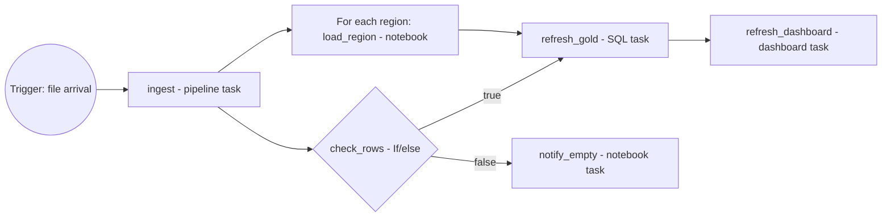

# Section 4: Working with Lakeflow Jobs

Weighted **16%** in the May 2026 exam guide, about seven questions. **Lakeflow Jobs** (formerly Databricks Workflows, and before that just "Jobs") is the orchestrator: it runs notebooks, SQL, pipelines and other tasks in a dependency graph, on a trigger, with retries and notifications.

The guide's objectives:

- Implement control flow: retries, and conditional tasks for branching and looping.
- Configure common tasks (notebook, SQL query, dashboard, pipeline) and their dependencies in the DAG.
- Schedule jobs, understanding the trigger types: scheduled, file arrival and table update.
- Choose between time-based and data-driven triggers, based on when data is available and on pipeline dependencies.

Source: the **[📖 exam page](https://www.databricks.com/learn/certification/data-engineer-associate)** and its linked exam guide. Creating jobs through the REST API and CLI, and serverless job settings, are Professional topics: see [Professional Section 1](../../data-engineer-professional/notes/01-developing-code-python-sql.md#lakeflow-jobs-ui-api-cli-and-control-flow).

## Table of Contents

1. [What a job is](#what-a-job-is)
2. [Task types](#task-types)
3. [Dependencies and the DAG](#dependencies-and-the-dag)
4. [Passing values between tasks](#passing-values-between-tasks)
5. [Control flow: retries, branching and looping](#control-flow-retries-branching-and-looping)
6. [Triggers](#triggers)
7. [Time-based or data-driven?](#time-based-or-data-driven)
8. [Compute, notifications and other job settings](#compute-notifications-and-other-job-settings)
9. [How the exam tests this section](#how-the-exam-tests-this-section)

---

## What a job is

A **job** has three parts: one or more **tasks** (units of work), the **dependencies** between them (a directed acyclic graph, DAG), and a **trigger** (when it runs). Each execution is a **job run**, made of **task runs**. You build jobs in the Jobs & Pipelines UI, with the REST API or CLI, or as YAML in a Declarative Automation Bundle ([Section 5](05-cicd.md)). The same job definition can be viewed as YAML in the UI, which is a quick way to move from clicking to code.



The diagram shows a typical job: a trigger starts an ingestion pipeline, a condition decides whether to build gold or send a notice, a For each task loads regions in parallel, and a dashboard refreshes at the end.

**[📖 Lakeflow Jobs](https://docs.databricks.com/aws/en/jobs/)** - concepts, tasks, triggers
**[📖 Configure and edit tasks](https://docs.databricks.com/aws/en/jobs/configure-task)** - task settings

---

## Task types

| Task type | Runs | Typical use |
|---|---|---|
| **Notebook** | A notebook from the workspace or a Git provider | Most PySpark and mixed logic; ingestion from APIs |
| **Python script** / **Python wheel** | A `.py` file or a packaged entry point | Code kept as plain Python modules |
| **SQL** | A saved **query**, a **SQL file**, an **alert** or a legacy dashboard, on a SQL warehouse | Gold refreshes, validation queries |
| **Dashboard** | Refreshes an AI/BI dashboard (and can send its subscription snapshots) | Update the dashboard right after its data is rebuilt |
| **Pipeline** | An update of a Lakeflow Spark Declarative Pipeline (optionally a full refresh) | Run declarative ETL, or a Lakeflow Connect ingestion pipeline |
| **dbt** | dbt commands against a SQL warehouse | Teams using dbt |
| **JAR**, **Spark Submit** | JVM code | Existing Scala or Java jobs |
| **Run Job** | Another job | Reuse a job as a step; split big workflows |
| **If/else condition**, **For each** | Control flow (below) | Branching and looping |

Two pairings the exam likes: put a **pipeline task** upstream of a **SQL** or **dashboard task** so the dashboard refreshes only after the data it shows has been rebuilt; and run SQL tasks on a **SQL warehouse**, notebook tasks on jobs compute.

**[📖 Task types](https://docs.databricks.com/aws/en/jobs/configure-task#task-types)** - every type and its settings
**[📖 Dashboard task](https://docs.databricks.com/aws/en/jobs/dashboard)** - refresh dashboards from a job
**[📖 Pipeline task](https://docs.databricks.com/aws/en/jobs/pipeline)** - run a pipeline from a job

---

## Dependencies and the DAG

Each task lists the tasks it **depends on**. Tasks with no dependency between them run **in parallel**; a task with several upstreams waits for all of them (by default). Draw the DAG and the run order falls out of it.

By default a task runs only when **all** its upstream tasks succeeded. The **Run if** setting changes that:

| Run if | Runs when | Example |
|---|---|---|
| All succeeded (default) | Every upstream succeeded | Normal flow |
| At least one succeeded | Any upstream succeeded | Merge two alternative branches |
| None failed | No upstream failed (some may be skipped) | After an If/else, where one branch is always skipped |
| All done | Every upstream finished, whatever the result | Cleanup, release a lock, send a summary |
| At least one failed | Any upstream failed | Run an error handler |
| All failed | Every upstream failed | Fallback path |

When a task fails, its downstream tasks are marked **Upstream failed** and don't run (unless their Run if says otherwise). After you fix the cause, **repair run** reruns only the failed and skipped tasks, not the whole job.

**[📖 Run if dependencies](https://docs.databricks.com/aws/en/jobs/run-if)** - conditions and examples
**[📖 Repair a failed job run](https://docs.databricks.com/aws/en/jobs/repair-job-failures)** - rerun only what failed

---

## Passing values between tasks

**Job parameters** are key-value pairs set on the job and passed to every task; you can override them for a single run with **Run now with different parameters**. Inside a notebook, read them as widgets (`dbutils.widgets.get("run_date")`). In task settings, **dynamic value references** in double braces insert values at run time:

| Reference | Value |
|---|---|
| `{{job.parameters.run_date}}` | A job parameter |
| `{{job.id}}`, `{{job.run_id}}` | Identifiers of this job and run |
| `{{job.trigger.time.iso_date}}` | When the run was triggered |
| `{{job.trigger.file_arrival.location}}` | The location that fired a file arrival trigger |
| `{{tasks.ingest.values.row_count}}` | A task value set by the `ingest` task |
| `{{input}}` | The current element inside a For each task |

**Task values** let one task hand a small result to another:

```python
# In task "ingest"
dbutils.jobs.taskValues.set(key="row_count", value=n)

# In a later task, or in an If/else condition as {{tasks.ingest.values.row_count}}
n = dbutils.jobs.taskValues.get(taskKey="ingest", key="row_count", default=0)
```

Task values are for small values (counts, flags, a list of table names), not datasets; data moves between tasks through tables.

**[📖 Parameterize jobs](https://docs.databricks.com/aws/en/jobs/parameters)** - job and task parameters
**[📖 Dynamic value references](https://docs.databricks.com/aws/en/jobs/dynamic-value-references)** - the full list
**[📖 Task values](https://docs.databricks.com/aws/en/jobs/task-values)** - set and get

---

## Control flow: retries, branching and looping

**Retries** are set per task: a maximum number of retries, a minimum interval between attempts, and whether to retry on timeout. They fix **transient** failures (a cloud capacity blip, a throttled API); they don't fix bugs, which fail every time. Add a **timeout** so a hung task fails instead of running forever. Only retry tasks that are safe to repeat: an ingestion task that appends could duplicate rows unless it is idempotent (Auto Loader, `COPY INTO` and `MERGE` are).

**Branching** uses the **If/else condition** task. It compares two operands with `==`, `!=`, `>`, `>=`, `<` or `<=`; operands are usually a task value or job parameter and a constant. Its downstream tasks depend on its `true` or `false` outcome; the other branch is **skipped** (which is why tasks after a branch often use Run if "None failed").

```yaml
- task_key: check_rows
  depends_on: [ { task_key: ingest } ]
  condition_task:
    op: GREATER_THAN
    left: "{{tasks.ingest.values.row_count}}"
    right: "0"
- task_key: refresh_gold
  depends_on: [ { task_key: check_rows, outcome: "true" } ]
  sql_task:
    file: { path: ../sql/refresh_gold.sql }
    warehouse_id: ${var.warehouse_id}
```

**Looping** uses the **For each** task. It runs one nested task once per item of an input list (a JSON array, a job parameter or a task value), with a **concurrency** setting for how many iterations run at once. Inside, `{{input}}` is the current item. The classic example: load 40 source tables with one parameterised notebook, 8 at a time, instead of copying the task 40 times.

```yaml
- task_key: load_each_region
  for_each_task:
    inputs: '["emea", "amer", "apac"]'
    concurrency: 3
    task:
      task_key: load_region
      notebook_task:
        notebook_path: ../src/load_region.ipynb
        base_parameters: { region: "{{input}}" }
```

Failed iterations are retried on their own (per the nested task's retry policy), and a repair run reruns only failed iterations.

**[📖 Add branching logic with If/else](https://docs.databricks.com/aws/en/jobs/if-else)** - operators and outcomes
**[📖 Use a For each task to loop](https://docs.databricks.com/aws/en/jobs/for-each)** - inputs and concurrency
**[📖 Retries and timeouts](https://docs.databricks.com/aws/en/jobs/configure-task#retries)** - per-task policies

---

## Triggers

A job has a trigger type that decides when runs start:

| Trigger | Starts a run when | Settings to know |
|---|---|---|
| **None (manual)** | Someone clicks Run now, or an API, CLI or external orchestrator calls it | - |
| **Scheduled** | A time arrives | Simple interval ("every 1 day") or Quartz **cron** syntax with a time zone; can be paused |
| **File arrival** | New files land in a Unity Catalog **external location or volume** path | Checked about once a minute; **minimum time between triggers** (cooldown) and **wait after last change** (wait for a burst of files to finish); without file events enabled, up to 10,000 files in the location |
| **Table update** | One or more Unity Catalog tables are updated | Up to 10 tables; run when **any** or **all** have updated; minimum time between triggers and wait after last change; the run-as identity needs `SELECT` on them |
| **Continuous** | Always: a new run starts as soon as the previous one ends or fails | For streaming jobs that must always be up; can't be combined with other triggers |

```yaml
trigger:
  pause_status: UNPAUSED
  file_arrival:
    url: /Volumes/main/raw/landing/orders/
    min_time_between_triggers_seconds: 300
    wait_after_last_change_seconds: 120
```

"Wait after last change" is a debounce: if a vendor drops 50 files over two minutes, a 120-second wait starts one run after the last file instead of fifty runs. "Minimum time between triggers" is a cooldown: at most one run every N seconds.

**[📖 Automating jobs with schedules and triggers](https://docs.databricks.com/aws/en/jobs/triggers)** - every trigger type
**[📖 File arrival triggers](https://docs.databricks.com/aws/en/jobs/file-arrival-triggers)** - locations, limits, settings
**[📖 Table update triggers](https://docs.databricks.com/aws/en/jobs/trigger-table-update)** - any or all, supported tables
**[📖 Continuous jobs](https://docs.databricks.com/aws/en/jobs/continuous)** - always-on runs

---

## Time-based or data-driven?

The guide's last objective is a judgement call. A **time-based** trigger runs whether or not there is new data. A **data-driven** trigger (file arrival, table update) runs because data changed.

| Situation | Better trigger | Why |
|---|---|---|
| A report due at 07:00 every day, sources loaded overnight | Scheduled | The deadline is a time; data is reliably ready |
| A partner drops files at unpredictable times | File arrival | Process soon after arrival; no empty runs, no missed late files |
| A gold job must run after another team's silver table refreshes | Table update | Starts on the real dependency, not a guessed time gap |
| Several upstream tables must all be fresh | Table update with **all** | Waits for every source |
| Near real-time stream that must never stop | Continuous (or a continuous pipeline) | Always running |
| A job that is one step of a larger flow you own | A **task** in the same job, or a **Run Job** task | Explicit dependency; no trigger needed |

The tell in exam wording: "files arrive at irregular times", "as soon as new data is available" and "avoid running when nothing changed" point to data-driven triggers. "Every night at 2 AM", "by a fixed time" or "on a regular cadence" point to schedules. A schedule set "a bit after the upstream usually finishes" is the classic wrong answer: it breaks the day the upstream runs late.

---

## Compute, notifications and other job settings

- **Compute.** Each task picks compute: **serverless jobs compute** (the default choice: no cluster to manage, fast start), a classic **jobs cluster** created for the run and terminated after (for custom libraries, init scripts or GPUs), or a **SQL warehouse** for SQL and dashboard tasks. Several tasks can share one jobs cluster to avoid repeated start-ups. Running production jobs on an all-purpose cluster costs more and is the wrong answer.
- **Notifications.** On start, success, failure, duration warning and streaming backlog, to email, Slack, Microsoft Teams, PagerDuty or a webhook, at the job or task level.
- **Duration threshold and timeout.** Warn when a run takes longer than expected; fail it after a hard limit.
- **Maximum concurrent runs.** Default 1, so a slow run delays the next instead of overlapping it; raise only if runs are independent.
- **Run as.** The identity the job runs as. In production, use a **service principal**, not a person who might leave.
- **Queueing.** Lets runs wait when a concurrency limit is reached instead of being skipped.

**[📖 Notifications](https://docs.databricks.com/aws/en/jobs/notifications)** - destinations and events
**[📖 Configure compute for jobs](https://docs.databricks.com/aws/en/jobs/compute)** - serverless, jobs clusters, sharing
**[📖 Manage identities for jobs](https://docs.databricks.com/aws/en/jobs/privileges)** - run as a service principal

---

## How the exam tests this section

- **Pick the trigger.** Irregular arrivals or "only when new data exists" is file arrival; dependency on another table is table update; fixed time is scheduled; must never stop is continuous.
- **Pick the control flow.** "Only if the load produced rows" is If/else on a task value. "Same step for each of N items" is For each with concurrency. "Even if something failed" is Run if All done. "Transient failures" is retries, ideally with a fresh jobs cluster or serverless compute, plus pinned library versions.
- **Order of tasks.** Pipeline before the SQL refresh before the dashboard refresh. Independent tasks run in parallel.
- **Values between tasks** go through task values and `{{tasks.<key>.values.<name>}}`; data goes through tables.
- **Recovering.** Repair run reruns only failed tasks and their dependents.
- **Cost.** Jobs belong on serverless jobs compute or jobs clusters, not all-purpose clusters.

Continue with [Section 5: Implementing CI/CD](05-cicd.md).
