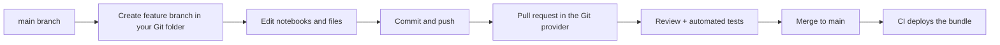

# Section 5: Implementing CI/CD

Weighted **10%** in the May 2026 exam guide, about four or five questions. This section is new to the Associate exam in 2026. It covers two tools: **Git folders** (formerly Repos) for day-to-day version control inside the workspace, and **Declarative Automation Bundles** (formerly Databricks Asset Bundles, renamed in March 2026 with no change to files or commands) for defining and promoting jobs and pipelines across environments with the **Databricks CLI**.

The guide's objectives:

- Manage the development workflow in the workspace UI: create and switch branches in Git folders, commit and push, and create pull requests through the Git integration.
- Understand environment-specific configuration with bundle **variables** and **overrides**, promoting the same code across dev, test and prod targets.
- Deploy bundles to package, configure and promote Lakeflow Jobs, Lakeflow Spark Declarative Pipelines and other workspace assets across environments.
- Use the Databricks CLI to validate, deploy and manage bundles and other workspace assets in automated CI/CD.

Source: the **[📖 exam page](https://www.databricks.com/learn/certification/data-engineer-associate)** and its linked exam guide. Bundle Python project structure, deployment modes and production Git folder patterns are covered more deeply in [Professional Section 9](../../data-engineer-professional/notes/09-debugging-deploying.md#deploying-with-declarative-automation-bundles).

## Table of Contents

1. [Why CI/CD for data pipelines](#why-cicd-for-data-pipelines)
2. [Git folders: the developer loop](#git-folders-the-developer-loop)
3. [Declarative Automation Bundles: what they are](#declarative-automation-bundles-what-they-are)
4. [Variables, targets and overrides](#variables-targets-and-overrides)
5. [The Databricks CLI](#the-databricks-cli)
6. [A complete CI/CD flow](#a-complete-cicd-flow)
7. [How the exam tests this section](#how-the-exam-tests-this-section)

---

## Why CI/CD for data pipelines

Without CI/CD, pipelines are notebooks edited in place and jobs clicked together in the UI. Nobody can tell which version ran last night, prod differs from dev in ways nobody wrote down, and a fix is copied by hand. CI/CD replaces that with three habits:

1. **All code and all definitions live in Git.** Notebooks and Python files, *and* the job and pipeline definitions (schedules, task graphs, compute).
2. **Changes go through review.** A branch, a pull request, a reviewer, automated tests.
3. **The same commit is promoted through environments** by an automated deploy, with only configuration (catalog names, cluster sizes, schedules, notification addresses) changing per environment.

Git folders cover the first two inside the workspace. Bundles and the CLI cover the first and third.

---

## Git folders: the developer loop

A **Git folder** is a workspace folder linked to a remote Git repository (GitHub, GitLab, Azure DevOps, Bitbucket, AWS CodeCommit and others). You authenticate once with a Git credential (a personal access token or the provider's OAuth app), then clone the repo into the workspace: Workspace > Create > Git folder, paste the URL.

The everyday operations all happen in the **Git dialog** (the branch name button at the top of a notebook or the folder):

| Task | In the Git dialog |
|---|---|
| Start work on a change | **Create branch**: name it and pick the base branch (usually `main`) |
| Switch to another branch | The branch dropdown. Uncommitted changes carry over if they don't conflict |
| Get teammates' changes | **Pull** |
| Save and share your change | Review the changed files and diffs, write a commit message, **Commit & Push** |
| Combine branches | **Merge** or **Rebase** from the menu; resolve conflicts in the editor (keep current, take incoming, or edit by hand) |
| Throw away local changes | **Reset** to the remote branch |
| Ask for review | Open a **pull request** in the Git provider for your pushed branch; review and merge happen there |

The pull request is a provider feature: Databricks pushes your branch, and the PR is created and merged in GitHub, GitLab or Azure DevOps, where branch protection and required reviews apply. Good practice is one Git folder per developer, each on its own feature branch, rather than several people editing the same checkout.



The diagram follows one change: a feature branch is created and edited in a Git folder, pushed, reviewed through a pull request in the Git provider, merged, and then deployed by CI.

What Git folders are **not**: a deployment tool. Jobs that run notebooks from a developer's Git folder break when the developer switches branches. Production runs from code deployed by a bundle (or from a dedicated production Git folder updated by automation, the older pattern).

**[📖 Git integration for Databricks Git folders](https://docs.databricks.com/aws/en/repos/)** - supported providers and features
**[📖 Run Git operations on Git folders](https://docs.databricks.com/aws/en/repos/git-operations-with-repos)** - branch, commit, push, pull, merge
**[📖 Configure Git credentials](https://docs.databricks.com/aws/en/repos/get-access-tokens-from-git-provider)** - tokens and OAuth

---

## Declarative Automation Bundles: what they are

A **bundle** is a folder in Git that holds your source code *and* YAML describing the Databricks resources that run it: jobs, pipelines, dashboards, schemas, volumes, model serving endpoints, apps and more. The root file is `databricks.yml`. The Databricks CLI reads it and creates or updates those resources in a workspace; the set of things to deploy where is called a **target**.

A minimal project from `databricks bundle init`:

```text
orders_etl/
├── databricks.yml          # bundle name, variables, targets
├── resources/
│   ├── orders_job.yml      # the Lakeflow Job
│   └── orders_pipeline.yml # the declarative pipeline
├── src/
│   ├── ingest.ipynb
│   └── pipeline/transformations.py
└── tests/
```

```yaml
# resources/orders_pipeline.yml
resources:
  pipelines:
    orders_pipeline:
      name: orders_pipeline_${bundle.target}
      catalog: ${var.catalog}
      schema: sales
      serverless: true
      libraries:
        - glob: { include: ../src/pipeline/** }
```

```yaml
# resources/orders_job.yml
resources:
  jobs:
    orders_job:
      name: orders_job
      trigger:
        file_arrival: { url: "${var.landing_path}" }
      tasks:
        - task_key: ingest
          notebook_task: { notebook_path: ../src/ingest.ipynb }
        - task_key: transform
          depends_on: [ { task_key: ingest } ]
          pipeline_task: { pipeline_id: "${resources.pipelines.orders_pipeline.id}" }
      email_notifications:
        on_failure: [ "${var.alert_email}" ]
```

Note how the job refers to the pipeline with `${resources.pipelines.orders_pipeline.id}`: the ID differs in each workspace, so the bundle wires it at deploy time. Paths are relative to the YAML file.

Why bundles beat clicking in the UI: the definition is reviewed in pull requests, every environment is built from the same files, a bad change is rolled back by deploying an earlier commit, and `destroy` cleans up a test environment completely.

**[📖 What are Declarative Automation Bundles?](https://docs.databricks.com/aws/en/dev-tools/bundles/)** - concepts and workflow
**[📖 Bundle configuration](https://docs.databricks.com/aws/en/dev-tools/bundles/settings)** - `databricks.yml` reference
**[📖 Bundle resources](https://docs.databricks.com/aws/en/dev-tools/bundles/resources)** - supported resource types

---

## Variables, targets and overrides

The guide's second objective is about one codebase, several environments. Bundles do it with **targets** (dev, test, prod) and **variables** whose values differ per target.

```yaml
# databricks.yml
bundle:
  name: orders_etl

include:
  - resources/*.yml

variables:
  catalog:
    description: Catalog the pipeline writes to
    default: dev
  landing_path:
    default: /Volumes/dev/raw/landing/orders/
  alert_email:
    default: me@example.com
  warehouse_id:
    lookup:
      warehouse: "Shared SQL"        # resolve an ID from a name in each workspace

targets:
  dev:
    mode: development                # prefixes names with [dev <user>], pauses triggers
    default: true
    workspace:
      host: https://acme-dev.cloud.databricks.com

  test:
    workspace:
      host: https://acme-test.cloud.databricks.com
    variables:
      catalog: test
      landing_path: /Volumes/test/raw/landing/orders/

  prod:
    mode: production                 # checks for a non-personal run-as, no name prefixes
    workspace:
      host: https://acme-prod.cloud.databricks.com
    run_as:
      service_principal_name: 6f1c0d2e-...-orders-sp
    variables:
      catalog: prod
      landing_path: /Volumes/prod/raw/landing/orders/
      alert_email: data-oncall@example.com
    resources:                       # override part of a resource for this target only
      jobs:
        orders_job:
          max_concurrent_runs: 1
```

How the pieces work:

- **Variables** are declared once under `variables` with an optional `default`, and referenced as `${var.catalog}`. A `lookup` resolves an ID (warehouse, cluster, service principal) by name, so the YAML doesn't hard-code IDs that differ per workspace.
- **Targets** set the workspace host and override variable values. Anything not overridden falls back to the default.
- **Resource overrides** inside a target merge with the top-level definition: change one field (schedule, cluster size, concurrency) for one environment without copying the resource.
- **Built-in substitutions** such as `${bundle.target}`, `${bundle.name}` and `${workspace.current_user.userName}` let names and paths include the environment or user.
- **Deployment modes**: `mode: development` gives each developer an isolated copy (names prefixed, schedules and triggers paused); `mode: production` enforces production-safe settings such as running as a service principal.

Variable values are resolved in this order, first match wins: the CLI flag `--var="catalog=prod"`, an environment variable `BUNDLE_VAR_catalog`, the `.databricks/bundle/<target>/variable-overrides.json` file, the target's `variables`, then the `default`. CI systems typically set secrets-free values with `--var` or `BUNDLE_VAR_`.

**[📖 Substitutions and variables](https://docs.databricks.com/aws/en/dev-tools/bundles/variables)** - declaring, referencing, precedence
**[📖 Deployment modes](https://docs.databricks.com/aws/en/dev-tools/bundles/deployment-modes)** - development and production
**[📖 Override with target settings](https://docs.databricks.com/aws/en/dev-tools/bundles/settings#targets)** - how target overrides merge

---

## The Databricks CLI

The **Databricks CLI** (`databricks`) is the command-line tool for the whole platform; bundles are one command group. Install it, then authenticate: interactively with `databricks auth login --host <url>` (OAuth user-to-machine), or in CI as a **service principal** with OAuth machine-to-machine credentials (`DATABRICKS_HOST`, `DATABRICKS_CLIENT_ID`, `DATABRICKS_CLIENT_SECRET`) or, better, workload identity federation so no secret is stored. Profiles in `~/.databrickscfg` hold several workspaces; pick one with `-p`.

The bundle lifecycle:

| Command | Does | When |
|---|---|---|
| `databricks bundle init` | Create a project from a template (default Python, SQL, pipelines...) | Starting a project |
| `databricks bundle validate -t test` | Parse YAML, resolve variables, check the configuration | Every PR in CI; before deploy |
| `databricks bundle deploy -t test` | Build artifacts, upload files, create or update the jobs and pipelines | After merge, per environment |
| `databricks bundle run -t test orders_job` | Run a deployed job or pipeline and stream its status | Integration tests, smoke tests |
| `databricks bundle summary -t prod` | Show what is deployed and its URLs | Checking a deployment |
| `databricks bundle destroy -t dev` | Delete everything this bundle deployed to the target | Clean up dev or ephemeral test environments |

Other workspace assets are managed with their own command groups: `databricks jobs list`, `databricks jobs run-now <id>`, `databricks pipelines start-update <id>`, `databricks fs cp` (files to volumes), `databricks repos update` (move a Git folder to a branch), `databricks secrets put-secret`, `databricks workspace import`. In automation, prefer bundles for anything you want versioned, and the plain command groups for one-off operations.

**[📖 Databricks CLI](https://docs.databricks.com/aws/en/dev-tools/cli/)** - install, commands
**[📖 Bundle commands](https://docs.databricks.com/aws/en/dev-tools/cli/bundle-commands)** - validate, deploy, run, destroy
**[📖 Authentication for the CLI](https://docs.databricks.com/aws/en/dev-tools/cli/authentication)** - OAuth U2M and M2M

---

## A complete CI/CD flow

Putting it together, with GitHub Actions as the example runner (Azure DevOps and GitLab look the same):

```yaml
# .github/workflows/deploy.yml (simplified)
on:
  pull_request:
  push:
    branches: [main]
jobs:
  deploy:
    runs-on: ubuntu-latest
    env:
      DATABRICKS_HOST: ${{ vars.DATABRICKS_HOST }}
      DATABRICKS_CLIENT_ID: ${{ secrets.SP_CLIENT_ID }}
      DATABRICKS_CLIENT_SECRET: ${{ secrets.SP_CLIENT_SECRET }}
    steps:
      - uses: actions/checkout@v4
      - uses: databricks/setup-cli@main
      - run: databricks bundle validate -t test
      - run: pytest tests/                                     # unit tests
      - if: github.ref == 'refs/heads/main'
        run: databricks bundle deploy -t test && databricks bundle run -t test orders_job
      - if: github.ref == 'refs/heads/main'
        run: databricks bundle deploy -t prod
```

| Stage | What happens | Tool |
|---|---|---|
| Develop | Feature branch in a Git folder (or a local IDE), `bundle deploy -t dev` for a personal copy | Git folders, CLI |
| Pull request | Review; CI runs `bundle validate` and unit tests | Git provider, CI |
| Merge to main | CI deploys to **test** and runs the job as an integration test | CLI |
| Release | CI deploys the **same commit** to **prod** as a service principal | CLI |

The exam's fifth sample question is this pattern in one line: to deploy, version and orchestrate ETL modularly with CI/CD, **define resources and code in a bundle, keep it in Git, and promote through environments with automated CI/CD**. Distractors use models in Unity Catalog, wheel files bound to jobs by hand, or notebook revision history as versioning.

**[📖 CI/CD on Databricks](https://docs.databricks.com/aws/en/dev-tools/ci-cd/)** - recommended workflow
**[📖 GitHub Actions](https://docs.databricks.com/aws/en/dev-tools/ci-cd/github)** - the setup-cli action and examples

---

## How the exam tests this section

- **Git folder operations.** Know where each action lives: create and switch branches, pull, commit and push, merge and resolve conflicts are in the Git dialog; pull requests are created and merged in the Git provider.
- **"Same code, different environments"** means a bundle with targets and variables (`${var.name}`), with per-target values and overrides. Copying notebooks per environment, or editing prod by hand, is wrong.
- **Which CLI command.** Check the config: `bundle validate`. Push it to an environment: `bundle deploy -t <target>`. Start it: `bundle run`. Clean up: `bundle destroy`.
- **What a bundle can deploy.** Jobs, pipelines, dashboards, schemas, volumes and more, together with their code.
- **Who deploys to prod.** CI, as a service principal, from a merged commit. Not a developer from a laptop, and not by switching a Git folder's branch by hand.
- **Old names.** Databricks Asset Bundles (DABs) are Declarative Automation Bundles; Repos are Git folders. The sample question still says "DABs".

Continue with [Section 6: Troubleshooting, Monitoring, and Optimization](06-troubleshooting-monitoring-optimization.md).
