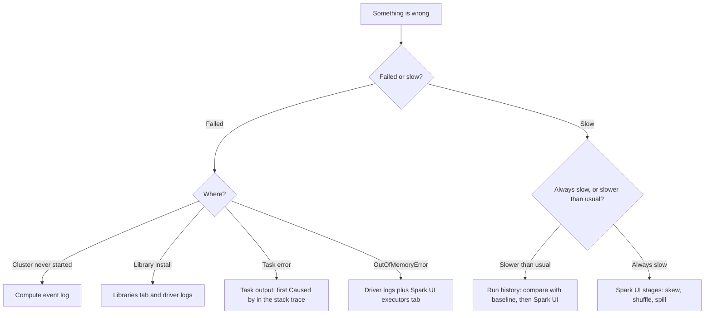
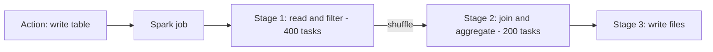

# Section 6: Troubleshooting, Monitoring, and Optimization

Weighted **10%** in the May 2026 exam guide, about four or five questions. The section is about keeping pipelines healthy once they run: reading the Lakeflow Jobs run history and task graph, reading the Spark UI to find skew, shuffle and spill, knowing what Liquid Clustering and predictive optimization do, and diagnosing the three classic failures: a cluster that won't start, a library conflict, and out-of-memory errors.

The guide's objectives:

- Identify trends in job performance with the Lakeflow Jobs **run history**, comparing current run times with historical baselines.
- Monitor pipeline health in the Lakeflow Jobs UI: job statuses, the DAG task graph to spot upstream blockers, run times and failure rates.
- Identify bottlenecks (data skew, shuffling, disk spilling) from stage-level metrics in the **Spark UI**.
- Understand the features of **Liquid Clustering** and **predictive optimization**.
- Diagnose cluster startup failures, library conflicts and out-of-memory issues.

Source: the **[📖 exam page](https://www.databricks.com/learn/certification/data-engineer-associate)** and its linked exam guide. System tables, alerts, the query profile, deletion vectors and repair runs with overrides go deeper in [Professional Section 5](../../data-engineer-professional/notes/05-monitoring-alerting.md), [Section 6](../../data-engineer-professional/notes/06-cost-performance-optimisation.md) and [Section 9](../../data-engineer-professional/notes/09-debugging-deploying.md).

## Table of Contents

1. [Where to look for what](#where-to-look-for-what)
2. [Monitoring in the Lakeflow Jobs UI](#monitoring-in-the-lakeflow-jobs-ui)
3. [Spotting trends in run history](#spotting-trends-in-run-history)
4. [Reading the Spark UI](#reading-the-spark-ui)
5. [Skew, shuffle and spill: causes and fixes](#skew-shuffle-and-spill-causes-and-fixes)
6. [Liquid Clustering](#liquid-clustering)
7. [Predictive optimization](#predictive-optimization)
8. [Diagnosing cluster, library and memory failures](#diagnosing-cluster-library-and-memory-failures)
9. [How the exam tests this section](#how-the-exam-tests-this-section)

---

## Where to look for what

| Question | Look at |
|---|---|
| Did last night's job succeed? Which task failed? | Lakeflow Jobs UI: the job's **Runs** tab, then the run's task graph |
| Why did a task fail? | The failed task's **output** and error (stack trace) |
| Is this job getting slower over time? | The Runs tab's **run history** chart (duration per run) |
| Why is a Spark step slow? | The **Spark UI** (Jobs, Stages, SQL / DataFrame tabs) |
| Why won't the cluster start? | The cluster's **event log** |
| Why did a library fail to install, or the driver crash? | Cluster **Libraries** tab, **driver logs** (stdout, stderr, log4j) |
| Why is a SQL warehouse query slow? | The **query profile** in Query History |
| Was a pipeline's data quality OK? | The pipeline UI and its **event log** |



The flowchart routes a problem to the right tool: failures by where they happened, slowness by whether it is new (compare with history) or built in (read the stages).

**[📖 Monitoring and observability for Lakeflow Jobs](https://docs.databricks.com/aws/en/jobs/monitor)** - run views and metrics
**[📖 Debugging with the Spark UI](https://docs.databricks.com/aws/en/compute/troubleshooting/debugging-spark-ui)** - where to start

---

## Monitoring in the Lakeflow Jobs UI

The **Jobs & Pipelines** page lists every job with its last run's status. Open a job to see:

- **Runs tab.** A **matrix view**: one column per run, one row per task, each cell coloured by status. A row that keeps turning red is a task failing repeatedly; a column that is red only from one task down is an **upstream blocker** (the downstream tasks show *Upstream failed* or *Skipped*, not real failures). Above it, a bar chart of run durations.
- **A single run.** The **task graph** (DAG) with each task's status and duration. Click a task for its output, error, logs, parameters and the compute it used. The graph shows immediately which task blocked the rest.
- **Run statuses** to recognise: *Pending*, *Queued*, *Running*, *Succeeded*, *Failed*, *Timed out*, *Canceled*, *Skipped* (a branch not taken, or a condition not met), *Upstream failed*, *Succeeded with failures* (some tasks failed but a leaf task configured to tolerate it succeeded).

For a declarative pipeline, the pipeline's own page shows the flow graph, each table's row counts and expectation pass/fail counts, and the event log.

For failure rates and run times across *many* jobs, the Jobs UI has a jobs monitoring view, and the **system tables** (`system.lakeflow.job_run_timeline`, `system.lakeflow.job_task_run_timeline`) hold the history for SQL queries and dashboards. Those are Professional depth; at Associate level, know they exist.

**[📖 View runs for a job](https://docs.databricks.com/aws/en/jobs/monitor#view-runs-for-a-job)** - matrix view, statuses
**[📖 Jobs system tables](https://docs.databricks.com/aws/en/admin/system-tables/jobs)** - history for reporting

---

## Spotting trends in run history

"The job used to take 20 minutes and now takes 50" is a trend question. The habit the guide asks for is to compare the current run with a **baseline**: the typical duration over the last few weeks, from the run history chart.

How to reason about a slowdown:

1. **Is it one run or a trend?** One slow run among normal ones is usually transient (a slow cluster start, a spot instance lost, a busy source). A steady rise points to growth or a change.
2. **Which task got slower?** Compare task durations between a normal run and a slow one. Only one task slower narrows it down immediately.
3. **What changed around when it started?** A new data source onboarded, a code deploy, a runtime upgrade, data volume growth, a new join key. The exam's first sample question starts exactly like this: duration doubled after a new source was onboarded.
4. **Then open the Spark UI** for that task's run and read the slow stage.

Cluster start time counts in run duration too: a job on a new classic jobs cluster spends several minutes starting before any code runs. Serverless jobs compute, or pools for classic clusters, shorten that.

---

## Reading the Spark UI

Each Spark **action** (a write, a `count`, a `display`) becomes one or more **jobs**; each job is split into **stages** at every **shuffle** (when data must move between machines, for joins, `groupBy`, `distinct`, `repartition`); each stage runs as many **tasks**, one per partition, in parallel on executors.



The diagram shows how one action becomes a job, split into stages at each shuffle, each stage running one task per partition.

The tabs that matter:

- **Jobs** and **SQL / DataFrame**: find the slow query and its plan, with time per operator.
- **Stages**: every stage of a job with its duration; open the slowest one first.
- **Stage detail > Summary Metrics**: Min, 25th percentile, Median, 75th percentile and Max for task duration, shuffle read size, shuffle write size, and spill. **This table is where skew and spill show up.**
- **Executors**: memory, garbage collection (GC) time, failed tasks and lost executors per executor.

What the summary metrics tell you:

| Pattern in stage metrics | Means |
|---|---|
| Max task duration and Max shuffle read far above the Median (one task 10 minutes, the rest 30 seconds) | **Data skew**: one partition holds much more data |
| Large *Shuffle Read* / *Shuffle Write* totals | **Heavy shuffle**: lots of data moving between executors |
| Non-zero *Spill (Memory)* and *Spill (Disk)* | **Spill**: partitions didn't fit in memory and were written to local disk |
| Thousands of tasks each taking milliseconds | **Too many small partitions**: overhead dominates |
| Few tasks, cores idle | **Too few partitions**: not enough parallelism |
| High GC time on executors | Memory pressure, often before spill or OOM |

**[📖 Diagnosing a long stage in Spark](https://docs.databricks.com/aws/en/optimizations/spark-ui-guide/long-spark-stage)** - reading task metrics
**[📖 Skew and spill](https://docs.databricks.com/aws/en/optimizations/spark-ui-guide/long-spark-stage-page)** - recognising both in the UI

---

## Skew, shuffle and spill: causes and fixes

| Problem | Typical cause | Fixes, in the order to try them |
|---|---|---|
| **Skew** | A few keys are very common (a default customer ID, nulls, one huge country) | Make sure **AQE skew join handling** is on (default on Databricks): it splits oversized partitions at run time. Filter or handle nulls and placeholder keys separately. Broadcast the smaller side if it's small enough. As a last resort, **salt** the hot key by hand |
| **Heavy shuffle** | Joining two large tables, wide `groupBy`, unnecessary `repartition` or `distinct` | Broadcast small tables; filter and select columns *before* the join; cluster both tables on the join key; remove needless repartitions |
| **Spill** | Partitions too large for executor memory | More shuffle partitions (or let AQE size them); memory-optimised instances; fix skew (a skewed partition spills first) |
| **Too many small tasks** | `spark.sql.shuffle.partitions` far too high for the data size | Lower it, or let AQE coalesce partitions |

The exam's first sample question puts this together. One task takes 10 minutes while the rest take 30 seconds, and Max shuffle read (over 5 GB) dwarfs the Median (around 400 MB): that is skew. **Adding executors** doesn't help, because one partition is still processed by one task. **Fewer shuffle partitions** makes partitions bigger, which is worse. **Manual salting** works but is more effort and more code. The best answer is to confirm **AQE with skew join handling** is active so Spark splits the oversized partition itself.

**[📖 Adaptive query execution](https://docs.databricks.com/aws/en/optimizations/aqe)** - coalescing, broadcast switching, skew joins

---

## Liquid Clustering

**Liquid Clustering** organises a Delta table's data files by one or more **clustering keys**, so queries that filter on those columns read far fewer files (data skipping). It replaces both Hive-style **partitioning** and **Z-ordering** for new tables.

```sql
-- New table clustered by the columns queries filter on most
CREATE TABLE main.silver.events (event_id BIGINT, customer_id BIGINT, event_date DATE, payload STRING)
CLUSTER BY (customer_id, event_date);

-- Change keys later without rewriting the table
ALTER TABLE main.silver.events CLUSTER BY (event_date);

-- Let Databricks choose keys from the actual query workload (needs predictive optimization)
ALTER TABLE main.silver.events CLUSTER BY AUTO;

-- Cluster new data (incremental); FULL re-clusters everything
OPTIMIZE main.silver.events;
OPTIMIZE main.silver.events FULL;
```

| | Partitioning | Z-order | Liquid Clustering |
|---|---|---|---|
| Set with | `PARTITIONED BY` | `OPTIMIZE ... ZORDER BY` each time | `CLUSTER BY` once |
| Change the columns | Rewrite the whole table | Next `OPTIMIZE` | `ALTER TABLE ... CLUSTER BY`, no rewrite |
| High-cardinality columns | Bad: thousands of tiny partitions | OK | Good |
| Incremental | - | No, rewrites the data each time | Yes, clusters only new or unclustered data |
| Recommendation | Legacy; only very large tables with a clear low-cardinality filter | Legacy | **Default for new tables** |

Choose keys from the columns that appear most in `WHERE` filters and joins, up to four. Liquid Clustering can't be combined with partitioning or Z-order on the same table.

**[📖 Use liquid clustering for tables](https://docs.databricks.com/aws/en/delta/clustering)** - keys, `CLUSTER BY AUTO`, `OPTIMIZE`

---

## Predictive optimization

**Predictive optimization** runs table maintenance for you on **Unity Catalog managed tables**. Databricks watches how each table is used and automatically runs:

- **`OPTIMIZE`**: compacts small files and performs Liquid Clustering;
- **`VACUUM`**: removes data files no longer needed by the table's retention window;
- **`ANALYZE TABLE ... COMPUTE STATISTICS`**: keeps statistics fresh for the query optimiser;
- and picks clustering keys for tables set to `CLUSTER BY AUTO`.

It runs on serverless compute, billed separately, only when Databricks judges the benefit worth the cost. It is enabled by default for new accounts, and can be enabled or disabled at the account, catalog or schema level (`ALTER CATALOG main ENABLE PREDICTIVE OPTIMIZATION`). Its history is in the `system.storage.predictive_optimization_operations_history` system table.

The design lesson the exam draws from it: **managed tables plus predictive optimization plus Liquid Clustering** is the low-maintenance default. A scheduled job you wrote to run `OPTIMIZE` and `VACUUM` every night is now usually the wrong answer for managed tables, and predictive optimization does nothing for **external** tables, which still need manual maintenance.

**[📖 Predictive optimization for Unity Catalog managed tables](https://docs.databricks.com/aws/en/optimizations/predictive-optimization)** - operations, enablement, history
**[📖 OPTIMIZE](https://docs.databricks.com/aws/en/sql/language-manual/delta-optimize)** - compaction and clustering

---

## Diagnosing cluster, library and memory failures

**Cluster won't start.** Read the cluster's **event log** first. Common causes:

| Message or symptom | Likely cause | Fix |
|---|---|---|
| Cloud provider capacity or "insufficient instances" errors | The region has no capacity for that instance type (common with spot or GPUs) | Another instance type or zone, on-demand instead of spot, or serverless |
| Quota or limit exceeded | Your cloud account's vCPU quota is used up | Raise the quota, smaller or fewer nodes |
| Init script failure | A cluster-scoped init script exited with an error | Read the init script logs; fix the script |
| Network or bootstrap timeout | VPC, subnet, security group or firewall blocks the control plane | Fix the network configuration (usually a platform admin) |
| Permission denied when creating compute | No permission to create or use that compute policy | Ask for `CAN USE` on a policy, or use an existing cluster |

**Library conflicts.** A task fails with `ModuleNotFoundError`, an `ImportError`, or a strange `AttributeError` after a library upgrade. Causes: a library installed in one place but not the one the job uses; two libraries needing incompatible versions of a dependency; an unpinned version that changed overnight; a library that conflicts with one preinstalled in the Databricks Runtime. Check the cluster's **Libraries** tab for install status and the driver logs for pip's resolver errors. Fixes: **pin versions** (`pandas==2.2.3`), install per notebook with `%pip install` (then the Python process restarts) or per task in a job's environment, test on the same runtime version as production, and on serverless declare dependencies in the **environment** rather than as cluster libraries.

**Out of memory.**

| Where | Symptom | Usual cause | Fix |
|---|---|---|---|
| **Driver** | `java.lang.OutOfMemoryError` in driver logs, "driver is temporarily unavailable", notebook detached | `collect()`, `toPandas()`, `display()` of huge results; broadcasting a table that's too big; many small files listed on the driver | Don't pull big data to the driver (write to a table instead); limit broadcast; a larger driver if truly needed |
| **Executor** | Tasks fail with OOM, executors lost, heavy spill before failing | Skewed or oversized partitions, a big Python UDF or pandas step per partition | Fix skew, more partitions, memory-optimised workers; avoid row-at-a-time Python UDFs |

A worked case from the guide's language: a job fails every few nights with "executor lost" on the same stage, and the stage metrics show one huge task. That is skew causing an executor OOM, and the fix is skew handling, not a bigger driver.

**[📖 Compute event log](https://docs.databricks.com/aws/en/compute/clusters-manage#event-log)** - startup and termination events
**[📖 Notebook-scoped Python libraries](https://docs.databricks.com/aws/en/libraries/notebooks-python-libraries)** - `%pip` and pinning
**[📖 Troubleshoot compute](https://docs.databricks.com/aws/en/compute/troubleshooting/)** - common compute problems

---

## How the exam tests this section

- **Symptom to tool.** Failed task: task output. Cluster won't start: event log. Library error: Libraries tab and driver logs. Slower than usual: run history first, then the Spark UI. Upstream blocker: the run's task graph.
- **Reading stage metrics.** Max far above Median is skew. Spill columns non-zero is spill. Large shuffle totals is a shuffle-heavy plan.
- **Skew fixes.** AQE skew join handling first; more executors and fewer partitions are traps; salting works but is manual.
- **Liquid Clustering vs partitioning and Z-order.** New tables use `CLUSTER BY`; keys can change without a rewrite; `CLUSTER BY AUTO` lets Databricks pick.
- **Predictive optimization** runs `OPTIMIZE`, `VACUUM` and `ANALYZE` automatically, on managed tables only.
- **OOM.** Driver OOM almost always means pulling too much data to the driver; executor OOM usually means skew or oversized partitions.

Continue with [Section 7: Governance and Security](07-governance-security.md).
