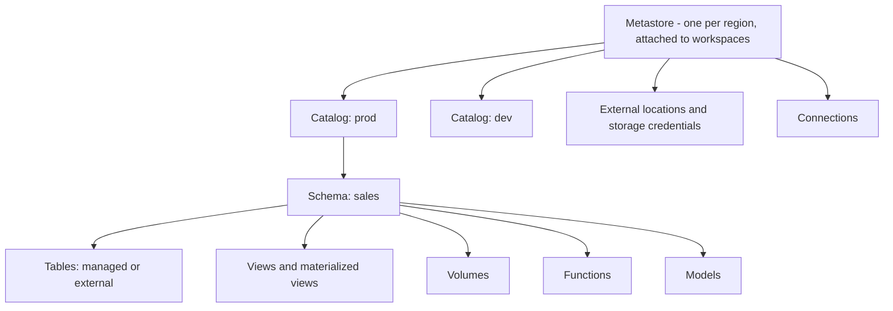

# Section 7: Governance and Security

Weighted **15%** in the May 2026 exam guide, about seven questions. Everything here runs through **Unity Catalog**: where tables keep their data, who may read or change them, and what each user sees inside a table.

The guide's objectives:

- Tell **managed** and **external** tables apart, and create, modify, delete and convert between them.
- Configure access with the UI and SQL: `GRANT`, `REVOKE` and `DENY` to users, groups and service principals, at the right level of the hierarchy.
- Understand **column masking** and **row-level security** that restrict what each group sees.
- Understand Unity Catalog **ABAC policies** that apply row filters and column masks centrally.

Source: the **[📖 exam page](https://www.databricks.com/learn/certification/data-engineer-associate)** and its linked exam guide. Anonymisation, PII pipelines, data erasure, governed tags and ownership in depth are Professional topics: see [Professional Section 7](../../data-engineer-professional/notes/07-security-compliance.md) and [Section 8](../../data-engineer-professional/notes/08-data-governance.md).

## Table of Contents

1. [The Unity Catalog object model](#the-unity-catalog-object-model)
2. [Managed and external tables](#managed-and-external-tables)
3. [Converting between managed and external](#converting-between-managed-and-external)
4. [Volumes for files](#volumes-for-files)
5. [Principals and privileges](#principals-and-privileges)
6. [GRANT, REVOKE and DENY](#grant-revoke-and-deny)
7. [Row filters and column masks](#row-filters-and-column-masks)
8. [ABAC policies](#abac-policies)
9. [Lineage, audit and discovery](#lineage-audit-and-discovery)
10. [How the exam tests this section](#how-the-exam-tests-this-section)

---

## The Unity Catalog object model



The diagram shows the hierarchy: one metastore per region holds catalogs, catalogs hold schemas, and schemas hold tables, views, volumes, functions and models. Storage access (external locations) and connections to outside systems hang off the metastore.

Objects are named `catalog.schema.object`. `USE CATALOG prod; USE SCHEMA sales;` sets defaults so you can write just `orders`. Catalogs usually separate environments (`dev`, `prod`) or business domains; a catalog can be **bound** to specific workspaces so prod data isn't visible from a dev workspace.

Storage is governed by two objects: a **storage credential** (a cloud IAM role or managed identity) and an **external location** (a cloud path plus the credential that can reach it). Users never handle cloud keys; they get privileges on external locations instead.

**[📖 Unity Catalog object model](https://docs.databricks.com/aws/en/data-governance/unity-catalog/#the-unity-catalog-object-model)** - securables and hierarchy
**[📖 External locations](https://docs.databricks.com/aws/en/connect/unity-catalog/cloud-storage/external-locations)** - how storage access is governed

---

## Managed and external tables

| | Managed table | External table |
|---|---|---|
| Who manages the files | Unity Catalog, in the managed storage location of the metastore, catalog or schema | You, at a path you give with `LOCATION` |
| Formats | Delta or Iceberg | Delta, Parquet, CSV, JSON, Avro, ORC, text and more |
| `DROP TABLE` | Removes the table; the data files are deleted after a recovery window (`UNDROP` works for 7 days by default) | Removes only the metadata; files stay in your storage |
| Predictive optimization, automatic maintenance | Yes | No |
| Other engines | Read and write through Unity Catalog APIs | Can read the files directly at the path |
| Recommendation | **Default for almost everything** | When other systems must use the files at a fixed path, or for formats other than Delta and Iceberg |

```sql
-- Managed: no LOCATION
CREATE TABLE prod.sales.orders (order_id BIGINT, amount DECIMAL(12,2), order_ts TIMESTAMP);

-- External: LOCATION inside an external location you have CREATE EXTERNAL TABLE on
CREATE TABLE prod.sales.orders_ext (order_id BIGINT, amount DECIMAL(12,2), order_ts TIMESTAMP)
LOCATION 's3://acme-lake/sales/orders/';

-- Inspect: Type (MANAGED / EXTERNAL) and Location
DESCRIBE TABLE EXTENDED prod.sales.orders;

-- Modify
ALTER TABLE prod.sales.orders ADD COLUMNS (channel STRING);
ALTER TABLE prod.sales.orders RENAME TO prod.sales.orders_v2;
COMMENT ON TABLE prod.sales.orders_v2 IS 'One row per order, from the web shop';

-- Delete, and recover a mistake
DROP TABLE prod.sales.orders_v2;
SHOW TABLES DROPPED IN prod.sales;
UNDROP TABLE prod.sales.orders_v2;
```

Two consequences to remember. Dropping a **managed** table deletes its data (after the recovery window). Dropping an **external** table never deletes the files, so recreating it with the same `LOCATION` brings the data straight back.

**[📖 Managed tables](https://docs.databricks.com/aws/en/tables/managed)** - storage, benefits
**[📖 External tables](https://docs.databricks.com/aws/en/tables/external)** - when to use them
**[📖 UNDROP TABLE](https://docs.databricks.com/aws/en/sql/language-manual/sql-ref-syntax-ddl-undrop-table)** - recovery window

---

## Converting between managed and external

**External to managed** (the common direction, to get predictive optimization and simpler governance) is one statement:

```sql
ALTER TABLE prod.sales.orders_ext SET MANAGED;
```

`SET MANAGED` copies the data into managed storage while keeping the table's name, history, permissions and dependent views, with minimal downtime for readers and writers (who must access the table by name, not by path). For 14 days you can roll it back with `ALTER TABLE ... UNSET MANAGED`; after that the old files are cleaned up. It needs Databricks Runtime 17.3 LTS or later, or serverless compute.

The older way, which still appears in questions, is to create a new managed table from the external one and swap names:

```sql
CREATE TABLE prod.sales.orders_managed DEEP CLONE prod.sales.orders_ext;   -- or CTAS
```

`DEEP CLONE` copies data and table properties; CTAS copies only the data. Either way you then fix grants and downstream references yourself, which is why `SET MANAGED` is preferred.

**Managed to external** has no in-place command (other than rolling back a recent `SET MANAGED`). Create an external table at a location from the managed one, for example `CREATE TABLE ... LOCATION 's3://...' AS SELECT * FROM managed_table` or a `DEEP CLONE` with a `LOCATION`, then drop or rename the original.

**[📖 Convert an external table to a managed table](https://docs.databricks.com/aws/en/tables/convert-external-managed)** - `SET MANAGED`, rollback, requirements
**[📖 Clone a table](https://docs.databricks.com/aws/en/delta/clone)** - deep and shallow clones

---

## Volumes for files

Tables govern rows; **volumes** govern files (raw landing files, images, PDFs, libraries). A volume lives in a schema next to tables and is read at `/Volumes/<catalog>/<schema>/<volume>/<path>`. A **managed volume** keeps files in Unity Catalog's managed storage; an **external volume** points at a path in an external location. Access uses `READ VOLUME` and `WRITE VOLUME`.

```sql
CREATE VOLUME prod.raw.landing;                                         -- managed
CREATE EXTERNAL VOLUME prod.raw.vendor_drop LOCATION 's3://acme-vendor/drop/';
GRANT READ VOLUME ON VOLUME prod.raw.landing TO `data_engineers`;
```

**[📖 What are Unity Catalog volumes?](https://docs.databricks.com/aws/en/volumes/)** - managed and external volumes

---

## Principals and privileges

A **principal** is who receives a privilege:

- **Users**: people, identified by email.
- **Groups**: sets of users and service principals, ideally **account-level** groups synced from the identity provider. Grant to groups, not individuals, so access follows team membership.
- **Service principals**: identities for automation (jobs, pipelines, CI/CD). Production jobs should run as one.

The main privileges:

| Privilege | On | Lets the principal |
|---|---|---|
| `USE CATALOG` | Catalog | Reference anything in the catalog (a gate, not data access) |
| `USE SCHEMA` | Schema | Reference anything in the schema (a gate) |
| `BROWSE` | Catalog | See metadata in Catalog Explorer without reading data |
| `SELECT` | Table, view, MV (or a container, inherited) | Read data |
| `MODIFY` | Table | Insert, update, delete, merge |
| `CREATE TABLE`, `CREATE VOLUME`, `CREATE FUNCTION`... | Schema | Create objects in it |
| `CREATE SCHEMA` | Catalog | Create schemas |
| `EXECUTE` | Function | Call it |
| `READ VOLUME`, `WRITE VOLUME` | Volume | Read or write files |
| `READ FILES`, `WRITE FILES`, `CREATE EXTERNAL TABLE` | External location | Use the cloud path directly or put external tables on it |
| `MANAGE` | Any securable | Grant and revoke on it, rename or drop it, without owning it |
| `ALL PRIVILEGES` | Any | Every applicable privilege (not ownership) |

Two rules decide most questions:

1. **You need the gates plus the privilege.** Reading `prod.sales.orders` needs `USE CATALOG` on `prod`, `USE SCHEMA` on `prod.sales`, and `SELECT` on the table (or on the schema or catalog).
2. **Privileges are inherited downward, including by objects created later.** `SELECT` on a schema covers every table in it, today's and tomorrow's. Every object also has one **owner**, who has all privileges on it.

**[📖 Unity Catalog privileges and securable objects](https://docs.databricks.com/aws/en/data-governance/unity-catalog/access-control/privileges-reference)** - the full reference
**[📖 Manage privileges in Unity Catalog](https://docs.databricks.com/aws/en/data-governance/unity-catalog/manage-privileges/)** - inheritance and ownership

---

## GRANT, REVOKE and DENY

In SQL:

```sql
-- Analysts read everything in prod.sales, now and in future
GRANT USE CATALOG ON CATALOG prod TO `analysts`;
GRANT USE SCHEMA, SELECT ON SCHEMA prod.sales TO `analysts`;

-- The ETL service principal writes one table
GRANT USE CATALOG ON CATALOG prod TO `sp-orders-etl`;
GRANT USE SCHEMA ON SCHEMA prod.sales TO `sp-orders-etl`;
GRANT SELECT, MODIFY ON TABLE prod.sales.orders TO `sp-orders-etl`;

-- Engineers create tables in a dev schema
GRANT USE SCHEMA, CREATE TABLE ON SCHEMA dev.sandbox TO `data_engineers`;

-- Take access away, and check
REVOKE SELECT ON SCHEMA prod.sales FROM `analysts`;
SHOW GRANTS ON SCHEMA prod.sales;
SHOW GRANTS `analysts` ON CATALOG prod;

-- Hand ownership to a group
ALTER TABLE prod.sales.orders OWNER TO `data_platform`;
```

Principal names with special characters (emails, hyphens) go in backticks. In the **UI**, the same thing is done in **Catalog Explorer**: open the catalog, schema or table, go to the **Permissions** tab, click **Grant**, choose principals and privileges. The UI shows inherited grants too.

**What `REVOKE` can and can't do.** `REVOKE` removes a grant made on *that* object. It can't take away access inherited from a parent: if `analysts` have `SELECT` on the schema, revoking `SELECT` on one table in it does nothing. To exclude one table, grant at a narrower level (on the tables they *should* see), move the table to another schema, or hide its rows with a row filter.

**`DENY`.** The exam guide lists `DENY`, so know where it fits:

- The `DENY` **statement** belongs to the legacy **Hive metastore** table access control (`hive_metastore` catalog). Unity Catalog does **not** support it: Unity Catalog privileges are additive, and access is limited by not granting it.
- In Unity Catalog, explicit denial comes through **ABAC DENY policies** (Beta as of late 2026), attached at a catalog or schema and matched by governed tags. They take precedence over any grant, including ownership. Today they can deny only the `MANAGE ACCESS CONTROL` privilege, for example to stop anyone but admins from changing grants on tables tagged sensitive.

So for "user X must not read table Y" in Unity Catalog, the expected answer is to remove or narrow the grants, or filter or mask the data; a `DENY SELECT` statement is the legacy Hive metastore answer.

**[📖 GRANT](https://docs.databricks.com/aws/en/sql/language-manual/security-grant)** - syntax and examples
**[📖 REVOKE](https://docs.databricks.com/aws/en/sql/language-manual/security-revoke)** - syntax
**[📖 DENY (Hive metastore)](https://docs.databricks.com/aws/en/sql/language-manual/security-deny)** - legacy table ACLs only
**[📖 ABAC DENY policies](https://docs.databricks.com/aws/en/data-governance/unity-catalog/abac/deny-policies)** - the Unity Catalog form of deny

---

## Row filters and column masks

Grants decide **whether** someone can read a table. **Row filters** and **column masks** decide **what** they see in it.

- A **row filter** is a SQL function returning `BOOLEAN`, attached to a table. For each row, users only see it if the function returns true for them.
- A **column mask** is a SQL function that receives the column's value and returns what this user should see: the value, part of it, a hash or null.

Both decide by asking who is querying, with `is_account_group_member('group')` (account-level groups, preferred), `is_member('group')` (workspace groups) or `current_user()`.

```sql
-- Row-level security: each region team sees its own rows; admins see all
CREATE FUNCTION prod.sec.region_filter(region STRING)
RETURNS BOOLEAN
RETURN is_account_group_member('admins')
    OR (region = 'EU' AND is_account_group_member('eu_team'))
    OR (region = 'US' AND is_account_group_member('us_team'));

ALTER TABLE prod.sales.orders SET ROW FILTER prod.sec.region_filter ON (region);

-- Column masking: only HR sees full SSNs
CREATE FUNCTION prod.sec.mask_ssn(ssn STRING)
RETURNS STRING
RETURN CASE WHEN is_account_group_member('hr') THEN ssn
            ELSE concat('***-**-', right(ssn, 4)) END;

ALTER TABLE prod.hr.employees ALTER COLUMN ssn SET MASK prod.sec.mask_ssn;

-- Remove them
ALTER TABLE prod.sales.orders DROP ROW FILTER;
ALTER TABLE prod.hr.employees ALTER COLUMN ssn DROP MASK;
```

Filters and masks apply wherever the table is read: notebooks, SQL warehouses, BI tools, jobs. Users query the real table name, and nothing new to grant.

The older pattern is a **dynamic view**: a view over the table with `CASE WHEN is_account_group_member(...)` and a `WHERE` clause, granted to users instead of the base table. It still works (and is still the way to restrict data you share), but it means a second object per table and users must be kept off the base table.

| | Dynamic view | Row filter / column mask | ABAC policy |
|---|---|---|---|
| Lives on | A separate view | The table itself | A catalog or schema |
| Covers | One view | One table | Every matching table and column, including future ones |
| Users query | The view | The table | The table |
| Best for | Sharing a restricted subset | A handful of tables with specific rules | Many tables, consistent rules by tag |

**[📖 Row filters and column masks](https://docs.databricks.com/aws/en/data-governance/unity-catalog/filters-and-masks)** - syntax, limitations
**[📖 Dynamic views](https://docs.databricks.com/aws/en/views/dynamic)** - the older pattern

---

## ABAC policies

Per-table filters and masks don't scale: with 300 tables containing personal data, someone has to remember to attach a mask to every new column. **Attribute-based access control (ABAC)** moves the rule up to a **policy** that matches tables and columns by **governed tags**.

How it fits together:

1. An admin defines **governed tags** at the account level, for example `pii` with allowed values `ssn`, `email`, `phone`. Only permitted users can assign them.
2. Data stewards (or automatic data classification) tag columns: `ssn` gets `pii = ssn`.
3. Someone with `MANAGE` on the catalog or schema creates a **policy**: "for these principals, on every column tagged `pii = ssn` under this schema, apply mask function `last4`", or "on every table tagged `sensitivity = high`, apply this row filter".
4. Every matching column and table is covered at once, **including ones created or tagged later**.

```sql
CREATE POLICY mask_ssn
ON SCHEMA prod.customers
COLUMN MASK prod.sec.mask_ssn
TO `analysts` EXCEPT `hr`
FOR TABLES
MATCH COLUMNS has_tag_value('pii', 'ssn') AS ssn
ON COLUMN ssn;
```

For the Associate exam you need the idea more than the syntax: **ABAC = central, tag-driven row filters and column masks, inherited by current and future tables.** Choose it when a question says "many tables", "centrally", "consistently" or "without changing each table". The Professional notes have more policy examples: [ABAC policies with governed tags](../../data-engineer-professional/notes/07-security-compliance.md#abac-policies-with-governed-tags).

**[📖 Unity Catalog attribute-based access control](https://docs.databricks.com/aws/en/data-governance/unity-catalog/abac/)** - concepts and requirements
**[📖 Create and manage ABAC policies](https://docs.databricks.com/aws/en/data-governance/unity-catalog/abac/policies)** - examples
**[📖 Governed tags](https://docs.databricks.com/aws/en/admin/governed-tags/)** - defining tags and who may assign them

---

## Lineage, audit and discovery

Not named as separate objectives, but they come with Unity Catalog and appear in answer options:

- **Lineage**: captured automatically, down to columns, for queries run on Unity Catalog-enabled compute, and shown on the table's **Lineage** tab in Catalog Explorer. Use it for impact analysis ("what breaks if I change this column?").
- **Audit logs**: record every access and permission change; query them in the `system.access.audit` system table.
- **Information schema**: every catalog has `information_schema` views (`tables`, `columns`, `table_privileges`...) for SQL queries over metadata.
- **Comments and tags** on tables and columns make data findable in search; AI-generated comments can draft them.

**[📖 Data lineage](https://docs.databricks.com/aws/en/data-governance/unity-catalog/data-lineage)** - what is captured
**[📖 Information schema](https://docs.databricks.com/aws/en/sql/language-manual/sql-ref-information-schema)** - metadata views

---

## How the exam tests this section

- **Managed or external.** "Drop must not delete the files" or "other tools read the path" is external. Everything else, especially "least maintenance", is managed. `DESCRIBE TABLE EXTENDED` shows which one a table is.
- **Conversions.** External to managed is `ALTER TABLE ... SET MANAGED` (rollback within 14 days with `UNSET MANAGED`). The other direction means creating a new external table from it.
- **Minimum grants.** Reading one table needs `USE CATALOG` + `USE SCHEMA` + `SELECT`. Writing adds `MODIFY`. Creating tables needs `CREATE TABLE` on the schema. Grant to groups and service principals.
- **Inheritance.** A grant on a schema or catalog covers future tables. Revoking on a child doesn't cancel a parent's grant.
- **DENY.** A `DENY` statement is legacy Hive metastore; in Unity Catalog, narrow the grants, or use filters, masks and ABAC.
- **Filters, masks, dynamic views, ABAC.** One table with a rule: row filter or column mask. Many tables, rules by tag, future tables included: ABAC. A restricted copy to share: a dynamic view.

Back to the [exam guide README](../README.md).
