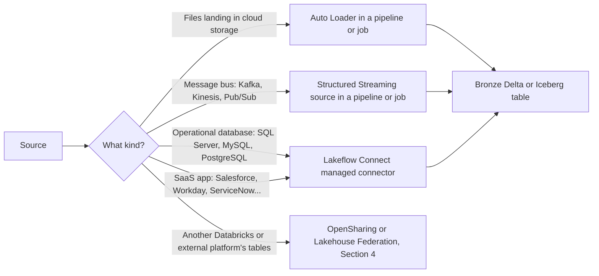

# Section 2: Data Ingestion & Acquisition

The exam page weights this section at 7%. The 2026-10-09 exam guide PDF folds sharing and federation into it and weights the combined section at 12%; sharing and federation have their own note here, [Section 4](04-data-sharing-federation.md). This note covers getting data in: files in many formats, message buses, CDC feeds landing in Delta or Iceberg tables, and managed database connectors.

Source: the **[📖 exam page](https://www.databricks.com/learn/certification/data-engineer-professional)** and its linked exam guide.

## Table of Contents

1. [Choosing an ingestion method](#choosing-an-ingestion-method)
2. [File formats and what each needs](#file-formats-and-what-each-needs)
3. [Auto Loader in depth](#auto-loader-in-depth)
4. [Message buses: Kafka, Kinesis, Pub/Sub](#message-buses-kafka-kinesis-pubsub)
5. [Incremental CDC pipelines into Delta or Iceberg](#incremental-cdc-pipelines-into-delta-or-iceberg)
6. [Lakeflow Connect for SQL Server, MySQL and PostgreSQL](#lakeflow-connect-for-sql-server-mysql-and-postgresql)
7. [How the exam tests this section](#how-the-exam-tests-this-section)

---

## Choosing an ingestion method

Start every ingestion question by naming the source. The method follows from it.



The diagram shows the four families: files go through Auto Loader, event streams through a streaming source, databases and SaaS apps through Lakeflow Connect, and data that already lives in another platform is shared or federated rather than copied.

---

## File formats and what each needs

Every format reads with `spark.read.format(...)`, `spark.readStream.format("cloudFiles")` with `cloudFiles.format`, or the SQL table-valued function `read_files(...)`. What differs is how much schema each carries.

| Format | Carries a schema? | Things to set |
|---|---|---|
| **Delta** | Yes, with a transaction log | Read as a table (`spark.readStream.table`) not a path; streaming reads see each commit once |
| **Iceberg** | Yes, with metadata files | Read through Unity Catalog (managed Iceberg or a foreign Iceberg catalog) |
| **Parquet** | Yes, per file | Schema can differ between files; `mergeSchema` to union them |
| **JSON** | No | Infer or supply a schema; `multiLine` for one document spanning lines; nested fields become structs, or keep raw as `VARIANT` |
| **CSV** | No | `header`, `sep`, `quote`, `escape`, schema; `badRecordsPath` or rescued data for malformed rows |
| **Binary** (`binaryFile`) | Fixed | Produces `path`, `modificationTime`, `length`, `content`; use for images, PDFs, audio; `pathGlobFilter` to pick extensions |

Two practical points the exam likes. First, for semi-structured or unknown-shape data, land it in bronze as close to raw as possible (a `VARIANT` column or rescued data) and shape it in silver. Second, binary files are usually ingested so a later step can run `ai_parse_document` or a model on `content` (see [Section 3](03-data-transformation-quality.md#ai-functions-in-pipelines)).

**[📖 Binary file data source](https://docs.databricks.com/aws/en/query/formats/binary)** - columns and options for `binaryFile`

---

## Auto Loader in depth

**Auto Loader** (`format("cloudFiles")`) incrementally processes new files as they land. It records every discovered file in its checkpoint, so each file is processed exactly once, even across restarts and even with millions of files.

**File discovery modes:**

- **Directory listing** (default) lists the input path. Databricks optimises listing for lexically ordered paths, and it needs no extra cloud setup.
- **File notification** subscribes to cloud events (S3 event notifications via SNS/SQS, Azure Event Grid with a queue, Google Pub/Sub). It scales to very high file counts without listing. Newer runtimes can use **managed file events** on a Unity Catalog external location, which avoids per-stream queue setup.

**Schema handling:**

- `cloudFiles.schemaLocation` stores the inferred schema and its history. Required for inference and evolution.
- `cloudFiles.inferColumnTypes` infers real types for JSON and CSV (otherwise everything is a string).
- `cloudFiles.schemaHints` pins types for named columns, for example `"amount DECIMAL(12,2), ts TIMESTAMP"`.
- `cloudFiles.schemaEvolutionMode` decides what happens when a new column appears:

| Mode | On a new column |
|---|---|
| `addNewColumns` (default when no schema is given) | Stream fails once, schema is updated, restart picks up the new column |
| `rescue` | Schema never changes; unknown data goes to the `_rescued_data` column |
| `failOnNewColumns` | Stream fails until you update the schema yourself |
| `none` | New columns ignored; no rescue unless you set `rescuedDataColumn` |

The `_rescued_data` column also catches type mismatches (a string in an int column) and case-mismatched names, so nothing is silently lost. "Never stop the stream and never lose data" points to `rescue` mode or to `addNewColumns` run under a pipeline or job that restarts automatically.

**[📖 Auto Loader](https://docs.databricks.com/aws/en/ingestion/cloud-object-storage/auto-loader/)** - how it tracks files, discovery modes
**[📖 Schema inference and evolution](https://docs.databricks.com/aws/en/ingestion/cloud-object-storage/auto-loader/schema)** - modes, hints, rescued data
**[📖 Auto Loader options](https://docs.databricks.com/aws/en/spark/api-options)** - full option reference

---

## Message buses: Kafka, Kinesis, Pub/Sub

All three are Structured Streaming sources. They deliver **bytes plus metadata**; you parse the payload yourself.

```python
raw = (spark.readStream.format("kafka")
       .option("kafka.bootstrap.servers", "broker1:9092")
       .option("subscribe", "orders")
       .option("startingOffsets", "earliest")
       .load())

orders = raw.selectExpr("CAST(key AS STRING) AS key",
                        "parse_json(CAST(value AS STRING)) AS payload",
                        "topic", "partition", "offset", "timestamp")
```

- **Kafka** returns `key`, `value` (binary), `topic`, `partition`, `offset`, `timestamp`. Offsets live in the checkpoint, not in Kafka consumer groups. `maxOffsetsPerTrigger` caps batch size. Credentials come from a Unity Catalog service credential or secrets. In SQL pipelines, the `read_kafka()` table-valued function does the same.
- **Kinesis** (`format("kinesis")`) needs `streamName`, `region` and `initialPosition` (`latest`, `trim_horizon`, `at_timestamp`); payload is in `data`.
- **Pub/Sub** (`format("pubsub")`) needs a subscription, topic and project; payload is in `payload`.

Because a message bus retains data only for a limited time, the standard design is: stream raw messages into a bronze Delta table with almost no transformation, then parse and clean from bronze. If parsing has a bug, you replay from bronze, not from a bus that has already expired the data.

**[📖 Kafka](https://docs.databricks.com/aws/en/connect/streaming/kafka)** - options, authentication, `read_kafka`
**[📖 Kinesis](https://docs.databricks.com/aws/en/connect/streaming/kinesis)** - options and positions
**[📖 Pub/Sub](https://docs.databricks.com/aws/en/connect/streaming/pub-sub)** - subscription setup

---

## Incremental CDC pipelines into Delta or Iceberg

The objective is to configure a Lakeflow pipeline that applies a CDC feed incrementally, with either Delta or Iceberg as the target format. The CDC mechanics are the AUTO CDC flow from [Section 1](01-developing-code-python-sql.md#cdc-with-auto-cdc-scd-type-1-and-type-2): keys, `sequence_by`, delete condition, SCD type. What this objective adds is the target format.

- **Delta** is the default for every table a pipeline creates.
- **Iceberg**: Unity Catalog supports **managed Iceberg tables** (created `USING ICEBERG`), which Databricks and external Iceberg engines can both read and write through the Unity Catalog Iceberg REST catalog. A Delta table can also be made readable as Iceberg with **UniForm** (`delta.universalFormat.enabledFormats = 'iceberg'`), which writes Iceberg metadata alongside the Delta log.

The design choice: if the consumers are external engines that speak only Iceberg (Snowflake, Trino, Athena, a partner) and need the CDC result, write to an Iceberg target or enable UniForm. If every consumer is on Databricks, Delta keeps the most features (for example deletion vectors and change data feed). Check the current docs for which pipeline features support Iceberg targets before you rely on one; support has been widening through 2026.

A common end-to-end shape:

1. Lakeflow Connect or a Kafka source lands change events in bronze.
2. An AUTO CDC flow applies them, keyed and sequenced, into a silver streaming table (SCD Type 1 for the current state, Type 2 for history).
3. Materialized views build gold aggregates on top.

**[📖 Apache Iceberg in Databricks](https://docs.databricks.com/aws/en/iceberg/)** - managed Iceberg tables, UniForm, the Iceberg REST catalog
**[📖 Unity Catalog managed tables](https://docs.databricks.com/aws/en/tables/managed)** - Delta and Iceberg managed tables

---

## Lakeflow Connect for SQL Server, MySQL and PostgreSQL

**Lakeflow Connect** provides managed connectors that ingest from enterprise sources with almost no code. For SaaS apps it uses the app's API. For **databases** (SQL Server, MySQL, PostgreSQL) it reads the database's change log, so inserts, updates **and deletes** arrive incrementally.

Database connectors have two parts:

- An **ingestion gateway**: a pipeline running on classic compute, close to the database network, that reads the snapshot and then the change log and stages changes in a Unity Catalog volume.
- An **ingestion pipeline**: a serverless pipeline that applies the staged changes to Unity Catalog streaming tables (SCD Type 1 or Type 2), on a schedule.

Each database needs its change mechanism switched on first:

| Database | Source-side setup |
|---|---|
| SQL Server (incl. Azure SQL, RDS) | Enable **change tracking** (tables with a primary key) or **change data capture**, and grant a replication user |
| MySQL | Binary logging in row format (`binlog_format=ROW`) and a user with replication privileges |
| PostgreSQL | Logical replication (`wal_level=logical`), a publication for the tables, and a replication slot |

A **Unity Catalog connection** stores the host, port and credentials, so the pipeline never holds a password in code.

Compare the alternatives the exam offers as distractors. A nightly JDBC full read is simple but heavy, high-latency and misses hard deletes between runs. Exporting to CSV and using Auto Loader adds a step and also loses deletes. OpenSharing does not apply to an operational database. "Continuously replicate inserts, updates and deletes with minimal custom code" means a Lakeflow Connect managed connector.

**[📖 Lakeflow Connect](https://docs.databricks.com/aws/en/ingestion/lakeflow-connect/)** - managed and standard connectors
**[📖 SQL Server ingestion](https://docs.databricks.com/aws/en/ingestion/lakeflow-connect/sql-server-pipeline)** - gateway, pipeline, change tracking vs CDC
**[📖 PostgreSQL ingestion](https://docs.databricks.com/aws/en/ingestion/lakeflow-connect/postgresql)** - logical replication setup
**[📖 MySQL ingestion](https://docs.databricks.com/aws/en/ingestion/lakeflow-connect/mysql)** - binlog setup

---

## How the exam tests this section

- **Name the source first.** File, bus, database, SaaS, or someone else's platform. Each has one best answer.
- **Deletes are the tiebreaker.** Methods that reload snapshots or read files miss deletes; change-log based ingestion (Lakeflow Connect, Debezium into Kafka, Delta change data feed) keeps them.
- **Schema questions** are about Auto Loader modes and `_rescued_data`. "Without failing and without data loss" usually means rescue.
- **Format questions** turn on who reads the result. External Iceberg readers mean an Iceberg target or UniForm.

Continue with [Section 3: Data Transformation, Cleansing, and Quality](03-data-transformation-quality.md).
