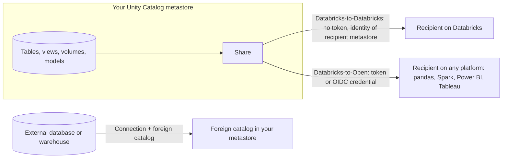

# Section 4: Data Sharing and Federation

The exam page lists "Data Sharing and Federation" as its own section (5%). The 2026-10-09 exam guide PDF places the same two objectives inside Data Ingestion & Acquisition. Either way, the exam wants you to know three ways of working with data you do not copy in: **OpenSharing** (formerly Delta Sharing), **Clean Rooms**, and **Lakehouse Federation**.

Source: the **[📖 exam page](https://www.databricks.com/learn/certification/data-engineer-professional)** and its linked exam guide.

## Table of Contents

1. [Share, federate, or ingest?](#share-federate-or-ingest)
2. [OpenSharing: Databricks-to-Databricks](#opensharing-databricks-to-databricks)
3. [OpenSharing: Databricks-to-Open](#opensharing-databricks-to-open)
4. [Clean Rooms](#clean-rooms)
5. [Lakehouse Federation](#lakehouse-federation)
6. [How the exam tests this section](#how-the-exam-tests-this-section)

---

## Share, federate, or ingest?

These three are easy to mix up. The direction of the data and who owns it decide which one fits.

| Need | Answer |
|---|---|
| Give another organisation or business unit read access to **your** tables, without copying | OpenSharing |
| Two or more parties analyse their combined data, but **none may see the others' raw rows** | Clean Rooms |
| Query data that lives in **another system** (PostgreSQL, Snowflake, BigQuery...) from Databricks, governed by Unity Catalog, without building a pipeline | Lakehouse Federation |
| Data must be transformed, joined at scale or kept with history | Ingest it (Section 2) |



The diagram shows the two outbound sharing paths from a share in your metastore, and the inbound federation path, where an external system appears as a read-only foreign catalog.

---

## OpenSharing: Databricks-to-Databricks

**OpenSharing** is the open protocol for zero-copy sharing that Databricks used to call Delta Sharing; the Linux Foundation hosts it. The recipient reads the provider's data in place, so there is no export, no copy to keep in sync, and the provider can revoke access at any time.

The objects:

- A **share** is a named, read-only collection of assets: tables, views, materialized views, streaming tables, volumes, models, notebooks.
- A **recipient** is who you share with.
- A **provider** object appears on the recipient's side, from which they create a catalog.

**Databricks-to-Databricks (D2D)** is for recipients who also have a Unity Catalog-enabled workspace. You identify the recipient by its **sharing identifier** (cloud, region and metastore ID). No token changes hands: Databricks handles authentication between the two metastores.

```sql
-- Provider
CREATE SHARE sales_share COMMENT 'Curated sales data for partner A';
ALTER SHARE sales_share ADD TABLE main.gold.daily_sales WITH HISTORY;
ALTER SHARE sales_share ADD SCHEMA main.partner_views;
CREATE RECIPIENT partner_a USING ID 'aws:us-east-1:<metastore-uuid>';
GRANT SELECT ON SHARE sales_share TO RECIPIENT partner_a;

-- Recipient
CREATE CATALOG partner_sales USING SHARE provider_x.sales_share;
```

What D2D adds over open sharing: sharing views, materialized views, volumes, models and notebooks; **`WITH HISTORY`**, which lets the recipient time travel, read the change data feed and **stream** from the shared table; and governance on the recipient side (they grant access to their own users with Unity Catalog). To share only some rows or columns, share a **view** that filters them; recipients cannot see the base table.

**[📖 What is OpenSharing?](https://docs.databricks.com/aws/en/opensharing)** - protocol, shares, recipients, providers
**[📖 Share data with Databricks recipients](https://docs.databricks.com/aws/en/opensharing/share-data-databricks)** - D2D setup and supported assets

---

## OpenSharing: Databricks-to-Open

**Databricks-to-Open (D2O)**, also called open sharing, is for recipients **not** on Databricks. The recipient gets credentials and reads with any OpenSharing client: the Python connector or pandas, Apache Spark, Power BI, Tableau, Excel and others.

Authentication options:

- **Bearer token**: you create the recipient, Databricks issues an **activation link**, and the recipient downloads a one-time credential file. Tokens have a lifetime you set; rotate them.
- **OIDC federation**: the recipient authenticates with its own identity provider (for example Entra ID or Okta), so no long-lived token is shared. This is the more secure option where available.

D2O supports tabular data (tables and views as tables). It is the answer when the question says "the partner does not use Databricks" and "no copies".

**[📖 Share data using the open sharing protocol](https://docs.databricks.com/aws/en/opensharing/share-data-open)** - D2O recipients, tokens, OIDC federation

---

## Clean Rooms

A **Databricks Clean Room** is a secure, isolated environment where several organisations bring data and run agreed analysis, while **no party sees another party's raw data**. Typical uses: an advertiser and a publisher measuring campaign overlap, two banks finding shared fraud patterns, a retailer and a supplier joining sales and inventory.

How it works:

1. One collaborator creates the clean room and invites others (each needs a Unity Catalog-enabled workspace with serverless compute). Under the hood it uses D2D sharing.
2. Each collaborator adds **assets** (tables, views, volumes) from its own metastore. Others can see the schema and metadata, not the rows.
3. Collaborators add **notebooks** with the agreed logic. A notebook written by one party is reviewed and approved by the others before it runs, so nobody can slip in a query that dumps raw rows.
4. A run executes on isolated serverless compute and writes to **output tables** that are shared back to the runner, temporarily.

Exam cues: "privacy-preserving", "neither party may see the other's records", "joint analysis" point to Clean Rooms. Plain sharing is wrong because it exposes rows; federation is wrong because it is about querying your own external sources.

**[📖 What is Databricks Clean Rooms?](https://docs.databricks.com/aws/en/clean-rooms/)** - collaborators, assets, notebooks, output tables

---

## Lakehouse Federation

**Lakehouse Federation** lets you query an external data system from Databricks as if it were a catalog in Unity Catalog. There are two flavours:

- **Query federation** pushes queries to an external database or warehouse (PostgreSQL, MySQL, SQL Server, Oracle, Redshift, Snowflake, BigQuery, Synapse, Teradata, another Databricks workspace and more) over JDBC. Filters and some aggregations are pushed down.
- **Catalog federation** reads the external system's **files** directly through its catalog (Hive metastore, AWS Glue, Snowflake Horizon), so Databricks compute reads the data without going through the source engine.

Setting it up has two objects:

```sql
-- 1. A connection: where the system is and how to log in
CREATE CONNECTION pg_sales TYPE postgresql
OPTIONS (host 'pg.internal', port '5432',
         user secret('fed', 'pg_user'), password secret('fed', 'pg_pass'));

-- 2. A foreign catalog: mirrors one database of that system
CREATE FOREIGN CATALOG pg_sales_cat USING CONNECTION pg_sales
OPTIONS (database 'sales');

GRANT USE CATALOG, USE SCHEMA, SELECT ON CATALOG pg_sales_cat TO `analysts`;
```

**Governance** is the point of this objective:

- **Connection-level credentials.** The connection holds one credential. Every Databricks user who queries the foreign catalog connects as that credential, so the external system cannot tell users apart. Access control therefore lives in **Unity Catalog**, not in the source.
- **Privileges.** Creating a connection needs `CREATE CONNECTION` on the metastore; creating a foreign catalog needs `CREATE FOREIGN CATALOG` on the metastore and `USE CONNECTION` (or ownership) on the connection. Querying needs `USE CATALOG`, `USE SCHEMA` and `SELECT`, like any table.
- **Read-only.** Foreign catalogs are for reading. Writes go to the source system by other means.
- **Lineage, audit, tags, row filters and column masks** apply to federated tables as they do to native ones, because Unity Catalog sits in the middle.

When to use federation instead of ingestion: ad hoc and exploratory queries, proof of concept before building a pipeline, small reference tables, or regulatory reasons to keep data in place. When not to: heavy, repeated analytics on large tables (each query hits the source, which is slow and loads the operational system). The usual answer for "we query it constantly" is to ingest it with Lakeflow Connect.

**[📖 What is Lakehouse Federation?](https://docs.databricks.com/aws/en/query-federation/)** - query vs catalog federation, supported sources
**[📖 Run federated queries on PostgreSQL](https://docs.databricks.com/aws/en/query-federation/postgresql)** - connection and foreign catalog example
**[📖 Catalog federation](https://docs.databricks.com/aws/en/query-federation/catalog-federation)** - reading through Hive metastore, Glue, Horizon
**[📖 CREATE CONNECTION](https://docs.databricks.com/aws/en/sql/language-manual/sql-ref-syntax-ddl-create-connection)** - syntax and options

---

## How the exam tests this section

- **Direction:** your data out to others is sharing; others' raw data never visible is Clean Rooms; external data into your queries is federation.
- **Recipient platform:** on Databricks is D2D (no token, more asset types, history and streaming); not on Databricks is D2O (token or OIDC).
- **Row or column restriction for a recipient:** share a view.
- **Federation governance:** one credential per connection, Unity Catalog permissions per user, foreign catalogs read-only.

Continue with [Section 5: Monitoring and Alerting](05-monitoring-alerting.md).
