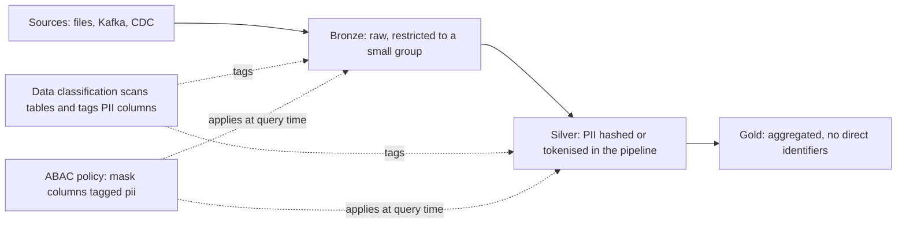

# Section 7: Ensuring Data Security and Compliance

Weighted 10% on the exam page and 8% in the 2026-10-09 exam guide PDF. The objectives move from basic access control to compliance engineering: least-privilege grants, attribute-based access control (ABAC) with governed tags, anonymisation and pseudonymisation, PII detection and masking across batch and streaming, and purging data to meet retention and right-to-erasure rules.

Source: the **[📖 exam page](https://www.databricks.com/learn/certification/data-engineer-professional)** and its linked exam guide.

## Table of Contents

1. [Least-privilege access control](#least-privilege-access-control)
2. [Row filters and column masks](#row-filters-and-column-masks)
3. [ABAC policies with governed tags](#abac-policies-with-governed-tags)
4. [Anonymisation and pseudonymisation](#anonymisation-and-pseudonymisation)
5. [A compliant pipeline: PII detection and masking](#a-compliant-pipeline-pii-detection-and-masking)
6. [Purging data for retention and right to erasure](#purging-data-for-retention-and-right-to-erasure)
7. [How the exam tests this section](#how-the-exam-tests-this-section)

---

## Least-privilege access control

Least privilege means each principal gets only the access its job needs, on the narrowest object that works. In Unity Catalog that comes down to four habits:

1. **Grant to groups, not users.** People change teams; groups (synced from the identity provider via SCIM) carry the access. Jobs and pipelines run as **service principals**, not as a person.
2. **Grant at the right level.** To read one table a user needs `USE CATALOG` on the catalog, `USE SCHEMA` on the schema, and `SELECT` on the table. Granting `SELECT` on a whole catalog is convenient but broad, because it is inherited by everything in it, including future tables ([Section 8](08-data-governance.md#the-permission-inheritance-model)).
3. **Separate read, write and manage.** `SELECT` reads; `MODIFY` writes; `CREATE TABLE` in a schema creates; `MANAGE` lets a non-owner grant privileges and manage the object; `ALL PRIVILEGES` is rarely appropriate. Ownership is the strongest right: give production objects to a group or service principal, never to an individual.
4. **Use `BROWSE` for discovery.** `BROWSE` lets users see that a table exists and read its metadata without reading data, so they can request access.

Workspace resources have their own **ACLs** separate from data: who can view, run or manage a job (`CAN VIEW`, `CAN MANAGE RUN`, `IS OWNER`, `CAN MANAGE`), use a cluster or SQL warehouse (`CAN ATTACH TO`, `CAN USE`), or edit a notebook or folder. Least privilege applies there too: analysts get `CAN MANAGE RUN` on a job, not `CAN MANAGE`; a job runs **as** a service principal so it does not depend on the author's personal rights.

```sql
GRANT USE CATALOG ON CATALOG prod TO `finance_analysts`;
GRANT USE SCHEMA ON SCHEMA prod.finance TO `finance_analysts`;
GRANT SELECT ON TABLE prod.finance.invoices TO `finance_analysts`;
GRANT MODIFY ON TABLE prod.finance.invoices TO `sp_finance_etl`;
REVOKE SELECT ON CATALOG prod FROM `all_users`;
```

**[📖 Manage privileges in Unity Catalog](https://docs.databricks.com/aws/en/data-governance/unity-catalog/manage-privileges/)** - grant, revoke, ownership
**[📖 Privileges reference](https://docs.databricks.com/aws/en/data-governance/unity-catalog/access-control/privileges-reference)** - every privilege and which object it applies to

---

## Row filters and column masks

Grants decide whether you can read a table. **Row filters** and **column masks** decide what you see inside it.

- A **row filter** is a SQL UDF returning `BOOLEAN`, attached to a table. Rows where it returns false are invisible to the querying user.
- A **column mask** is a SQL UDF that takes the column value and returns what the user should see (the value, a partial value, a hash, or null).

```sql
CREATE FUNCTION prod.sec.region_filter(region STRING)
RETURN is_account_group_member('global_admins') OR region = 'US';

CREATE FUNCTION prod.sec.mask_ssn(ssn STRING)
RETURN CASE WHEN is_account_group_member('hr_admins') THEN ssn
            ELSE concat('***-**-', right(ssn, 4)) END;

ALTER TABLE prod.hr.employees SET ROW FILTER prod.sec.region_filter ON (region);
ALTER TABLE prod.hr.employees ALTER COLUMN ssn SET MASK prod.sec.mask_ssn;
```

They apply everywhere the table is read: SQL, notebooks, BI tools, shares to D2D recipients. They replace the older pattern of **dynamic views** (a view with `CASE WHEN is_member(...)` that users query instead of the base table), which still works and is still the way to restrict what you share, but duplicates objects.

The limit is scale: these are set **per table**. With hundreds of tables containing PII, someone must remember to attach a mask to every new column. That is the problem ABAC solves.

**[📖 Row filters and column masks](https://docs.databricks.com/aws/en/data-governance/unity-catalog/filters-and-masks)** - syntax, limitations, comparison with dynamic views

---

## ABAC policies with governed tags

**Attribute-based access control (ABAC)** moves the rule from the table to a **policy** that matches objects by their **tags**. Write the rule once at a catalog or schema; every table and column carrying the tag is covered, **including tables created later**.

Two building blocks:

- **Governed tags** are account-level tag definitions with a fixed key, an optional list of allowed values, and permissions on who may assign them. Because not everyone can apply them and values are controlled, they are safe to base security on (unlike free-form tags anyone could add or remove).
- **Policies** (`CREATE POLICY`) attach a row filter or column mask UDF to all matching tables or columns under a catalog, schema or table, for a set of principals, with exceptions.

```sql
-- Mask every column tagged pii=ssn under the schema, for analysts, except admins
CREATE FUNCTION prod.sec.last4(v STRING, n INT) RETURNS STRING RETURN right(v, n);

CREATE POLICY mask_ssn
ON SCHEMA prod.customers
COLUMN MASK prod.sec.last4
TO `us_analysts` EXCEPT `admins`
FOR TABLES
MATCH COLUMNS has_tag_value('pii', 'ssn') AS ssn
ON COLUMN ssn
USING COLUMNS (4);

-- Hide EU rows from US analysts in any highly sensitive table that has a geo_region column
CREATE FUNCTION prod.sec.non_eu(r STRING) RETURNS BOOLEAN RETURN r <> 'eu';

CREATE POLICY hide_eu
ON SCHEMA prod.customers
ROW FILTER prod.sec.non_eu
TO `us_analysts`
FOR TABLES
WHEN has_tag_value('sensitivity', 'high')
MATCH COLUMNS has_tag('geo_region') AS region
USING COLUMNS (region);
```

Creating a policy needs `MANAGE` on the securable (or ownership) and `EXECUTE` on the UDF. The tags must be governed tags. Policies are inherited downward from where they are defined.

Choose ABAC when the question says "hundreds of tables", "central", "current and future tables", or "without altering each table". Choose a per-table mask or filter for one or two tables with a specific rule.

**[📖 Unity Catalog attribute-based access control](https://docs.databricks.com/aws/en/data-governance/unity-catalog/abac/)** - concepts and requirements
**[📖 Create and manage ABAC policies](https://docs.databricks.com/aws/en/data-governance/unity-catalog/abac/policies)** - policy syntax and examples
**[📖 CREATE POLICY](https://docs.databricks.com/aws/en/sql/language-manual/sql-ref-syntax-ddl-create-policy)** - SQL reference
**[📖 Governed tags](https://docs.databricks.com/aws/en/admin/governed-tags/)** - defining tags and who can assign them

---

## Anonymisation and pseudonymisation

These words have legal meaning (GDPR uses both), and the exam expects the right technique for each.

- **Pseudonymisation** replaces an identifier with a stand-in, but the data can still be linked back to the person **with additional information** that is kept separately. Pseudonymised data is still personal data.
- **Anonymisation** removes the link irreversibly. Properly anonymised data is no longer personal data.

| Technique | What it does | Reversible? | Example |
|---|---|---|---|
| **Hashing** (salted) | One-way function of the value | No, but the same input always gives the same output, so joins still work | `sha2(concat(email, secret_salt), 256)` |
| **Tokenisation** | Replace the value with a random token; the token-to-value map is stored in a secured lookup table | Yes, for whoever holds the map | `customer_id -> tok_8f3a...` |
| **Suppression** | Remove or null the value entirely | No | Drop the name column; mask returns `NULL` |
| **Generalisation** | Reduce precision | No | Birth date to birth year; postcode to first three characters; exact salary to a band |

Hashing and tokenisation are **pseudonymisation**: they keep analytical joins working across tables. Suppression and generalisation (combined well enough that individuals cannot be re-identified) move towards **anonymisation**. Unsalted hashes of small value spaces (phone numbers, national IDs) can be reversed by brute force, so always salt with a secret kept in a secret scope.

In Databricks, apply them with **column masks** (show the hash or the generalised value to most users and the real value to a privileged group), with ABAC policies to cover every tagged column, or by writing a pseudonymised silver table and restricting the raw bronze table to a small group.

**[📖 sha2 function](https://docs.databricks.com/aws/en/sql/language-manual/functions/sha2)** - SHA-2 hashing in SQL

---

## A compliant pipeline: PII detection and masking

The objective asks for a pipeline that **finds** PII and **masks** it across batch and streaming. Put the pieces together:



The diagram shows PII controls at two points: transformation-time (hashing or tokenising in the silver step) and query-time (ABAC masks keyed on tags that data classification applies automatically).

1. **Detect.** Unity Catalog **data classification** scans tables and automatically tags columns it recognises as sensitive (email, phone, national IDs, card numbers and more). New tables are scanned as they appear. For free text, `ai_mask` can redact entities inside strings.
2. **Tag.** Classification results become governed tags, which ABAC policies match.
3. **Mask at query time.** An ABAC column-mask policy on the catalog masks every tagged column for everyone except an approved group, including in streaming tables and materialized views produced by pipelines.
4. **Minimise at write time.** The silver step hashes or tokenises identifiers so most downstream data never contains raw PII. In a streaming pipeline the same function runs per micro-batch, so batch and streaming are treated alike.
5. **Restrict bronze.** Only the pipeline's service principal and a small group can read raw data.
6. **Audit.** `system.access.audit` shows who read the sensitive tables.

**[📖 Data classification](https://docs.databricks.com/aws/en/data-governance/unity-catalog/data-classification)** - automatic detection and tagging of sensitive data
**[📖 AI functions](https://docs.databricks.com/aws/en/large-language-models/ai-functions)** - `ai_mask` for redacting entities in text

---

## Purging data for retention and right to erasure

Deleting personal data from a lakehouse is harder than running `DELETE`, because Delta keeps history on purpose. A complete purge has to remove the data from **every place it still physically exists**:

| Where the data still lives after `DELETE` | How to remove it |
|---|---|
| The current table (if deletion vectors are on, the row is only **marked** deleted) | `REORG TABLE t APPLY (PURGE)` rewrites the files without the deleted rows |
| Old table versions kept for time travel | `VACUUM t` removes files no longer referenced and older than the retention period (default 7 days) |
| Change data feed files | Also removed by `VACUUM` after retention |
| Downstream tables, materialized views and streaming tables that already copied the row | Delete there too; propagate deletes with CDF or AUTO CDC, and full refresh materialized views if needed |
| Streaming sources | A `DELETE` on a streaming source breaks append-only readers; they need `skipChangeCommits` (or read the change feed instead) |

```sql
DELETE FROM silver.customers WHERE customer_id IN (SELECT id FROM ops.erasure_requests);
REORG TABLE silver.customers APPLY (PURGE);   -- needed when deletion vectors are enabled
VACUUM silver.customers;                       -- physically removes old files after retention
```

Design choices that make erasure easier:

- **Keep PII in as few tables as possible**, and pseudonymise everywhere else. Then erasure means deleting from one table (and its token map) instead of hundreds.
- **Crypto-shredding**: encrypt each person's PII with a per-person key and delete the key to make the data unreadable everywhere at once.
- **Retention**: set `delta.deletedFileRetentionDuration` and `delta.logRetentionDuration` to match policy (and keep `VACUUM` running, which Predictive Optimization does for managed tables). Shorter retention means faster erasure but less time travel.
- **Time-based retention** for whole datasets: delete rows older than N days on a schedule, then purge and vacuum.

**[📖 GDPR and CCPA compliance with pipelines and Delta](https://docs.databricks.com/aws/en/ldp/gdpr)** - delete, purge, vacuum, streaming implications
**[📖 VACUUM](https://docs.databricks.com/aws/en/tables/operations/vacuum)** - retention and what is removed
**[📖 REORG TABLE](https://docs.databricks.com/aws/en/sql/language-manual/delta-reorg-table)** - `APPLY (PURGE)` for deletion vectors

---

## How the exam tests this section

- **Many tables, one rule, future tables included** is ABAC with governed tags. Per-table masks and duplicated dynamic views are the distractors.
- **"Must still join on it"** is hashing or tokenisation (pseudonymisation). **"Must not be identifiable at all"** is suppression and generalisation (anonymisation).
- **Right to erasure** needs `DELETE` + `REORG ... APPLY (PURGE)` (with deletion vectors) + `VACUUM`, and downstream copies handled. `DELETE` alone is the trap, because time travel still returns the row.
- **Least privilege** answers grant to groups and service principals, at the narrowest level, with `USE CATALOG` and `USE SCHEMA` alongside `SELECT`.

Continue with [Section 8: Data Governance](08-data-governance.md).
