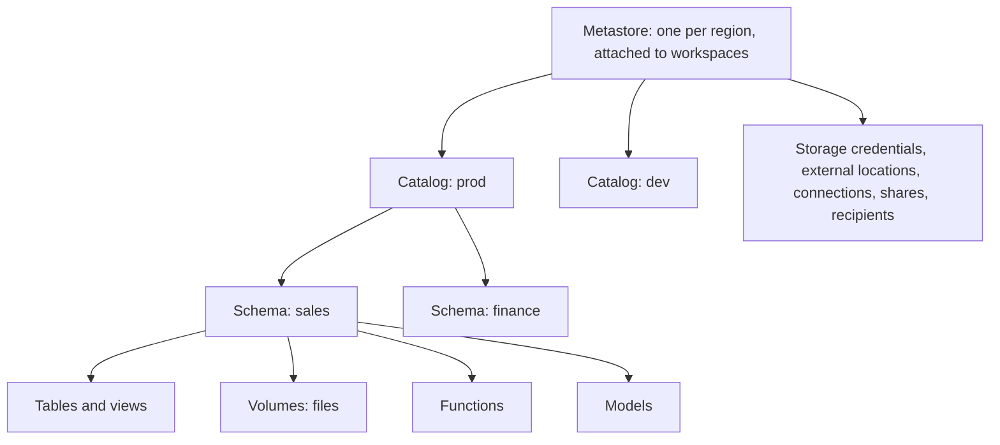

# Section 8: Data Governance

Weighted 7% on the exam page and 5% in the 2026-10-09 exam guide PDF. It has only two objectives, and both are foundations the security section builds on: **tags and comments** for discoverability, and the **permission inheritance model**. Questions here are short, but they reward knowing exactly how inheritance and ownership behave.

Source: the **[📖 exam page](https://www.databricks.com/learn/certification/data-engineer-professional)** and its linked exam guide.

## Table of Contents

1. [The Unity Catalog object model](#the-unity-catalog-object-model)
2. [The permission inheritance model](#the-permission-inheritance-model)
3. [Ownership and MANAGE](#ownership-and-manage)
4. [Tags and comments for discoverability](#tags-and-comments-for-discoverability)
5. [Lineage](#lineage)
6. [How the exam tests this section](#how-the-exam-tests-this-section)

---

## The Unity Catalog object model

Unity Catalog addresses every data object with a **three-level name**: `catalog.schema.object`.



The diagram shows the hierarchy: the metastore holds catalogs and account-level objects; catalogs hold schemas; schemas hold tables, views, volumes, functions and models. Privileges flow down this tree.

Catalogs usually separate environments (`dev`, `prod`) or business units; schemas separate domains or layers (`bronze`, `silver`, `gold`). A catalog can be **bound** to specific workspaces so, for example, `prod` data is not reachable from a dev workspace.

---

## The permission inheritance model

**A privilege granted on a container is inherited by every object inside it, including objects created later.**

- `SELECT` on catalog `prod` lets the grantee read every table and view in every schema of `prod`, now and in the future (they also need `USE CATALOG` and `USE SCHEMA`; granting `USE SCHEMA` at the catalog level is itself inherited by all schemas).
- `SELECT` on schema `prod.sales` covers every table in `sales`, including new ones.
- `SELECT` on a single table covers only that table.

Privileges are **additive**: the effective permission is the union of grants on the object, its parents, and every group the user belongs to. You cannot `REVOKE` a privilege on a child that was granted on its parent; to exclude a table, grant at a narrower level instead, or move the table, or use a row filter or ABAC policy.

The `USE` privileges are gates, not data access:

| Privilege | On | Means |
|---|---|---|
| `USE CATALOG` | Catalog | May reference objects in the catalog (needed for anything inside) |
| `USE SCHEMA` | Schema (or catalog, inherited) | May reference objects in the schema |
| `SELECT` | Table, view, or a container (inherited) | Read data |
| `BROWSE` | Catalog | See metadata of objects in Catalog Explorer and search without reading data |
| `EXECUTE` | Function | Call it |
| `READ VOLUME` / `WRITE VOLUME` | Volume | Read or write files |

So `SELECT` on a table without `USE CATALOG` on its catalog gives no access, and `USE CATALOG` alone gives no data. A typical analyst grant is `USE CATALOG` + `USE SCHEMA` + `SELECT` at the schema level.

```sql
-- One grant, covering all current and future tables in every schema of prod
GRANT USE CATALOG, USE SCHEMA, SELECT ON CATALOG prod TO `analysts`;

-- What can a principal do? Check grants on an object
SHOW GRANTS ON SCHEMA prod.sales;
SHOW GRANTS `analysts` ON CATALOG prod;
```

**[📖 Manage privileges in Unity Catalog](https://docs.databricks.com/aws/en/data-governance/unity-catalog/manage-privileges/)** - the inheritance model and grant syntax
**[📖 Privileges reference](https://docs.databricks.com/aws/en/data-governance/unity-catalog/access-control/privileges-reference)** - which privileges apply to which securable

---

## Ownership and MANAGE

Every securable has exactly one **owner** (a user, service principal or group). The owner has all privileges on the object and can grant them to others. Owners of a parent can manage children: the owner of a catalog can grant on any schema or table in it. Metastore admins can take ownership of anything.

- **Transfer ownership** with ``ALTER TABLE t OWNER TO `data_platform` ``. Production objects should be owned by a group or service principal, so access does not break when a person leaves.
- **`MANAGE`** is the privilege that lets a non-owner grant and revoke privileges on an object, rename it, or drop it, without making them the owner. It is also inherited.

"Ownership" answers are wrong when the question only asks about reading data: granting `SELECT` never makes anyone an owner.

---

## Tags and comments for discoverability

A catalog with ten thousand tables is useless if nobody can find the right one. **Comments** and **tags** are the metadata that make data findable and understandable.

**Comments** are free-text descriptions on catalogs, schemas, tables, views, columns, volumes and functions:

```sql
COMMENT ON TABLE prod.sales.orders IS 'One row per order line. Source: ERP via Lakeflow Connect. Refreshed hourly.';
ALTER TABLE prod.sales.orders ALTER COLUMN net_amount COMMENT 'Amount after discounts, before tax, in EUR';
```

Comments appear in Catalog Explorer and search, and Databricks can **generate AI comments** to suggest descriptions from the table's schema and data, which a human then reviews.

**Tags** are key-value labels on catalogs, schemas, tables, columns, volumes and other objects:

```sql
ALTER TABLE prod.sales.orders SET TAGS ('domain' = 'sales', 'tier' = 'gold', 'owner_team' = 'revenue');
ALTER TABLE prod.sales.orders ALTER COLUMN email SET TAGS ('pii' = 'email');
SELECT * FROM prod.information_schema.column_tags WHERE tag_name = 'pii';
```

Tags drive three things:

- **Discovery.** Search and filter in Catalog Explorer by tag ("show me every certified gold table in the sales domain").
- **Classification and policy.** Governed tags feed ABAC policies ([Section 7](07-security-compliance.md#abac-policies-with-governed-tags)).
- **Querying metadata.** `information_schema.table_tags` and `column_tags` let you audit, for example, which tables lack an owner tag.

Free-form tags can be applied by anyone with the right privilege on the object; **governed tags** restrict keys, values and who can assign them, so they are safe for policy.

**[📖 Apply tags to Unity Catalog securable objects](https://docs.databricks.com/aws/en/database-objects/tags)** - setting and querying tags
**[📖 Add comments to data and AI assets](https://docs.databricks.com/aws/en/comments/)** - manual and AI-generated comments
**[📖 Discover data](https://docs.databricks.com/aws/en/discover/)** - search and Catalog Explorer

---

## Lineage

Unity Catalog captures **lineage** automatically for queries run on Unity Catalog-enabled compute: which tables and columns each table, view, notebook, job, pipeline or dashboard reads and writes. You see it as a graph in Catalog Explorer and query it in `system.access.table_lineage` and `system.access.column_lineage`. It answers "what breaks if I change this column?" and "where did this number come from?", and it underpins impact analysis and audits. Lineage respects permissions: users see objects in the graph but not data they cannot read.

**[📖 View data lineage using Unity Catalog](https://docs.databricks.com/aws/en/data-governance/unity-catalog/data-lineage)** - lineage graph and system tables

---

## How the exam tests this section

- **Inheritance**: a grant on a catalog or schema covers objects created later. "They must be granted again for each new table" is the trap.
- **USE privileges**: `SELECT` without `USE CATALOG` and `USE SCHEMA` does not work.
- **No child-level revoke** of an inherited privilege.
- **Discoverability** is comments and tags; governed tags when the tag must be controlled or used for policy.

Continue with [Section 9: Debugging and Deploying](09-debugging-deploying.md).
