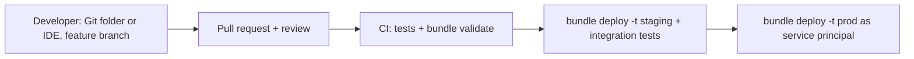

# Section 9: Debugging and Deploying

Weighted 10% on both the exam page and the 2026-10-09 exam guide PDF. Two halves: **debugging** (find the right diagnostic information, then repair failed runs) and **deploying** (Declarative Automation Bundles and Git folders for CI/CD).

Source: the **[📖 exam page](https://www.databricks.com/learn/certification/data-engineer-professional)** and its linked exam guide.

## Table of Contents

1. [Finding the diagnostic information](#finding-the-diagnostic-information)
2. [Common failures and what they look like](#common-failures-and-what-they-look-like)
3. [Repairing failed runs](#repairing-failed-runs)
4. [Deploying with Declarative Automation Bundles](#deploying-with-declarative-automation-bundles)
5. [CI/CD with Git folders](#cicd-with-git-folders)
6. [How the exam tests this section](#how-the-exam-tests-this-section)

---

## Finding the diagnostic information

Each tool shows a different layer. Go to the one that matches the symptom.

| Symptom | Where to look | What you find |
|---|---|---|
| Task failed with an exception | The task run's **output and error** in the job run page | The stack trace; usually the first "Caused by" is the real cause |
| Spark job slow or a stage hangs | **Spark UI**: Jobs, Stages, SQL / DataFrame tabs | Task duration distribution (skew), shuffle read/write, spill, failed tasks and executor losses |
| SQL or serverless query slow | **Query profile** | Operator time, files pruned, join type, spill ([Section 6](06-cost-performance-optimisation.md#reading-the-query-profile)) |
| Cluster will not start, library install failed, driver crashed | **Compute event log** and **driver logs** (stdout, stderr, log4j) | Cloud capacity or quota errors, init script failures, `OutOfMemoryError`, library resolution errors |
| Pattern across many runs: which jobs fail, when, cost | **System tables** (`system.lakeflow.*`, `system.compute.*`, `system.billing.usage`) | Failure rates, duration trends, node utilisation over time |
| Pipeline update failed | Pipeline UI and **event log** | Which flow failed, error message, expectation that failed the update |

**Reading the Spark UI** for the exam:

- **Stages tab, summary metrics.** Compare the median and max task duration. A max far above the median is **skew**: one partition holds much more data.
- **Spill (memory) / spill (disk)** above zero means partitions do not fit in memory; reduce partition size (more shuffle partitions, AQE), filter earlier, or use bigger memory.
- **Shuffle read/write** sizes show expensive exchanges.
- **Failed tasks** with `ExecutorLostFailure` often mean an executor was killed for memory; driver `OutOfMemoryError` often means a `collect()` or a huge broadcast.
- **Gaps** in the job timeline where no Spark job runs mean driver-side work (Python loops, pandas, listing files).

Cluster logs can be **delivered** to a volume or cloud storage (cluster log delivery) so they survive the cluster's termination; job clusters are gone once the run ends, so set this up for anything you will need to debug later.

**[📖 Spark UI guide](https://docs.databricks.com/aws/en/optimizations/spark-ui-guide/)** - diagnosing cost and performance with the Spark UI
**[📖 Diagnosing gaps in Spark jobs](https://docs.databricks.com/aws/en/optimizations/spark-ui-guide/spark-job-gaps)** - driver-side bottlenecks
**[📖 Compute troubleshooting](https://docs.databricks.com/aws/en/compute/troubleshooting/)** - start failures, logs, debugging
**[📖 Manage compute](https://docs.databricks.com/aws/en/compute/clusters-manage)** - event log, driver logs, log delivery

---

## Common failures and what they look like

| Error or symptom | Likely cause | Fix |
|---|---|---|
| `OutOfMemoryError` on the driver | `collect()`, `toPandas()`, broadcasting a large table | Keep work distributed; write results to a table; raise the broadcast threshold only if the side is truly small |
| Executor lost, container killed | Skewed partition or too-large partitions | AQE skew join, more shuffle partitions, salting, more memory per core |
| `ConcurrentAppendException` / `ConcurrentDeleteReadException` | Two writers conflicting on the same files | Liquid Clustering or deletion vectors for row-level concurrency; make writes touch disjoint data; retry |
| Streaming query fails after a code change | Incompatible change with the existing checkpoint | Restart with a new checkpoint (and reprocess) or revert the change |
| `AnalysisException: cannot resolve column` | Schema changed upstream | Schema evolution settings, or fix the upstream contract |
| Library `ModuleNotFoundError` in a job but not in a notebook | Dependency installed with `%pip` in the session only | Declare it on the task or environment ([Section 1](01-developing-code-python-sql.md#troubleshooting-library-installs)) |
| `PERMISSION_DENIED` in a job that works for you | Job runs as a different identity | Grant to the job's run-as service principal |

---

## Repairing failed runs

When one task in a 20-task job fails, re-running the whole job wastes time and money and may double-process successful tasks. **Repair run** re-runs **only the failed and skipped tasks** (and tasks that depend on them), reusing the successful tasks' results from the original run. The repair attaches to the same run, so history shows the original attempt and the repair.

When repairing you can:

- Select which tasks to re-run (by default, failed tasks and their dependents).
- **Override parameters**: change job parameters (or a task's parameters on legacy jobs) for the repair, for example correct a wrong `run_date` that caused the failure.
- Repair from the UI ("Repair run"), the CLI (`databricks jobs repair-run <run_id> --rerun-all-failed-tasks`) or the API (`POST /api/2.2/jobs/runs/repair` with `rerun_tasks` and `job_parameters`).

The workflow: open the failed run, read the failing task's error, fix the cause (code, data, permission, or a parameter), then repair. If the fix was a code change, deploy it first: the repair uses the current task definition.

Contrast with **retries**, which re-run a task automatically on failure without a human, and are right only for transient failures in idempotent tasks.

**[📖 Troubleshoot and repair job failures](https://docs.databricks.com/aws/en/jobs/repair-job-failures)** - repair runs and parameter overrides
**[📖 Job parameters](https://docs.databricks.com/aws/en/jobs/parameters)** - defining and overriding parameters

---

## Deploying with Declarative Automation Bundles

A **Declarative Automation Bundle** (formerly Databricks Asset Bundle, renamed in March 2026 with no change to files or commands) describes Databricks resources (jobs, pipelines, dashboards, schemas, volumes, model serving endpoints, apps and more) in YAML, next to the code that runs in them. The Databricks CLI validates and deploys the bundle to one or more **targets**.

```yaml
# databricks.yml
bundle:
  name: orders_etl

include:
  - resources/*.yml

variables:
  catalog:
    description: Target catalog
    default: dev
  notify:
    default: data-eng-dev@example.com

targets:
  dev:
    mode: development          # prefixes resource names with [dev <user>], pauses schedules
    default: true
    workspace:
      host: https://dev.cloud.databricks.com
  prod:
    mode: production           # requires run_as / permissions set, no user prefixes
    workspace:
      host: https://prod.cloud.databricks.com
      root_path: /Workspace/Shared/.bundle/${bundle.name}/${bundle.target}
    run_as:
      service_principal_name: 9f2c...-sp-orders
    variables:
      catalog: prod
      notify: data-eng-oncall@example.com
```

```yaml
# resources/orders_job.yml
resources:
  jobs:
    orders_job:
      name: orders_job
      email_notifications:
        on_failure: [ "${var.notify}" ]
      tasks:
        - task_key: refresh_pipeline
          pipeline_task:
            pipeline_id: ${resources.pipelines.orders_pipeline.id}
        - task_key: publish
          depends_on: [ { task_key: refresh_pipeline } ]
          notebook_task:
            notebook_path: ../src/publish.ipynb
            base_parameters: { catalog: "${var.catalog}" }
```

The lifecycle commands:

| Command | Does |
|---|---|
| `databricks bundle init` | Create a project from a template |
| `databricks bundle validate -t prod` | Check the configuration resolves |
| `databricks bundle plan -t prod` | Preview what deploy would change |
| `databricks bundle deploy -t prod` | Upload files, build artifacts, create or update resources |
| `databricks bundle run -t prod orders_job` | Run a deployed job or pipeline |
| `databricks bundle destroy -t dev` | Remove everything the bundle deployed to that target |

Key behaviours: **development mode** gives each developer an isolated, prefixed copy of the resources with schedules paused; **production mode** checks that the deployment is not tied to a personal identity. **Variables** and per-target overrides change values (catalog, cluster size, notification address) without changing the resource definitions. References like `${resources.pipelines.orders_pipeline.id}` wire resources together. Deployments are tracked in a state file in the workspace, and newer CLI versions can deploy directly without the older Terraform-based engine.

**[📖 What are Declarative Automation Bundles?](https://docs.databricks.com/aws/en/dev-tools/bundles/)** - concepts and workflow
**[📖 Bundle configuration](https://docs.databricks.com/aws/en/dev-tools/bundles/settings)** - `databricks.yml` reference
**[📖 Deployment modes](https://docs.databricks.com/aws/en/dev-tools/bundles/deployment-modes)** - development vs production
**[📖 Substitutions and variables](https://docs.databricks.com/aws/en/dev-tools/bundles/variables)** - per-target values
**[📖 Bundle resources](https://docs.databricks.com/aws/en/dev-tools/bundles/resources)** - supported resource types

---

## CI/CD with Git folders

**Git folders** (formerly Repos) are workspace folders backed by a Git repository. Inside the workspace you can clone, create and switch branches, pull, commit and push, and resolve merge conflicts, so notebooks and files are versioned like any other code.

Two CI/CD patterns, and when each fits:

**Pattern 1: bundles from CI (recommended).** Developers work in Git folders or a local IDE on feature branches and open pull requests. On merge to `main`, a CI runner (GitHub Actions, Azure DevOps, GitLab) authenticates as a service principal (ideally with OAuth workload identity federation rather than a stored secret), runs tests, and runs `databricks bundle deploy -t prod`. Jobs reference the deployed files, so production runs exactly what was merged.

**Pattern 2: a production Git folder.** A Git folder in a shared production location is checked out to the release branch. CI calls the Repos API (`databricks repos update <id> --branch main`) to pull the latest commit after merge, and jobs run notebooks from that folder. Simpler, but only code is versioned, not the job definitions.

A related option: a job task can point **directly at a Git provider** (the job's Git source, with a branch, tag or commit), so each run checks out that reference fresh. Good for pinning a job to a tag.

Rules of thumb the exam follows: never edit production code in the workspace by hand; promote the same commit through dev, staging and prod; deploy as a service principal; and keep job definitions in source control (bundles) as well as the code.



The diagram shows the bundle-based promotion path: code moves from a feature branch through review and tests, then the same commit is deployed to staging and production by CI.

**[📖 Git integration for Databricks Git folders](https://docs.databricks.com/aws/en/repos/)** - supported operations and providers
**[📖 CI/CD with Git folders](https://docs.databricks.com/aws/en/repos/ci-cd)** - production Git folder pattern
**[📖 CI/CD on Databricks](https://docs.databricks.com/aws/en/dev-tools/ci-cd/)** - recommended workflow with bundles

---

## How the exam tests this section

- **Symptom to tool**: skew and spill are Spark UI or query profile; start failures are the compute event log; trends across runs are system tables; the exception is in the task output.
- **"Re-run only what failed, with a corrected parameter"** is repair run with parameter overrides. Re-running the whole job is the trap.
- **"Same definitions to dev, staging and prod with per-environment values"** is a bundle with targets and variables, deployed with `databricks bundle deploy -t <target>`.
- **Git folders** are for versioning and branching in the workspace; production deploys come from CI as a service principal.

Continue with [Section 10: Data Modelling](10-data-modelling.md).
