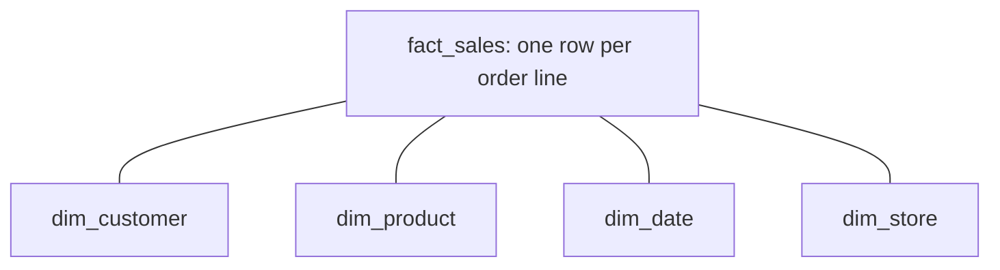

# Section 10: Data Modelling

Weighted 6% on the exam page and 5% in the 2026-10-09 exam guide PDF. Two objectives: design **physical table layouts** for large Delta or Iceberg tables, and design **dimensional models** that use materialized views for pre-computed aggregates and **Unity Catalog metric views** for governed metric definitions.

Source: the **[📖 exam page](https://www.databricks.com/learn/certification/data-engineer-professional)** and its linked exam guide.

## Table of Contents

1. [Physical layout: grain, partitioning, clustering, file size](#physical-layout-grain-partitioning-clustering-file-size)
2. [Dimensional models on the lakehouse](#dimensional-models-on-the-lakehouse)
3. [Materialized views for pre-computed aggregates](#materialized-views-for-pre-computed-aggregates)
4. [Metric views for governed metrics](#metric-views-for-governed-metrics)
5. [Putting the layers together](#putting-the-layers-together)
6. [How the exam tests this section](#how-the-exam-tests-this-section)

---

## Physical layout: grain, partitioning, clustering, file size

The objective's wording is precise: map **partitioning to data grain**, align **clustering to relationship access patterns**, and keep **balanced file sizes through compaction**. Each part is a separate decision.

**1. Partitioning follows the grain and lifecycle of the data, not the query filters.** The grain is what one row represents and how data arrives (one row per event, arriving daily). If a very large table is loaded, retained and deleted by day, a partition on the event date matches that grain: a daily load writes one partition, a retention job drops whole old partitions, a backfill overwrites one day with `REPLACE WHERE`. Rules that still hold:

- Only partition large tables (as a rule of thumb, more than about 1 TB), and only so each partition holds at least about 1 GB.
- Only low-cardinality columns (date, region). Never IDs or timestamps.
- If you are not sure, do not partition; cluster instead.

**2. Clustering follows how tables are joined and filtered.** "Relationship access patterns" means the keys used to join and look up: a fact table's foreign keys (`customer_id`, `product_id`) and its date. Liquid Clustering on those columns puts related rows in the same files, so joins and filtered queries read few files. Cluster a dimension on its natural or surrogate key. `CLUSTER BY AUTO` picks keys from actual queries when the patterns are not stable ([Section 6](06-cost-performance-optimisation.md#liquid-clustering-and-cluster-by-auto)).

**3. File sizes must stay balanced.** Too many small files (from streaming or frequent small writes) means high metadata overhead and slow listing; a few huge files limit parallelism and skipping. Keep them healthy with:

- **Optimized writes** (shuffle before write so each partition writes fewer, larger files) and **auto compaction** (compact small files right after a write).
- `OPTIMIZE` (or Predictive Optimization) to compact and cluster.
- Databricks tunes the **target file size** automatically from table size; `delta.targetFileSize` overrides it when needed.

The same principles apply to **Iceberg** tables managed in Unity Catalog: Iceberg uses hidden partitioning transforms (for example `days(ts)`) and supports Liquid Clustering for managed Iceberg tables; compaction is still required.

**[📖 When to partition tables](https://docs.databricks.com/aws/en/tables/partitions)** - size thresholds and guidance
**[📖 Use liquid clustering for tables](https://docs.databricks.com/aws/en/tables/clustering)** - choosing keys
**[📖 Configure Delta Lake to control data file size](https://docs.databricks.com/aws/en/tables/tune-file-size)** - optimized writes, auto compaction, target size

---

## Dimensional models on the lakehouse

A **dimensional model** (Kimball style) splits analytical data into **facts** and **dimensions**.

- A **fact table** holds measurements of a business process at a declared grain: one row per order line, per payment, per page view. Columns are foreign keys to dimensions plus numeric measures (`quantity`, `net_amount`).
- A **dimension table** holds the descriptive context: customer, product, date, store. Columns are attributes people group and filter by.
- A **star schema** joins each fact directly to its dimensions. Fewer, wider joins are simpler and faster than a deeply normalised snowflake schema, which is why stars are the default for BI.



The diagram shows a star schema: one fact table at the centre, each dimension joined to it by a key.

On Databricks the model usually lives in the **gold** layer, built from silver:

- **Declare the grain first.** Every fact design question starts with "one row per what?". Mixing grains in one table double-counts.
- **Surrogate keys.** Use an identity column (`BIGINT GENERATED ALWAYS AS IDENTITY`) or a hash of the natural key, especially for SCD Type 2 dimensions where one natural key has many versions.
- **Slowly changing dimensions.** Type 1 overwrites, Type 2 keeps history with validity columns; AUTO CDC builds both ([Section 1](01-developing-code-python-sql.md#cdc-with-auto-cdc-scd-type-1-and-type-2)). Facts join to the dimension version valid at the event time.
- **Informational constraints.** Declare `PRIMARY KEY` and `FOREIGN KEY` constraints on Unity Catalog tables. They are not enforced, but they document the model and the optimizer can use `RELY` constraints to eliminate unnecessary joins.
- **Layout.** Cluster facts on the date and the most-used foreign keys; dimensions are small enough to be broadcast in joins.

**[📖 Data modeling on Databricks](https://docs.databricks.com/aws/en/transform/data-modeling)** - dimensional modelling, keys and constraints
**[📖 Medallion architecture](https://docs.databricks.com/aws/en/lakehouse/medallion)** - where the model sits

---

## Materialized views for pre-computed aggregates

Dashboards that aggregate a billion-row fact table on every load are slow and expensive. A **materialized view** stores the aggregated result and keeps it up to date, so dashboards read a small, ready table.

```sql
CREATE OR REPLACE MATERIALIZED VIEW gold.sales_daily_by_store
SCHEDULE EVERY 1 HOUR
AS SELECT d.calendar_date, s.store_name, SUM(f.net_amount) AS revenue, COUNT(*) AS order_lines
   FROM gold.fact_sales f
   JOIN gold.dim_date d  ON f.date_key = d.date_key
   JOIN gold.dim_store s ON f.store_key = s.store_key
   GROUP BY ALL;
```

On serverless, refreshes are **incremental** where possible: only changed source data is processed. Materialized views can be created in Databricks SQL (with a schedule or a trigger on source table updates) or inside a Lakeflow pipeline. They reflect updates and deletes in the sources, which a streaming table would not ([Section 1](01-developing-code-python-sql.md#streaming-table-or-materialized-view)).

**[📖 Materialized views](https://docs.databricks.com/aws/en/ldp/concepts/materialized-views)** - refresh, incremental refresh, scheduling

---

## Metric views for governed metrics

The other problem in BI is **inconsistent definitions**: "net revenue" is computed one way in the finance dashboard and another in the sales notebook, and the numbers disagree. A **Unity Catalog metric view** defines measures and dimensions **once**, in YAML, on top of a source table or star schema. Every tool (SQL, dashboards, Genie, BI tools) queries the same definition, governed and permissioned like any Unity Catalog object.

```sql
CREATE OR REPLACE VIEW gold.sales_metrics
WITH METRICS
LANGUAGE YAML
AS $$
  version: 1.1
  source: gold.fact_sales
  joins:
    - name: store
      source: gold.dim_store
      'on': source.store_key = store.store_key
  fields:
    - name: Order Month
      expr: DATE_TRUNC('MONTH', source.order_date)
    - name: Region
      expr: store.region
  measures:
    - name: Net Revenue
      expr: SUM(source.gross_amount - source.discount - source.refund)
    - name: Revenue per Order
      expr: SUM(source.gross_amount - source.discount - source.refund) / COUNT(DISTINCT source.order_id)
$$;

SELECT `Order Month`, `Region`, MEASURE(`Net Revenue`) AS net_revenue
FROM gold.sales_metrics
GROUP BY ALL;
```

The point of separating measures from dimensions: a ratio like "revenue per order" must be computed **after** grouping, not by averaging pre-computed ratios. The metric view applies the measure expression at whatever grouping the query asks for, so the answer is right at month, region or month-and-region level.

Materialized views and metric views solve different problems and are used together: metric views give **one definition**; materialized views give **speed** by pre-computing the heavy joins and aggregations underneath.

**[📖 Unity Catalog metric views](https://docs.databricks.com/aws/en/uc-semantics/metric-views)** - concepts, YAML, querying with `MEASURE`

---

## Putting the layers together

| Layer | Model | Physical design |
|---|---|---|
| Bronze | Source-shaped, append-only | Partition by ingest date only if huge; otherwise cluster by ingest time or `AUTO` |
| Silver | Cleaned, conformed entities; SCD history | Cluster on business keys; deletion vectors for frequent CDC merges |
| Gold | Star schema facts and dimensions | Facts clustered on date + foreign keys; dimensions small and broadcastable |
| Serving | Materialized views and metric views | Pre-aggregated, refreshed on schedule; one metric definition |

---

## How the exam tests this section

- **"Partition by customer_id"** or partitioning a small table is wrong. Partition (if at all) by a low-cardinality column matching the grain and lifecycle; cluster on join and filter keys.
- **Small-files problems** are fixed with optimized writes, auto compaction and `OPTIMIZE` / Predictive Optimization.
- **"One authoritative metric definition"** is a metric view. **"Dashboards are slow because they recompute joins"** is a materialized view. The question that has both problems wants both.
- **Grain** is the first decision in any fact table design.

Back to the [exam README](../README.md) or the [fact sheet](../fact-sheet.md).
