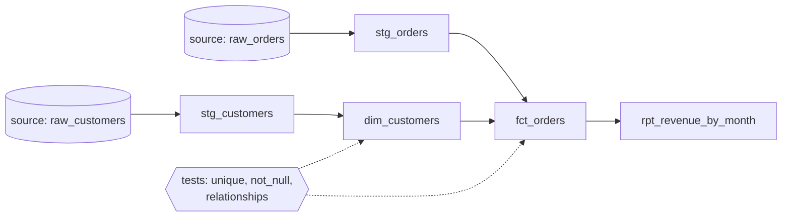

# Analytics engineering and dbt

> **12-minute read. Assumes comfortable SQL and the idea of [ELT](./etl-vs-elt.md). The hands-on follow-up is [Build a dbt project](../../resources/hands-on-projects/build-dbt-project.md).**

## The one-line answer

**Analytics engineering** is applying software engineering habits (version control, code review, tests, documentation, environments) to the SQL that turns raw warehouse tables into trusted models. **dbt** (data build tool) is the most widely used tool for it: you write `SELECT` statements, and dbt works out the order to build them in, runs them in the warehouse, and tests the results.

## The problem it solves

Before analytics engineering, transformation logic lived in a few common places, all bad:

- **Inside dashboards.** Each BI report had its own SQL. Three reports defined "active customer" three ways.
- **In scheduled stored procedures** nobody could review, test or roll back.
- **In a Python ETL codebase** that only the data engineers could change, so analysts waited weeks for a new column.

Once the warehouse became fast and cheap enough to do the transforming (the shift from ETL to [ELT](./etl-vs-elt.md)), the transformation step became "a pile of SQL in the warehouse". Analytics engineering is the discipline that keeps that pile maintainable.

The role sits between data engineering (getting raw data in, running the platform) and analysis (asking business questions). See [Data from Scratch](../data-from-scratch.md) phase 7 for how the roles differ.

## How dbt works

A dbt project is a folder of SQL files. Each file is a **model**: one `SELECT` that defines one table or view.

```sql
-- models/staging/stg_orders.sql
select
    id                       as order_id,
    customer                 as customer_id,
    cast(ordered_at as date) as order_date,
    status,
    amount_cents / 100.0     as amount
from {{ source('shop', 'raw_orders') }}
where _deleted is not true
```

```sql
-- models/marts/fct_orders.sql
select
    o.order_id,
    o.order_date,
    c.customer_key,
    o.amount
from {{ ref('stg_orders') }} o
join {{ ref('dim_customers') }} c using (customer_id)
where o.status <> 'cancelled'
```

The two pieces of templating do the heavy lifting:

- **`{{ source(...) }}`** points at a raw table loaded by something else, declared once in YAML.
- **`{{ ref(...) }}`** points at another model. dbt reads every `ref` to build a dependency graph (a DAG), runs models in the right order, and substitutes the correct schema for the environment (your dev schema or production).

You never write `CREATE TABLE`, and you never hand-maintain the run order.



The DAG dbt derives from `ref` and `source` calls. Staging models clean each raw table, marts combine them into facts and dimensions, and tests run against the built tables.

## The standard layers

Most projects follow the same three-layer layout, which maps onto the bronze/silver/gold idea from [Warehouses, lakes, and lakehouses](./warehouses-lakes-lakehouses.md):

| Layer | Prefix | Job | Rules |
|---|---|---|---|
| **Staging** | `stg_` | One model per source table. Rename, cast, light cleanup | No joins, no business logic. A 1:1 cleaned mirror |
| **Intermediate** | `int_` | Reusable building blocks between staging and marts | Not exposed to BI tools |
| **Marts** | `fct_`, `dim_` | Facts and dimensions for a business area | What analysts and dashboards query |

The point of staging is that if a source renames a column, you fix it in exactly one place.

## Materializations

Each model chooses how it exists in the warehouse:

| Materialization | What dbt builds | Use for |
|---|---|---|
| **view** | A view; computed on every query | Staging, light models |
| **table** | A full rebuild every run | Marts that are small enough to rebuild |
| **incremental** | Insert or merge only new rows each run | Large fact tables |
| **ephemeral** | Nothing; inlined as a CTE into models that use it | Small helper logic |
| **materialized view** | A warehouse-maintained materialized view | Where the platform supports it well |

Incremental models are where most of the cost savings and most of the bugs are:

```sql
{{ config(materialized='incremental', unique_key='order_id') }}

select * from {{ ref('stg_orders') }}

  where updated_at > (select max(updated_at) from {{ this }})

```

The trap: rows that arrive late with an older `updated_at` are skipped forever. Common fixes are a lookback window (`> max(updated_at) - interval '3 days'`) combined with the `unique_key` merge, and a periodic `--full-refresh`.

## Tests

dbt has two kinds of test, both of which compile to SQL that returns the rows that break the rule. Zero rows means pass.

**Generic data tests** are declared in YAML:

```yaml
models:
  - name: dim_customers
    columns:
      - name: customer_key
        data_tests: [unique, not_null]
  - name: fct_orders
    columns:
      - name: customer_key
        data_tests:
          - relationships:
              to: ref('dim_customers')
              field: customer_key
      - name: amount
        data_tests:
          - dbt_utils.accepted_range:
              min_value: 0
```

`unique` on every dimension key is the cheapest high-value test there is: it catches the join fan-out described in [SQL joins explained](./sql-joins-explained.md) before a dashboard double-counts.

**Singular tests** are any SQL file in `tests/` that should return no rows, for rules too specific for a generic test:

```sql
-- tests/assert_revenue_matches_source.sql
select 1
from (select sum(amount) a from {{ ref('fct_orders') }}) f,
     (select sum(amount_cents) / 100.0 b from {{ source('shop','raw_orders') }}
      where status <> 'cancelled' and _deleted is not true) s
where abs(f.a - s.b) > 0.01
```

dbt also supports **unit tests** (fixed input rows, expected output rows) for complex logic, and **model contracts** that enforce column names and types at build time; see [data contracts](./data-contracts.md).

`dbt build` runs models and their tests together in DAG order, and stops downstream models from building on top of a model whose tests failed. That one behavior turns "a wrong number reached the CEO" into "the pipeline stopped and paged someone".

## Snapshots, seeds, docs

- **Snapshots** record changes to a mutable source table over time, producing Type 2 history. See [slowly changing dimensions](./slowly-changing-dimensions.md).
- **Seeds** are small CSV files in the repo loaded as tables: country codes, mapping tables.
- **`dbt docs generate`** builds a browsable site of every model, column description and the lineage graph. It is a lightweight [catalog](./data-governance-and-catalogs.md) for the transformation layer.

## The everyday workflow

1. Branch in git. Change or add a model.
2. `dbt build --select my_model+` runs the model and everything downstream of it, with tests, in your personal dev schema.
3. Open a pull request. CI runs the changed models and their children against a CI schema (often with `state:modified+` so only what changed is built).
4. Review, merge, and the production job picks it up on its next run.

This is the whole value: data transformations get the same safety net as application code.

## dbt versions and products

- **dbt Core** is the open-source command-line tool (Apache 2.0 license). You run it anywhere, usually from an orchestrator.
- **dbt v2 / Fusion** is the newer engine, written in Rust, with faster parsing and SQL understanding built in. Current dbt Core 1.x releases announce that v2 is the default for new installations. Check its license and adapter support for your warehouse, and use the **[📖 upgrade guide](https://docs.getdbt.com/docs/dbt-versions/dbt-upgrade/upgrading-to-v2)** for existing projects. The concepts on this page apply to both.
- **dbt platform** (formerly dbt Cloud) is the hosted product: IDE, scheduler, CI, docs hosting, semantic layer.

Alternatives with the same idea include **SQLMesh**, **Dataform** (built into BigQuery), and the declarative pipeline features in Databricks and Snowflake (Dynamic Tables). The habits transfer between them.

## Common mistakes

- **Business logic in staging.** Keep staging boring, so source changes have one place to land.
- **No tests, or only `not_null`.** Start with `unique` and `not_null` on every key, `relationships` on every foreign key, and one reconciliation test per important mart.
- **Hard-coded table names** instead of `ref` and `source`. They break lineage and environment switching.
- **Incremental models without a late-data plan.**
- **Hundreds of marts nobody uses.** Every model is maintenance. Delete what no dashboard or person reads.

## Official docs

- **[📖 dbt: What is dbt?](https://docs.getdbt.com/docs/introduction)** - the product overview and core concepts
- **[📖 dbt: Add data tests to your DAG](https://docs.getdbt.com/docs/build/data-tests)** - generic and singular tests
- **[📖 dbt: Incremental models](https://docs.getdbt.com/docs/build/incremental-models)** - strategies, `unique_key`, and full refreshes
- **[📖 dbt: How we structure our dbt projects](https://docs.getdbt.com/best-practices/how-we-structure/1-guide-overview)** - the staging, intermediate and marts layout

## What to look at next

- **[Build a dbt project](../../resources/hands-on-projects/build-dbt-project.md)** - a tested star schema, step by step
- **[Data modeling for analytics](./data-modeling-for-analytics.md)** - what the marts layer should look like
- **[Data quality and lineage](./data-quality-and-lineage.md)** - tests in the wider context of trusting data
- **[Data pipelines and orchestration](./data-pipelines-and-orchestration.md)** - running `dbt build` on a schedule after the loads finish
