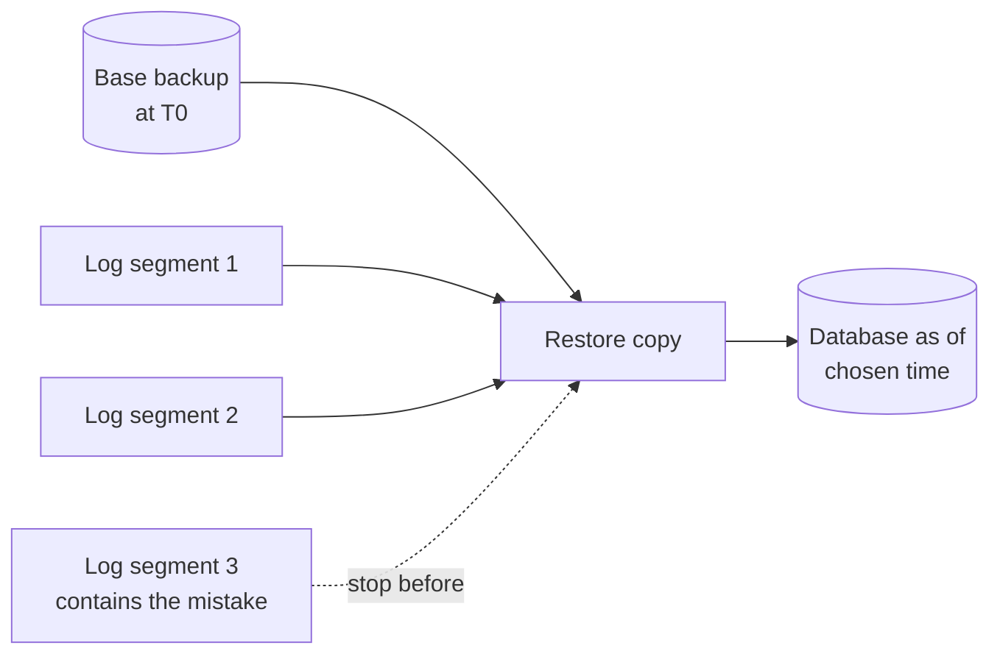

# Backup and point-in-time restore

> **9-minute read. A backup you have never restored is a hope, not a backup.**

## The one-line answer

A **backup** is a copy of the data at one moment. **Point-in-time restore** (PITR) combines that copy with a continuous record of every change since, so you can rewind to a chosen second, for example just before someone ran `DELETE` without a `WHERE`.

## The two ingredients

1. **A base backup.** A full copy taken at some time T0.
2. **The change log, kept unbroken.** Relational databases already write every change to a log before changing the data files (the write-ahead log, WAL, in PostgreSQL and SQLite). Archiving that log somewhere safe is what makes PITR possible.

Restore = copy the base backup back, then replay the log forward and stop at the time you choose.



Point-in-time restore. The base backup is restored first, then archived log segments are replayed in order and replay stops at the target time, before the bad change.

## How PostgreSQL does it

The PostgreSQL manual describes continuous archiving this way (settings named exactly as on the page):

- Set `wal_level` to `replica` or higher, turn on `archive_mode`, and give an `archive_command` that copies each full WAL segment to safe storage. The command must succeed only when the copy did.
- Take a base backup with `pg_basebackup` (or the low-level `pg_backup_start()` / `pg_backup_stop()`). `pg_dump` cannot be used for this, because a logical dump lacks what WAL replay needs.
- Recovery needs an unbroken sequence of archived WAL from the start of the base backup onward. Test archiving before you rely on it.
- To restore: put the base backup in an empty data directory, set `restore_command` and a recovery target (such as a target time), create an empty `recovery.signal` file and start the server. Replay stops at the target.
- Each completed recovery starts a new **timeline**, so new WAL cannot overwrite the old history.

## How a managed service does it

Amazon RDS uploads transaction logs to S3 every five minutes, and you can restore to any time within the backup retention period. The restore always creates a **new** DB instance and does not touch the source. Stated on the RDS page: the `LatestRestorableTime` field shows how recent you can go, and the new instance loads data blocks from S3 in the background after it becomes available, so performance may be lower at first.

Two practical consequences: you must repoint the application (or copy the repaired rows back), and the recovery point is "up to about the last log upload", not "up to the second".

## A tiny demonstration

I ran this locally with Python's built-in `sqlite3` (SQLite 3.46.1). It is a **toy**: SQLite is not PostgreSQL, and the "archived log" is a Python list of statements standing in for WAL segments. What it shows is the shape of the idea. A base copy plus an ordered log lets you stop anywhere.

```python
db.execute("PRAGMA journal_mode=WAL")           # real SQLite WAL mode
# ... create table, insert 3 rows, checkpoint, copy file as base_backup.db
run(1, "UPDATE orders SET status='shipped' WHERE id=1")
run(2, "INSERT INTO orders VALUES (4,'paid')")
run(3, "DELETE FROM orders")                      # the mistake
```

Real output:

```text
journal_mode: wal
files: ['app.db', 'app.db-shm', 'app.db-wal', 'base_backup.db']
live now: []
restore to t=2: [(1, 'shipped'), (2, 'paid'), (3, 'paid'), (4, 'paid')]
restore to t=3: []
restore to t=0: [(1, 'paid'), (2, 'paid'), (3, 'paid')]
```

The `-wal` file really exists in WAL mode; SQLite's own WAL page says changes are appended there and copied back into the database file at checkpoints. SQLite itself has no built-in log archiving, so the replay part here is the toy.

## Decisions you actually make

| Question | Meaning |
|---|---|
| **RPO** (how much data may we lose) | How often the log is shipped. Continuous archiving gives a small RPO. A nightly dump gives up to a day. |
| **RTO** (how long to be back) | Restore plus replay plus repointing. Long replays mean long RTO, which is why base backups are repeated. |
| **Retention** | How far back you can rewind. Mistakes are often noticed days later. |
| **Where copies live** | Another account or region, so one compromised credential cannot delete both data and backups. |

## Common mistakes

- **Never testing a restore.** Run a restore drill on a schedule and time it.
- **Backups in the same failure domain** as the database.
- **A gap in the log.** One lost segment ends replay at the gap.
- **Treating replicas as backups.** A replica faithfully copies the `DELETE` too. See [Replication and sharding](./replication-and-sharding.md).
- **Forgetting the warehouse and lake.** Many warehouses offer their own time travel or snapshots (not covered or verified on this page, check your platform's docs).

## Official docs

- **[📖 PostgreSQL: Continuous archiving and point-in-time recovery](https://www.postgresql.org/docs/current/continuous-archiving.html)** - WAL archiving, base backups, recovery targets
- **[📖 Amazon RDS: Restoring a DB instance to a specified time](https://docs.aws.amazon.com/AmazonRDS/latest/UserGuide/USER_PIT.html)** - latest restorable time, new-instance restore
- **[📖 SQLite: Write-ahead logging](https://www.sqlite.org/wal.html)** - the WAL file, checkpoints, readers and writers

## What to look at next

- **[Transactions and ACID](./transactions-and-acid.md)** - why the log exists in the first place
- **[Change data capture](./change-data-capture.md)** - reading that same log for downstream systems
- **[Replication and sharding](./replication-and-sharding.md)** - why a replica is not a backup
