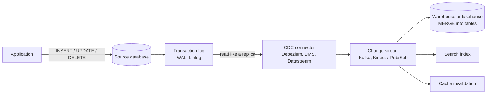

# Change data capture

> **11-minute read. Assumes you know what a pipeline and a transaction are. [OLTP vs OLAP](./oltp-vs-olap.md) explains why you need to copy data at all.**

## The one-line answer

**Change data capture** (CDC) turns every insert, update and delete in a database into a stream of change events, usually by reading the database's own transaction log. Downstream systems apply those events to stay in sync, within seconds, without querying the source tables.

It is the standard way to get operational data into a warehouse, lake, search index or cache once nightly full copies stop being good enough.

## The problem with re-reading tables

The simplest way to copy a table is `SELECT * FROM orders` every night. It works until:

- The table is 2 billion rows, and the nightly copy takes 6 hours and hammers production.
- The business wants data from 5 minutes ago, not last night.
- Rows are **deleted** at the source. A full copy notices; most incremental copies do not.

The usual next step is an **incremental query**:

```sql
SELECT * FROM orders WHERE updated_at > :last_run_time;
```

This is cheaper, but it has three blind spots:

1. **Deletes are invisible.** A deleted row has no `updated_at` to find.
2. **It trusts every writer to set `updated_at`.** One script or bulk fix that forgets, and the change is never copied.
3. **Intermediate states are lost.** If an order went `pending` to `paid` to `refunded` between two runs, you only see `refunded`.

CDC fixes all three by reading the log the database already writes for itself.

## How log-based CDC works

Every transactional database writes changes to a log before applying them, for crash recovery and replication: the WAL in PostgreSQL, the binlog in MySQL, the transaction log in SQL Server, the redo log in Oracle, the oplog or change streams in MongoDB, DynamoDB Streams for DynamoDB.

A CDC tool connects as if it were a replica, reads that log, and converts each change into an event.



Log-based CDC. The application does nothing differently; the connector reads the database's log and publishes each change, and any number of consumers apply it.

A typical change event, in the shape Debezium produces:

```json
{
  "op": "u",
  "ts_ms": 1771669812345,
  "source": { "db": "shop", "table": "orders", "lsn": 2849302 },
  "before": { "order_id": 90215, "status": "pending", "amount": 59.00 },
  "after":  { "order_id": 90215, "status": "paid",    "amount": 59.00 }
}
```

`op` is `c` (create), `u` (update), `d` (delete) or `r` (read, from the initial snapshot). Deletes carry a `before` and a null `after`. The log position (`lsn`) lets the connector resume exactly where it stopped.

## The three ways to capture changes

| Method | How | Pros | Cons |
|---|---|---|---|
| **Query-based** | Poll with `WHERE updated_at > ?` | Works anywhere, no special access | Misses deletes, relies on `updated_at`, loads the source |
| **Trigger-based** | Database triggers write each change to an audit table | Captures everything, including deletes | Adds work to every write transaction, in the hot path |
| **Log-based** | Read the transaction log | Complete, low impact on the source, ordered, near real time | Needs log access and configuration, more moving parts |

Log-based is the default for anything serious. Query-based remains fine for small tables, SaaS APIs that offer a "modified since" filter, and sources you cannot touch.

## Snapshot, then stream

A new CDC pipeline has a chicken-and-egg problem: the log only holds recent changes, but the target needs every existing row too. Connectors solve it by taking an **initial snapshot** (reading the tables, emitting `r` events) while noting the log position, then switching to streaming from that position. Tools like Debezium can also run **incremental snapshots** in chunks while streaming continues, so re-snapshotting one table does not stop the pipeline.

## Applying changes downstream: MERGE

Change events usually land in a raw table first (append-only, every event kept). A downstream step then applies them to a current-state table, latest event per key wins:

```sql
MERGE INTO analytics.orders AS t
USING (
  SELECT *
  FROM raw.orders_changes
  WHERE _batch_id = :batch
  QUALIFY ROW_NUMBER() OVER (PARTITION BY order_id ORDER BY lsn DESC) = 1
) AS s
ON t.order_id = s.order_id
WHEN MATCHED AND s.op = 'd' THEN DELETE
WHEN MATCHED THEN UPDATE SET status = s.status, amount = s.amount, updated_at = s.ts
WHEN NOT MATCHED AND s.op <> 'd' THEN INSERT (order_id, status, amount, updated_at)
  VALUES (s.order_id, s.status, s.amount, s.ts);
```

Three details make or break this:

- **Deduplicate within the batch** first (the `QUALIFY` line, see [window functions](./window-functions-explained.md)). One order can change five times in a batch, and `MERGE` fails or misbehaves when several source rows match one target row.
- **Order by log position**, not by timestamp. Two changes in the same millisecond have distinct log positions.
- **Make it idempotent.** CDC delivery is at-least-once. Replaying a batch must produce the same result.

Keeping the raw change table gives you history for free. It is the input for a Type 2 [slowly changing dimension](./slowly-changing-dimensions.md) and for auditing what a row looked like last Tuesday.

## The managed options

| | Tooling |
|---|---|
| **Open source** | Debezium (on Kafka Connect, or Debezium Server to Kinesis, Pub/Sub and others) |
| **AWS** | AWS DMS ongoing replication; DynamoDB Streams; Aurora zero-ETL integrations to Redshift |
| **Azure** | SQL Server and Azure SQL CDC; Cosmos DB change feed; Fabric mirroring |
| **GCP** | Datastream (MySQL, PostgreSQL, Oracle, SQL Server into BigQuery or Cloud Storage) |
| **Platforms** | Fivetran, Airbyte, Confluent connectors, Databricks Lakeflow Connect, Snowflake connectors |

The "zero-ETL" and "mirroring" features are CDC with the plumbing hidden. They are worth using when they cover your source and target, and you should still know what they do underneath when one falls behind.

## Things that go wrong

- **Log retention.** If the connector is down longer than the database keeps its log, the position it needs is gone, and you must re-snapshot. In PostgreSQL the opposite also bites: a replication slot that nobody is reading **holds** WAL forever and can fill the disk. Monitor slot lag.
- **Schema changes.** A column added, renamed or retyped at the source changes the shape of every event. Use a schema registry and decide what downstream does when the schema changes. This is the core argument for [data contracts](./data-contracts.md).
- **Large transactions.** A bulk `UPDATE` of 50 million rows becomes 50 million events in a burst.
- **Missing primary keys.** Without a key, a downstream `MERGE` cannot tell which row changed. Some sources need extra configuration (PostgreSQL `REPLICA IDENTITY`, MySQL `binlog_row_image = FULL`) to emit full before-images.
- **Sensitive data.** CDC copies every column, including ones that should never leave the source. Exclude or mask at the connector. See [Security Zero to Hero](https://security.noblerworks.com/) for data protection.

## CDC and the transactional outbox

CDC captures **row changes**, which are the source system's internal model. Downstream teams then couple themselves to that model, and a refactor of the source tables breaks them.

The **outbox pattern** separates the two: the application writes a deliberate, versioned business event ("OrderPaid") into an `outbox` table in the same transaction as its own changes, and CDC publishes only the outbox table. You get CDC's reliability with an interface the source team owns on purpose. See [Transactions and ACID](./transactions-and-acid.md) for why the same transaction matters.

## Official docs

- **[📖 Debezium documentation](https://debezium.io/documentation/reference/stable/index.html)** - connectors, event format, snapshots and the outbox router
- **[📖 AWS DMS: Ongoing replication with CDC](https://docs.aws.amazon.com/dms/latest/userguide/CHAP_Task.CDC.html)** - how DMS reads source logs
- **[📖 PostgreSQL: Logical replication](https://www.postgresql.org/docs/current/logical-replication.html)** - publications, subscriptions and replication slots underneath most PostgreSQL CDC

## What to look at next

- **[Slowly changing dimensions](./slowly-changing-dimensions.md)** - turning a change history into dimension versions
- **[Data contracts](./data-contracts.md)** - keeping a source schema change from breaking every consumer
- **[Queues vs streams](./queues-vs-streams.md)** - the transport CDC events travel on
- **[Build a streaming pipeline](../../resources/hands-on-projects/build-streaming-pipeline.md)** - a hands-on stream into a lake
- **[Database migration guide](../../resources/migration-guides/database-migration.md)** - CDC as the low-downtime migration technique
