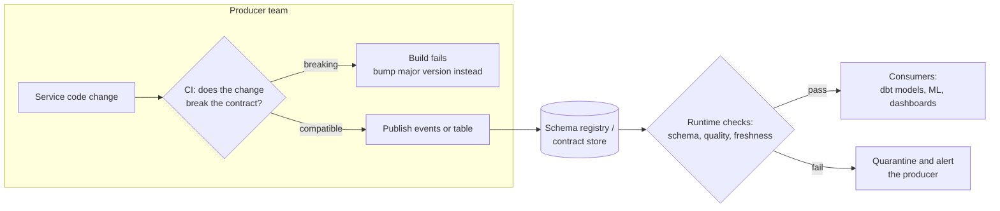

# Data contracts

> **10-minute read. Assumes you have met pipelines and schemas. [Data quality and lineage](./data-quality-and-lineage.md) is the natural lead-in.**

## The one-line answer

A **data contract** is an explicit, versioned agreement between the team that produces a dataset and the teams that consume it: the schema, what each field means, the quality and freshness guarantees, and how changes will be made. It is written as code and checked automatically, so a breaking change fails a build instead of a dashboard.

## The problem: everyone depends on things nobody promised

A typical failure:

1. The orders service team renames `amount` to `total_amount` in their database. A routine refactor. Their tests pass.
2. [Change data capture](./change-data-capture.md) copies the table into the lake, so the change flows through.
3. The nightly revenue model reads `amount`, gets nulls, and publishes revenue of zero.
4. Finance notices three days later.

Nobody did anything wrong by their own lights. The orders team never agreed that their internal table was an interface. The data team built on it anyway, because there was nothing else. The coupling was real, but invisible.

Data contracts make the coupling visible and deliberate. The producer publishes a dataset **as an interface**, with the same care a team gives a public API, and the consumers depend on that interface instead of internal tables.

## What goes in a contract

| Section | Example |
|---|---|
| **Schema** | Field names, types, nullability, keys |
| **Semantics** | "`amount` is the order total in EUR, including VAT, after discounts, before refunds" |
| **Quality rules** | `order_id` unique; `amount >= 0`; `status` in an allowed set |
| **Service levels** | Fresh within 15 minutes; 99.5% of days on time; complete by 02:00 UTC for the daily file |
| **Ownership and support** | Owning team, contact, on-call channel |
| **Versioning and change policy** | Semantic version; breaking changes need a new major version and 90 days' notice |
| **Classification** | `customer_email` is PII; retention 2 years |

A minimal contract in YAML, in the spirit of the Open Data Contract Standard:

```yaml
apiVersion: v3.0.0
kind: DataContract
id: orders-v2
name: orders
version: 2.1.0
status: active
owner: team-checkout
description: One row per placed order. Cancelled orders included, with status = cancelled.
schema:
  - name: orders
    physicalName: published.orders_v2
    properties:
      - name: order_id
        logicalType: string
        required: true
        unique: true
      - name: amount
        logicalType: number
        required: true
        description: Order total in EUR incl. VAT, after discounts, before refunds.
        quality:
          - rule: "amount >= 0"
      - name: status
        logicalType: string
        required: true
        description: One of placed, paid, shipped, cancelled.
      - name: customer_email
        logicalType: string
        classification: pii
slaProperties:
  - property: freshness
    value: 15
    unit: minutes
```

The exact format matters less than three properties: it lives in version control, a machine can read it, and something enforces it.

## Where contracts are enforced



Contracts enforced at two points: in the producer's CI, so breaking changes are caught before deployment, and at runtime, so bad data is quarantined before consumers read it.

The earlier the check, the cheaper the failure:

1. **Producer CI** - compare the proposed schema against the published contract. Block incompatible changes. This is the highest-value check, because it stops the problem before it exists.
2. **Schema registry at write time** - for event streams, a registry (Confluent Schema Registry, AWS Glue Schema Registry, Apicurio) rejects messages that do not match a registered schema and enforces compatibility rules between versions.
3. **At the boundary** - when data lands, run the contract's quality rules ([data quality checks](./data-quality-and-lineage.md)). Quarantine failures instead of passing them on.
4. **Consumer side** - dbt **model contracts** enforce that a model's output columns and types match its declaration, so a downstream change cannot silently alter the shape of a published mart.

```yaml
# dbt: enforce the shape of a published model
models:
  - name: fct_orders
    config:
      contract:
        enforced: true
    columns:
      - name: order_id
        data_type: varchar
        constraints: [{ type: not_null }]
      - name: amount
        data_type: numeric(12,2)
```

## Compatibility: what counts as breaking

Borrowed from schema registries, and worth knowing by name:

| Change | Backward compatible? | Why |
|---|---|---|
| Add an optional field | Yes | Old consumers ignore it |
| Add a required field with no default | No | Old messages lack it |
| Remove a field | No for anyone reading it | Consumers get nulls or errors |
| Rename a field | No | It is a remove plus an add |
| Widen a type (int to long) | Usually | Check your format's rules |
| Narrow a type or change units | No | And the unit change is the worst kind: no error, just wrong numbers |
| Change meaning without changing schema | No | The schema check passes; only the semantics section and a human catch it |

**Backward** compatibility means new readers can read old data. **Forward** means old readers can read new data. Most teams require backward compatibility for streams and use versioned tables (`orders_v2`) with an overlap period for breaking changes.

## Contracts and team structure

Contracts are as much an organizational tool as a technical one. They shift responsibility for data quality **upstream**, to the team that creates the data and is best placed to fix it. That is the central idea of the [data mesh](../../resources/architecture-patterns/data-mesh.md) pattern, where each domain publishes data products with contracts.

They only work if producers accept the obligation. Contracts imposed by a data team on producers who never agreed are just documentation of what the data team hopes for. Start with one willing producer and one painful dataset.

## When not to bother

Contracts have a cost: the producing team now maintains a public interface. They are worth it for datasets that are consumed by several teams, feed money or regulatory reporting, or have broken before. They are overkill for a scratch table one analyst uses.

## Common mistakes

- **Contracts that describe only the schema.** Most damaging breaks are semantic: units, inclusions, definitions.
- **Contracts on internal tables.** Publish a deliberate interface (a view, a topic, an outbox) and put the contract there, so the producer can still refactor internals.
- **No enforcement.** A YAML file nothing checks will drift from reality within a month.
- **No change path.** If there is no way to make a breaking change (new version, deprecation window), producers will work around the contract.

## Official docs

- **[📖 Open Data Contract Standard (Bitol)](https://bitol-io.github.io/open-data-contract-standard/latest/)** - an open, vendor-neutral contract specification under the Linux Foundation
- **[📖 dbt: Model contracts](https://docs.getdbt.com/docs/collaborate/govern/model-contracts)** - enforcing column names and types on published models
- **[📖 Confluent: Schema evolution and compatibility](https://docs.confluent.io/platform/current/schema-registry/fundamentals/schema-evolution.html)** - backward, forward and full compatibility for streams

## What to look at next

- **[Data quality and lineage](./data-quality-and-lineage.md)** - the checks a contract's quality section turns into
- **[Data governance and catalogs](./data-governance-and-catalogs.md)** - where contracts are published and found
- **[Change data capture](./change-data-capture.md)** - the outbox pattern, a contract-friendly CDC source
- **[Data mesh pattern](../../resources/architecture-patterns/data-mesh.md)** - data products owned by domains
