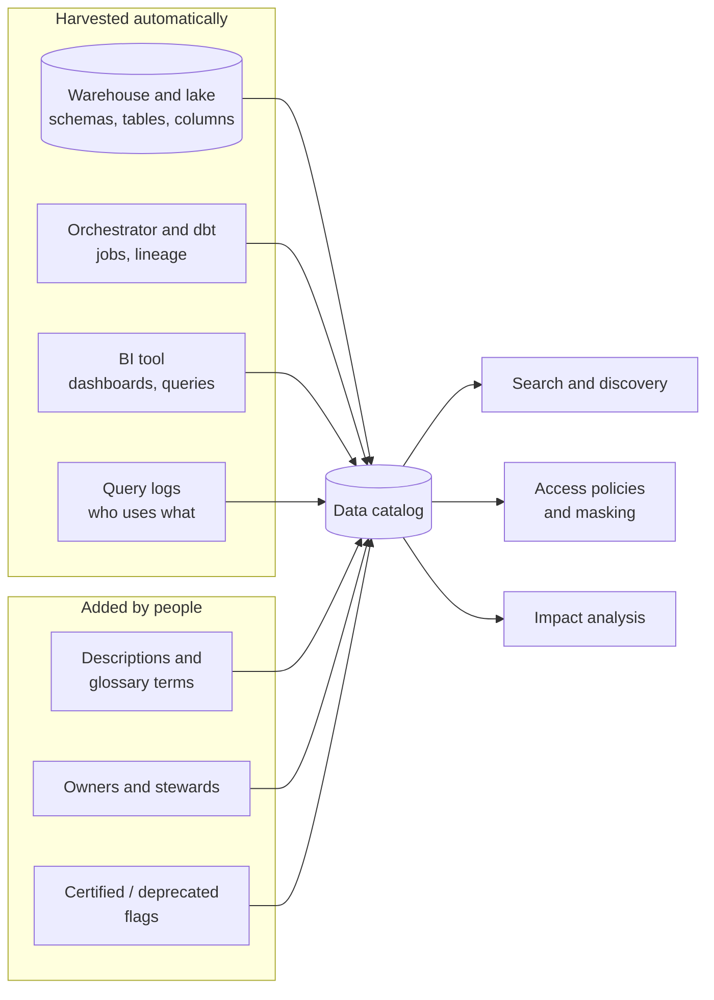

# Data governance and catalogs

> **11-minute read. Pairs with [Data quality and lineage](./data-quality-and-lineage.md). Identity, encryption and compliance law live on [Security Zero to Hero](https://security.noblerworks.com/).**

## The one-line answer

**Data governance** is the set of decisions and controls that say who owns each dataset, who may use it, what it means, how good it must be, and how long it is kept. A **data catalog** is the tool that makes those decisions findable and enforceable: a searchable inventory of every table, with owners, descriptions, lineage, classifications and access rules.

Done badly, governance is a committee that produces policy documents nobody reads. Done well, it is mostly automation that makes the right thing the easy thing.

## Why it becomes necessary

A ten-person company does not need governance. Everyone knows which table is real. Somewhere around a few hundred tables and a few dozen people who query them, the same problems start appearing everywhere:

- **"Which table do I use?"** Four tables called something like `customers`, and nobody knows which is current.
- **"What does this column mean?"** Is `revenue` gross or net? Before or after refunds?
- **"Who can see this?"** A table with customer emails and birth dates is readable by every analyst, and nobody decided that.
- **"Can we delete this?"** A regulator or a customer asks for data to be removed, and nobody knows every place it was copied to.
- **"Why did this number change?"** See [lineage](./data-quality-and-lineage.md).

Governance is the answer to all five, and a catalog is where the answers live.

## The pillars

| Pillar | The question it answers | Typical mechanism |
|---|---|---|
| **Ownership** | Who is accountable for this data? | An owner and a steward recorded on every dataset |
| **Discovery and meaning** | What exists, and what does it mean? | Catalog search, descriptions, a business glossary |
| **Classification** | How sensitive is it? | Tags such as `pii`, `confidential`, `public`, often auto-detected |
| **Access control** | Who may read or change it? | Grants, roles, row filters, column masks |
| **Quality** | Can I trust it? | Tests, freshness checks, published SLAs |
| **Lineage** | Where did it come from, and what depends on it? | Captured from SQL, orchestrators and jobs |
| **Lifecycle** | How long is it kept, and how is it deleted? | Retention policies, deletion workflows |

## Roles: owners and stewards

Two roles show up in every governance framework:

- A **data owner** is accountable for a dataset: usually a business leader (head of sales owns sales data). They decide who gets access and what "correct" means.
- A **data steward** does the day-to-day work: maintains definitions, answers questions, triages quality issues.

The single most effective governance step is putting a named owner on every important table. An unowned table is one nobody will fix.

## What a catalog contains



A catalog combines metadata it harvests automatically (technical schemas, lineage, usage) with metadata people add (meaning, ownership, endorsement), and serves search, policy and impact analysis from the result.

**Technical metadata** (schemas, types, row counts, partitions) is harvested from the platforms. **Operational metadata** (when it last loaded, how long it took, whether tests passed) comes from the orchestrator. **Business metadata** (what it means, who owns it, whether it is the certified version) has to come from people, which is why catalogs that rely on manual entry decay. The best catalogs harvest everything they can and ask people only for the things a machine cannot know.

**Usage** data is underrated. "This table is queried 4,000 times a week by 60 people" tells a newcomer which of the four `customers` tables is the real one faster than any description.

## Access control that scales

Granting access table by table to individuals does not scale. The patterns that do:

- **Role-based access control (RBAC)**: grant to roles (`analyst_finance`), put people in roles.
- **Attribute- or tag-based access control (ABAC)**: write a policy once - "columns tagged `pii` are masked unless the user is in `pii_readers`" - and it applies to every current and future column with that tag.
- **Row-level security**: one table, filtered per user. A regional manager sees only their region.
- **Dynamic masking**: the column is visible but shows `****@example.com` to most users.

```sql
-- Snowflake: a masking policy attached to a column
CREATE MASKING POLICY email_mask AS (val STRING) RETURNS STRING ->
  CASE WHEN IS_ROLE_IN_SESSION('PII_READER') THEN val
       ELSE REGEXP_REPLACE(val, '.+@', '****@') END;

ALTER TABLE customers MODIFY COLUMN email SET MASKING POLICY email_mask;
```

Tag-based policy is where a catalog pays for itself: classify a column once, and access control follows the tag everywhere it is copied, if the platform propagates tags through lineage.

## The tools

| | Catalog / governance product |
|---|---|
| **AWS** | AWS Glue Data Catalog (technical), Lake Formation (permissions), Amazon DataZone / SageMaker Catalog (business catalog) |
| **Azure** | Microsoft Purview (catalog, classification, lineage, data map) |
| **GCP** | Dataplex Universal Catalog (discovery, lineage, quality), BigQuery policy tags |
| **Databricks** | Unity Catalog (catalog, permissions, lineage, tags) |
| **Snowflake** | Horizon Catalog (tags, masking, lineage, access history) |
| **Open source** | DataHub, OpenMetadata, Apache Atlas, Unity Catalog OSS, Apache Polaris (Iceberg REST catalog) |
| **Commercial** | Atlan, Collibra, Alation |

Note a naming collision: **technical catalogs** like the Glue Data Catalog, Unity Catalog, Polaris or the Hive metastore are also what query engines use to find a table's files and schema. That is a different job from the human-facing discovery catalog, though modern products increasingly do both.

## Regulation in one paragraph

Laws such as GDPR, CCPA and HIPAA, and standards such as PCI DSS, are what turn governance from "nice" into "required". They demand that you know where personal data is, limit who sees it, keep it only as long as needed, and delete it on request. All four depend on classification and lineage. The legal and security detail is on [Security Zero to Hero](https://security.noblerworks.com/) and its [compliance guides](https://security.noblerworks.com/resources/compliance-guides/).

## Where to start

Governance programs fail when they start with a framework document and a committee. A sequence that works:

1. **Turn on the platform catalog** you already pay for (Unity Catalog, Purview, Dataplex, Horizon). Harvest schemas and lineage automatically.
2. **Name owners** for the 20 tables that matter most. Mark them certified.
3. **Auto-classify sensitive columns** and attach masking by tag.
4. **Describe** those 20 tables and their key columns, in the dbt YAML or the catalog, so the descriptions live next to the code.
5. **Deprecate** obvious duplicates, with a visible flag and a date.
6. **Measure** adoption: searches, certified-table usage, access requests.

## Common mistakes

- **Catalog as a one-off project.** Metadata entered by hand in a launch week is stale in a quarter.
- **Governance as gatekeeping.** If getting access takes three weeks, people copy data to spreadsheets, which is worse for everyone.
- **Classification without enforcement.** A `pii` tag that controls nothing is a label, not a control.
- **Ignoring copies.** The governed warehouse table is fine; the CSV exported from it last year is in someone's shared drive.

## Official docs

- **[📖 Databricks: What is Unity Catalog?](https://docs.databricks.com/aws/en/data-governance/unity-catalog/)** - catalog, permissions, lineage and tags in one layer
- **[📖 Microsoft Purview overview](https://learn.microsoft.com/en-us/purview/purview)** - data map, catalog, classification and lineage on Azure
- **[📖 AWS Lake Formation: What is Lake Formation?](https://docs.aws.amazon.com/lake-formation/latest/dg/what-is-lake-formation.html)** - fine-grained permissions over a lake on AWS
- **[📖 Snowflake: Column-level security](https://docs.snowflake.com/en/user-guide/security-column-intro)** - dynamic masking and external tokenization

## What to look at next

- **[Data quality and lineage](./data-quality-and-lineage.md)** - the trust half of governance
- **[Data contracts](./data-contracts.md)** - governance agreed between producer and consumer, enforced in code
- **[Data mesh pattern](../../resources/architecture-patterns/data-mesh.md)** - federated governance across domain teams
- **[IAM explained](https://security.noblerworks.com/learn/concepts/iam-explained/)** - the identity layer access control sits on
