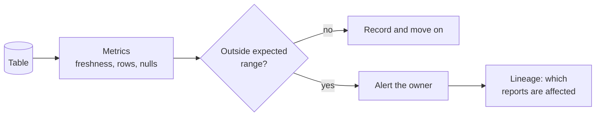

# Data observability

> **8-minute read. Knowing that data is wrong before the person using it does.**

## The one-line answer

**Data observability** is watching the health of your data the way you watch the health of a service: automatically, continuously, with alerts that reach the owner. Pipelines that "succeed" can still deliver empty, late or wrong tables. Observability is how you notice.

## Pipeline monitoring versus data monitoring

A green Airflow run tells you the code finished. It does not tell you the table has today's rows. Both need watching:

| Layer | Question | Example signal |
|---|---|---|
| **Job** | Did it run? | Task status, duration |
| **Data** | Is the output right? | Row count, freshness, nulls |
| **Use** | Who is hurt if it is wrong? | Lineage to dashboards and models |

## Signals worth watching

These are the common ones, in the order they usually pay off:

- **Freshness.** When was the table last updated, compared to when it should have been?
- **Volume.** Row count today versus the usual range. Zero rows and a doubling are both alarms.
- **Schema.** Did a column vanish, change type or arrive new?
- **Values.** Null rate, duplicate keys, values outside an allowed set.
- **Distribution.** The average order value suddenly halves while row counts look normal.

A data observability loop. Metrics are computed on a schedule, compared with an expectation (fixed or learned from history), and a breach alerts the owner and uses lineage to show the downstream blast radius.

## Two ways to build it

**Tests you write.** In dbt, a data test is a SQL `select` that returns failing rows; zero rows means pass. dbt ships four generic tests (`unique`, `not_null`, `accepted_values`, `relationships`), and its docs recommend `unique` and `not_null` on every model's primary key. See [Analytics engineering and dbt](./analytics-engineering-and-dbt.md).

**Monitors the platform runs.** Snowflake's data quality monitoring pairs a data metric function (such as a null count, or how often a table is updated) with an expectation, runs on a schedule (default hourly, adjustable), and reports violations. Its anomaly detection covers freshness and volume by comparing against a range predicted from history. It runs on serverless compute that uses credits, so monitoring itself has a cost. Other platforms and vendors offer similar features; check their docs.

Hand-written tests catch what you thought of. Learned monitors catch what you did not, at the price of some false alarms. Most teams use both.

## What makes it work

- **An owner for every alert.** An alert that goes to a shared channel nobody owns is noise.
- **Few, meaningful alerts.** Page on the tables that feed money or customers; log the rest.
- **Lineage.** Knowing a table is late is half the answer; knowing which dashboards it feeds is the other half. See [Data quality and lineage](./data-quality-and-lineage.md).
- **Contracts upstream.** The best fix for a schema alert is a producer who promised not to break it. See [Data contracts](./data-contracts.md).

## Common mistakes

- **Alerting on everything**, then muting the channel.
- **Only checking the pipeline**, not the output.
- **Thresholds that never adapt**, so every holiday pages someone.
- **No runbook.** Say what the owner should do first when an alert fires.

I did not run any of these tools for this page; the descriptions come from the docs below.

## Official docs

- **[📖 dbt: Data tests](https://docs.getdbt.com/docs/build/data-tests)** - singular and generic tests, the four built-ins
- **[📖 Snowflake: Data quality and data metric functions](https://docs.snowflake.com/en/user-guide/data-quality-intro)** - scheduled checks, freshness and volume anomaly detection

## What to look at next

- **[Data quality and lineage](./data-quality-and-lineage.md)** - the checks and the map
- **[Data contracts](./data-contracts.md)** - stopping breakage at the source
- **[Data pipelines and orchestration](./data-pipelines-and-orchestration.md)** - where job monitoring lives
