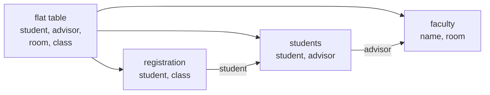

# Database normalization for OLTP

> **8-minute read. Store each fact once, so it can only be wrong once.**

## The one-line answer

**Normalization** organizes tables so each fact lives in one place. Microsoft's guide describes it as rules that protect the data and make the database more flexible "by eliminating redundancy and inconsistent dependency". It is the default shape for [OLTP](./oltp-vs-olap.md) databases, where many small writes must stay consistent.

## The problem: one wide table

Take a table where one row holds a student, the advisor, the advisor's office and a class. Using the example from the Microsoft page:

| student | advisor | adv_room | class |
|---|---|---|---|
| 1022 | Jones | 412 | 101-07 |
| 1022 | Jones | 412 | 143-01 |
| 1022 | Jones | 412 | 159-02 |

Jones's room is copied on every row. Change it in two rows out of three and the table now disagrees with itself.

## The first three normal forms

Plain-English versions, following the same page:

1. **First normal form (1NF).** No repeating groups: not `Class1, Class2, Class3` columns, but one row per class. Every row identified by a primary key.
2. **Second normal form (2NF).** Facts that apply to many rows get their own table, linked by a foreign key. A fact must depend on the whole key.
3. **Third normal form (3NF).** Remove columns that depend on something other than the key. The advisor's room depends on the advisor, not on the student, so it moves to a `faculty` table.

The page says third normal form is generally the highest level necessary for most applications, and that fourth and fifth exist but are rarely considered in practice.



The flat table split into three. Advisor details live once in `faculty`, and the other tables point to them by key.

## Run it

I ran this with Python's built-in `sqlite3` (SQLite 3.46.1), loading the six-row flat table, then splitting it:

```text
flat table, Jones moves office, rows touched: 3
normalized, same move, rows touched: 1
[(1022, 'Jones', 500, 3), (4123, 'Smith', 216, 3)]
rejected: FOREIGN KEY constraint failed
```

Three rows changed versus one for the same real-world fact. A join still rebuilds the wide view. The last line shows the database refusing a student whose advisor does not exist (with `PRAGMA foreign_keys=ON`, which SQLite needs per connection).

```sql
CREATE TABLE faculty (name TEXT PRIMARY KEY, room INT NOT NULL);
CREATE TABLE students (student INT PRIMARY KEY,
  advisor TEXT NOT NULL REFERENCES faculty(name));
CREATE TABLE registration (student INT REFERENCES students(student),
  class TEXT, PRIMARY KEY (student, class));
```

## When to stop (or undo it)

The Microsoft page is candid: perfect compliance is not always practical, many small tables can hurt performance, and if you break a rule your application must anticipate the redundancy and inconsistency that follows.

- **OLTP:** normalize to about 3NF. Writes touch one place, constraints do the checking.
- **Analytics:** denormalize on purpose into stars and wide tables, because reads dominate. See [Data modeling for analytics](./data-modeling-for-analytics.md).
- **Document stores:** embedding related data is the norm; see [SQL vs NoSQL](./sql-vs-nosql.md).

## Common mistakes

- **Comma-separated lists in a column**, which is a repeating group in disguise.
- **Copying a value "for speed"** without a plan to keep copies in sync.
- **No foreign keys**, so the relationships exist only in people's heads.
- **Normalizing the warehouse** the same way as the app database.

## Official docs

- **[📖 Microsoft: Database normalization description](https://learn.microsoft.com/en-us/office/troubleshoot/access/database-normalization-description)** - the first three normal forms with a worked example (an archived support article, written for Access but general)

## What to look at next

- **[Transactions and ACID](./transactions-and-acid.md)** - keeping multi-table writes consistent
- **[Indexes explained](./indexes-explained.md)** - what joins across normalized tables need
- **[SQL joins explained](./sql-joins-explained.md)** - putting the pieces back together

## Check yourself

Test your understanding. Click an answer to reveal it.

**1. What goes wrong in the wide student-advisor-class table?**

<details markdown="1">
<summary>Answer</summary>

The advisor's room is copied on every row, so if you change it in two rows out of three the table disagrees with itself. See: [The problem: one wide table](#the-problem-one-wide-table).

</details>

**2. In third normal form, why does the advisor's room move to a `faculty` table?**

<details markdown="1">
<summary>Answer</summary>

Because the room depends on the advisor, not on the student, and 3NF removes columns that depend on something other than the key. See: [The first three normal forms](#the-first-three-normal-forms).

</details>

**3. How far should you normalize for OLTP, and what do analytics databases do instead?**

<details markdown="1">
<summary>Answer</summary>

For OLTP, normalize to about 3NF so writes touch one place and constraints do the checking. For analytics, denormalize on purpose into stars and wide tables because reads dominate. See: [When to stop (or undo it)](#when-to-stop-or-undo-it).

</details>

**4. What did the last line of the SQLite demo show, and what setting did it need?**

<details markdown="1">
<summary>Answer</summary>

It showed the database refusing a student whose advisor does not exist. SQLite needs `PRAGMA foreign_keys=ON` on each connection for that to happen. See: [Run it](#run-it).

</details>
