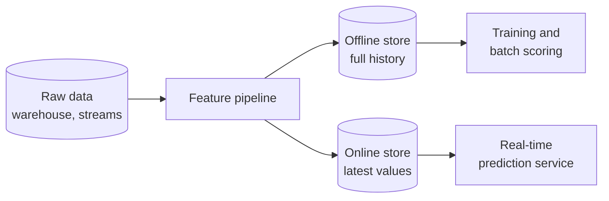

# Feature stores for data engineers

> **8-minute read. The data engineer's view: tables, pipelines and freshness. For model training and ML design, see [AI Zero to Hero](https://ai.noblerworks.com/).**

## The one-line answer

A **feature** is a prepared input to a machine-learning model, such as "orders in the last 30 days" for a customer. A **feature store** is a managed place to compute, store and serve features so training and live prediction use the same definitions. To a data engineer it is a pair of tables fed by pipelines: one for history, one for the latest values.

## The problem it solves

Without one, a data scientist writes the feature in a notebook for training, and an engineer rewrites it in application code for serving. The two drift apart. The SageMaker docs call the resulting gap between training and serving performance **training-serving skew**, and say consistent ingestion of feature-processing code reduces it.

## Two stores, one definition

Both AWS's SageMaker Feature Store and the open-source Feast describe the same split:

| Store | Holds | Used for |
|---|---|---|
| **Offline** | All historical feature values | Exploration, training, batch prediction |
| **Online** | Only the latest values | Low-latency lookups for real-time prediction |

In SageMaker, the offline store is append-only in your S3 bucket, in Parquet, queryable with Athena; the online store keeps only the latest record and is designed for millisecond reads. Features are grouped into a **feature group**, which the docs liken to a table where each column is a feature and each row has a unique identifier (the record identifier) plus an event time.

One feature pipeline writes to both stores. Training reads history from the offline store and the live service reads current values from the online store, so both use the same feature definitions.

## The part that is pure data engineering: point-in-time joins

When you build a training set, each example must use feature values **as they were at that example's time**, not today's. Using later values leaks the future into training. Feast describes building feature sets "point-in-time correct" for exactly this reason. It is an "as of" join, the same idea as a [slowly changing dimension](./slowly-changing-dimensions.md): you need history with timestamps, not just the current row.

## What you run

- **Ingestion.** Batch jobs and streaming. SageMaker accepts both (a `PutRecord` call for small streaming updates, batch jobs for large loads).
- **Freshness.** How stale may the online value be? Monitor it like any other [data quality](./data-quality-and-lineage.md) check.
- **Backfills.** A new feature must be computed over history, which is a large batch job.
- **Discovery and ownership.** Feature groups carry metadata and tags so others can find and reuse them. Do not put PII in names or tags, the SageMaker docs warn.
- **Deletes.** In SageMaker, deleting from the online store also records the deletion in the offline store.

## Do you need one?

Often not at first. A well-built warehouse table plus a nightly job is a feature store in all but name. Consider a dedicated one when several models share features, you need real-time serving, or training-serving skew has actually bitten you.

I did not run Feast or SageMaker for this page; everything above is from their docs. Model design, evaluation and MLOps are on the [AI site](https://ai.noblerworks.com/).

## Official docs

- **[📖 Amazon SageMaker Feature Store](https://docs.aws.amazon.com/sagemaker/latest/dg/feature-store.html)** - feature groups, online and offline stores, ingestion
- **[📖 Feast documentation](https://docs.feast.dev/)** - open-source feature store, point-in-time correct features

## What to look at next

- **[AI Zero to Hero](https://ai.noblerworks.com/)** - the machine-learning side
- **[Slowly changing dimensions](./slowly-changing-dimensions.md)** - history and "as of" thinking
- **[Batch vs streaming](./batch-vs-streaming.md)** - how features get fresh
