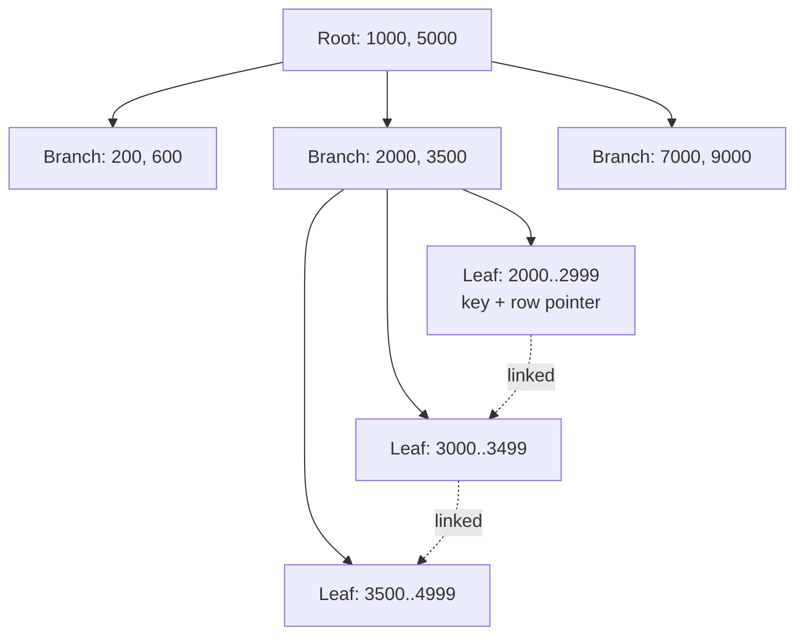

# Indexes explained

> **11-minute read. Assumes basic SQL. Useful to anyone whose query got slow as the table grew.**

## The one-line answer

An **index** is a separate, sorted copy of one or more columns, with a pointer back to each full row. It lets the database jump straight to the rows it needs instead of reading the whole table.

Every index makes some reads faster and every write slower. Indexing well is choosing which trade to make.

## The book analogy, and where it stops

A book index lists terms alphabetically with page numbers. To find "replication" you do not read 400 pages; you look it up and jump to page 212. A database index does the same for a column.

The analogy breaks in one useful way. A book has one index. A table can have many, and each one must be updated on every insert, update and delete. A table with ten indexes does eleven writes for every new row.

## Without an index: the full scan

```sql
SELECT * FROM orders WHERE customer_id = 4821;
```

With no index on `customer_id`, the database reads every row in `orders` and checks each one. On 1,000 rows that is instant. On 500 million it is minutes, and it competes for disk with every other query. This is a **sequential scan** (PostgreSQL) or **table scan** (SQL Server, MySQL).

```sql
CREATE INDEX idx_orders_customer ON orders (customer_id);
```

Now the database walks a small sorted structure to the entries for 4821, and reads only those rows.

## How a B-tree index works

Nearly every relational database uses a **B-tree** (strictly, a B+ tree) as its default index. It is a shallow, wide tree of sorted keys.



A B-tree lookup for key 4821 reads the root, one branch, and one leaf. The leaves are linked in order, which is what makes range scans cheap.

Two properties matter:

- **It is shallow.** Each node holds hundreds of keys, so a billion-row table needs only three or four levels. A lookup is three or four page reads.
- **The leaves are sorted and linked.** Once the database finds the start of a range, it walks sideways. That is why `WHERE created_at BETWEEN ... AND ...` and `ORDER BY created_at` can both use the same index.

## What an index can and cannot help

A B-tree helps when the query can use the sorted order:

| Query | Uses an index on `(last_name)`? |
|---|---|
| `WHERE last_name = 'Okafor'` | Yes |
| `WHERE last_name LIKE 'Ok%'` | Yes, a prefix is a range |
| `WHERE last_name LIKE '%for'` | No, the start is unknown |
| `WHERE LOWER(last_name) = 'okafor'` | No, unless you index the expression `LOWER(last_name)` |
| `ORDER BY last_name LIMIT 10` | Yes, read the first 10 leaves |

The function case catches people constantly. Wrapping a column in a function, or comparing it to a value of a different type, hides it from the index. `WHERE created_at::date = '2026-10-21'` scans; `WHERE created_at >= '2026-10-21' AND created_at < '2026-10-22'` uses the index.

## Composite indexes and the leftmost-prefix rule

An index on several columns is sorted by the first column, then by the second within it, like a phone book sorted by last name then first name.

```sql
CREATE INDEX idx_orders_cust_date ON orders (customer_id, created_at);
```

This one index serves:

- `WHERE customer_id = 4821`
- `WHERE customer_id = 4821 AND created_at >= '2026-10-01'`
- `WHERE customer_id = 4821 ORDER BY created_at DESC LIMIT 20` (the "recent orders" page)

It does **not** serve `WHERE created_at >= '2026-10-01'` on its own, because dates are only sorted within each customer. A phone book cannot find everyone named "Maria" quickly.

Column order rule of thumb: equality filters first, then the range or sort column.

## Covering indexes

If every column a query needs is in the index, the database never visits the table at all. That is a **covering index**, shown as an "index-only scan" in PostgreSQL plans.

```sql
CREATE INDEX idx_orders_cover ON orders (customer_id, created_at) INCLUDE (amount);

SELECT created_at, amount
FROM orders
WHERE customer_id = 4821
ORDER BY created_at DESC LIMIT 20;
```

`INCLUDE` (PostgreSQL, SQL Server) stores `amount` in the leaves without making it part of the sort order.

## Selectivity: when the planner ignores your index

An index on `status` where 95% of rows are `'complete'` is nearly useless for `WHERE status = 'complete'`. Fetching 95% of rows one pointer at a time is slower than just scanning. The **query planner** knows this from table statistics and will choose the scan, correctly.

Indexes pay off when they narrow the result to a small fraction of the table. For a rare value (`WHERE status = 'failed'` at 0.1%), a **partial index** is smaller and faster:

```sql
CREATE INDEX idx_orders_failed ON orders (created_at) WHERE status = 'failed';
```

If the planner picks a bad plan on a column it should index, stale statistics are a likely cause. `ANALYZE orders;` refreshes them.

## Reading the plan

Never guess. Ask the database what it did:

```sql
EXPLAIN ANALYZE
SELECT * FROM orders WHERE customer_id = 4821;
```

What to look for:

- **Seq Scan** on a big table, with a filter that removes most rows - a missing or unusable index.
- **Index Scan** / **Index Only Scan** - the index is in use.
- **Estimated rows vs actual rows** far apart - stale statistics, or a correlation the planner cannot see.

## Other index types

| Type | Good for | Where |
|---|---|---|
| **Hash** | Equality only, no ranges | PostgreSQL, memory engines |
| **GIN / inverted** | "Contains" queries on arrays, JSON, full text | PostgreSQL GIN, Elasticsearch, OpenSearch |
| **GiST / spatial** | Geometry, ranges, nearest neighbor | PostGIS |
| **BRIN** | Huge append-only tables sorted by time | PostgreSQL |
| **Vector (HNSW, IVF)** | Approximate nearest-neighbor on embeddings | pgvector, see [vector databases](./vector-databases-for-data-engineers.md) |
| **Clustered** | The table itself stored in index order | SQL Server, MySQL InnoDB primary key |

## Warehouses mostly do not use indexes

This surprises people moving from OLTP to analytics. Columnar warehouses like BigQuery, Snowflake and Redshift have no B-tree indexes for you to create (Snowflake's search optimization and BigQuery's search indexes are narrow exceptions). They rely on different tricks:

- **Columnar storage** reads only the columns a query names.
- **Partition pruning** skips whole files by date or another key.
- **Min/max statistics** per block (zone maps) skip blocks whose range cannot match.
- **Clustering / sort keys** make those min/max ranges tight, so more blocks are skipped.

The goal is the same, read less data, but the mechanism is "skip big chunks" rather than "jump to the exact row". [OLTP vs OLAP](./oltp-vs-olap.md) explains why, and [file formats and partitioning](./file-formats-and-partitioning.md) covers the layout.

## Common mistakes

- **Indexing every column.** Each index slows writes and uses memory. Index what real queries filter, join and sort on, and drop indexes nothing uses (PostgreSQL's `pg_stat_user_indexes` shows scans per index).
- **Duplicate indexes.** An index on `(customer_id)` is redundant next to one on `(customer_id, created_at)`; the composite already serves it.
- **Forgetting foreign keys.** PostgreSQL does not index foreign key columns automatically. Joins and cascading deletes on them scan.
- **Building a big index during peak hours.** A plain `CREATE INDEX` can block writes. Use `CREATE INDEX CONCURRENTLY` (PostgreSQL) or your engine's online option.
- **Blaming the index for a bad query.** If a query returns two million rows to an application that shows 20, no index fixes that.

## Official docs

- **[📖 PostgreSQL: Indexes](https://www.postgresql.org/docs/current/indexes.html)** - types, multicolumn, partial, expression and covering indexes
- **[📖 PostgreSQL: Using EXPLAIN](https://www.postgresql.org/docs/current/using-explain.html)** - reading plans, estimated versus actual rows
- **[📖 Snowflake: Clustering keys](https://docs.snowflake.com/en/user-guide/tables-clustering-keys)** - the warehouse answer to "how do I make this filter fast?"

## What to look at next

- **[OLTP vs OLAP](./oltp-vs-olap.md)** - why the two worlds speed up queries differently
- **[SQL joins explained](./sql-joins-explained.md)** - nested-loop joins live or die by indexes
- **[Transactions and ACID](./transactions-and-acid.md)** - what the database is protecting while it updates those indexes
- **[File formats and partitioning](./file-formats-and-partitioning.md)** - pruning, the columnar equivalent
