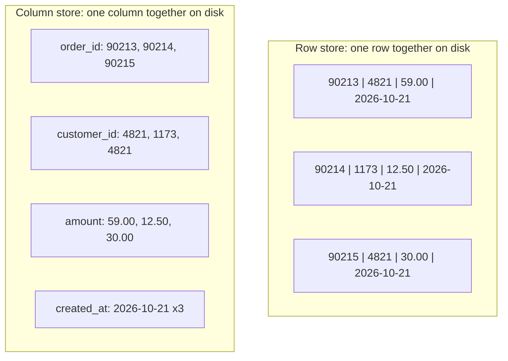
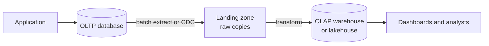

# OLTP vs OLAP

> **9-minute read. No prerequisites beyond knowing what a table is.**

## The one-line answer

**OLTP** (online transaction processing) systems run the business: many tiny reads and writes, one order or one login at a time, in milliseconds. **OLAP** (online analytical processing) systems analyze the business: few huge queries that scan and aggregate millions of rows.

They need opposite storage layouts, which is why almost every company copies data from one into the other.

## Two queries that want different things

The checkout page runs this thousands of times a second:

```sql
INSERT INTO orders (order_id, customer_id, amount, created_at)
VALUES (90215, 4821, 59.00, now());

SELECT * FROM orders WHERE order_id = 90215;
```

The finance dashboard runs this a few times an hour:

```sql
SELECT DATE_TRUNC('month', created_at) AS month, region, SUM(amount)
FROM orders
WHERE created_at >= '2025-01-01'
GROUP BY 1, 2;
```

The first touches one row and every column. The second touches two years of rows and three columns. A system tuned for one is bad at the other.

## The side-by-side

| | OLTP | OLAP |
|---|---|---|
| **Typical query** | Read or write a few rows by key | Scan and aggregate millions of rows |
| **Users** | Applications, thousands of concurrent sessions | Analysts, BI tools, data pipelines |
| **Latency target** | Milliseconds | Seconds to minutes |
| **Storage layout** | Row-oriented | Column-oriented |
| **Schema** | Normalized (3NF): each fact stored once | Denormalized: [star schemas](./data-modeling-for-analytics.md), wide tables |
| **Data** | Current state | History, often years |
| **Writes** | Constant small transactions | Bulk loads in batches or micro-batches |
| **Speed-up tool** | [Indexes](./indexes-explained.md) | Columnar compression, partition pruning, parallel scans |
| **Examples** | PostgreSQL, MySQL, SQL Server, Oracle, DynamoDB, Cosmos DB | BigQuery, Snowflake, Redshift, Synapse / Fabric, Databricks SQL, ClickHouse |

## Row stores versus column stores

This is the physical reason the two cannot be the same system.



The same three orders laid out two ways. A row store keeps each order together, so fetching one order is one read. A column store keeps each column together, so summing `amount` reads only the amount column.

A **row store** keeps each row's values next to each other. Fetching "order 90215, all columns" is one small read. Summing `amount` over a billion orders means reading every column of every row just to use one.

A **column store** keeps each column's values next to each other. Summing `amount` reads only the amount column, and because a column holds similar values (dates, small integers, repeated region codes), it compresses 5 to 10 times better. Fetching one complete order means stitching together a value from every column file, which is slow.

## Why you do not run analytics on the production database

It is tempting: the data is right there. Three reasons it goes wrong:

1. **Contention.** A two-minute aggregate scan competes for CPU, memory and disk with checkout. Customers feel it.
2. **Wrong shape.** The normalized OLTP schema needs eight joins to answer a simple business question, and row storage reads far more bytes than needed.
3. **No history.** OLTP tables hold current state. When a customer moves country, the old value is overwritten. Analytics usually needs to know what was true at the time, see [slowly changing dimensions](./slowly-changing-dimensions.md).

A **read replica** fixes the first problem only. It is a fine first step for a small company, and the start of the path to a warehouse.

## How data gets from OLTP to OLAP



The usual flow. The application writes to the OLTP database; a pipeline copies changes out, either in nightly batches or continuously through change data capture, and the warehouse reshapes them for analysis.

The copy step is the job of [pipelines](./data-pipelines-and-orchestration.md). Nightly full extracts are simple and fine at small scale. At larger scale, **[change data capture](./change-data-capture.md)** reads the database's transaction log and streams every change, which is cheaper on the source and gives fresher data.

## HTAP: can one system do both?

**HTAP** (hybrid transactional/analytical processing) systems try. Examples include SingleStore, TiDB, AlloyDB's columnar engine, SQL Server columnstore indexes, Oracle's in-memory column store, and the "zero-ETL" integrations that replicate Aurora or Cosmos DB into an analytical store automatically.

They work by keeping two copies in two layouts inside one product and syncing them for you. They are genuinely useful for operational analytics ("live dashboard of today's orders") and for removing a pipeline you would otherwise build. They do not remove the need for modelling, history, or joining data from many source systems, which is most of what a warehouse is for.

## OLAP cubes, the older meaning

Older material uses "OLAP" to mean **cubes**: pre-aggregated structures (SQL Server Analysis Services, Essbase) where every combination of dimensions is computed ahead of time, so "slice and dice" is instant. Modern columnar warehouses are fast enough to aggregate on the fly, so cubes have mostly faded, but the vocabulary (dimensions, measures, drill down, roll up) lives on in BI tools and semantic layers.

## Common mistakes

- **Using a warehouse as an application backend.** Warehouses handle a few dozen concurrent heavy queries well and thousands of tiny ones badly, and are priced accordingly. A user-facing API that does point lookups wants an OLTP store or a cache in front.
- **Single-row inserts into a warehouse.** Columnar engines like batches. Thousands of single-row `INSERT`s create thousands of tiny files or micro-partitions. Buffer and load in bulk, or use the engine's streaming ingestion API.
- **Copying the OLTP schema unchanged.** Landing raw copies is the right first step. Stopping there leaves every analyst writing the same eight joins, differently.

## Official docs

- **[📖 Google Cloud: BigQuery storage overview](https://cloud.google.com/bigquery/docs/storage_overview)** - columnar storage in a managed warehouse
- **[📖 Amazon Redshift: Columnar storage](https://docs.aws.amazon.com/redshift/latest/dg/c_columnar_storage_disk_mem_mgmnt.html)** - why column layout cuts I/O for analytics
- **[📖 Microsoft: Columnstore indexes overview](https://learn.microsoft.com/en-us/sql/relational-databases/indexes/columnstore-indexes-overview)** - a column store inside an OLTP engine

## What to look at next

- **[Warehouses, lakes, and lakehouses](./warehouses-lakes-lakehouses.md)** - the OLAP side in detail
- **[SQL vs NoSQL](./sql-vs-nosql.md)** - the OLTP side's choices
- **[Change data capture](./change-data-capture.md)** - the modern bridge between the two
- **[Data modeling for analytics](./data-modeling-for-analytics.md)** - how the OLAP side is shaped
- **[Database services across clouds](../../resources/service-comparison-databases.md)** - every managed OLTP and OLAP service side by side
