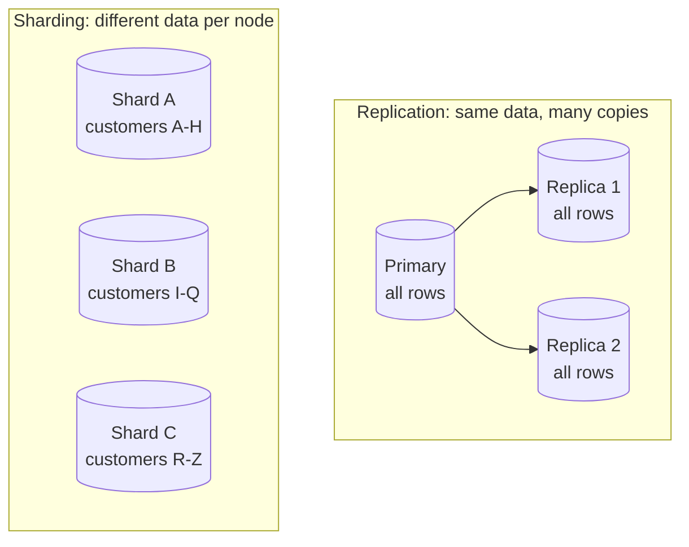

# Replication and sharding

> **12-minute read. Assumes you know what a database transaction is. [Transactions and ACID](./transactions-and-acid.md) and [Eventual consistency](./eventual-consistency.md) are the companions.**

## The one-line answer

**Replication** keeps copies of the same data on several machines, for availability and to spread reads. **Sharding** (also called partitioning) splits the data so each machine holds a different slice, to spread writes and storage.

Replication answers "what if this server dies?" and "too many reads". Sharding answers "too much data or too many writes for one server". Large systems do both: every shard is itself replicated.

Replication copies the whole dataset to several nodes. Sharding divides the dataset so each node owns one part. In production each shard on the right would have its own replicas.

## Replication

### Leader-follower (primary-replica)

The most common setup. One **primary** accepts all writes. It records each change in its log (the PostgreSQL WAL, the MySQL binlog) and ships that log to **replicas**, which replay it. Applications send writes to the primary and can send reads to replicas.

This is how Amazon RDS read replicas, Azure SQL geo-replication, Cloud SQL replicas, and MongoDB replica sets work.

### Synchronous versus asynchronous

The key decision is when the primary tells the client "committed".

| | Synchronous | Asynchronous |
|---|---|---|
| **Commit returns when** | At least one replica has the change | The primary alone has the change |
| **Write latency** | Higher: includes a network round trip | Lowest |
| **Data loss if primary dies** | None, for acknowledged writes | Whatever had not reached a replica yet |
| **If the replica is slow or down** | Writes slow down or stall | No effect on writes |

Most systems use asynchronous replicas for read scaling and one synchronous (or semi-synchronous, or quorum-based) standby for durability. Amazon Aurora and Cloud Spanner sidestep part of the trade by writing to a quorum of storage nodes rather than to whole replica databases.

### Replication lag and the read-your-writes problem

Asynchronous replicas are behind by some amount, usually milliseconds, sometimes minutes under load. That produces the most common replication bug:

1. A user updates their profile. The write goes to the primary.
2. The page reloads and reads from a replica that has not caught up.
3. The user sees their old profile and assumes the save failed.

Fixes, from simplest:

- Read from the primary for a short time after a user writes (**read-your-writes** consistency).
- Route all reads for a given user to the same replica, so time never goes backwards for them (**monotonic reads**).
- Pass the write's log position and wait until the replica has reached it.

This is [eventual consistency](./eventual-consistency.md) showing up inside a "consistent" relational database.

### Failover

When the primary dies, a replica is **promoted**. The hard parts are not the promotion itself:

- **Detecting failure correctly.** A primary that is slow, not dead, can be declared dead. If it comes back still accepting writes, you have two primaries (**split brain**) and conflicting data. Managed services use fencing and a single source of truth for "who is primary" to prevent this.
- **Losing unreplicated writes.** With async replication, the last moments of writes on the old primary may never reach the new one.
- **Repointing clients.** Applications must find the new primary. Managed services usually do this with a DNS name that moves, which means connection pools and DNS caches need to let go of the old address.

### Multi-leader and leaderless

- **Multi-leader** replication accepts writes in several places, typically one per region. Writes are fast locally, but two regions can change the same row at once, so the system needs a **conflict resolution** rule (last writer wins, merge, or application logic). Cosmos DB multi-region writes and DynamoDB global tables work this way.
- **Leaderless** replication (Cassandra, the original Dynamo design) writes to several nodes and reads from several, with tunable **quorums**: with N replicas, writing to W and reading from R where W + R > N guarantees the read overlaps the latest write.

### Replication is not a backup

A replica copies mistakes instantly. `DELETE FROM customers;` without a `WHERE` is faithfully replicated to every copy within milliseconds. You still need point-in-time backups.

## Sharding

### When you need it

Sharding adds a lot of complexity, so it should be the last scaling step, not the first. Before sharding, a relational database can usually go a long way with bigger hardware, read replicas, better indexes, caching, and archiving old data. Many companies never need to shard their OLTP database.

You need it when the **write** rate or the **data size** exceeds what one machine can handle, because replication does not help with either: every replica still applies every write and stores every row.

### Choosing a shard key

Every row is assigned to a shard by its **shard key** (DynamoDB calls it the partition key). The choice decides almost everything.

| Strategy | How rows are placed | Strength | Weakness |
|---|---|---|---|
| **Range** | Key ranges: A-H, I-Q, R-Z, or by date | Range scans stay on one shard | Hot spots: all new rows land on the "latest date" shard |
| **Hash** | `hash(key) mod N`, or consistent hashing | Even spread | Range queries hit every shard |
| **Directory / lookup** | A table maps each key to its shard | Flexible, can move tenants individually | The lookup service is critical infrastructure |
| **Geographic** | By region or tenant location | Data residency, low latency | Uneven sizes |

A good shard key has high cardinality, spreads writes evenly, and matches how the data is queried, so most queries touch one shard.

A classic bad choice: sharding a multi-tenant app by `created_at`. Every write in the system goes to the newest shard. A classic good choice: shard by `tenant_id` (or `customer_id`), so each tenant's data lives together and most queries stay on one shard.

### Hot partitions

Even with hashing, one key can be too busy. A celebrity's account, a viral product, or a default value like `country = 'US'` puts a disproportionate share of traffic on one shard. Fixes include adding a random suffix to spread a hot key (then reading all suffixes back), caching the hot reads, or picking a key with more spread.

### What sharding costs you

- **Cross-shard queries** must fan out to every shard and merge results.
- **Cross-shard transactions** need a distributed protocol, or the application must avoid them.
- **Joins across shards** are expensive or unsupported.
- **Uniqueness** across all shards (a global unique email) needs a separate mechanism.
- **Resharding** - moving to more shards - means moving data while the system runs. Consistent hashing and "many small virtual shards per machine" exist mainly to make this less painful.

### Distributed SQL

**Distributed SQL** databases (Google Cloud Spanner, CockroachDB, YugabyteDB, TiDB, Aurora DSQL) shard and replicate automatically behind a normal SQL interface, with real cross-shard transactions. They remove most of the pain above. The costs are higher write latency (consensus across replicas on every commit), higher price, and the need to still think about keys: a monotonically increasing primary key creates a hot range in Spanner exactly as it would in a hand-sharded system.

## Partitioning in analytics is a different idea

In warehouses and lakes, "partitioning" usually means **splitting one table into files or segments by a column, often date**, so queries can skip irrelevant parts. It is about reading less, not about spreading writes across machines. See [file formats and partitioning](./file-formats-and-partitioning.md). Same word, related intuition, different problem.

Kafka partitions are closer to sharding: each topic is split by key across brokers, ordering holds within a partition, and the partition count caps consumer parallelism. See [queues vs streams](./queues-vs-streams.md).

## Common mistakes

- **Sharding too early.** The operational cost is permanent; the scale may never arrive.
- **Sending writes-then-reads to a replica.** Read-your-writes bugs look like data loss to users.
- **Treating replicas as backups.** They replicate the mistake too.
- **A shard key nobody queries by.** Every query becomes a fan-out.
- **Ignoring failover until it happens.** Test it. Measure how long clients take to reconnect.

## Official docs

- **[📖 PostgreSQL: High Availability, Load Balancing, and Replication](https://www.postgresql.org/docs/current/high-availability.html)** - every replication option PostgreSQL offers, with trade-offs
- **[📖 MongoDB: Sharding](https://www.mongodb.com/docs/manual/sharding/)** - shard keys, chunks, and balancing in a sharded cluster
- **[📖 Amazon DynamoDB: Partition key design](https://docs.aws.amazon.com/amazondynamodb/latest/developerguide/bp-partition-key-design.html)** - avoiding hot partitions in a managed key-value store

## What to look at next

- **[Eventual consistency](./eventual-consistency.md)** - what replication lag looks like to a reader
- **[Transactions and ACID](./transactions-and-acid.md)** - the guarantees each shard still has to provide
- **[Change data capture](./change-data-capture.md)** - the same replication log, used to feed pipelines
- **[SQL vs NoSQL](./sql-vs-nosql.md)** - many NoSQL stores were designed around sharding from day one
- **[Database services across clouds](../../resources/service-comparison-databases.md)** - managed replication and distributed SQL options
