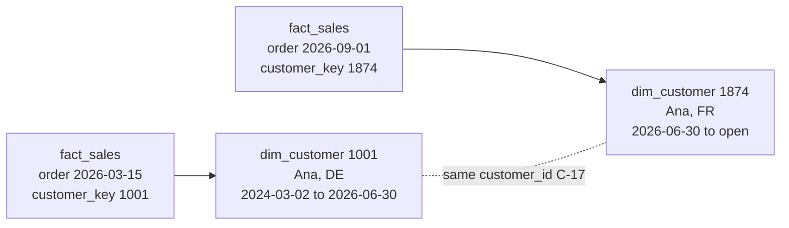

# Slowly changing dimensions

> **11-minute read. Assumes you know what a fact and a dimension are. [Data modeling for analytics](./data-modeling-for-analytics.md) introduces them.**

## The one-line answer

A **slowly changing dimension** (SCD) is a dimension whose attributes change over time: a customer moves, a product is recategorized, a salesperson changes region. The SCD **type** is the rule for whether you overwrite the old value or keep it, and how.

Get it wrong and last year's report quietly changes every time someone updates a record today.

## The problem, concretely

Ana lived in Germany until 30 June 2026 and then moved to France. She placed orders before and after the move.

If `dim_customer` simply has `country = 'FR'` now, then this query:

```sql
SELECT c.country, SUM(f.revenue)
FROM fact_sales f
JOIN dim_customer c ON c.customer_key = f.customer_key
WHERE f.order_date BETWEEN '2026-01-01' AND '2026-06-30'
GROUP BY c.country;
```

credits Ana's first-half German orders to France. Run the same report in May and in October and you get two different answers for the same past period. Nobody changed an order; the dimension changed underneath them.

Whether that is wrong depends on the question. "Revenue by where customers live **now**" wants the overwrite. "Revenue by where customers lived **at the time**" wants history. SCD types let you choose per attribute.

## The types

| Type | Behavior | History kept | Typical use |
|---|---|---|---|
| **0** | Never change the value | Original value only | Birth date, original signup channel |
| **1** | Overwrite in place | None | Fixing typos; attributes where only the current value matters |
| **2** | Add a new row per version, with validity dates | Full | Region, segment, price tier - anything reported historically |
| **3** | Keep a "previous value" column | One prior value | A one-off reorganization where "old vs new" is the only comparison |
| **4** | Current table plus a separate history table | Full, kept apart | Very large or fast-changing dimensions |
| **6** | Type 2 rows plus a Type 1 "current" column (1 + 2 + 3) | Full, plus current on every row | Reports that need both "as was" and "as is" without a second join |

In practice you will mostly use Type 1 and Type 2, often in the same table: Type 2 for `country` and `segment`, Type 1 for `email` corrections.

## Type 2 in detail

Type 2 adds a new row each time a tracked attribute changes, and records when each version was valid.

```sql
-- dim_customer
customer_key | customer_id | name | country | valid_from | valid_to   | is_current
-------------+-------------+------+---------+------------+------------+-----------
1001         | C-17        | Ana  | DE      | 2024-03-02 | 2026-06-30 | false
1874         | C-17        | Ana  | FR      | 2026-06-30 | 9999-12-31 | true
```

Two keys do two jobs:

- **`customer_id`** is the **natural** (business) key from the source. It identifies Ana.
- **`customer_key`** is a **surrogate** key the warehouse generates. It identifies **one version** of Ana.

Facts store the surrogate key of the version that was current when the fact happened. An order on 15 March 2026 points at 1001 (Germany); an order on 1 September 2026 points at 1874 (France). Now the original report returns the right answer by itself, with a plain equality join.



Each fact points at the version of the customer that was true when it happened. Both versions share the natural key, so "all of Ana's orders" is still easy.

Conventions worth adopting:

- Use a **half-open interval**: valid when `valid_from <= t < valid_to`. Then the end of one version equals the start of the next, with no gaps or overlaps.
- Use a far-future date (`9999-12-31`) rather than `NULL` for the open end, so range joins need no special case.
- Keep `is_current` for convenience. `WHERE is_current` is the "as is" view.

## Building a Type 2 dimension

### Looking up the right version when loading facts

When facts arrive with only the natural key, find the version valid at the event time with a range join:

```sql
SELECT o.order_id, o.order_date, o.amount, c.customer_key
FROM staging.orders o
JOIN dim_customer c
  ON c.customer_id = o.customer_id
 AND o.order_date >= c.valid_from
 AND o.order_date <  c.valid_to;
```

### Deriving versions from a change history

If you have a full history of source changes (from [change data capture](./change-data-capture.md) or daily snapshots), `LEAD` builds the validity windows:

```sql
SELECT customer_id, name, country,
       changed_at AS valid_from,
       COALESCE(LEAD(changed_at) OVER (PARTITION BY customer_id ORDER BY changed_at),
                DATE '9999-12-31') AS valid_to
FROM customer_changes;
```

### Letting a tool do it

You rarely hand-write the close-old-row, insert-new-row logic today:

- **dbt snapshots** compare the source to the last snapshot on each run and maintain `dbt_valid_from` and `dbt_valid_to` for you. See [Analytics engineering and dbt](./analytics-engineering-and-dbt.md).
- **Delta Lake and Databricks** support it through `MERGE` and Lakeflow declarative pipelines' `AUTO CDC ... STORED AS SCD TYPE 2`.
- **Most ELT tools** offer a "history mode" that keeps every version of a source row.

## Subtleties that bite

- **Snapshots miss changes between runs.** A daily snapshot that sees `bronze` on Monday and `gold` on Tuesday never knows the customer was `silver` for six hours. If intermediate states matter, build from CDC events, not snapshots.
- **Late-arriving facts.** An order dated June arrives in September. The range-join lookup above still finds the June version, as long as you look up by event time and not load time.
- **Late-arriving dimensions.** A fact arrives for a customer the dimension has never seen. Insert a placeholder "inferred member" row and update it when the real record arrives, rather than dropping the fact or pointing it at an "unknown" row forever.
- **Tracking noise.** If `last_login_at` is a tracked column, every login creates a version and the dimension explodes. Track only attributes someone reports on. Move fast-changing values to a fact, or to a separate small "mini-dimension" of banded values.
- **Counting customers.** `COUNT(*)` on a Type 2 dimension counts versions. Count distinct natural keys, or filter `is_current`.
- **Corrections versus changes.** A typo fix is not a real-world change. Treat it as Type 1 even on a Type 2 column, or reports will show a new customer version for every typo fixed.

## How to choose

Ask the business owner of the report, per attribute: "If this changes, should old numbers move?" If yes, Type 1. If no, Type 2. If they want both views, Type 2 plus a current-value column (Type 6) or a join to the current row.

Default to Type 2 for any attribute used to group or filter financial or regulatory reports. Going from Type 1 to Type 2 later is easy for the future and impossible for the past: the history you overwrote is gone, unless the raw changes were kept somewhere.

## Official docs

- **[📖 Kimball Group: Dimensional modeling techniques](https://www.kimballgroup.com/data-warehouse-business-intelligence-resources/kimball-techniques/dimensional-modeling-techniques/)** - the original definitions of every SCD type
- **[📖 dbt: Snapshots](https://docs.getdbt.com/docs/build/snapshots)** - Type 2 history maintained automatically from a source table
- **[📖 Delta Lake: Table deletes, updates, and merges](https://docs.delta.io/latest/delta-update.html)** - `MERGE` patterns, including SCD Type 2

## What to look at next

- **[Data modeling for analytics](./data-modeling-for-analytics.md)** - facts, dimensions and grain
- **[Design a star schema](../../resources/hands-on-projects/design-star-schema.md)** - a hands-on design that includes a Type 2 dimension
- **[Change data capture](./change-data-capture.md)** - the change history that feeds Type 2 properly
- **[SQL joins explained](./sql-joins-explained.md)** - the range join that looks up the right version
