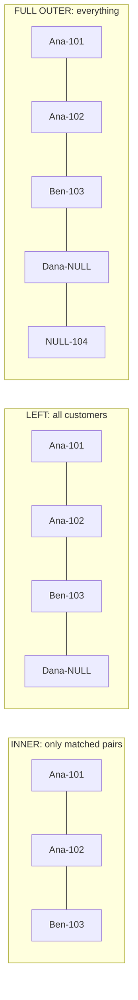

# SQL joins explained

> **10-minute read. Assumes you can write a `SELECT ... WHERE`. [SQL vs NoSQL](./sql-vs-nosql.md) is the gentler starting point.**

## The one-line answer

A **join** combines rows from two tables by matching a column they share. The type of join decides what happens to rows that have no match: keep them, drop them, or fill the gap with `NULL`.

Most join bugs are not syntax errors. The query runs, returns a number, and the number is wrong because a row was silently dropped or silently duplicated.

## Why joins exist at all

A well-designed operational database stores each fact once. The customer's name lives in `customers`, the order lives in `orders`, and the order carries a `customer_id` pointing back. This is **normalization**, and it means you never have to update a customer's name in a thousand order rows.

The price is that any question spanning two tables needs a join to put the pieces back together. "Which customers in France ordered last month?" needs `customers` (country) and `orders` (date) at once.

## The two example tables

Every example below uses these two tables. Note the awkward cases on purpose: Dana has no orders, and order 104 points at a customer who does not exist.

```sql
-- customers
customer_id | name  | country
------------+-------+--------
1           | Ana   | FR
2           | Ben   | DE
3           | Dana  | FR

-- orders
order_id | customer_id | amount
---------+-------------+-------
101      | 1           | 50
102      | 1           | 30
103      | 2           | 20
104      | 9           | 99
```

## INNER JOIN - only the matches

```sql
SELECT c.name, o.order_id, o.amount
FROM customers c
INNER JOIN orders o ON o.customer_id = c.customer_id;
```

| name | order_id | amount |
|---|---|---|
| Ana | 101 | 50 |
| Ana | 102 | 30 |
| Ben | 103 | 20 |

Dana disappears (no orders). Order 104 disappears (no customer). An inner join keeps a row only when both sides match. A bare `JOIN` is an inner join.

This is the right default when you only care about things that exist on both sides. It is the wrong default when the missing rows are the point, like "customers who never ordered".

## LEFT JOIN - keep everything on the left

```sql
SELECT c.name, o.order_id, o.amount
FROM customers c
LEFT JOIN orders o ON o.customer_id = c.customer_id;
```

| name | order_id | amount |
|---|---|---|
| Ana | 101 | 50 |
| Ana | 102 | 30 |
| Ben | 103 | 20 |
| Dana | NULL | NULL |

Every customer survives. Where there is no matching order, the order columns are `NULL`. `RIGHT JOIN` is the same thing with the tables swapped; most teams never write one and just reorder the tables so the "keep all" table is on the left.

The classic use is finding what is missing, an **anti-join**:

```sql
-- customers who have never ordered
SELECT c.name
FROM customers c
LEFT JOIN orders o ON o.customer_id = c.customer_id
WHERE o.order_id IS NULL;
```

`NOT EXISTS` says the same thing more directly and is often the clearer choice:

```sql
SELECT c.name
FROM customers c
WHERE NOT EXISTS (
  SELECT 1 FROM orders o WHERE o.customer_id = c.customer_id
);
```

## FULL OUTER JOIN - keep everything on both sides

```sql
SELECT c.name, o.order_id
FROM customers c
FULL OUTER JOIN orders o ON o.customer_id = c.customer_id;
```

This returns Ana's two orders, Ben's order, Dana with a `NULL` order, and order 104 with a `NULL` name. It is the join for **reconciliation**: comparing a source table against a target table and listing rows that exist on only one side. Data engineers use it constantly to check that a pipeline copied everything.

## CROSS JOIN - every combination

A cross join pairs every row of one table with every row of the other. Three customers times four orders is twelve rows. It is rarely what you want by accident, but it is exactly right for building a scaffold, such as every store paired with every date, so that days with zero sales still show up as a row with zero.

```sql
SELECT s.store_id, d.date_day
FROM stores s
CROSS JOIN dim_date d
WHERE d.date_day BETWEEN '2026-10-01' AND '2026-10-31';
```

## The picture



The same two tables under three join types. Each step to the right keeps more of the unmatched rows, padding the missing side with NULL.

## Mistake 1: fan-out, the silent duplication

Join on a key that is not unique on one side, and every row on the other side is multiplied. Suppose a `customer_addresses` table has two rows for Ana (home and work):

```sql
SELECT SUM(o.amount)
FROM orders o
JOIN customer_addresses a ON a.customer_id = o.customer_id;
-- Ana's 80 is counted twice: 160
```

Nothing errors. Revenue is just higher. Before joining, ask "is the right-hand key unique?" and check it:

```sql
SELECT customer_id, COUNT(*)
FROM customer_addresses
GROUP BY customer_id
HAVING COUNT(*) > 1;
```

If it is not unique, either filter to one row per key first (`WHERE address_type = 'home'`, or a [window function](./window-functions-explained.md) with `ROW_NUMBER()`), or aggregate before joining.

## Mistake 2: a WHERE clause that undoes the LEFT JOIN

```sql
SELECT c.name, o.amount
FROM customers c
LEFT JOIN orders o ON o.customer_id = c.customer_id
WHERE o.amount > 25;
```

You wanted all customers, with orders over 25 where they exist. You got only customers with such orders, because Dana's `o.amount` is `NULL`, and `NULL > 25` is not true, so `WHERE` drops her. The left join quietly became an inner join.

Put conditions on the right-hand table in the `ON` clause instead:

```sql
SELECT c.name, o.amount
FROM customers c
LEFT JOIN orders o
  ON o.customer_id = c.customer_id
 AND o.amount > 25;
```

Rule of thumb: in a left join, filters on the left table go in `WHERE`, filters on the right table go in `ON`.

## Mistake 3: NULL never equals NULL

A join condition `a.x = b.x` is never true when either side is `NULL`. If your join key can be `NULL`, those rows will never match anything. Usually that is correct. If it is not, use `IS NOT DISTINCT FROM` (PostgreSQL, Snowflake, DuckDB) or coalesce both sides to a sentinel value.

## Mistake 4: joining on the wrong grain

Joining a daily table to a monthly table on month will repeat the monthly value on every day. Summing it afterwards multiplies it by the number of days. Before any join, say out loud what one row of each table means. That is the **grain**, covered in [Data modeling for analytics](./data-modeling-for-analytics.md).

## How the engine actually runs a join

You write *what* to join; the planner decides *how*. The three algorithms you will see in a query plan:

| Algorithm | How it works | Good when |
|---|---|---|
| **Nested loop** | For each row on one side, look up matches on the other | One side is small, and the other has an [index](./indexes-explained.md) on the key |
| **Hash join** | Build a hash table from the smaller side, stream the larger side through it | Large tables, equality joins, no useful index. The analytics default |
| **Merge join** | Sort both sides on the key, walk them together | Both sides are already sorted, or the result must be sorted anyway |

In a distributed warehouse (BigQuery, Snowflake, Redshift, Spark) there is one more decision: **broadcast** the small table to every worker, or **shuffle** both tables across the network by join key. Shuffles are where large joins spend their time and money. Joining a huge fact to small dimensions, which is what a star schema does, is cheap precisely because the dimensions can be broadcast.

Run `EXPLAIN` on a slow query and you will see which algorithm was chosen and how many rows the planner expected at each step. A planner that expected 10 rows and got 10 million is the most common root cause of a slow join.

## Self-joins and non-equi joins

A table can be joined to itself. Employees and their managers live in one table:

```sql
SELECT e.name AS employee, m.name AS manager
FROM employees e
LEFT JOIN employees m ON m.employee_id = e.manager_id;
```

Joins also do not have to use `=`. A **range join** matches an event to the price that was valid at the time:

```sql
SELECT o.order_id, p.price
FROM orders o
JOIN product_prices p
  ON p.product_id = o.product_id
 AND o.ordered_at >= p.valid_from
 AND o.ordered_at <  p.valid_to;
```

This exact shape is how facts join to a Type 2 [slowly changing dimension](./slowly-changing-dimensions.md).

## Official docs

- **[📖 PostgreSQL: Joins Between Tables](https://www.postgresql.org/docs/current/tutorial-join.html)** - the tutorial version, with inner and outer joins
- **[📖 PostgreSQL: Table Expressions](https://www.postgresql.org/docs/current/queries-table-expressions.html)** - the full reference for every join type, including `LATERAL`
- **[📖 PostgreSQL: Using EXPLAIN](https://www.postgresql.org/docs/current/using-explain.html)** - how to read the plan the planner chose

## What to look at next

- **[Window functions explained](./window-functions-explained.md)** - the tool for "one row per key" and running totals, without self-joins
- **[Indexes explained](./indexes-explained.md)** - why a join on an indexed key is fast
- **[Data modeling for analytics](./data-modeling-for-analytics.md)** - star schemas, built so joins are simple and safe
- **[Data quality and lineage](./data-quality-and-lineage.md)** - the uniqueness test that catches fan-out
- **[Databases topic](../../topics/databases.md)** - everything on the site about where data rests
