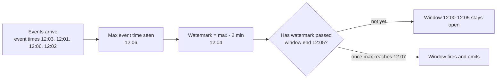

# Stream processing: windows and watermarks

> **13-minute read. Read [Batch vs streaming](./batch-vs-streaming.md) first; this page is the deeper follow-up on how a streaming job decides what to compute and when.**

## The one-line answer

A stream never ends, so a streaming job cannot "aggregate everything". It groups events into **windows** of time, uses **watermarks** to decide when a window has probably received all its events, and keeps **state** for windows that are still open. Those three ideas, plus a policy for late data, are most of stream processing.

## Event time is the only clock that means anything

Every event has two timestamps:

- **Event time** - when it happened, stamped by the device or service that produced it.
- **Processing time** - when your job sees it.

A phone in a tunnel buffers clicks for ten minutes and sends them all at once. A Kafka consumer restarts and reads an hour of backlog in two minutes. In both cases processing time says "these all happened just now", which is false.

Windowing by processing time is simple and gives wrong answers whenever there is delay or a backfill. Windowing by event time gives the same answer however and whenever the data arrives, which is the property that lets you reprocess history and trust the result. Use event time unless you have a specific reason not to.

## Windows

### Tumbling windows

Fixed size, no overlap. Every event belongs to exactly one window.

```text
events:   *  * *     *   * *  *     * *
windows: [ 12:00-12:05 )[ 12:05-12:10 )[ 12:10-12:15 )
```

Use for periodic totals: orders per 5 minutes, errors per hour.

### Sliding (hopping) windows

Fixed size, but a new window starts every slide interval, so windows overlap and an event belongs to several. A 10-minute window sliding every minute puts each event in ten windows.

Use for moving averages and rate alerts: "more than 50 failed logins in any 10-minute span". Watch the cost: state and output grow with size divided by slide.

### Session windows

No fixed size. A window stays open while events keep arriving, and closes after a **gap** of inactivity. Each key (each user) gets its own sessions.

```text
user 42:  * *  *          * *        *
          [session 1 ]    [s2 ]      [s3]
                     gap > 30 min
```

Use for user visits, device bursts, and anything where activity clusters naturally. Session windows can **merge**: a late event that lands in the gap between two sessions joins them into one.

### Global windows and custom triggers

Some engines also offer a single never-ending window per key with a custom **trigger** ("emit every 1,000 events" or "emit when this event type arrives"). Powerful, and easy to misuse; reach for it only when time-based windows do not fit.

## Watermarks

The job must decide when the 12:00-12:05 window is done. Waiting forever is not an option, and closing it at 12:05 processing time ignores every delayed event.

A **watermark** is the job's running estimate of event-time progress: a timestamp W meaning "I believe no more events with event time earlier than W will arrive". When the watermark passes a window's end, the window fires.

The most common way to generate one is **bounded out-of-orderness**: watermark = the highest event time seen so far, minus a fixed allowance.



With a 2-minute allowance, the 12:00-12:05 window fires once the job has seen an event stamped 12:07 or later. Events up to 2 minutes out of order are handled correctly.

The allowance is a direct trade:

| Allowance | Latency of results | Late events |
|---|---|---|
| Small (seconds) | Results come out quickly | More events arrive after their window closed |
| Large (minutes to hours) | Every result waits that long | Few late events |

Pick it from data, not guesswork: measure the distribution of `processing_time - event_time` and choose a percentile you can live with (for example, the 99.9th).

### The idle partition trap

The watermark of a job reading from many partitions is the **minimum** across them. If one Kafka partition receives no events, its watermark never advances, and **every** window in the job stops firing. It looks like the job is hung. Engines provide an **idleness timeout** that excludes quiet partitions from the minimum; set one.

## Late data

Events can still arrive after the watermark passed their window. You have three options, and you should choose one deliberately:

1. **Drop** - the default in many engines. Simple; silently loses data. At least count what you drop.
2. **Allowed lateness** - keep the window's state for an extra period after it fires, and emit an **updated** result when a late event arrives. Downstream must accept updates (an upsert sink, not an append-only log).
3. **Side output** - route late events to a separate stream or table, and reconcile them in a batch job.

A common production design is "fast and approximate now, exact later": the streaming job uses a short watermark and drops or side-outputs late events, and a nightly batch job recomputes yesterday's figures from the complete data in the lake.

## A worked example in Flink SQL

Count clicks per page in 5-minute tumbling windows, by event time, tolerating events up to 30 seconds out of order:

```sql
CREATE TABLE clicks (
  page_id    STRING,
  user_id    STRING,
  event_time TIMESTAMP(3),
  WATERMARK FOR event_time AS event_time - INTERVAL '30' SECOND
) WITH (
  'connector' = 'kafka',
  'topic' = 'clicks',
  'properties.bootstrap.servers' = 'localhost:9092',
  'scan.startup.mode' = 'earliest-offset',
  'format' = 'json'
);

SELECT window_start, window_end, page_id, COUNT(*) AS clicks
FROM TABLE(
  TUMBLE(TABLE clicks, DESCRIPTOR(event_time), INTERVAL '5' MINUTE)
)
GROUP BY window_start, window_end, page_id;
```

The same in Spark Structured Streaming (PySpark):

```python
from pyspark.sql.functions import window, col

counts = (
    clicks
    .withWatermark("event_time", "30 seconds")
    .groupBy(window(col("event_time"), "5 minutes"), col("page_id"))
    .count()
)
```

Both engines also accept `HOP` / sliding and `SESSION` windows with the same structure.

## State and checkpoints

Every open window, every running count, every partially matched join is **state**. It lives in memory or a local store (RocksDB is common) on the workers.

- **Checkpoints** periodically snapshot all state plus the input offsets to durable storage. After a crash, the job restores the last checkpoint and replays input from those offsets, so no event is counted twice or missed. This is how engines offer "exactly-once" state.
- **State grows with keys times windows.** A job keyed by `user_id` with hour-long session windows and allowed lateness of a day keeps a lot of state. Set state TTLs, and size the watermark and lateness knowing they control memory.
- **Upgrading a job with state** means the new version must be able to read the old state. Changing the key, or the window definition, may require starting fresh and reprocessing from the log.

## Joins on streams

- **Stream to table (enrichment)** - join each click to the current user profile. The table side is kept as state, often fed by [change data capture](./change-data-capture.md). The common gotcha is joining to the **current** profile when you wanted the profile **as of** the event time; engines offer temporal or "as of" joins for that.
- **Stream to stream (interval join)** - match each order to its payment within 15 minutes. Both sides are buffered for the interval, then expired by the watermark. Without a time bound, a stream-to-stream join keeps state forever.

## Exactly-once output

The engine's checkpoints make internal state exactly-once. The **output** is only exactly-once if the sink cooperates:

- A **transactional sink** (Kafka transactions, a lakehouse table commit) writes results as part of the checkpoint.
- An **idempotent sink** (upsert by window and key into a database) makes replays harmless.
- An append-only sink with neither will get duplicates after a failure.

## Common mistakes

- **Processing-time windows** because they were the default, then numbers change on every replay.
- **No idleness timeout**, so one quiet partition freezes the job.
- **Dropping late events silently.** Emit a metric for late-event counts.
- **Unbounded state** from stream-to-stream joins or session windows with no expiry.
- **Streaming because it sounds modern.** Re-read the honest warning in [Batch vs streaming](./batch-vs-streaming.md).

## Official docs

- **[📖 Apache Flink: Timely stream processing](https://nightlies.apache.org/flink/flink-docs-stable/docs/concepts/time/)** - event time, watermarks, lateness and idleness
- **[📖 Apache Flink: Windowing table-valued functions](https://nightlies.apache.org/flink/flink-docs-stable/docs/dev/table/sql/queries/window-tvf/)** - `TUMBLE`, `HOP`, `CUMULATE` and `SESSION` in SQL
- **[📖 Apache Beam: Windowing and triggers](https://beam.apache.org/documentation/programming-guide/#windowing)** - the model Dataflow implements, with triggers and accumulation modes

## What to look at next

- **[Batch vs streaming](./batch-vs-streaming.md)** - the decision before any of this
- **[Queues vs streams](./queues-vs-streams.md)** - partitions, offsets and replay underneath
- **[Build a streaming pipeline](../../resources/hands-on-projects/build-streaming-pipeline.md)** - windows and late data in a hands-on build
- **[Streaming analytics pattern](../../resources/architecture-patterns/streaming-analytics.md)** - Lambda versus Kappa, and a reference design
