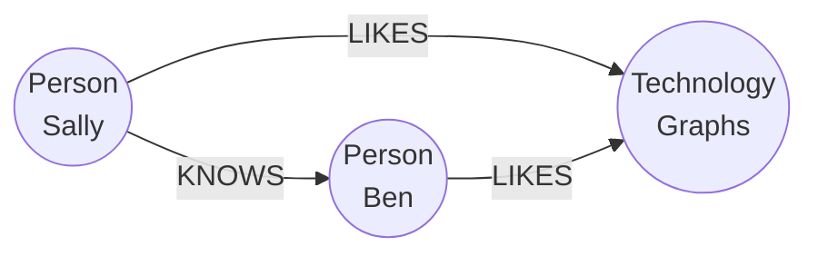

# Time-series and graph databases

> **8-minute read. Two specialized stores, and how to tell whether you need one.**

## The one-line answer

A **time-series database** is built for data that arrives stamped with a time and is mostly appended and queried by time range (metrics, sensor readings, events). A **graph database** is built for data where the relationships are the point (who follows whom, which account paid which). Both are answers to "a general table does this awkwardly at scale".

## Time-series

Typical shape: very many rows, mostly inserts, almost never updated, queried like "the last hour" or "daily average for March".

The usual trick is to **partition by time**. TimescaleDB's hypertable is a PostgreSQL table that automatically partitions time-series data by time into **chunks** (a day or a week, adjustable). A query for a time range reads only the matching chunks, and old chunks stay small and independent. You use it like a normal PostgreSQL table, per the vendor docs.

Other things these stores add (general features; verify per product): downsampling old data into hourly or daily rollups, retention rules that drop old chunks, and time-bucket functions.

The core query, shown as plain SQL in SQLite's dialect to show the idea:

```sql
SELECT strftime('%Y-%m-%d %H:00', ts) AS hour, AVG(temp)
FROM readings GROUP BY hour;
```

Not run: I did not execute this snippet or try TimescaleDB or Neo4j for this page.

Reach for a time-series store when volume is high, you query by time window, and you need retention and rollups. A plain partitioned table is often enough below that. See [File formats and partitioning](./file-formats-and-partitioning.md).

## Graph

A graph database stores **nodes** (things), **relationships** (typed, directed links) and **properties** (key-value pairs on either). Neo4j's Cypher query language writes patterns with round brackets for nodes and square brackets with an arrow for relationships:

```cypher
MATCH (p:Person)-[:LIKES]->(t:Technology)
RETURN p, t
```

That example is from Neo4j's getting-started page, which says graph pattern matching sits at the core of Cypher. The database finds the parts of the graph that fit the pattern.



A tiny property graph. Circles are nodes, labeled arrows are typed relationships. A query describes this shape and the database returns the matches.

Why not just joins? A relational database can store the same links in a join table. A "friends of friends of friends" question then needs a join per hop, which gets awkward and slow as depth grows. Graph stores are designed to walk relationships directly. Good fits: fraud rings, recommendations, network and dependency maps, knowledge graphs. Poor fits: ordinary reporting and aggregates, where a warehouse wins.

## Choosing

| If the question is... | Look at |
|---|---|
| "What happened in this time window?" at high volume | Time-series store, or a partitioned table |
| "How is A connected to B, in how many hops?" | Graph database |
| "Totals by category and month" | Warehouse. See [Warehouses, lakes, and lakehouses](./warehouses-lakes-lakehouses.md) |
| "Find items like this one" | [Vector database](./vector-databases-for-data-engineers.md) |

## Common mistakes

- **A specialized store for a small problem.** A normal indexed table handles millions of rows.
- **Keeping every raw point forever** with no rollups or retention.
- **A graph database for data with no deep relationships.**
- **No pipeline plan.** Either store is another target to feed and keep in sync. See [Change data capture](./change-data-capture.md).

## Official docs

- **[📖 Tiger Data (TimescaleDB): Hypertables](https://www.tigerdata.com/docs/use-timescale/latest/hypertables)** - time partitioning into chunks
- **[📖 Neo4j: Getting started with Cypher](https://neo4j.com/docs/getting-started/cypher/)** - nodes, relationships, properties, pattern matching

## What to look at next

- **[SQL vs NoSQL](./sql-vs-nosql.md)** - where specialized stores fit
- **[Indexes explained](./indexes-explained.md)** - the general-purpose alternative
- **[Vector databases for data engineers](./vector-databases-for-data-engineers.md)** - another specialized store
