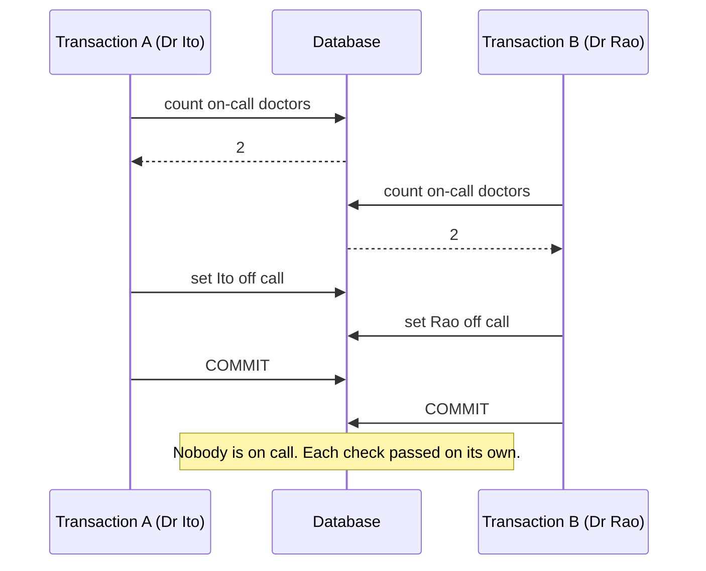

# Transactions and ACID

> **12-minute read. Assumes basic SQL. Pairs with [Eventual consistency](./eventual-consistency.md), which covers what happens when you give some of this up.**

## The one-line answer

A **transaction** is a group of database operations that succeed or fail as one unit. **ACID** is the set of four promises a transactional database makes about that unit: Atomicity, Consistency, Isolation, Durability.

Most developers lean on atomicity and durability without thinking. Isolation is the one that causes real bugs, because the default level in most databases is weaker than people assume.

## Why transactions exist

Moving 100 from Ana's account to Ben's is two writes:

```sql
UPDATE accounts SET balance = balance - 100 WHERE owner = 'Ana';
UPDATE accounts SET balance = balance + 100 WHERE owner = 'Ben';
```

If the server crashes between them, 100 has vanished. If another session reads between them, it sees a total that is 100 short. A transaction wraps both:

```sql
BEGIN;
UPDATE accounts SET balance = balance - 100 WHERE owner = 'Ana';
UPDATE accounts SET balance = balance + 100 WHERE owner = 'Ben';
COMMIT;
```

Either both changes land, or (after a crash or a `ROLLBACK`) neither does.

## The four letters

### Atomicity - all or nothing

Every statement in the transaction is applied, or none is. The database achieves this with a **write-ahead log** (WAL): changes are recorded in a log before they touch the data files, so after a crash it can replay committed work and discard uncommitted work.

### Consistency - the rules still hold

A transaction moves the database from one valid state to another. "Valid" means the constraints you declared: primary keys, foreign keys, `NOT NULL`, `CHECK (balance >= 0)`, unique constraints. If any statement would break one, the transaction fails.

This "C" is different from the "C" in the CAP theorem, which means every reader sees the latest write. Same letter, different idea. ACID consistency is only as good as the constraints you write; a database cannot enforce a business rule you never told it about.

### Isolation - concurrent transactions do not trip over each other

Ideally, transactions running at the same time behave as if they ran one after another. Doing that perfectly is expensive, so databases offer **isolation levels** that trade correctness for concurrency. The next section is about this, because it is where the bugs are.

### Durability - committed means committed

Once `COMMIT` returns, the change survives a crash or power loss. In practice that means the WAL was flushed to disk (and, in replicated systems, often to at least one other machine) before the commit was acknowledged.

## Isolation levels and the anomalies they allow

The SQL standard defines four levels by which anomalies they permit:

| Level | Dirty read | Non-repeatable read | Phantom read | Write skew |
|---|---|---|---|---|
| **Read uncommitted** | Possible | Possible | Possible | Possible |
| **Read committed** | No | Possible | Possible | Possible |
| **Repeatable read** | No | No | Possible (standard) | Possible |
| **Serializable** | No | No | No | No |

What the anomalies mean, in plain English:

- **Dirty read** - you read another transaction's change before it commits, and it then rolls back. You acted on data that never existed.
- **Non-repeatable read** - you read a row twice in one transaction and get different values, because someone committed a change in between.
- **Phantom read** - you run the same `WHERE` query twice and get a different set of rows, because someone inserted a matching row.
- **Write skew** - two transactions each read the same data, each make a decision that is valid on its own, and together they break a rule.

Defaults matter: **PostgreSQL, SQL Server, and Oracle default to read committed. MySQL InnoDB defaults to repeatable read.** Most applications run at read committed without anyone having chosen it.

## The bug read committed lets through

A hospital rule says at least one doctor must be on call. Two doctors, both on call, both click "go off call" at the same moment:

```sql
-- Both transactions run this at the same time
BEGIN;
SELECT COUNT(*) FROM doctors WHERE on_call = true;  -- both see 2
-- 2 > 1, so it is safe for me to leave
UPDATE doctors SET on_call = false WHERE name = :me;
COMMIT;
```



Write skew under read committed or snapshot isolation: two valid decisions made from the same stale read combine into an invalid state.

Neither transaction wrote a row the other wrote, so neither conflicts. The fixes:

- Run at **serializable**, and retry when the database aborts one of them.
- **Lock what you read**: `SELECT ... FOR UPDATE` on the rows the decision depends on.
- Turn the rule into a **constraint** the database enforces, where it can be expressed as one.

The same shape causes double-booked meeting rooms, oversold inventory, and two users claiming the same username when uniqueness is checked in application code instead of with a unique constraint.

## How databases implement isolation: MVCC

Older databases used locks for everything: readers blocked writers and writers blocked readers. Most modern engines (PostgreSQL, Oracle, MySQL InnoDB, SQL Server with snapshot isolation, Snowflake, every lakehouse table format) use **multi-version concurrency control** (MVCC).

Instead of overwriting a row, an update writes a new version and keeps the old one. Each transaction sees a **snapshot**: the versions that were committed when it started (or when each statement started, at read committed). Readers never block writers, and writers never block readers.

The costs: old versions pile up and must be cleaned (PostgreSQL's `VACUUM`), and a very long transaction pins old versions and bloats the table. "Do not leave a transaction open while you wait for an HTTP call" is advice that comes straight from MVCC.

## Serializable in practice

Serializable used to mean heavy locking. PostgreSQL (since 9.1) and CockroachDB use **serializable snapshot isolation**, which runs optimistically and aborts a transaction when it detects a dangerous pattern. You get correctness at modest cost, with one obligation: your code must **retry** aborted transactions (`SQLSTATE 40001`). A serializable database without retry logic just turns race conditions into error pages.

## Transactions in analytics and lakehouses

Classic data lakes had no transactions. A job that failed halfway through writing 200 files left 120 of them behind, and readers saw a half-written table.

**Open table formats** (Delta Lake, Apache Iceberg, Apache Hudi) brought ACID to object storage. A write produces new data files plus a new metadata or log entry, and the commit is a single atomic swap of the table's pointer to the new metadata. Readers see the old snapshot or the new one, never a mix. The same design gives **time travel**: query the table as of an earlier snapshot. See [Warehouses, lakes, and lakehouses](./warehouses-lakes-lakehouses.md).

Warehouses like Snowflake and BigQuery support multi-statement transactions too, but they are tuned for big batch writes, not thousands of tiny transactions per second. That workload difference is the subject of [OLTP vs OLAP](./oltp-vs-olap.md).

## Transactions across systems

A transaction lives inside one database. "Write to the database **and** publish to Kafka" is two systems, and no local transaction covers both. If the commit succeeds and the publish fails, they disagree.

The common fixes:

- **Transactional outbox** - write the event to an `outbox` table in the same transaction as the business change, and have a separate process publish it. The publisher can retry safely.
- **[Change data capture](./change-data-capture.md)** - let the database's own log be the event stream.
- **Idempotent consumers** - assume at-least-once delivery and make reprocessing harmless.

Two-phase commit (2PC) exists, but it couples every participant's availability together and is rarely used across services.

## Common mistakes

- **Autocommit surprise.** Many drivers commit every statement on its own. Two statements you thought were one transaction are two.
- **Check-then-act in application code.** `SELECT` to see if a username is free, then `INSERT` it. Use a unique constraint and handle the violation.
- **Long transactions.** Holding a transaction open across user input or network calls blocks cleanup and can hold locks.
- **Assuming serializable.** Know your database's default level and what it allows.
- **Catching the error and carrying on.** In PostgreSQL, after an error the whole transaction is aborted; later statements fail until you roll back.

## Official docs

- **[📖 PostgreSQL: Transaction Isolation](https://www.postgresql.org/docs/current/transaction-iso.html)** - each level, with exactly which anomalies PostgreSQL allows
- **[📖 PostgreSQL: Concurrency Control (MVCC)](https://www.postgresql.org/docs/current/mvcc.html)** - snapshots, locking, and serializable snapshot isolation
- **[📖 Delta Lake: Concurrency control](https://docs.delta.io/latest/concurrency-control.html)** - how a lakehouse table gets ACID on object storage

## What to look at next

- **[Eventual consistency](./eventual-consistency.md)** - what you get when you relax these guarantees for scale
- **[Replication and sharding](./replication-and-sharding.md)** - durability and scale across machines
- **[Change data capture](./change-data-capture.md)** - turning the transaction log into a data feed
- **[Indexes explained](./indexes-explained.md)** - the other structures every write has to keep in step
- **[Idempotency explained](https://cloud.noblerworks.com/learn/concepts/idempotency-explained/)** - surviving retries across system boundaries
