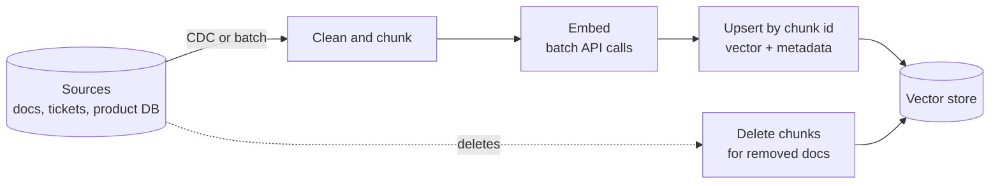

# Vector databases for data engineers

> **8-minute read. The data engineer's view: storage, pipelines and operations. For embeddings, retrieval quality and RAG design, see [AI Zero to Hero](https://ai.noblerworks.com/).**

## The one-line answer

A **vector database** stores **embeddings** (long lists of numbers that represent the meaning of text, images or other items) and finds the ones nearest to a query vector, fast. To a data engineer it is one more serving store, fed by a pipeline, with its own indexing, freshness, cost and governance concerns.

## What is being stored

An embedding model turns a chunk of text into a vector, for example 1,024 floating-point numbers. Chunks with similar meaning get vectors that are close together. A search embeds the question and asks for the nearest stored vectors.

The model and retrieval side of that story - how embeddings work, chunking strategy, retrieval quality, RAG - is covered on the AI site: **[Embeddings and vector search](https://ai.noblerworks.com/learn/concepts/embeddings-and-vector-search/)** and **[RAG explained](https://ai.noblerworks.com/learn/concepts/rag-explained/)**. This page is about the part that looks like data engineering.

A stored record is usually:

```text
id         | doc-8812#chunk-4
vector     | [0.0123, -0.0841, ..., 0.0377]   (1,024 floats)
text       | "Refunds are issued within 14 days of..."
metadata   | {source: "help-center", product: "pro", lang: "en",
              updated_at: "2026-10-02", acl: ["support", "all-staff"]}
model      | embed-v3
```

The metadata matters as much as the vector. Real queries are almost always "nearest vectors **where** product = pro **and** the user may see it".

## Why it needs a special index

Finding the exact nearest neighbors means comparing the query to every stored vector. At ten million vectors of 1,024 dimensions, that is around ten billion multiplications per query. Vector stores use **approximate nearest neighbor** (ANN) indexes instead, which trade a little accuracy (recall) for orders of magnitude of speed.

| Index | Idea | Trade-off |
|---|---|---|
| **HNSW** | A layered graph; search hops toward the query | Fast, high recall, memory-hungry, slower to build |
| **IVF** | Cluster vectors; search only the nearest clusters | Less memory, recall depends on how many clusters you probe |
| **Product quantization (PQ)** | Compress vectors into short codes | Much smaller, some recall loss; often combined with IVF |
| **DiskANN-style** | Graph index designed to live on SSD | Large datasets without all of it in RAM |

Every one has tuning knobs (HNSW's `m` and `ef_search`, IVF's list and probe counts) that move along the same curve: more recall costs more latency, memory or build time. Measure recall on your own queries before and after changing them.

## Where vectors can live

You do not always need a new database:

| Option | Examples | Good when |
|---|---|---|
| **Extension to your OLTP database** | PostgreSQL + pgvector, Azure SQL / SQL Server vectors, MongoDB Atlas Vector Search | Up to tens of millions of vectors; you want joins, transactions and one less system |
| **Search engine** | OpenSearch, Elasticsearch | You also need keyword (BM25) search and want hybrid ranking |
| **Warehouse / lakehouse** | BigQuery vector search, Snowflake vector type, Databricks Vector Search | Analytical or batch similarity over data already in the platform |
| **Dedicated vector DB** | Pinecone, Weaviate, Qdrant, Milvus | Very large scale, high query rates, specialized features |
| **Cloud-native** | Amazon S3 Vectors, Vertex AI Vector Search, Azure AI Search | Managed, pay-per-use, integrated with the provider's AI services |

A short decision rule: start with pgvector or your existing platform's vector support, and move to a dedicated store when measured scale or latency needs it. The AI site's **[vector database decision guide](https://ai.noblerworks.com/tools/decisions/vector-database/)** compares the products in depth.

pgvector, for a sense of how ordinary it can be:

```sql
CREATE EXTENSION IF NOT EXISTS vector;

CREATE TABLE doc_chunks (
  id          text PRIMARY KEY,
  product     text,
  updated_at  timestamptz,
  body        text,
  embedding   vector(1024)
);

CREATE INDEX ON doc_chunks USING hnsw (embedding vector_cosine_ops);

SELECT id, body
FROM doc_chunks
WHERE product = 'pro'
ORDER BY embedding <=> :query_embedding   -- cosine distance
LIMIT 5;
```

## The pipeline is the hard part

The vector store is the easy bit. Keeping it correct is a normal data pipeline problem:



An embedding pipeline. Changed source documents are re-chunked, re-embedded and upserted by stable id; deleted documents must be deleted from the index too.

The questions to answer, all familiar from the rest of this site:

- **Incremental updates.** Re-embedding everything nightly is slow and costs money per token. Detect changed documents (a content hash, `updated_at`, or [CDC](./change-data-capture.md)) and re-embed only those.
- **Deletes.** A document removed from the source must disappear from the index. Stale vectors are how a chatbot quotes a withdrawn policy. Use stable chunk ids derived from the source id so deletes and updates can find their rows.
- **Model versions.** Vectors from two embedding models are not comparable. Changing the model means re-embedding the whole corpus into a new index and switching over, like any blue-green migration. Store the model name on every row.
- **Idempotency and retries.** Embedding APIs rate-limit and fail. Batch, retry with backoff, and make upserts idempotent.
- **Freshness SLAs.** Decide how stale the index may be, and monitor it like any other [data quality](./data-quality-and-lineage.md) check.
- **Access control.** If the source has permissions, the index must enforce them at query time, usually by filtering on ACL metadata. An index that ignores source permissions leaks documents to whoever asks the right question. See [Security Zero to Hero](https://security.noblerworks.com/).
- **Cost.** Embedding calls, index memory and replicas all scale with corpus size. Memory, not disk, usually decides the bill for HNSW.

## Common mistakes

- **A new database for 50,000 vectors.** pgvector or your warehouse handles that easily.
- **No metadata filters**, then trying to bolt permissions on later.
- **Forgetting deletes**, so the index slowly fills with content that no longer exists.
- **Mixing embedding models** in one index.
- **Treating retrieval quality as the vector store's job.** Chunking and the embedding model usually matter more than the index type. That side is on the [AI site](https://ai.noblerworks.com/).

## Official docs

- **[📖 pgvector](https://github.com/pgvector/pgvector)** - vector type, distance operators, HNSW and IVFFlat indexes for PostgreSQL
- **[📖 Amazon S3 Vectors](https://docs.aws.amazon.com/AmazonS3/latest/userguide/s3-vectors.html)** - vector buckets and indexes in object storage
- **[📖 BigQuery: Introduction to vector search](https://cloud.google.com/bigquery/docs/vector-search-intro)** - vector indexes and `VECTOR_SEARCH` inside a warehouse

## What to look at next

- **[Embeddings and vector search](https://ai.noblerworks.com/learn/concepts/embeddings-and-vector-search/)** - the AI side of the same topic
- **[Build a RAG pipeline](https://ai.noblerworks.com/build/projects/build-rag-pipeline/)** - a hands-on build that uses a vector store
- **[Indexes explained](./indexes-explained.md)** - how ordinary database indexes compare
- **[Change data capture](./change-data-capture.md)** - keeping an index in sync with its source
