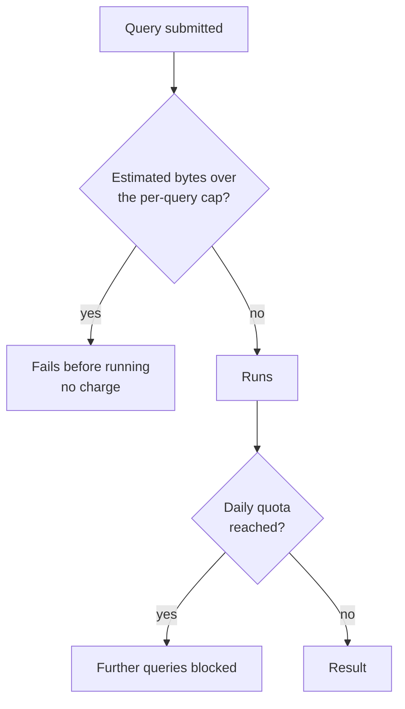

# Warehouse cost control

> **8-minute read. FinOps for data: finding out why the bill moved and putting a ceiling on it. No prices here, because they change; check your provider.**

## The one-line answer

Warehouse cost comes from two things: **how much data your queries read** and **how long compute runs**. Cost control is making both visible, trimming waste, and adding hard limits so one bad query cannot spend the month's budget.

## Find out which model you pay under

| Model | You pay for | Main lever |
|---|---|---|
| **Per data scanned** (BigQuery on-demand) | Bytes processed by each query | Read less data |
| **Per compute time or capacity** (Snowflake warehouses, BigQuery slot reservations) | Compute that is running or reserved | Right-size it, suspend it, cap it |

The BigQuery cost page puts it this way: on-demand compute is billed by bytes processed, and its controls are project or user daily quotas plus a maximum bytes billed setting; capacity compute is billed for slots, where you can cap maximum slots, buy commitments or use autoscaling.

## Cut waste first

- **Read fewer bytes.** Partition tables on the columns queries filter by and select only the columns you need (both are advice on BigQuery's query-optimization page; clustering shows up on the cost page only in the `LIMIT` note below). See [File formats and partitioning](./file-formats-and-partitioning.md). On a non-clustered BigQuery table, `LIMIT` does not reduce the data read; on a clustered one it can.
- **Look before you run.** BigQuery's dry run (or the console validator) returns the estimated bytes without running the query. The estimate is an upper bound.
- **Preview instead of querying.** Table preview and `bq head` do not incur query charges.
- **Do not recompute what you can store.** Incremental models beat full rebuilds. See [Analytics engineering and dbt](./analytics-engineering-and-dbt.md).
- **Switch off idle compute.** Auto-suspend and short idle timers are the usual first win on warehouse-style billing (a general practice; verify the setting names on your platform).

## Then add guardrails

Layered limits on a scan-priced warehouse. A per-query bytes cap rejects a single huge query up front, and a daily quota stops the cumulative spend.

- **BigQuery:** a maximum bytes billed setting makes a query fail before running (and unbilled) if its estimate exceeds the cap. Custom daily quotas limit bytes processed per project or per user; once reached, users cannot run queries.
- **Snowflake resource monitors:** set a credit quota per interval (monthly by default). Triggers fire at percentages of the quota: up to five Notify actions, plus Suspend (let running statements finish) and Suspend Immediate (cancel them). A monitor covers all warehouses (one per account) or chosen warehouses. It does not cover serverless features, which need a budget instead.

## Make spend visible

Tag or label every warehouse, project and job by team and purpose, then report cost per team and per pipeline weekly. The most useful question is "what changed?" A new dashboard refreshing every minute is a common answer. Pair this with the general ideas in [Cloud cost basics](https://cloud.noblerworks.com/learn/concepts/cloud-cost-basics/).

## Common mistakes

- **Alerts without limits.** A notification at 80% helps only if someone acts before the weekend.
- **Cutting the wrong thing.** Saving cents on storage while a scheduled `SELECT *` scans a petabyte.
- **No owner per workload**, so nobody feels the bill.
- **Limits so tight** that production jobs fail. Give pipelines their own budgets.

I did not run any of these controls for this page; they are described from the docs.

## Official docs

- **[📖 BigQuery: Estimate and control costs](https://docs.cloud.google.com/bigquery/docs/best-practices-costs)** - dry runs, maximum bytes billed, quotas, pricing models
- **[📖 BigQuery: Optimize query computation](https://docs.cloud.google.com/bigquery/docs/best-practices-performance-compute)** - query only the columns you need, filter on partitions
- **[📖 Snowflake: Resource monitors](https://docs.snowflake.com/en/user-guide/resource-monitors)** - credit quotas, notify and suspend triggers

## What to look at next

- **[Warehouses, lakes, and lakehouses](./warehouses-lakes-lakehouses.md)** - what you are paying for
- **[File formats and partitioning](./file-formats-and-partitioning.md)** - the biggest scan-cost lever
- **[Cloud cost basics](https://cloud.noblerworks.com/learn/concepts/cloud-cost-basics/)** - the cloud-wide view
