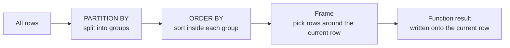

# Window functions explained

> **10-minute read. Assumes `GROUP BY` and [joins](./sql-joins-explained.md) are comfortable.**

## The one-line answer

A **window function** computes a value across a set of related rows, but unlike `GROUP BY` it keeps every row. You get the detail and the aggregate side by side.

That one property solves a family of problems that are painful any other way: running totals, rankings, "latest row per customer", period-over-period change, and deduplication.

## GROUP BY versus a window

`GROUP BY` collapses rows. Ten orders for one customer become one row with a total.

```sql
SELECT customer_id, SUM(amount) AS total
FROM orders
GROUP BY customer_id;
```

A window keeps all ten rows, and attaches the total to each one:

```sql
SELECT order_id, customer_id, amount,
       SUM(amount) OVER (PARTITION BY customer_id) AS customer_total
FROM orders;
```

| order_id | customer_id | amount | customer_total |
|---|---|---|---|
| 101 | 1 | 50 | 80 |
| 102 | 1 | 30 | 80 |
| 103 | 2 | 20 | 20 |

Now "what share of this customer's spend was this order?" is one more column: `amount / customer_total`. With `GROUP BY` you would need a subquery and a join back.

## The anatomy of OVER

```sql
function(...) OVER (
  PARTITION BY ...   -- which rows belong together (like GROUP BY, without collapsing)
  ORDER BY ...       -- the order within each partition
  ROWS BETWEEN ...   -- the frame: which rows around the current one count
)
```



How a window function is evaluated: partition, then order, then a frame per row, then a result added to that row without removing any.

All three parts are optional. An empty `OVER ()` treats the whole result as one window.

## The three families

| Family | Functions | Answers |
|---|---|---|
| **Ranking** | `ROW_NUMBER`, `RANK`, `DENSE_RANK`, `NTILE` | "Which is first?" "What is the top 3 per group?" |
| **Offset** | `LAG`, `LEAD`, `FIRST_VALUE`, `LAST_VALUE` | "What was the previous value?" "What changed?" |
| **Aggregate** | `SUM`, `AVG`, `COUNT`, `MIN`, `MAX` with `OVER` | Running totals, moving averages, share of total |

## Pattern 1: latest row per key (deduplication)

The single most useful window query in data engineering. A source sends the same customer several times as it changes, and you want the latest version of each.

```sql
SELECT *
FROM (
  SELECT *,
         ROW_NUMBER() OVER (
           PARTITION BY customer_id
           ORDER BY updated_at DESC
         ) AS rn
  FROM raw_customers
) t
WHERE rn = 1;
```

Snowflake, BigQuery, Databricks and DuckDB support `QUALIFY`, which filters on a window result directly and removes the subquery:

```sql
SELECT *
FROM raw_customers
QUALIFY ROW_NUMBER() OVER (PARTITION BY customer_id ORDER BY updated_at DESC) = 1;
```

Watch the tie-breaker. If two rows share the same `updated_at`, `ROW_NUMBER` picks one arbitrarily, and the pick can change between runs. Add a second sort column that is unique (`ORDER BY updated_at DESC, ingested_at DESC, _row_id DESC`) so the result is deterministic.

## Pattern 2: ROW_NUMBER vs RANK vs DENSE_RANK

They differ only on ties. Scores of 90, 85, 85, 70:

| score | ROW_NUMBER | RANK | DENSE_RANK |
|---|---|---|---|
| 90 | 1 | 1 | 1 |
| 85 | 2 | 2 | 2 |
| 85 | 3 | 2 | 2 |
| 70 | 4 | 4 | 3 |

Use `ROW_NUMBER` when you need exactly one row per position (dedup, pagination). Use `RANK` for "competition ranking" where ties share a place and the next place is skipped. Use `DENSE_RANK` for "top 3 distinct values".

## Pattern 3: running totals and moving averages

```sql
SELECT order_date, daily_revenue,
       SUM(daily_revenue) OVER (ORDER BY order_date) AS revenue_to_date,
       AVG(daily_revenue) OVER (
         ORDER BY order_date
         ROWS BETWEEN 6 PRECEDING AND CURRENT ROW
       ) AS revenue_7day_avg
FROM daily_sales;
```

The frame is where most window bugs live. When you write `ORDER BY` without a frame, the default in most engines is `RANGE BETWEEN UNBOUNDED PRECEDING AND CURRENT ROW`. `RANGE` treats rows with the **same** `ORDER BY` value as one peer group, so two rows on the same date both get the total including each other. That is usually what you want for a running total per date, and usually not what you want for a running total per order. Say `ROWS` explicitly when you mean physical rows.

A second trap: `ROWS BETWEEN 6 PRECEDING` means six **rows**, not six days. If a day has no sales and no row, the "7-day" average quietly covers eight days. Build a complete date spine first (a [cross join](./sql-joins-explained.md) against a calendar table), or use a `RANGE` frame with an interval where the engine supports it.

## Pattern 4: what changed since last time

`LAG` reads the previous row in the partition. Month-over-month growth:

```sql
SELECT month, revenue,
       LAG(revenue) OVER (ORDER BY month) AS prev_revenue,
       ROUND(100.0 * (revenue - LAG(revenue) OVER (ORDER BY month))
             / NULLIF(LAG(revenue) OVER (ORDER BY month), 0), 1) AS pct_change
FROM monthly_revenue;
```

The same function finds gaps and state changes: the time between a user's sessions, or the moment a subscription status flipped from `active` to `cancelled`.

## Pattern 5: gaps and islands

"How many consecutive days did each user log in?" is a famous interview question, and windows solve it neatly. Subtract a row number from the date. Consecutive dates produce the same result, which becomes the group key.

```sql
WITH d AS (
  SELECT user_id, login_date,
         login_date - CAST(ROW_NUMBER() OVER (
           PARTITION BY user_id ORDER BY login_date) AS INT) AS streak_key
  FROM (SELECT DISTINCT user_id, login_date FROM logins) x
)
SELECT user_id, MIN(login_date) AS streak_start, COUNT(*) AS streak_days
FROM d
GROUP BY user_id, streak_key;
```

Date arithmetic syntax differs by engine (`DATEADD`, `DATE_SUB`), but the trick is the same everywhere.

## Where window functions run in the query

Logically, windows are evaluated **after** `WHERE`, `GROUP BY` and `HAVING`, and **before** `ORDER BY` and `LIMIT`. Two consequences:

- You cannot filter on a window result in `WHERE`. Use a subquery, a CTE, or `QUALIFY`.
- `WHERE` filters rows before the window sees them. If you filter to October and then compute `LAG`, the first October row has no previous month, even though September exists in the table.

## Performance

Each distinct `PARTITION BY ... ORDER BY` combination needs its own sort. Five window columns with five different orderings means five sorts over the data. Where you can, give several functions the same window (named windows help: `WINDOW w AS (PARTITION BY customer_id ORDER BY updated_at)`), and the engine sorts once.

In distributed engines, `PARTITION BY` also decides how data is shuffled. A window with no `PARTITION BY` over a billion rows forces everything onto one worker. A running total across the whole table is a single-threaded operation however big your cluster is.

## Official docs

- **[📖 PostgreSQL: Window Functions tutorial](https://www.postgresql.org/docs/current/tutorial-window.html)** - the clearest introduction from any vendor
- **[📖 PostgreSQL: Window function reference](https://www.postgresql.org/docs/current/functions-window.html)** - every ranking and offset function
- **[📖 Snowflake: QUALIFY](https://docs.snowflake.com/en/sql-reference/constructs/qualify)** - filtering on window results without a subquery

## What to look at next

- **[SQL joins explained](./sql-joins-explained.md)** - the other half of everyday SQL
- **[Slowly changing dimensions](./slowly-changing-dimensions.md)** - where `LEAD` builds `valid_to` dates
- **[Analytics engineering and dbt](./analytics-engineering-and-dbt.md)** - where these queries end up living as tested models
- **[OLTP vs OLAP](./oltp-vs-olap.md)** - why windows over millions of rows belong in a warehouse
