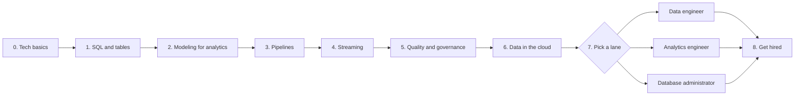

# Data from Scratch

> **The plain-English path from "what is a table?" to working as a data engineer, analytics engineer, or database administrator. Eight phases, each ending with something you can actually do.**
>
> No exam required. Certifications are named where they help, but every phase stands on its own.

---

## How to use this path

Work through the phases in order. Each one lists:

- **Learn** - the concept pages on this site to read first
- **Do** - a small exercise or build that proves you understood it
- **After this phase** - what you can now do that you could not before
- **Certify (optional)** - exams that test the same ground

Most people spend a few weeks per phase alongside a job. Phases 1 to 4 are shared by every data role. Phase 7 is where the three roles split.

The diagram shows the eight phases in order, with the path branching into three roles at phase 7 and joining again for interview prep.

---

## Phase 0 - Tech basics (skip if you already use a terminal)

Data work happens in terminals, notebooks and cloud consoles. If those are new, start on the sister site.

- **Learn:** [Day One](https://cloud.noblerworks.com/learn/day-one/) on Cloud Zero to Hero - terminal, git, HTTP, servers, JSON and YAML, assuming nothing.
- **Do:** install Python, open a terminal, and run `python3 --version`. Work through the first few chapters of the official [Python tutorial](https://docs.python.org/3/tutorial/).
- **After this phase:** you can run a script, read an error message, and save your work in git.

---

## Phase 1 - SQL and relational thinking

SQL is the one skill every data role uses every day. Learn it before any tool.

- **Learn:** [SQL vs NoSQL](./concepts/sql-vs-nosql.md) for the big picture, then the [Databases topic index](../topics/databases.md) for where each engine fits.
- **Do:** load a public CSV into SQLite or PostgreSQL. Write queries with `SELECT`, `WHERE`, `GROUP BY`, `JOIN`, and one window function (`ROW_NUMBER()` or `SUM() OVER`).
- **After this phase:** you can answer a business question ("which product sold best last month, by region?") straight from raw tables.
- **Certify (optional):** [Azure Data Fundamentals (DP-900)](../exams/azure/dp-900/) covers relational, non-relational and analytics basics at an entry level.

---

## Phase 2 - Modeling data for analytics

Operational databases are shaped for writing one order at a time. Analytics wants the opposite: reading millions of rows at once. Modeling is how you bridge the two.

- **Learn:** [Warehouses, lakes, and lakehouses](./concepts/warehouses-lakes-lakehouses.md), then [Data modeling for analytics](./concepts/data-modeling-for-analytics.md) (star schemas, facts and dimensions, slowly changing dimensions).
- **Do:** take the tables from phase 1 and redesign them as one fact table and three dimension tables. Rewrite your phase 1 queries against the new model.
- **After this phase:** you can explain why a warehouse is laid out differently from an app database, and design a star schema for a simple business.

---

## Phase 3 - Pipelines: moving and transforming data

Data rarely starts where it is needed. A pipeline extracts it, cleans it, and lands it somewhere useful, on a schedule, without a human pressing a button.

- **Learn:** [ETL vs ELT](./concepts/etl-vs-elt.md), [File formats and partitioning](./concepts/file-formats-and-partitioning.md) (why Parquet beats CSV at scale), and [Data pipelines and orchestration](./concepts/data-pipelines-and-orchestration.md).
- **Do:** the [Build a data pipeline](../resources/hands-on-projects/build-data-pipeline.md) lab. It takes four to five hours and covers ingest, transform and load with scheduled runs.
- **Read alongside:** the [Data pipeline and ETL pattern](../resources/architecture-patterns/data-pipeline-etl.md) for how the same shape looks on AWS, Azure and GCP.
- **After this phase:** you can build a scheduled job that pulls data from a source, cleans it, and loads it into a warehouse, and rerun it safely when it fails halfway.

---

## Phase 4 - Streaming and event data

Batch pipelines run every hour or every night. Some data cannot wait that long: payments, sensor readings, clickstreams.

- **Learn:** [Batch vs streaming](./concepts/batch-vs-streaming.md), [Queues vs streams](./concepts/queues-vs-streams.md), and [Eventual consistency](./concepts/eventual-consistency.md).
- **Compare:** [Messaging and queue services across clouds](../resources/service-comparison-messaging-queues.md).
- **Do:** run Kafka (or a managed equivalent) locally, produce a stream of fake events, and write a consumer that keeps a running count per key.
- **After this phase:** you can tell when a problem needs a stream and when a nightly batch is the cheaper, simpler answer.
- **Certify (optional):** [Confluent Certified Developer](../exams/confluent/certified-developer/) for Kafka application work, [Confluent Certified Administrator](../exams/confluent/certified-administrator/) for running clusters.

---

## Phase 5 - Quality, lineage and governance

A pipeline that runs on time with wrong numbers is worse than one that fails loudly. This phase is what separates hobby projects from production data.

- **Learn:** [Data quality and lineage](./concepts/data-quality-and-lineage.md).
- **Read:** the [Data mesh pattern](../resources/architecture-patterns/data-mesh.md), which treats each team's data as a product with an owner and a contract.
- **Do:** add three checks to your phase 3 pipeline (row count not zero, no null primary keys, totals match the source) and make the pipeline stop when one fails.
- **After this phase:** you can say where a number on a dashboard came from, and catch bad data before a stakeholder does.
- **Related:** access control and data privacy are covered on [Security Zero to Hero](https://security.noblerworks.com/).

---

## Phase 6 - Data in the cloud

Most data platforms now run on a cloud provider or a cloud data platform. You do not need to master a whole cloud, but you need its storage, identity and compute basics.

- **Learn the cloud basics first:** [Cloud from Scratch](https://cloud.noblerworks.com/learn/cloud-from-scratch/) on Cloud Zero to Hero (compute, storage, networking, identity).
- **Learn the data platforms:** the [Lakehouse architecture pattern](../resources/architecture-patterns/lakehouse-architecture.md), then [Database services across clouds](../resources/service-comparison-databases.md).
- **Do:** rebuild your phase 3 pipeline on one cloud: object storage for raw files, a managed warehouse or lakehouse for the modeled tables, and the cloud's scheduler or a managed orchestrator.
- **After this phase:** you can design a small data platform on one cloud and explain what each piece costs you to run.
- **Certify (optional):** pick the cloud you use at work - [AWS Data Engineer Associate (DEA-C01)](../exams/aws/associate/data-engineer-dea-c01/), [Fabric Data Engineer (DP-700)](../exams/azure/dp-700/), or [Google Cloud Professional Data Engineer](../exams/gcp/data-engineer/).

---

## Phase 7 - Pick a lane

The first six phases are shared. Here the three roles diverge. Pick the one closest to the work you enjoyed most.

### Data engineer

You build and run the pipelines and platforms everyone else depends on.

- **Go deeper on:** Spark and lakehouse engines, orchestration, streaming at scale, cost control.
- **Certs, in a sensible order:** a cloud data engineer cert from phase 6, then [Databricks Data Engineer Associate](../exams/databricks/data-engineer-associate/) and [Professional](../exams/databricks/data-engineer-professional/), or [SnowPro Core](../exams/snowflake/snowpro-core/) and [SnowPro Advanced Data Engineer](../exams/snowflake/snowpro-advanced-data-engineer/).
- **Full roadmap:** [Data engineer certification roadmap](../resources/certification-roadmap-data-engineer.md) and the [data engineering topic index](../topics/data-engineering.md).

### Analytics engineer

You turn raw tables into trusted models and the dashboards the business reads. More SQL and modeling, less infrastructure.

- **Go deeper on:** dimensional modeling (phase 2), transformation-as-code with tests, semantic layers, BI tools.
- **Certs:** [Power BI Data Analyst (PL-300)](../exams/azure/pl-300/), [Fabric Analytics Engineer (DP-600)](../exams/azure/dp-600/), [SnowPro Core](../exams/snowflake/snowpro-core/).
- **Build:** take your phase 6 warehouse, add a tested model layer, and publish one dashboard that a non-technical friend can read without help.

### Database administrator (DBA)

You keep databases fast, available, backed up and secure. Fewer pipelines, more depth in one or two engines.

- **Go deeper on:** indexing and query plans, backup and restore, replication and failover, migrations between engines.
- **Certs:** [Azure Database Administrator (DP-300)](../exams/azure/dp-300/), [Google Cloud Professional Cloud Database Engineer](../exams/gcp/cloud-database-engineer/), [MongoDB Associate DBA](../exams/mongodb/associate-dba/), [Cosmos DB (DP-420)](../exams/azure/dp-420/) for globally distributed NoSQL.
- **Read:** the [Database migration guide](../resources/migration-guides/database-migration.md) and the [Database specialist roadmap](../resources/certification-roadmap-database-specialist.md).

---

## Phase 8 - Get hired

- **Read:** [Data engineer interview prep](../resources/interview-prep/data-engineer-interview.md) - pipeline design, data modeling and SQL questions.
- **Quick refresher:** [Data engineer in 1 hour](../resources/playlist-data-engineer-1hour.md), a curated reading order through this site.
- **Show your work:** put the pipeline from phases 3 to 6 on GitHub with a README that explains the design, the checks from phase 5, and what you would change at ten times the data.
- **Practice:** every cert above has a [practice question bank](../resources/practice-questions/) with explained answers.

---

## Where this path stops

- **Machine learning and AI** are on the sister site, [AI Zero to Hero](https://ai.noblerworks.com/). Start with its [zero to hero path](https://ai.noblerworks.com/learn/start-here/zero-to-hero-path/). The pipelines and models you built here are what ML systems are fed from.
- **Cloud infrastructure** beyond what a data platform needs (networking, Kubernetes, DevOps) is on [Cloud Zero to Hero](https://cloud.noblerworks.com/).
- **Security** (identity, encryption, compliance such as GDPR and HIPAA) is on [Security Zero to Hero](https://security.noblerworks.com/).

---

## Related

- [Concepts](./concepts/) - every data concept page on one list
- [Study Hub](../STUDY-HUB.md) - every data certification, by provider
- [Topic indexes](../topics/) - databases and data engineering, across every pillar
