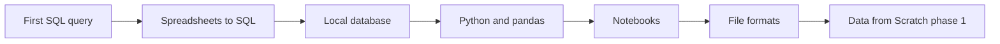

# Day One - Your First Day With Data

> **You have never written a SQL query. You may live in spreadsheets today. You have heard "pandas", "Parquet" and "notebook" and nodded along.**
>
> **This is for you.**

---

## What this section is

Six pages, in order. Each is a 10-20 minute read with code you run on your own computer. Every sample on these pages was run before it was written down, and the output you see is the real output (the versions are listed below).

All six pages use the same tiny `orders.csv` file (10 rows), so the answers stay familiar while the tools change. No cloud account is needed. Everything runs locally and costs nothing.

## Suggested order

1. **[Your first SQL query](./first-sql-query.md)** - `SELECT`, `WHERE`, `ORDER BY` and `GROUP BY` on a real file, with the mistakes everyone makes. (20 min)
2. **[From spreadsheets to SQL](./spreadsheets-to-sql.md)** - what a filter, a pivot table, `SUMIF` and `VLOOKUP` become in SQL. (12 min)
3. **[A local database to practice on](./local-practice-database.md)** - DuckDB (one `pip install`) and PostgreSQL in Docker, with a way to move between them. (15 min)
4. **[Python and pandas for data](./python-and-pandas.md)** - the same questions in a DataFrame, plus a note on Polars. (15 min)
5. **[Notebooks](./notebooks.md)** - mixing code, results and notes, and the one trap that bites everyone (run order). (10 min)
6. **[CSV, JSON and Parquet in practice](./csv-json-parquet.md)** - the three file formats you will meet, with a measured size and speed comparison. (12 min)

The diagram shows the six pages in reading order, ending at the start of the full Data from Scratch path.

After these you can load a file, ask it questions, and move between tools. Next stop is [Data from Scratch](../data-from-scratch.md), phase 1.

## What you do NOT need to know yet

- Joins beyond one small example (see [SQL joins explained](../concepts/sql-joins-explained.md) later)
- Any cloud service
- Data modeling, pipelines or streaming
- Statistics

## What you DO need

- A computer with Python 3.10 or newer (`python3 --version` prints it). New to the terminal? Do [Terminal basics](https://cloud.noblerworks.com/learn/day-one/terminal-basics/) on the Cloud site first.
- A text editor. [VS Code](https://code.visualstudio.com/) is free and fine.
- Docker, for the PostgreSQL half of page 3 only. Everything else works without it.

## The environment these pages were tested in

| Tool | Version run |
|---|---|
| Python | 3.12 (virtual environment) |
| DuckDB | 2.0.0 |
| pandas | 3.1.1 |
| Polars | 2.1.0 |
| PyArrow | 26.0.1 |
| PostgreSQL (Docker image `postgres:17`) | 17.11 |

Timings quoted on page 6 come from one WSL2 laptop and will differ on yours. The shape of the result (Parquet is smaller and faster to read) does not.

## Companion resources

- **[Glossary](../glossary.md)** - look up any term you do not recognize
- **[Data from Scratch](../data-from-scratch.md)** - the full path to a data role
- **[Concepts](../concepts/)** - bite-size pages once you want depth
