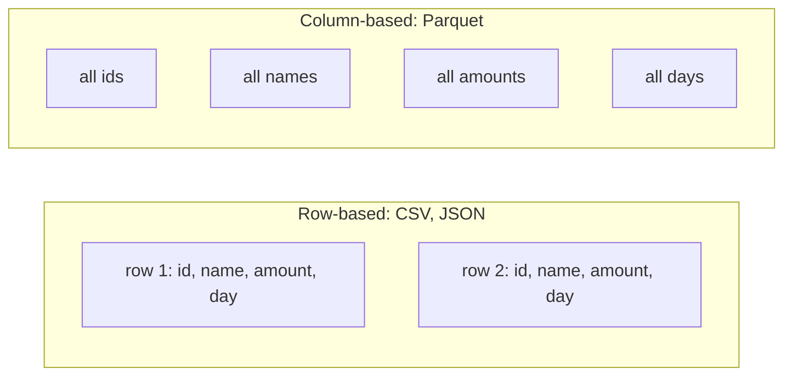

# CSV, JSON and Parquet in practice

> **12-minute read plus typing. Assumes [Your first SQL query](./first-sql-query.md) and DuckDB installed.**

## Why this page exists

Data arrives in files before it reaches a database. Three formats cover most of what you will meet: **CSV**, **JSON** and **Parquet**. Knowing what each is good at, and where each bites, saves hours. This page uses DuckDB to read all three and measures the difference on a million rows.

For the deeper design view (partitioning, ORC, Avro, table formats), see [File formats and partitioning](../concepts/file-formats-and-partitioning.md). For JSON and YAML syntax rules, see [JSON and YAML](https://cloud.noblerworks.com/learn/day-one/json-and-yaml/) on the Cloud site.

## The three, in one table

| | CSV | JSON | Parquet |
|---|---|---|---|
| Looks like | Text, one row per line | Text, nested objects and lists | Binary (not readable in an editor) |
| Stores types? | No, everything is text and the reader guesses | Partly (string, number, true/false, null) | Yes, exactly |
| Nested data? | No | Yes | Yes |
| Layout | Row by row | Row by row | Column by column |
| Compression | None unless you zip it | None unless you zip it | Built in |
| Open in Excel or a text editor? | Yes | Text editor | No, needs a tool |
| Best for | Small data, exports, sharing with anyone | APIs and nested records | Analytics and large data |

Specifications: **[📖 RFC 4180: Common Format for CSV Files](https://www.rfc-editor.org/rfc/rfc4180)** (CSV in the wild varies; this RFC records the common form), **[📖 RFC 8259: The JSON Data Interchange Format](https://www.rfc-editor.org/rfc/rfc8259)**, and the **[📖 Apache Parquet documentation](https://parquet.apache.org/docs/)**.

## CSV: universal and untyped

Our `orders.csv` is a CSV. The header is just the first line, and nothing says `order_date` is a date. DuckDB inferred it. Read DuckDB's guess:

```python
import duckdb
duckdb.sql("DESCRIBE SELECT * FROM 'orders.csv'").show()
```

```text
┌─────────────┬─────────────┬─────────┬─────────┬─────────┬─────────┐
│ column_name │ column_type │  null   │   key   │ default │  extra  │
│   varchar   │   varchar   │ varchar │ varchar │ varchar │ varchar │
├─────────────┼─────────────┼─────────┼─────────┼─────────┼─────────┤
│ order_id    │ BIGINT      │ YES     │ NULL    │ NULL    │ NULL    │
│ order_date  │ DATE        │ YES     │ NULL    │ NULL    │ NULL    │
│ customer    │ VARCHAR     │ YES     │ NULL    │ NULL    │ NULL    │
│ region      │ VARCHAR     │ YES     │ NULL    │ NULL    │ NULL    │
│ product     │ VARCHAR     │ YES     │ NULL    │ NULL    │ NULL    │
│ quantity    │ BIGINT      │ YES     │ NULL    │ NULL    │ NULL    │
│ unit_price  │ DOUBLE      │ YES     │ NULL    │ NULL    │ NULL    │
└─────────────┴─────────────┴─────────┴─────────┴─────────┴─────────┘
```

That guess is usually right and sometimes wrong. A zip code `02134` becomes the number `2134`; a column with one `N/A` becomes text. When it matters, state the types yourself (the **[📖 DuckDB CSV overview](https://duckdb.org/docs/stable/data/csv/overview)** shows how).

CSV gotchas in practice: commas inside values need quotes, the delimiter is sometimes `;` or a tab, line endings differ, and the encoding may not be UTF-8. When a CSV loads with the wrong number of columns, look at the raw text first.

## JSON: nested and flexible

JSON holds objects inside objects and lists inside objects, which CSV cannot. Here is a two-record file, `nested.json`:

```json
[{"id":1,"name":"Ava","tags":["a","b"],"address":{"city":"Boston"}},
 {"id":2,"name":"Ben","tags":[],"address":{"city":"Denver"}}]
```

DuckDB keeps the nesting:

```python
duckdb.sql("SELECT * FROM read_json('nested.json')").show()
```

```text
┌───────┬─────────┬───────────┬──────────────────────┐
│  id   │  name   │   tags    │       address        │
│ int64 │ varchar │ varchar[] │ struct(city varchar) │
├───────┼─────────┼───────────┼──────────────────────┤
│     1 │ Ava     │ [a, b]    │ {'city': Boston}     │
│     2 │ Ben     │ []        │ {'city': Denver}     │
└───────┴─────────┴───────────┴──────────────────────┘
```

A `struct` is a nested record and `varchar[]` is a list of text. Reach inside with a dot, and measure a list with `len`:

```python
duckdb.sql("SELECT id, address.city AS city, len(tags) AS n_tags FROM read_json('nested.json')").show()
```

```text
┌───────┬─────────┬────────┐
│  id   │  city   │ n_tags │
│ int64 │ varchar │ int64  │
├───────┼─────────┼────────┤
│     1 │ Boston  │      2 │
│     2 │ Denver  │      0 │
└───────┴─────────┴────────┘
```

One practical variant: **JSON Lines** (also called newline-delimited JSON, `.ndjson`) puts one complete JSON object per line, with no outer brackets. It can be read and written one line at a time, so it suits logs and big exports. See **[jsonlines.org](https://jsonlines.org/)**. DuckDB reads both forms; see the **[📖 DuckDB JSON overview](https://duckdb.org/docs/stable/data/json/overview)**.

## Parquet: the analytics format

Parquet stores each **column** together, with the type recorded and compression built in. A query that needs two columns out of twenty reads only those two.



The diagram contrasts storage order: row formats keep whole records together, Parquet keeps each column together.

## Measure it: one million rows, four files

This script generates a million fake rows, then writes the same data four ways. DuckDB does all of it. (Save as `formats.py` in a scratch folder; it writes about 175 MB of files, so delete them after.)

```python
import duckdb, os

con = duckdb.connect()
con.sql("""COPY (
  SELECT i AS id,
         'user_' || (i % 1000) AS name,
         (i * 37 % 10000) / 100.0 AS amount,
         DATE '2026-01-01' + CAST(i % 365 AS INTEGER) AS day
  FROM range(1000000) t(i)
) TO 'big.csv' (HEADER)""")
con.sql("COPY (SELECT * FROM 'big.csv') TO 'big.json' (FORMAT json, ARRAY true)")
con.sql("COPY (SELECT * FROM 'big.csv') TO 'big.ndjson' (FORMAT json, ARRAY false)")
con.sql("COPY (SELECT * FROM 'big.csv') TO 'big.parquet' (FORMAT parquet)")

for f in ["big.csv", "big.json", "big.ndjson", "big.parquet"]:
    print(f"{f:12} {os.path.getsize(f)/1e6:8.1f} MB")
```

Real output:

```text
big.csv          32.6 MB
big.json         67.6 MB
big.ndjson       65.6 MB
big.parquet       6.8 MB
```

JSON is about twice the size of CSV because every row repeats every key name. Parquet is about a fifth of the CSV. Now read speed, summing one column:

```python
import time
for f in ["big.csv", "big.parquet"]:
    t = time.time()
    r = con.sql(f"SELECT sum(amount) FROM '{f}'").fetchall()
    print(f, r, f"{time.time()-t:.3f}s")
```

```text
big.csv [(49995000.0,)] 0.145s
big.parquet [(49995000.0,)] 0.008s
```

The answer is identical. Parquet was about 18 times faster here because it read one column instead of parsing every line of text. This is one run on one WSL2 laptop with a warm file cache. Your timings will differ, and at a million rows both are fast. The gap grows with size, and it is the reason warehouses and lakes standardise on Parquet.

Check that Parquet kept the types:

```python
print(con.sql("DESCRIBE SELECT * FROM 'big.parquet'"))
```

```text
┌─────────────┬─────────────┬─────────┬─────────┬─────────┬─────────┐
│ column_name │ column_type │  null   │   key   │ default │  extra  │
│   varchar   │   varchar   │ varchar │ varchar │ varchar │ varchar │
├─────────────┼─────────────┼─────────┼─────────┼─────────┼─────────┤
│ id          │ BIGINT      │ YES     │ NULL    │ NULL    │ NULL    │
│ name        │ VARCHAR     │ YES     │ NULL    │ NULL    │ NULL    │
│ amount      │ DOUBLE      │ YES     │ NULL    │ NULL    │ NULL    │
│ day         │ DATE        │ YES     │ NULL    │ NULL    │ NULL    │
└─────────────┴─────────────┴─────────┴─────────┴─────────┴─────────┘
```

The types are stored in the file, so no guessing. See the **[📖 DuckDB Parquet overview](https://duckdb.org/docs/stable/data/parquet/overview)**. In pandas the same file is `pd.read_parquet("big.parquet")` (it needs `pyarrow`, installed here with `pip install pyarrow`; that pandas call was not run).

## Which should I use?

- **Sharing with a person, small data:** CSV.
- **Talking to an API, nested records:** JSON (or JSON Lines for streams and logs).
- **Storing data you will analyse:** Parquet.
- **A rule of thumb:** you receive CSV and JSON, you store Parquet.

## Try it yourself

1. Convert `orders.csv` to Parquet with `COPY (SELECT * FROM 'orders.csv') TO 'orders.parquet' (FORMAT parquet)` and query it with `SELECT * FROM 'orders.parquet'`.
2. Open `big.csv` and `big.json` in a text editor. Which one can you read? Try `big.parquet` too.
3. Make a CSV with a zip code like `02134`. What type does DuckDB infer?

When you finish, delete the large files: `rm big.csv big.json big.ndjson big.parquet`.

## Where to go next

You now have the first day of tools. Continue with [Data from Scratch](../data-from-scratch.md) at phase 1, or go deeper on this page's topic with [File formats and partitioning](../concepts/file-formats-and-partitioning.md).
