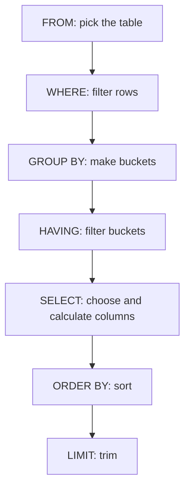

# Your first SQL query

> **20-minute read plus typing. Assumes nothing about SQL. You need Python and a terminal.**

## Why this page exists

SQL is the one skill every data role uses every day. It is also small: four ideas get you through most questions people ask of a table. This page teaches those four on a real file, and shows the errors you will hit so they are familiar when they happen.

## What SQL is

A **table** is rows and columns, like a spreadsheet tab with one rule: every column has one type (number, text, date) and every row is one thing. **SQL** (Structured Query Language, said "sequel" or "S-Q-L") is how you ask a database questions about tables. You describe the answer you want. The database works out how to get it.

## Set up in two minutes

Make a folder, a Python virtual environment, and install DuckDB, a database that runs inside Python with no server. (Page 3 explains DuckDB and PostgreSQL properly.)

```bash
mkdir sql-practice && cd sql-practice
python3 -m venv .venv
source .venv/bin/activate
pip install duckdb
```

Now create the data. Save this as `orders.csv` in the same folder. It is ten orders from a small stationery shop.

```csv
order_id,order_date,customer,region,product,quantity,unit_price
1001,2026-01-05,Ava,East,Notebook,3,4.50
1002,2026-01-06,Ben,West,Pen,10,1.20
1003,2026-01-06,Cara,East,Backpack,1,39.00
1004,2026-01-09,Dev,North,Notebook,5,4.50
1005,2026-01-12,Ava,East,Pen,20,1.20
1006,2026-01-15,Eli,West,Backpack,2,39.00
1007,2026-01-18,Ben,West,Notebook,4,4.50
1008,2026-01-21,Fay,North,Pen,15,1.20
1009,2026-01-25,Cara,East,Notebook,2,4.50
1010,2026-01-30,Gus,West,Backpack,1,39.00
```

Save this as `practice.py`. It loads the CSV into a table called `orders`, then runs one query.

```python
import duckdb

duckdb.sql("CREATE TABLE orders AS SELECT * FROM read_csv('orders.csv')")

duckdb.sql("SELECT * FROM orders").show()
```

Run it with `python practice.py`. From here on, you change the last line and run it again.

## Query 1 - SELECT: pick columns

`SELECT * FROM orders` means "give me every column from the table `orders`". Output (real, run on DuckDB 2.0.0):

```text
┌──────────┬────────────┬──────────┬─────────┬──────────┬──────────┬────────────┐
│ order_id │ order_date │ customer │ region  │ product  │ quantity │ unit_price │
│  int64   │    date    │ varchar  │ varchar │ varchar  │  int64   │   double   │
├──────────┼────────────┼──────────┼─────────┼──────────┼──────────┼────────────┤
│     1001 │ 2026-01-05 │ Ava      │ East    │ Notebook │        3 │        4.5 │
│     1002 │ 2026-01-06 │ Ben      │ West    │ Pen      │       10 │        1.2 │
│     1003 │ 2026-01-06 │ Cara     │ East    │ Backpack │        1 │       39.0 │
│     1004 │ 2026-01-09 │ Dev      │ North   │ Notebook │        5 │        4.5 │
│     1005 │ 2026-01-12 │ Ava      │ East    │ Pen      │       20 │        1.2 │
│     1006 │ 2026-01-15 │ Eli      │ West    │ Backpack │        2 │       39.0 │
│     1007 │ 2026-01-18 │ Ben      │ West    │ Notebook │        4 │        4.5 │
│     1008 │ 2026-01-21 │ Fay      │ North   │ Pen      │       15 │        1.2 │
│     1009 │ 2026-01-25 │ Cara     │ East    │ Notebook │        2 │        4.5 │
│     1010 │ 2026-01-30 │ Gus      │ West    │ Backpack │        1 │       39.0 │
└──────────┴────────────┴──────────┴─────────┴──────────┴──────────┴────────────┘
  10 rows                                                             7 columns
```

Look at the second header row: DuckDB worked out the type of each column (`int64`, `date`, `varchar` which means text, `double` which means a decimal number). Types matter because you cannot add text.

Name the columns you want instead of `*`:

```sql
SELECT customer, product, quantity FROM orders
```

```text
┌──────────┬──────────┬──────────┐
│ customer │ product  │ quantity │
│ varchar  │ varchar  │  int64   │
├──────────┼──────────┼──────────┤
│ Ava      │ Notebook │        3 │
│ Ben      │ Pen      │       10 │
│ Cara     │ Backpack │        1 │
│ Dev      │ Notebook │        5 │
│ Ava      │ Pen      │       20 │
│ Eli      │ Backpack │        2 │
│ Ben      │ Notebook │        4 │
│ Fay      │ Pen      │       15 │
│ Cara     │ Notebook │        2 │
│ Gus      │ Backpack │        1 │
└──────────┴──────────┴──────────┘
  10 rows              3 columns
```

## Query 2 - WHERE: keep some rows

`WHERE` is a filter. Only rows where the condition is true survive.

```sql
SELECT * FROM orders WHERE region = 'East'
```

```text
┌──────────┬────────────┬──────────┬─────────┬──────────┬──────────┬────────────┐
│ order_id │ order_date │ customer │ region  │ product  │ quantity │ unit_price │
│  int64   │    date    │ varchar  │ varchar │ varchar  │  int64   │   double   │
├──────────┼────────────┼──────────┼─────────┼──────────┼──────────┼────────────┤
│     1001 │ 2026-01-05 │ Ava      │ East    │ Notebook │        3 │        4.5 │
│     1003 │ 2026-01-06 │ Cara     │ East    │ Backpack │        1 │       39.0 │
│     1005 │ 2026-01-12 │ Ava      │ East    │ Pen      │       20 │        1.2 │
│     1009 │ 2026-01-25 │ Cara     │ East    │ Notebook │        2 │        4.5 │
└──────────┴────────────┴──────────┴─────────┴──────────┴──────────┴────────────┘
```

Text goes in **single quotes** (`'East'`). Join conditions with `AND` and `OR`:

```sql
SELECT * FROM orders WHERE region = 'West' AND quantity >= 2
```

```text
┌──────────┬────────────┬──────────┬─────────┬──────────┬──────────┬────────────┐
│ order_id │ order_date │ customer │ region  │ product  │ quantity │ unit_price │
│  int64   │    date    │ varchar  │ varchar │ varchar  │  int64   │   double   │
├──────────┼────────────┼──────────┼─────────┼──────────┼──────────┼────────────┤
│     1002 │ 2026-01-06 │ Ben      │ West    │ Pen      │       10 │        1.2 │
│     1006 │ 2026-01-15 │ Eli      │ West    │ Backpack │        2 │       39.0 │
│     1007 │ 2026-01-18 │ Ben      │ West    │ Notebook │        4 │        4.5 │
└──────────┴────────────┴──────────┴─────────┴──────────┴──────────┴────────────┘
```

A filter that matches nothing is not an error. It returns zero rows:

```sql
SELECT * FROM orders WHERE region = 'Mars'
```

```text
┌──────────┬────────────┬──────────┬─────────┬─────────┬──────────┬────────────┐
│ order_id │ order_date │ customer │ region  │ product │ quantity │ unit_price │
│  int64   │    date    │ varchar  │ varchar │ varchar │  int64   │   double   │
└──────────┴────────────┴──────────┴─────────┴─────────┴──────────┴────────────┘
                                     0 rows
```

Zero rows usually means a typo in the value or different capitalisation, so check that before you trust an empty answer.

## Query 3 - ORDER BY and LIMIT: sort and trim

Columns can be calculated. `quantity * unit_price` is the order total, and `AS total` names it. `ORDER BY total DESC` sorts largest first (`ASC` is the default). `LIMIT 3` keeps three rows.

```sql
SELECT order_id, customer, quantity * unit_price AS total
FROM orders
ORDER BY total DESC
LIMIT 3
```

```text
┌──────────┬──────────┬────────┐
│ order_id │ customer │ total  │
│  int64   │ varchar  │ double │
├──────────┼──────────┼────────┤
│     1006 │ Eli      │   78.0 │
│     1003 │ Cara     │   39.0 │
│     1010 │ Gus      │   39.0 │
└──────────┴──────────┴────────┘
```

Orders 1003 and 1010 tie at 39.0. SQL does not promise which of two tied rows comes first, so add a second sort column (`ORDER BY total DESC, order_id`) when you need a stable answer.

## Query 4 - GROUP BY: one row per group

This is where SQL starts to feel useful. `GROUP BY region` puts rows into one bucket per region, and **aggregate functions** (`count`, `sum`, `avg`, `min`, `max`) summarize each bucket.

```sql
SELECT region,
       count(*) AS orders,
       sum(quantity * unit_price) AS revenue
FROM orders
GROUP BY region
ORDER BY revenue DESC
```

```text
┌─────────┬────────┬─────────┐
│ region  │ orders │ revenue │
│ varchar │ int64  │ double  │
├─────────┼────────┼─────────┤
│ West    │      4 │   147.0 │
│ East    │      4 │    85.5 │
│ North   │      2 │    40.5 │
└─────────┴────────┴─────────┘
```

Ten rows became three. `WHERE` filters rows **before** grouping; `HAVING` filters groups **after**:

```sql
SELECT region, sum(quantity * unit_price) AS revenue
FROM orders
GROUP BY region
HAVING sum(quantity * unit_price) > 60
ORDER BY revenue DESC
```

```text
┌─────────┬─────────┐
│ region  │ revenue │
│ varchar │ double  │
├─────────┼─────────┤
│ West    │   147.0 │
│ East    │    85.5 │
└─────────┴─────────┘
```

Combine all four ideas. Average units per order by product, only for orders from 10 January on:

```sql
SELECT product, count(*) AS orders, avg(quantity) AS avg_qty
FROM orders
WHERE order_date >= '2026-01-10'
GROUP BY product
ORDER BY product
```

```text
┌──────────┬────────┬─────────┐
│ product  │ orders │ avg_qty │
│ varchar  │ int64  │ double  │
├──────────┼────────┼─────────┤
│ Backpack │      2 │     1.5 │
│ Notebook │      2 │     3.0 │
│ Pen      │      2 │    17.5 │
└──────────┴────────┴─────────┘
```

## The order you write it vs the order it runs

You write `SELECT` first, but the database reads the clauses in a different order. This explains most beginner confusion.



The diagram shows the logical order the clauses run in. That is why `WHERE` cannot use a column alias you create in `SELECT`: `SELECT` has not run yet.

## Three errors you will hit

**1. A typo in a column name.** Real output:

```text
Binder Error: Referenced column "regoin" not found in FROM clause!
Candidate bindings: "region", "order_id", "product"
```

Read the second line. The database suggests the fix.

**2. A column in `SELECT` that is not grouped.** Running `SELECT customer, region FROM orders GROUP BY customer` gives:

```text
Binder Error: column "region" must appear in the GROUP BY clause or must be part of an aggregate function.
Either add it to the GROUP BY list, or use ANY_VALUE("region") if the exact value of "region" is not important.
```

Each bucket has one customer but may hold several regions, so the database refuses to guess which one to show. Group by it, or aggregate it. PostgreSQL gives the same complaint in different words (page 3 shows it).

**3. Double quotes for text.** `'East'` is text. `"East"` is a column name. Use single quotes for values.

## Try it yourself

1. Which customer spent the most in total? (`GROUP BY customer`, `sum`, `ORDER BY ... DESC LIMIT 1`.)
2. How many units of each product were sold in the West?
3. What is the average order total, over all orders? (An aggregate with no `GROUP BY` returns one row.)

Check yourself after writing them: question 1 is Eli at 78.0, then Cara at 48.0.

## Go deeper

**[📖 PostgreSQL tutorial: Querying a Table](https://www.postgresql.org/docs/current/tutorial-select.html)** - the same `SELECT` ideas from the PostgreSQL manual, with a weather table.

**[📖 DuckDB: GROUP BY](https://duckdb.org/docs/stable/sql/query_syntax/groupby)** - every form of `GROUP BY` DuckDB supports, including the shorthand `GROUP BY ALL`.

**[📖 PostgreSQL: SELECT](https://www.postgresql.org/docs/current/sql-select.html)** - the full reference when you want every clause.

**Next:** [From spreadsheets to SQL](./spreadsheets-to-sql.md).
