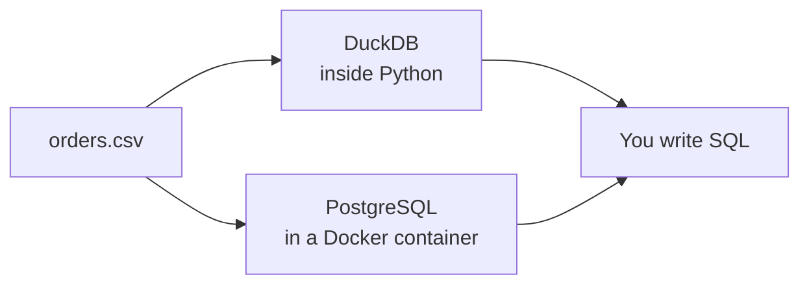

# A local database to practice on

> **15-minute read plus setup. Part 1 needs only Python. Part 2 needs Docker.**

## Why this page exists

You learn SQL by running it, so you need a database you can break without anyone noticing. This page gives you two: **DuckDB**, which is the fastest to start, and **PostgreSQL** in Docker, which is what many real systems run. Both are free and live on your own machine.

## Which one should I use?

| | DuckDB | PostgreSQL (Docker) |
|---|---|---|
| Install | `pip install duckdb` | Docker plus one `docker run` |
| Is there a server? | No. It runs inside your program | Yes. A background process you connect to |
| Best for | Analysis, files, learning | Learning how real app databases behave |
| Reads CSV/Parquet directly | Yes | No. Load the file first |
| Type of database | Analytics (column-oriented) | General purpose (row-oriented) |

The difference between row-oriented and column-oriented is explained in [OLTP vs OLAP](../concepts/oltp-vs-olap.md). For now: start with DuckDB, add PostgreSQL when you want to see a server database.



The diagram shows the same CSV loaded into either database, with the SQL you write staying nearly the same.

## Part 1 - DuckDB

Create a folder with a virtual environment, as on [page 1](./first-sql-query.md#set-up-in-two-minutes), and create `orders.csv` from that page.

```bash
python3 -m venv .venv
source .venv/bin/activate
pip install duckdb
```

(These pages were tested with a virtual environment created by `uv venv` and DuckDB 2.0.0. The `python3 -m venv` route above is the standard library route and does the same job, but it was not the one run here.)

### Query a file without loading it

DuckDB can treat a file as a table:

```python
import duckdb
duckdb.sql("SELECT count(*) AS n FROM 'orders.csv'").show()
```

### Keep a database in a file

By default the data lives in memory and disappears when your script ends. Give DuckDB a filename to keep it:

```python
import duckdb

con = duckdb.connect("practice.duckdb")
con.sql("CREATE OR REPLACE TABLE orders AS SELECT * FROM 'orders.csv'")
con.close()

con = duckdb.connect("practice.duckdb")      # a new connection, as if tomorrow
con.sql("SELECT count(*) AS n FROM orders").show()
```

```text
┌───────┐
│   n   │
│ int64 │
├───────┤
│    10 │
└───────┘
```

The table survived. `practice.duckdb` is one ordinary file (about 0.5 MB here) you can copy, email or delete. Add `*.duckdb` to your `.gitignore` if the folder is in git.

DuckDB also ships a command-line program, described in the **[📖 DuckDB CLI overview](https://duckdb.org/docs/stable/clients/cli/overview)**. It was not run for this page, which uses the Python package throughout.

## Part 2 - PostgreSQL in Docker

Check Docker works with `docker ps`. If you have never used Docker, [Your first Docker container](https://cloud.noblerworks.com/learn/day-one/docker-first-container/) on the Cloud site covers it.

Start a PostgreSQL 17 container. The name, password and port here are for practice only. Port `55432` avoids clashing with any PostgreSQL already on your machine.

```bash
docker run -d --name practice-pg \
  -e POSTGRES_PASSWORD=practice \
  -p 55432:5432 \
  postgres:17
```

The first run downloads the image, so wait a few seconds, then check it is ready:

```bash
docker exec practice-pg pg_isready -U postgres
```

```text
/var/run/postgresql:5432 - accepting connections
```

Copy the CSV in, and write a small SQL file. In PostgreSQL you declare the columns and types yourself before loading:

```bash
docker cp orders.csv practice-pg:/tmp/orders.csv
```

Save this as `load.sql`:

```sql
CREATE TABLE orders (
  order_id integer PRIMARY KEY,
  order_date date,
  customer text,
  region text,
  product text,
  quantity integer,
  unit_price numeric(8,2)
);
\copy orders FROM '/tmp/orders.csv' WITH (FORMAT csv, HEADER true)
SELECT region, count(*) AS orders, sum(quantity * unit_price) AS revenue
FROM orders GROUP BY region ORDER BY revenue DESC;
```

Run it:

```bash
docker cp load.sql practice-pg:/tmp/load.sql
docker exec practice-pg psql -U postgres -f /tmp/load.sql
```

```text
CREATE TABLE
COPY 10
 region | orders | revenue 
--------+--------+---------
 West   |      4 |  147.00
 East   |      4 |   85.50
 North  |      2 |   40.50
(3 rows)
```

Same answer as DuckDB. Note `\copy` is a `psql` command, not SQL: it reads the file and sends the rows to the server.

To get an interactive prompt, run `docker exec -it practice-pg psql -U postgres`, type queries ending in `;`, and `\q` to leave. `\d orders` describes the table.

### The same error, in PostgreSQL words

The grouping error from page 1 in PostgreSQL 17.11:

```text
ERROR:  column "orders.region" must appear in the GROUP BY clause or be used in an aggregate function
LINE 1: SELECT customer, region FROM orders GROUP BY customer
                         ^
```

Same rule, different wording. SQL is a standard, but each database has its own dialect and its own error messages.

### Stop and clean up

```bash
docker stop practice-pg      # pause it; the data stays in the container
docker start practice-pg     # resume
docker rm -f practice-pg     # delete the container and its data
```

This container has no volume, so `docker rm` deletes the data. That is fine for practice. For data you want to keep, the **[📖 PostgreSQL Docker Official Image](https://hub.docker.com/_/postgres)** page documents the `-v` volume option and the other environment variables.

## Part 3 - Use both together (optional)

DuckDB can read a running PostgreSQL database through its `postgres` extension. This is handy for pulling a table into fast analysis:

```python
import duckdb

con = duckdb.connect()
con.sql("INSTALL postgres; LOAD postgres;")
con.sql("ATTACH 'host=localhost port=55432 user=postgres password=practice dbname=postgres' AS pg (TYPE postgres)")
con.sql("""
  SELECT region, sum(quantity * unit_price) AS revenue
  FROM pg.public.orders GROUP BY region ORDER BY revenue DESC
""").show()
```

```text
┌─────────┬───────────────┐
│ region  │    revenue    │
│ varchar │ decimal(38,2) │
├─────────┼───────────────┤
│ West    │        147.00 │
│ East    │         85.50 │
│ North   │         40.50 │
└─────────┴───────────────┘
```

`INSTALL` downloads the extension the first time, so it needs internet. Note the revenue type: PostgreSQL stored `unit_price` as `numeric(8,2)` (exact decimals), so the answer is `decimal(38,2)`. DuckDB's CSV loader guessed `double` (a floating-point number). For money, exact decimals are safer, which is one reason to declare types yourself. See the **[📖 DuckDB postgres extension](https://duckdb.org/docs/stable/extensions/postgres)**.

## Try it yourself

1. In PostgreSQL, load `customers.csv` (from [page 2](./spreadsheets-to-sql.md)) and run the `LEFT JOIN`.
2. In DuckDB, save a second table into `practice.duckdb`, close Python, reopen and query it.
3. Try `INSERT INTO orders VALUES (1011, '2026-02-01', 'Hal', 'East', 'Pen', 5, 1.20);` in PostgreSQL, then run the same insert again. What does the `PRIMARY KEY` do?

## Go deeper

**[📖 DuckDB documentation](https://duckdb.org/docs/stable/)** - the full docs, including the SQL reference.

**[📖 PostgreSQL Docker Official Image](https://hub.docker.com/_/postgres)** - how to run PostgreSQL in a container.

**Next:** [Python and pandas for data](./python-and-pandas.md).
