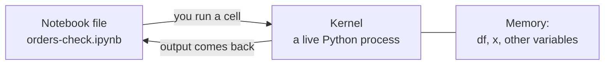

# Notebooks

> **10-minute read. Assumes [Python and pandas](./python-and-pandas.md).**

## Why this page exists

Data people spend a lot of time in **notebooks**. A notebook is a document where you write a little code, run it, see the result right under it, then write the next bit. It is how most analysis, exploration and teaching of data work is done. It is also where a very common trap lives, covered below.

## What a notebook is

A notebook is a list of **cells**. A cell is either:

- **Code** - you run it, and its output (a table, a chart, printed text) appears below it.
- **Markdown** - plain text, headings and notes, for explaining what you did.

Behind the page is a **kernel**: a running Python process that remembers everything you have defined so far. Run a cell that sets `x = 5`, and a later cell can use `x`, because the kernel still has it.



The diagram shows that the file only stores your cells and their outputs, while the kernel holds the live variables.

The file ends in `.ipynb` and is JSON underneath. That is why notebooks diff badly in git (outputs and run counters change) and why some teams strip outputs before committing.

## Ways to open one

- **VS Code** - install the Python and Jupyter extensions, open or create an `.ipynb` file, and pick your virtual environment as the kernel. Easiest if you already use VS Code.
- **JupyterLab** - the original browser interface. Install and start it per the **[📖 Jupyter install page](https://jupyter.org/install)**.
- **Hosted notebooks** - Google Colab, Databricks, SageMaker, Fabric and others run notebooks for you in the browser. The cell model is the same everywhere, so this page applies to all of them.

The notebook run described below was done from the command line. The browser and VS Code interfaces were not driven for this page, so their menu names come from the docs, not from a run.

## What was run

To keep the example honest, a small notebook was built and executed from the command line with `nbformat` and `nbconvert` (both installed with `pip install nbformat nbconvert ipykernel`). It had four code cells:

```python
# cell 1
import pandas as pd
df = pd.read_csv('orders.csv')
df.shape
```

```python
# cell 2
df['total'] = df['quantity'] * df['unit_price']
df.groupby('region')['total'].sum()
```

```python
# cell 3
x = 5
x
```

```python
# cell 4
print(x + y)
```

Notice that a notebook shows the **last expression** of a cell automatically; you do not need `print`. Real outputs, cell by cell:

```text
cell 1:  (10, 7)

cell 2:  region
         East      85.5
         North     40.5
         West     147.0
         Name: total, dtype: float64

cell 3:  5

cell 4:  NameError: name 'y' is not defined
```

Cell 4 failed because `y` was never defined, and the notebook kept going and recorded the error under that cell (this run used `--allow-errors`; in the browser, the error simply shows in red). Read the last line first: [Reading error messages](https://cloud.noblerworks.com/learn/day-one/reading-error-messages/) covers the habit.

## The trap: run order

Cells can run in any order, and the kernel remembers whatever ran, not what is written top to bottom. An example of what goes wrong (described, not run):

1. You run cell 3, `x = 5`.
2. You change cell 3 to `x = 10` but forget to rerun it.
3. A later cell using `x` still sees `5`.

Or the reverse: you delete the cell that defined `x`, the kernel still remembers it, everything seems fine, and the notebook crashes for the next person who opens it fresh.

The rules that prevent this:

- **Before you share or trust a notebook, restart the kernel and run all cells from the top.** (In Jupyter this is "Restart Kernel and Run All Cells".) If it passes, the notebook really works in order.
- Keep cells in the order they should run.
- Put all imports and file paths in the first cell.
- Do not rely on a variable you cannot point to in the cells above.

## When to use a notebook (and when not)

| Good for | Not good for |
|---|---|
| Exploring a new dataset | Code that runs every night in production |
| Showing your reasoning with charts | Big shared codebases with tests |
| Teaching and demos | Anything needing exact repeatable order |
| Quick prototypes | Long-lived programs |

A common path: explore in a notebook, then move the working logic into a `.py` script or a pipeline tool once it must run on a schedule. The [Data pipelines and orchestration](../concepts/data-pipelines-and-orchestration.md) concept page covers that next step.

## Try it yourself

1. Create a notebook, put the cell 1 and cell 2 code in it, and run them.
2. Add a Markdown cell above them saying in one sentence what the notebook finds.
3. Change `x` in a cell, do not rerun it, and watch a later cell use the old value. Then use "Restart and run all".

## Go deeper

**[📖 Jupyter documentation](https://docs.jupyter.org/en/latest/)** - the project docs for Jupyter Notebook, JupyterLab and the architecture behind kernels.

**[📖 Jupyter: installing](https://jupyter.org/install)** - the official install options.

**Next:** [CSV, JSON and Parquet in practice](./csv-json-parquet.md).
