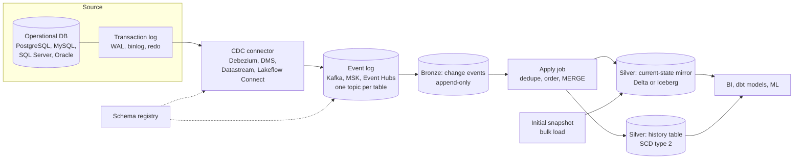

# CDC into a Lakehouse

How to copy every insert, update and delete from an operational database into open lakehouse tables (Delta Lake or Apache Iceberg) within minutes, without hammering the source, and keep the copy correct when things go wrong.

---

## The problem this solves

Most analytics starts with data that lives in an application database: orders in PostgreSQL, accounts in SQL Server, policies in Oracle. The old way to get it out was a nightly job that ran `SELECT * FROM orders` (or `WHERE updated_at > :last_run`) and dumped the result into the warehouse. That works until one of three things happens.

First, the table gets big. A full extract of a 2 billion row table every night takes hours, and it runs against the same database that serves customers. Second, the business wants fresher data. A nightly copy means every dashboard is up to a day stale, and "can we have it hourly?" turns a heavy job into a heavier job run 24 times. Third, deletes go missing. A query on `updated_at` never sees a row that was deleted, because the row is not there to have a timestamp. Your copy keeps cancelled orders forever, and nobody notices until finance reconciles.

Change data capture (CDC) fixes all three by reading the database's own change log instead of its tables. Every relational database already writes each change to a log before it commits it (the PostgreSQL write-ahead log, the MySQL binlog, the SQL Server transaction log, Oracle redo logs). A CDC tool tails that log and turns each committed change into an event: "row with key 42 in `orders` changed from this to that, at log position X". Reading the log is cheap for the source, it sees deletes, and it delivers changes seconds after they commit. The concept is covered in plain English on [Change data capture](../../learn/concepts/change-data-capture.md); this page is about the architecture you build around it.

The other half of the problem is the destination. A data lake made of plain Parquet files cannot apply an update or a delete; files are immutable. That is why this pattern targets a **table format** (Delta Lake or Apache Iceberg, sometimes Apache Hudi) that adds ACID transactions and `MERGE` on top of object storage. See [Warehouses, lakes and lakehouses](../../learn/concepts/warehouses-lakes-lakehouses.md) for why that layer matters.

---

## The reference design



The CDC-into-lakehouse reference design. A connector reads the source's transaction log and publishes one event per row change to a durable event log, with schemas held in a registry. Every event is appended untouched to a bronze table. An apply job deduplicates and orders the events per key, then merges them into a current-state mirror and, optionally, a full history table. A one-time snapshot seeds the mirror before streaming changes take over.

Five parts, each with a decision that matters more than the tool you pick:

| Part | Job | The decision that matters |
|---|---|---|
| **CDC connector** | Read the log, emit change events | How it takes the initial snapshot, and where it stores its log position (offset) |
| **Event log** | Buffer and replay changes | Retention: how far back you can replay if the apply job breaks |
| **Bronze change table** | Keep every event as received | Never update it; it is your audit trail and your replay source |
| **Apply job** | Turn events into table state | Ordering and deduplication rules per primary key |
| **Silver mirror and history** | Serve queries | Whether consumers need "now" (mirror), "as of" (history), or both |

You can skip the event log in some managed designs (Databricks Lakeflow Connect, Google Datastream, Fabric mirroring and AWS zero-ETL all write more or less directly to tables). You give up replay and fan-out to other consumers in exchange for less to run. For one source feeding one lakehouse, that trade is often right.

---

## How a change event is shaped

Understanding the event is most of understanding the pattern. A Debezium event for an update to one row looks roughly like this (trimmed):

```json
{
  "before": { "order_id": 42, "status": "PENDING", "amount": 30.00 },
  "after":  { "order_id": 42, "status": "SHIPPED", "amount": 30.00 },
  "source": { "db": "shop", "table": "orders", "lsn": 2398123344, "ts_ms": 1792771200000 },
  "op": "u",
  "ts_ms": 1792771200450
}
```

Four fields carry the logic:

- **`op`** is the operation: `c` create, `u` update, `d` delete, `r` read (a row from the initial snapshot).
- **`before` / `after`** are the row images. A delete has an `after` of null. Whether `before` is populated depends on source settings (PostgreSQL needs `REPLICA IDENTITY FULL` on the table to send full before images).
- **`source.lsn`** (or binlog file and position, or SCN on Oracle) is the position in the source log. It is the only reliable ordering key. Wall-clock timestamps can tie or go backwards; log positions do not.
- **`ts_ms`** at the top level is when the connector processed the event, not when the transaction committed. Use `source.ts_ms` for commit time.

Other tools use different shapes (AWS DMS writes an `Op` column of `I`, `U`, `D` into its output files; Datastream adds `source_metadata` with `change_type` and a `source_timestamp`), but every one of them gives you an operation, the row, and an ordering position. Your apply job is written against those three things.

---

## The apply job, step by step

The apply job is where most CDC pipelines go wrong, so it is worth walking through properly.

**1. Read a batch of new events from bronze.** Use the table format's incremental read (Delta streaming reads or change data feed, Iceberg incremental scans) or the stream offset, so each event is processed once.

**2. Keep only the latest event per key in the batch.** A single micro-batch may hold three updates to order 42. If you `MERGE` all three, most engines fail with "multiple source rows matched", and even when they do not, the winner is arbitrary. Rank by log position and keep the top one:

```sql
WITH ranked AS (
  SELECT *,
         ROW_NUMBER() OVER (
           PARTITION BY order_id
           ORDER BY source_lsn DESC
         ) AS rn
  FROM bronze_orders_changes
  WHERE batch_id = :current_batch
)
SELECT * FROM ranked WHERE rn = 1;
```

That is the same dedup pattern as on [Window functions explained](../../learn/concepts/window-functions-explained.md).

**3. Merge into the mirror, guarded by position.** The guard is what makes the job safe to re-run. If an older event arrives after a newer one has already been applied (replay, retry, or a parallel task), it must not overwrite:

```sql
MERGE INTO silver.orders AS t
USING latest_changes AS s
  ON t.order_id = s.order_id
WHEN MATCHED AND s.op = 'd' AND s.source_lsn > t.source_lsn
  THEN DELETE
WHEN MATCHED AND s.op <> 'd' AND s.source_lsn > t.source_lsn
  THEN UPDATE SET *
WHEN NOT MATCHED AND s.op <> 'd'
  THEN INSERT *;
```

Storing `source_lsn` on every mirror row costs one column and buys you idempotency: running the same batch twice changes nothing.

**4. Optionally, write history.** If consumers need "what did this order look like last Tuesday?", maintain a second table as a [slowly changing dimension type 2](../../learn/concepts/slowly-changing-dimensions.md): close the current row (`valid_to = commit time`, `is_current = false`) and insert the new version. Databricks' `AUTO CDC ... STORED AS SCD TYPE 2` and dbt snapshots both do this for you.

**A note on hard deletes.** Some teams prefer a soft delete in the mirror (`is_deleted = true`) instead of removing the row, so downstream incremental models can see that something went away. Pick one convention per platform and write it down. Mixed conventions are a classic source of "the count is off by a few hundred".

---

## The initial snapshot

CDC only gives you changes from the moment it starts reading the log. You also need the rows that already exist. Every serious tool handles this with a snapshot phase, and the hard part is stitching the snapshot and the stream together without a gap or a double count.

The safe sequence is: record the current log position, take a consistent snapshot of the table, then start streaming from the recorded position. Changes that happened during the snapshot are replayed on top of it, and the position guard in your merge makes the overlap harmless. Debezium does this with its initial snapshot mode, and since 1.6 it also supports **incremental snapshots** (driven by a signal table) that chunk a big table and interleave the chunks with live changes, so you can re-snapshot one table without stopping the stream. AWS DMS calls it "full load and CDC". Datastream calls it "backfill".

For very large tables (hundreds of millions of rows and up), a common shortcut is to bulk-export the table to Parquet from a read replica, load it straight into the mirror, and start CDC from the replica's recorded log position. It is faster than a connector snapshot and puts no load on the primary.

---

## Implementation options

### Open source on any cloud

**Debezium** on Kafka Connect is the reference implementation. It has connectors for PostgreSQL, MySQL, MariaDB, SQL Server, Oracle, Db2, MongoDB and others, and it is the engine inside many managed products. The current stable line is Debezium 3.x (3.6 as of September 2026). Pair it with a schema registry (Confluent, Apicurio or AWS Glue Schema Registry) so consumers can decode Avro or Protobuf events safely, and with a sink: the Iceberg Kafka Connect sink, Delta via Spark Structured Streaming, or Flink writing Iceberg.

- **[📖 Debezium documentation](https://debezium.io/documentation/reference/stable/index.html)** - connectors, snapshot modes, incremental snapshots and event format
- **[📖 Kafka Connect](https://kafka.apache.org/documentation/#connect)** - the framework Debezium runs on, including offset storage and distributed mode
- **[📖 Iceberg Spark writes](https://iceberg.apache.org/docs/latest/spark-writes/)** - `MERGE INTO`, copy-on-write and merge-on-read for Iceberg tables
- **[📖 Delta Lake MERGE](https://docs.delta.io/delta-update/)** - upsert semantics and the "multiple source rows matched" rule

### AWS

**AWS DMS** reads the source and writes either to Kinesis or MSK as a stream, or to S3 as change files with an `Op` column, which a Glue or EMR job then merges into Iceberg tables. **Amazon MSK Connect** runs Debezium if you want the open-source route without managing Connect workers. For a growing list of sources (Aurora MySQL and PostgreSQL, RDS for MySQL, DynamoDB, and SaaS apps such as Salesforce), **zero-ETL integrations** replicate into Amazon Redshift or into Iceberg tables in the SageMaker Lakehouse catalog with no pipeline of your own.

- **[📖 AWS DMS user guide](https://docs.aws.amazon.com/dms/latest/userguide/Welcome.html)** - full load plus CDC, task settings, and supported sources
- **[📖 Using S3 as a DMS target](https://docs.aws.amazon.com/dms/latest/userguide/CHAP_Target.S3.html)** - CDC file layout and the `Op` column
- **[📖 AWS Glue zero-ETL integrations](https://docs.aws.amazon.com/glue/latest/dg/zero-etl-using.html)** - managed replication into Iceberg tables

### Azure

**Microsoft Fabric mirroring** continuously replicates Azure SQL Database, Azure SQL Managed Instance, Cosmos DB, Snowflake and (in preview) SQL Server, Oracle and BigQuery into Delta tables in OneLake. **Open mirroring** lets partners such as Oracle GoldenGate and Striim land changes in the same format. Outside Fabric, Debezium on Event Hubs (which speaks the Kafka protocol) plus Azure Databricks is the usual build-your-own path.

- **[📖 Fabric mirroring overview](https://learn.microsoft.com/en-us/fabric/mirroring/overview)** - supported sources and how mirrored data lands in OneLake
- **[📖 Open mirroring partner ecosystem](https://learn.microsoft.com/en-us/fabric/mirroring/open-mirroring-partners-ecosystem)** - GoldenGate, Striim and other partner sources

### Google Cloud

**Datastream** is serverless CDC from MySQL, PostgreSQL, Oracle, SQL Server, AlloyDB and Spanner, writing to BigQuery (it applies the merge for you) or to Cloud Storage files. BigQuery tables for Apache Iceberg (BigLake Iceberg tables; Google renamed BigLake to "Lakehouse" in April 2026) are a supported destination, which gives you an open-format mirror without writing the apply job.

- **[📖 Datastream overview](https://docs.cloud.google.com/datastream/docs/overview)** - sources, backfill and stream behaviour
- **[📖 Datastream destinations](https://docs.cloud.google.com/datastream/docs/destinations)** - BigQuery, Cloud Storage and Iceberg targets

### Databricks

**Lakeflow Connect** offers managed database connectors (SQL Server, and others in preview or GA depending on cloud) that land changes in Unity Catalog tables. Downstream, **`AUTO CDC`** in Lakeflow Declarative Pipelines (the replacement for the older `APPLY CHANGES` API) does steps 2 to 4 of the apply job declaratively: you name the key, the sequencing column, and whether you want SCD type 1 or 2, and it handles out-of-order events.

- **[📖 The AUTO CDC APIs](https://docs.databricks.com/aws/en/ldp/cdc)** - declarative CDC with sequencing, deletes and SCD type 2
- **[📖 Delta change data feed](https://docs.delta.io/delta-change-data-feed/)** - reading row-level changes out of a Delta table for the next hop

### Snowflake

Snowflake's managed CDC ingestion runs through **Openflow** connectors (built on Apache NiFi) or partner tools (Fivetran, Striim, Qlik), landing into tables or Iceberg tables. Inside Snowflake, **streams** track changes on a table and **dynamic tables** keep a derived table up to date declaratively, which together cover the bronze-to-silver apply step.

- **[📖 Snowflake Openflow](https://docs.snowflake.com/en/user-guide/data-integration/openflow/about)** - managed connectors including database CDC
- **[📖 Introduction to streams](https://docs.snowflake.com/en/user-guide/streams-intro)** - change tracking on tables, offsets and staleness
- **[📖 Dynamic tables](https://docs.snowflake.com/en/user-guide/dynamic-tables/overview)** - declarative incremental refresh with a target lag

---

## Trade-offs

**Self-managed Debezium versus managed CDC.** Debezium plus Kafka gives you replay, multiple consumers (the same change stream can feed the lakehouse, a search index and a cache), and full control over the event format. It also gives you a Kafka cluster, Connect workers, offset topics and a schema registry to operate. Managed CDC (DMS, Datastream, Lakeflow Connect, Fabric mirroring, zero-ETL) is one console form and a bill. A reasonable rule: if the change stream has exactly one consumer and it is your lakehouse, go managed. If two or more systems need it, or you need sub-second latency to something other than the lakehouse, the event log earns its keep.

**Merge frequency versus cost.** Each `MERGE` rewrites the data files that contain matched rows (copy-on-write) or writes delete files that readers must reconcile (merge-on-read). Merging every 10 seconds into a large table creates thousands of small files and constant rewrite cost. Merging every 15 minutes is usually fresh enough for analytics and an order of magnitude cheaper. Decide the freshness target with the business first, then size the batch interval to it.

**Copy-on-write versus merge-on-read.** Copy-on-write (the default for Delta, configurable for Iceberg) makes reads fast and writes expensive. Merge-on-read (Iceberg position deletes and deletion vectors, Delta deletion vectors) makes writes cheap and reads slightly slower until compaction runs. High-churn CDC tables nearly always want merge-on-read plus scheduled compaction.

**Mirror only versus mirror plus history.** History tables are cheap to add at the start and painful to reconstruct later (you can only rebuild them if bronze kept every event). If there is any chance someone will ask "what was the status on the 3rd?", build the history table from day one.

---

## Failure modes and how to survive them

**The replication slot fills the source disk.** PostgreSQL keeps WAL until every replication slot has consumed it. If your connector stops for a weekend, WAL piles up on the primary until the disk fills and the production database stops. This is the single most dangerous CDC failure. Alert on slot lag (`pg_replication_slots`, `confirmed_flush_lsn`), set `max_slot_wal_keep_size` so PostgreSQL drops the slot instead of dying, and treat a dropped slot as a re-snapshot event.

**The log rolls over before you read it.** The mirror image of the above on MySQL, SQL Server and Oracle: binlog or log retention is shorter than your outage, the position you stored no longer exists, and the connector cannot resume. Size log retention to your worst plausible outage plus a margin (days, not hours), and have a tested re-snapshot runbook.

**Schema drift.** Someone adds a column, renames one, or changes a type in the source. Additive changes usually flow through (Debezium emits the new schema; Delta and Iceberg support schema evolution on merge if enabled). Renames and type narrowing do not, and the apply job either fails or silently writes nulls. Register schemas with a compatibility rule, alert on schema change events, and agree with the application team on a [data contract](../../learn/concepts/data-contracts.md) for tables you replicate.

**Out-of-order and duplicate events.** Retries, connector restarts and parallel consumers all produce duplicates and reordering. The position guard in the merge handles both. Without it you get rows that flip back to an older state, which is very hard to spot.

**Large transactions and bulk updates.** A batch job in the source that updates 50 million rows produces 50 million events at once. Expect lag spikes, size the apply job to absorb them, and consider asking the source team to run bulk changes in chunks.

**Primary key changes and tables without keys.** CDC merges need a stable key. Tables without a primary key must either get one or be replicated as append-only snapshots.

**Silent stalls.** The connector is "running" but not moving. Monitor end-to-end lag (source commit time to mirror commit time) as a metric with an alert, not just connector status. A freshness check on the mirror (`max(source_commit_ts)` older than N minutes) is a cheap backstop; dbt's source freshness does this well.

---

## Cost notes

- **Source impact** is low for log-based CDC, but not zero: logical decoding uses CPU on PostgreSQL, and supplemental logging on Oracle increases redo volume. Run the snapshot against a replica where you can.
- **Kafka or managed streaming** is a steady fixed cost. For a handful of tables, managed CDC is usually cheaper than a three-broker cluster running all month.
- **Merge compute** dominates at scale. Batch interval and file layout (clustering or partitioning on the merge key's access pattern so a merge touches few files) are the two biggest levers.
- **Compaction and snapshot expiry** are not optional. Without them, storage grows with every merge and query planning slows down. See the Iceberg maintenance guide below and `OPTIMIZE` / `VACUUM` for Delta.
- **Bronze retention.** Keep raw change events long enough to rebuild the mirror (often 30 to 90 days), then expire or move to a colder tier.

- **[📖 Iceberg table maintenance](https://iceberg.apache.org/docs/latest/maintenance/)** - expiring snapshots, compaction and orphan file cleanup

---

## Production checklist

- [ ] Source log retention is longer than your worst plausible outage, and slot or log lag is alerted on.
- [ ] Every mirror row stores the source log position, and the merge only applies newer positions.
- [ ] Each micro-batch is deduplicated per key before the merge.
- [ ] Deletes are handled with one documented convention (hard or soft).
- [ ] The snapshot-to-stream handover has been tested on a copy of a large table.
- [ ] Schema changes raise an alert, and a re-snapshot runbook exists and has been run once.
- [ ] End-to-end freshness is a monitored metric with an owner.
- [ ] Compaction and snapshot expiry are scheduled for every CDC table.

---

## Related

- [Change data capture](../../learn/concepts/change-data-capture.md) - the concept in plain English
- [Medallion architecture](./medallion-architecture.md) - where bronze, silver and gold fit
- [Lakehouse architecture](./lakehouse-architecture.md) - table formats and platform choices
- [Streaming analytics](./streaming-analytics.md) - when the same change stream also feeds live metrics
- [Database migration guide](../migration-guides/database-migration.md) - CDC used for zero-downtime cutovers
- [Failing and late pipelines](../troubleshooting/failing-and-late-pipelines.md) - debugging when the mirror falls behind
