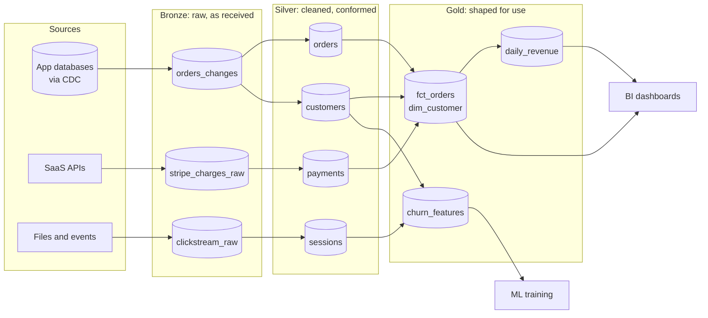

# Medallion Architecture (Bronze, Silver, Gold)

A layering convention for lakehouse data: land it raw, clean and conform it, then shape it for use. This page explains what each layer is really for, what belongs where, how to build it on each platform, and the ways teams get it wrong. The [lakehouse architecture](./lakehouse-architecture.md) page covers the platform; this one covers how to organize the data on it.

---

## The problem this solves

Picture a data lake two years after it was set up without a plan. There is a folder of raw JSON from the payments API, three slightly different cleaned copies of the customers table made by three different teams, a "final" orders table that someone's notebook overwrites every night, and a dashboard that reads from a file nobody can trace. When a number looks wrong, nobody can say which step changed it, and nobody dares delete anything because they do not know what depends on it. That is a data swamp.

The medallion architecture is a simple answer: **every table lives in exactly one of three layers, and each layer has one job and one set of rules.** Data only flows forward (bronze to silver to gold), each hop is a pipeline you can rerun, and anyone looking at a table knows from its layer how much to trust it. Databricks popularized the name, but the idea is older: it is the staging, integration and presentation layers of a classic warehouse, rebuilt on cheap object storage with table formats that support updates.

It is a convention, not a product. Nothing stops you from naming the layers raw, curated and consumption (Azure's older lake guidance does), or adding a fourth. What matters is that the rules for each layer are written down and enforced.

---

## The layers

Medallion layers. Sources land unchanged in bronze. Silver holds one cleaned, deduplicated, typed table per business entity, conformed across sources. Gold holds tables shaped for a specific use: star schemas for BI, aggregates for dashboards, feature tables for ML. Arrows only point forward.

### Bronze: what arrived, exactly as it arrived

Bronze is your record of what the source sent you. Its rules:

- **Append-only.** Never update or delete bronze rows in normal operation (legal deletion requests are the exception, covered below).
- **No business logic.** Do not filter, rename, or "fix" anything. If the API sent a malformed date, bronze keeps the malformed date.
- **Add metadata, not meaning.** Add columns for ingestion time, source file or offset, batch ID, and schema version. These let you trace any downstream row back to the delivery it came from.
- **Keep the source schema loose.** Many teams store the raw payload as a string or variant column alongside a few extracted keys, so a source schema change never breaks ingestion.

Why bother keeping raw data when you are about to clean it? Because your cleaning logic will have bugs. When it does, you fix the code and rebuild silver from bronze. Without bronze, a bug in cleaning is permanent data loss, or a re-extract from a source that may no longer have the data (APIs often only return 30 or 90 days).

### Silver: one trustworthy table per business entity

Silver is where data becomes reliable. A silver table should be something an analyst can query without knowing the quirks of the source. Typical work at this layer:

- **Deduplicate** (sources resend; CDC streams repeat) and keep the latest version per key.
- **Type and validate.** Parse timestamps into one time zone, cast strings to numbers, reject or quarantine rows that fail checks.
- **Conform across sources.** If customers come from both the CRM and the billing system, silver is where you decide which wins for each field and produce one `customers` table with one key.
- **Apply CDC.** Turn change events into a current-state table, and optionally a history table. See [CDC into a lakehouse](./cdc-to-lakehouse.md).
- **Standardize names and codes.** `cust_id`, `CustomerID` and `customer` all become `customer_id`; country names become ISO codes.

Silver tables are usually modelled around entities (orders, customers, products, sessions), close to third normal form or a light "one big table per entity" shape. They are not yet shaped for any particular report. That is deliberate: silver is reused by many gold tables, so it should not carry any one consumer's assumptions.

### Gold: shaped for a specific use

Gold tables answer questions. A gold table exists because a dashboard, an analyst team, an ML model or an external consumer needs data in a particular shape. Common gold shapes:

- **Star schemas**: fact and dimension tables for BI, as on [Data modeling for analytics](../../learn/concepts/data-modeling-for-analytics.md).
- **Aggregates**: daily revenue by region, weekly active users, pre-computed so dashboards are fast and cheap.
- **Feature tables** for ML, keyed by entity and time.
- **Data products** published to other domains in a [data mesh](./data-mesh.md).

Gold is where business definitions live. "Active customer" or "net revenue" is defined once, in a gold model or a [semantic layer](./semantic-layer.md) on top of it, not re-derived in every dashboard.

---

## What goes where: a worked example

Take a Stripe charges feed and an orders table replicated from PostgreSQL.

| Step | Layer | What happens |
|---|---|---|
| Stripe webhook payloads land as JSON | Bronze `stripe_charges_raw` | Payload stored as-is with `_ingested_at`, `_source_file` |
| PostgreSQL CDC events land | Bronze `orders_changes` | One row per change event, with `op` and log position |
| Parse JSON, convert cents to decimal, UTC timestamps, dedupe on `charge_id` | Silver `payments` | One row per charge, typed and validated |
| Apply CDC events to current state | Silver `orders` | One row per order, latest version |
| Join orders to payments and customers, compute net amount | Gold `fct_orders` | Grain: one row per order, with keys to dimensions |
| Sum by day and region | Gold `daily_revenue` | Small, fast table for the exec dashboard |

Notice the tests at each hop: bronze checks that files arrived and parse at all; silver checks uniqueness of keys, non-null required fields and accepted values; gold checks business rules ("net revenue is never negative for a completed order", "daily revenue reconciles to the finance ledger within 0.5%"). See [Data quality and lineage](../../learn/concepts/data-quality-and-lineage.md).

---

## Building it on each platform

The layers map onto whatever namespaces your platform offers: catalogs or schemas, databases, or storage containers.

### Databricks

The usual layout is one Unity Catalog catalog per environment and a schema per layer (`prod.bronze`, `prod.silver`, `prod.gold`), or a catalog per layer when you want permissions separated hard. Auto Loader streams files into bronze, Lakeflow Declarative Pipelines (formerly Delta Live Tables) define silver and gold as streaming tables and materialized views with expectations (data quality rules) attached, and `AUTO CDC` handles change feeds.

- **[📖 What is the medallion lakehouse architecture?](https://docs.databricks.com/aws/en/lakehouse/medallion)** - Databricks' own description of each layer
- **[📖 The AUTO CDC APIs](https://docs.databricks.com/aws/en/ldp/cdc)** - applying change feeds from bronze into silver

### Microsoft Fabric and Azure

In Fabric, a common design is one lakehouse per layer in a workspace (or one workspace per layer, for stricter separation), all stored in OneLake as Delta. Pipelines or Dataflows Gen2 land bronze, notebooks or dbt transform to silver, and gold is often a Fabric warehouse or a lakehouse with a semantic model on top for Power BI.

- **[📖 Implement medallion architecture in Fabric](https://learn.microsoft.com/en-us/fabric/onelake/onelake-medallion-lakehouse-architecture)** - Microsoft's layer-per-lakehouse guidance

### AWS

S3 prefixes or buckets per layer, with Glue Data Catalog databases named for the layer and Iceberg as the table format. Ingest with Firehose, DMS or Glue jobs; transform with Glue, EMR, or dbt on Athena or Redshift. Lake Formation grants make bronze readable only by the engineering role.

### Google Cloud

BigQuery datasets per layer (`bronze_*`, `silver_*`, `gold_*`), or Cloud Storage with BigQuery Iceberg tables when you want open format. Datastream and Pub/Sub subscriptions land bronze; Dataform or dbt build silver and gold.

### Snowflake

Databases or schemas per layer (`RAW`, `TRANSFORM` or `SILVER`, `ANALYTICS` or `GOLD` is a common naming), Snowpipe or Snowpipe Streaming into raw, then dbt or dynamic tables for the downstream layers. Snowflake's role hierarchy maps cleanly onto "loaders write bronze, transformers read bronze and write silver and gold, analysts read gold".

---

## Trade-offs and variations

**Three copies of the data.** Bronze, silver and gold can triple storage. In practice it is less (gold aggregates are tiny, bronze can be expired or tiered after its replay window), and object storage is the cheapest thing in the stack. The compute to rebuild layers matters far more than the bytes.

**More hops, more latency.** Each layer is a processing step. With batch jobs on a schedule, three layers can mean three schedule delays stacked. Streaming tables or incremental models that trigger on upstream changes keep end-to-end latency to minutes.

**Where does dbt fit?** dbt projects already have a layering convention (staging, intermediate, marts). It maps closely: dbt sources point at bronze, staging and intermediate models are silver, marts are gold. Do not run two parallel naming schemes; pick one vocabulary and map the other in a sentence of documentation. See [Analytics engineering and dbt](../../learn/concepts/analytics-engineering-and-dbt.md).

**A fourth layer?** Some teams add a "landing" or "raw files" zone before bronze (the files themselves, before they are loaded into a table), or a "platinum" layer for certified, externally shared data products. Fine, as long as each layer has written rules.

**Not every source needs all three.** A clean, well-typed reference table from a trusted source can go from bronze to gold with a view as its silver. Do not invent transformations to fill a layer.

---

## Failure modes

**Silver that is really gold.** A team builds a silver table with one dashboard's filters baked in ("only US customers, only active plans"). The next consumer silently inherits the filter. Keep consumer-specific logic in gold.

**Gold reading from bronze.** Someone builds a quick gold table straight from bronze to save a step. Now the deduplication and typing logic exists in two places, and they drift. Enforce with permissions: gold builders get no read access on bronze.

**Mutable bronze.** A well-meaning engineer "fixes" bad records in bronze. The audit trail is gone and the next rebuild of silver produces different results from the last one. Bronze is append-only; fixes go in silver.

**Personal data in bronze forever.** Bronze keeps everything, including data subject to deletion requests under GDPR or CCPA. You need a documented process to delete or crypto-shred a person's records from bronze, and a retention window so old raw data expires. See [Data governance and catalogs](../../learn/concepts/data-governance-and-catalogs.md).

**Rebuilds that are not really possible.** "We can always rebuild silver from bronze" is only true if bronze retention covers the history silver holds and the pipeline code is versioned. Test a full rebuild of one table once a quarter.

**Layer count as a goal.** Teams sometimes measure maturity by how many tables are "in gold". Gold tables without a named consumer are cost with no benefit. Each gold table should have an owner and a known use.

---

## Cost notes

- **Bronze**: cheap storage, set a lifecycle rule (for example, 90 days hot, then an infrequent-access tier, then expire unless needed for replay or audit).
- **Silver**: the heaviest compute (dedup, merge, CDC). Incremental processing rather than full rebuilds is the biggest saving; see [ETL vs ELT](../../learn/concepts/etl-vs-elt.md) and incremental models.
- **Gold**: small tables, but queried most. Clustering, materialization choices (table versus view versus materialized view) and caching drive BI cost.
- **Compaction** on every layer that receives frequent small writes, or query costs creep up as file counts grow. See [File formats and partitioning](../../learn/concepts/file-formats-and-partitioning.md).

---

## Production checklist

- [ ] Each layer's rules (what is allowed, who writes, who reads) are written down.
- [ ] Bronze is append-only and carries ingestion metadata on every row.
- [ ] Silver tables have tested primary keys and documented sources of truth for conformed fields.
- [ ] Every gold table has a named owner and consumer.
- [ ] Permissions enforce the flow (no gold-from-bronze shortcuts).
- [ ] A full rebuild of a silver table from bronze has been tested.
- [ ] Retention and deletion processes cover personal data in every layer.

---

## Related

- [Lakehouse architecture](./lakehouse-architecture.md) - table formats and the platform underneath
- [CDC into a lakehouse](./cdc-to-lakehouse.md) - the most common way bronze gets filled
- [Data pipeline / ETL](./data-pipeline-etl.md) - pipeline mechanics between layers
- [Warehouses, lakes and lakehouses](../../learn/concepts/warehouses-lakes-lakehouses.md)
- [Data pipelines and orchestration](../../learn/concepts/data-pipelines-and-orchestration.md)
