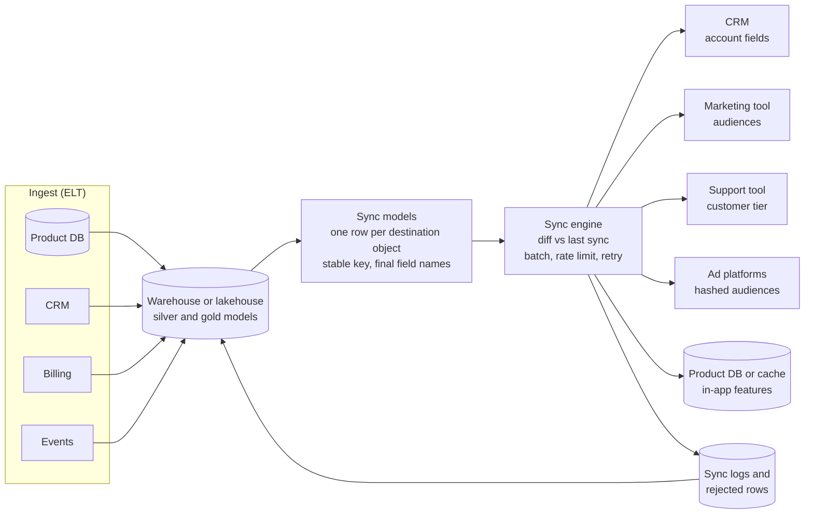

# Reverse ETL and Operational Analytics

How to push modelled data out of the warehouse or lakehouse and back into the tools people work in every day (CRM, marketing, support, ad platforms, product databases), so analytics changes what happens, not just what gets reported.

---

## The problem this solves

A typical data team spends years building a warehouse that knows a lot about each customer: lifetime value, product usage in the last 30 days, open support tickets, churn risk score, plan and renewal date. Then it puts all of that in dashboards. The sales rep working in Salesforce does not open the dashboard. The support agent in Zendesk does not either. The marketing team builds audiences in their email tool from whatever fields that tool happens to have. The best data in the company sits one browser tab away from the people who could act on it.

Before reverse ETL, teams solved this with one-off scripts: a Python job that queries the warehouse and calls the Salesforce API, another for HubSpot, another for the ad platform. Each script reimplements batching, rate limits, retries, field mapping and "which rows changed since last time". Each breaks quietly when an API changes.

**Reverse ETL** is the pattern (and the product category) that turns this into configuration: a model in the warehouse is the source, a SaaS tool is the destination, and a sync engine works out what changed and pushes only those rows, through the destination's API, with retries and error reporting. **Operational analytics** is the broader idea: use the warehouse as the source of truth for customer and business data, and feed operational systems from it, instead of each tool keeping its own partial copy.

The term "reverse" is because classic [ETL](../../learn/concepts/etl-vs-elt.md) moves data from operational systems into the warehouse; this moves it the other way.

---

## The reference design



Reverse ETL in context. Data is ingested into the warehouse as usual and modelled into gold tables. Dedicated sync models shape one row per destination object. A sync engine compares each model with what it sent last time, pushes only new and changed rows to each destination through its API, and writes results and rejected rows back to the warehouse for monitoring.

The parts:

| Part | Job | Key decision |
|---|---|---|
| **Sync models** | One table or view per destination object, final field names | Grain (one row per account? per contact?) and the stable matching key |
| **Diff engine** | Work out added, changed and removed rows since the last run | Where the previous state is stored, and how removals are handled |
| **Destination connector** | Call the API correctly | Batch size, rate limits, upsert versus insert, field type mapping |
| **Observability** | Know what synced and what failed | Rejected rows written somewhere a human sees them |

---

## How a sync actually works

Understanding the mechanics helps you design models that sync cleanly.

**1. Run the model.** The engine executes the sync model's query (or reads the table) in the warehouse. Example, a Salesforce account sync:

```sql
SELECT
  a.salesforce_account_id          AS sf_id,           -- matching key
  a.plan_tier                      AS plan_tier__c,
  u.weekly_active_users            AS wau__c,
  h.health_score                   AS health_score__c,
  CAST(r.renewal_date AS DATE)     AS renewal_date__c
FROM gold.dim_account a
JOIN gold.account_usage_weekly u USING (account_id)
JOIN gold.account_health h       USING (account_id)
LEFT JOIN gold.renewals r        USING (account_id)
WHERE a.salesforce_account_id IS NOT NULL;
```

**2. Diff against the last successful sync.** The engine keeps a snapshot of what it last sent (in its own store, or in a schema in your warehouse). Comparing the new result to that snapshot produces three sets: new keys, changed rows, and keys that disappeared. Only those are sent. On a table of 200,000 accounts where 3,000 changed today, the sync makes API calls for 3,000 rows, not 200,000. This matters because SaaS APIs have strict quotas.

**3. Push in batches through the destination API.** The connector uses bulk endpoints where they exist (for example Salesforce Bulk API 2.0), respects rate limits, retries transient failures with backoff, and records per-row errors (validation rules, picklist values that do not exist, a record locked by another process).

**4. Record the outcome.** Successful rows update the snapshot. Failed rows stay "dirty" so they retry next run. Good tools let you write sync results back into the warehouse so failures can be queried and alerted on like any other data.

Two design rules fall out of this. First, **every sync model needs a stable, unique key that exists in the destination**: the Salesforce account ID, the HubSpot contact email, your own user ID stored in an external ID field. Without one, the engine cannot tell an update from a new record and you create duplicates. Second, **sync models should be deterministic**. A model that orders by nothing and picks "any" row per key changes on every run, so the diff sends everything every time.

---

## Common use cases

- **Sales**: account health score, product usage, expansion signals and renewal dates on the CRM account record, so reps prioritize without leaving the CRM.
- **Marketing**: audiences built in SQL ("trial users who hit the paywall twice in a week but did not convert") synced to the email and ad tools. Ad platforms require hashed identifiers (for example SHA-256 of a normalized email); the sync engine usually handles the hashing.
- **Support**: customer tier and lifetime value in the support tool, so high-value tickets route to senior agents.
- **Finance**: usage-based billing quantities from the warehouse pushed into the billing system.
- **Product**: personalization or feature flags read from a fast store that is filled from the warehouse (for example, "show the upgrade prompt to accounts above 80% of plan limits"). This last one drifts into feature-store territory: if the product needs data fresher than minutes or reads it on every request, a dedicated low-latency store fed by streaming is the better fit.

---

## Implementation options

### Dedicated reverse ETL tools

**Hightouch** is the best-known independent product, with hundreds of destinations and audience-building features aimed at marketing teams. **Census** was acquired by Fivetran (announced May 2025) and now ships as part of Fivetran's platform, so a single vendor covers ingestion and activation. Several CDPs (customer data platforms) have also added "composable" or warehouse-native modes that do the same job.

- **[📖 Hightouch documentation](https://hightouch.com/docs)** - models, syncs, sync modes and destination behaviour

### Platform-native and build-your-own

There is no single first-party "reverse ETL" service on each cloud, but the building blocks are there:

- **AWS**: Amazon AppFlow can write to some SaaS destinations (Salesforce, for example) from S3; otherwise a Step Functions or Lambda job reading Redshift or Athena results.
- **Azure**: Data Factory and Fabric Data Factory pipelines have sink connectors for Dynamics 365, Dataverse and Salesforce.
- **Google Cloud**: Dataflow or Cloud Run jobs reading BigQuery; BigQuery can also export to Pub/Sub for event-style delivery.
- **Snowflake and Databricks**: both are destinations for, and partners of, the dedicated tools; both also support writing to external systems from Python (Snowpark external access integrations, Databricks jobs).

Building your own is reasonable for one or two destinations with simple objects. Past that, the hard parts (diffing, API quirks, error handling, field mapping UIs for non-engineers) are exactly what the products sell.

- **[📖 Salesforce Bulk API 2.0](https://developer.salesforce.com/docs/atlas.en-us.api_asynch.meta/api_asynch/bulk_api_2_0.htm)** - the bulk upsert API most CRM syncs use, and its limits

---

## Trade-offs

**Batch freshness.** Most reverse ETL runs on a schedule (every 15 minutes to every day), triggered after the dbt run that builds the models. That is fine for sales and marketing, where people act over hours or days. It is not fine for in-session personalization or fraud decisions, which need [streaming](./streaming-analytics.md).

**The warehouse becomes operational infrastructure.** Once the CRM depends on warehouse fields, a broken dbt model is a sales outage. That raises the bar: tests, alerting and on-call for the models that feed syncs, and [data contracts](../../learn/concepts/data-contracts.md) with the teams who rely on them.

**Who owns the field?** If the warehouse writes `health_score__c` every hour and a sales manager edits it by hand, the edit is overwritten. Fields written by reverse ETL should be read-only in the destination, clearly labelled, and documented as "owned by data".

**Write-back loops.** The CRM is also a source for the warehouse. If a synced field is ingested back, transformed, and synced out again, you can build a loop where values oscillate or grow. Exclude reverse-ETL-owned fields from the inbound transformations, or treat them as derived and never as source data.

**Cost moves to the warehouse.** Every sync runs a query. A sync every five minutes against an unclustered 2 TB table can cost more than the reverse ETL licence. Materialize sync models as small tables built once per pipeline run, and let syncs read those.

---

## Failure modes

- **Duplicates in the destination** from a missing or non-unique key. Test key uniqueness on every sync model, the same way you test a primary key in silver.
- **Mass overwrite from a bad model.** A join bug nulls `plan_tier` for every account, and the sync dutifully writes nulls to 200,000 CRM records. Protect with row-count and null-rate checks before the sync runs, and with a sync setting that aborts if more than N% of rows change at once (most tools have one).
- **Silent partial failure.** 4% of rows fail validation every run, nobody looks, and the CRM gradually diverges. Route rejected rows into a table with an alert on volume.
- **API quota exhaustion.** Syncs share the destination's daily API limit with every other integration. A full resync can starve the rest. Schedule large backfills off-hours and use bulk APIs.
- **Deleted records.** Decide what removal from the model means: delete in the destination, clear the fields, or do nothing. The default differs by tool and by sync mode; check it explicitly.
- **Privacy and consent.** Pushing personal data to ad platforms is regulated. Only sync users who consented, hash identifiers, and keep the consent filter in the model where it is tested, not in a tool setting someone can switch off.

---

## Cost notes

- Licence pricing for the dedicated tools is usually by destination count, rows synced, or both. Model the steady-state changed-rows volume, not the table size.
- Warehouse compute for sync queries: build sync models as tables in the main pipeline run and keep sync queries to `SELECT *` on small tables.
- Destination API usage is a hidden cost when it forces you into a higher SaaS tier for more API calls.

---

## Production checklist

- [ ] Every sync model has a tested unique key that exists in the destination.
- [ ] Sync models are deterministic and materialized as tables.
- [ ] Synced fields are read-only in the destination and documented as data-owned.
- [ ] Pre-sync checks (row counts, null rates, change percentage) can block a bad sync.
- [ ] Rejected rows land in a queryable table with an alert.
- [ ] Removal behaviour is chosen explicitly for each sync.
- [ ] Consent and hashing rules for personal data are enforced in the model.

---

## Related

- [ETL vs ELT](../../learn/concepts/etl-vs-elt.md) - the forward direction this pattern reverses
- [Medallion architecture](./medallion-architecture.md) - sync models are a kind of gold table
- [Semantic layer](./semantic-layer.md) - keeping metric definitions consistent between dashboards and synced fields
- [Analytics engineering and dbt](../../learn/concepts/analytics-engineering-and-dbt.md) - where sync models are usually built
- [Data quality and lineage](../../learn/concepts/data-quality-and-lineage.md) - tests that protect what you push out
