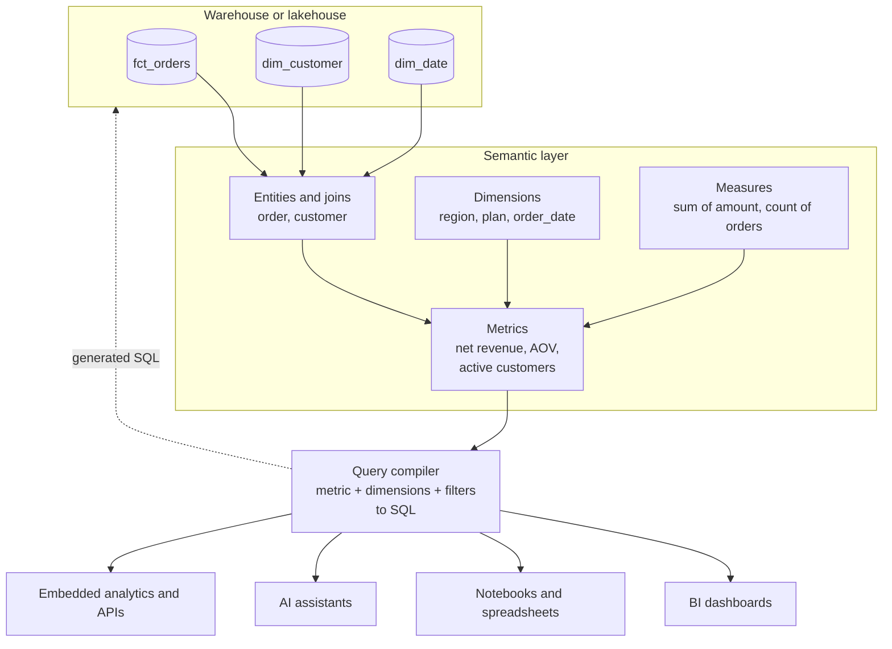

# Semantic Layer (Metrics Defined Once)

How to define business metrics such as revenue, active users and churn once, in code, and have every dashboard, notebook, spreadsheet and AI assistant compute them the same way. Covers the dbt Semantic Layer (MetricFlow), Snowflake semantic views, Databricks metric views, Power BI and Looker models, and standalone tools like Cube.

---

## The problem this solves

Ask three teams for last quarter's revenue and you get three numbers. Finance subtracts refunds and excludes tax. The sales dashboard counts bookings on the contract signature date. The product team's notebook sums the `amount` column on `orders` and forgets that cancelled orders are still in it. Every number is "right" for its author, and every meeting starts with twenty minutes of reconciling them.

The root cause is that a metric is not a column. "Net revenue" is a formula (sum of amount, minus refunds), plus filters (completed orders only, exclude internal test accounts), plus a time rule (recognized on ship date), plus rules about what you may group it by. When every BI tool and every analyst re-derives that from raw tables, the definitions drift.

A **semantic layer** is a model that sits between the tables and the tools. It declares the business entities (customer, order), how they join, the dimensions you can slice by (region, plan, month), and the measures and metrics, each with its formula and filters. Tools ask the semantic layer for "net revenue by region by month", and it generates the correct SQL, with the correct joins and the correct aggregation, every time.

This has become more urgent with AI assistants that answer data questions in natural language. A language model writing SQL against raw tables will happily sum the wrong column. Pointed at a semantic layer, it chooses from a list of governed metrics and dimensions, which is far more likely to be right. Every major platform's "talk to your data" feature now leans on one.

---

## The reference design

A semantic layer between data and tools. Tables in the warehouse are described as entities, dimensions and measures, and metrics are built from those. Every consumer asks for metrics by name with the dimensions and filters it wants; a query compiler turns the request into SQL that runs in the warehouse.

The vocabulary differs by product but the parts are the same:

| Part | What it is | Example |
|---|---|---|
| **Entity** | A thing with a key, and how tables join through it | `customer` joins `fct_orders.customer_id` to `dim_customer.customer_id` |
| **Dimension** | Something you group or filter by | `region`, `plan_tier`, `order_date` at day, week or month grain |
| **Measure** | A basic aggregation over a column | `sum(amount)`, `count_distinct(customer_id)` |
| **Metric** | A business definition built from measures | `net_revenue = sum(amount) - sum(refund_amount)` where `status = 'completed'` |

---

## Why "define once" is harder than it looks

A semantic layer earns its place by handling the cases a hand-written view cannot.

**Ratios must be computed after aggregation.** Average order value is total revenue divided by order count, at whatever grain the user groups by. If you pre-compute AOV per day in a view and someone averages it across a month, they get the average of daily averages, which is wrong whenever days have different order counts. A semantic layer stores the ratio as a formula over two measures and computes both sums at the requested grain before dividing. Databricks' metric view docs make exactly this point: a standard view locks in the grouping, a metric view does not.

**Distinct counts do not add up.** Daily active users summed over 30 days is not monthly active users. The layer must recompute the distinct count at the requested grain.

**Joins fan out.** Join orders to order line items and sum `orders.shipping_fee`, and each fee is counted once per line. A semantic layer that knows the grain of each table (one row per order versus one row per line) can aggregate each to the right level before joining. This "fan-out" or "chasm trap" problem is the most common source of inflated numbers in BI. See [SQL joins explained](../../learn/concepts/sql-joins-explained.md).

**Time is subtle.** Cumulative metrics (revenue to date), period-over-period comparisons, fiscal calendars, and metrics that use different date columns (bookings by signature date, revenue by ship date) all need explicit rules.

---

## Implementation options

The landscape splits into three families.

### 1. Platform-agnostic, code-first

**dbt Semantic Layer and MetricFlow.** You declare semantic models and metrics in YAML in your dbt project, next to the models they describe, so they are versioned, reviewed and tested like any other code. MetricFlow is the engine that compiles metric requests into SQL; it was open-sourced under the Apache 2.0 licence in October 2025. The hosted Semantic Layer APIs (JDBC and GraphQL) that BI tools connect to are part of dbt's paid platform. Supports Snowflake, BigQuery, Databricks, Redshift and others.

**Cube** is an open-source semantic layer with its own modelling language, a caching layer (pre-aggregations), and SQL, REST and GraphQL APIs. It is popular for embedded analytics, where an application needs to serve metrics to its own customers with low latency.

- **[📖 About MetricFlow](https://docs.getdbt.com/docs/build/about-metricflow)** - semantic models, measures, dimensions, entities and metric types
- **[📖 dbt Semantic Layer](https://docs.getdbt.com/docs/use-dbt-semantic-layer/dbt-sl)** - the hosted APIs and integrations
- **[📖 Cube documentation](https://docs.cube.dev/docs/introduction)** - data modelling, pre-aggregations and APIs

### 2. Native to the data platform

**Snowflake semantic views** are schema-level objects that define tables, relationships, facts, dimensions and metrics inside Snowflake, queryable with SQL and used by Cortex Analyst for natural-language questions. Snowflake Labs publishes a dbt package that lets you manage semantic views from a dbt project.

**Databricks metric views** are defined in YAML, registered in Unity Catalog, and queried from SQL, dashboards, Genie (the natural-language interface) and connected BI tools. They inherit Unity Catalog permissions and lineage.

**BigQuery** relies on Looker (below) for its semantic model, and on Gemini features in BigQuery for natural-language queries over tables and their descriptions.

- **[📖 Snowflake semantic views](https://docs.snowflake.com/en/user-guide/views-semantic/overview)** - creating and querying semantic views
- **[📖 Databricks metric views](https://docs.databricks.com/aws/en/uc-semantics/metric-views)** - defining, querying and governing metric views

### 3. Inside the BI tool

**LookML** (Looker) was the original widely used semantic layer: views, explores and measures in version-controlled files. **Power BI semantic models** (formerly datasets) define relationships and DAX measures, and in Microsoft Fabric they can read Delta tables in OneLake directly through Direct Lake mode. **Tableau** has published data sources and Tableau Semantics.

BI-tool semantic layers are excellent when one BI tool is the only consumer. They become a problem when the same metrics are needed in a notebook, a reverse ETL sync and an AI agent, because the definitions are locked inside the tool.

---

## Choosing

A practical way to decide:

- **One BI tool, one platform, few consumers outside BI.** Use the BI tool's model (Power BI semantic model, LookML). It is the least moving parts.
- **One data platform, many tools including AI assistants.** Use the platform's native layer (Snowflake semantic views, Databricks metric views). Governance and permissions come for free and the platform's AI features use it directly.
- **Several platforms, or metrics that must travel with your dbt code.** Use MetricFlow, or Cube if you also need caching and embedded APIs.

Whatever you pick, **one** layer must be the source of truth. Two semantic layers with overlapping metrics just move the reconciliation meeting up a level. If you need definitions in a second place, generate them from the first (for example, dbt YAML published to Snowflake semantic views by the package above), never copy them by hand.

---

## Trade-offs

**Flexibility versus control.** Analysts lose some freedom: a metric that is not in the layer cannot be queried through it. That is the point, but it means the layer needs an owner who can add metrics quickly. If adding a metric takes three weeks, people go back to raw SQL.

**Performance.** Generated SQL is correct, not always fast. Queries over large fact tables at fine grain can be expensive. Pre-aggregated gold tables, materialized views, or the layer's own caching (Cube pre-aggregations, Power BI import mode, platform result caches) keep dashboards quick.

**Tool support.** Not every BI tool can query every semantic layer. Check native connectors before committing; a JDBC "it looks like a database" interface works more broadly but may lose features like drill-down metadata.

**Lock-in.** Platform-native layers tie metric definitions to one platform; BI-native layers tie them to one tool. Code-first YAML in Git is the most portable.

---

## Failure modes

- **Two definitions with the same name.** "Revenue" in the semantic layer and "revenue" in an old dashboard built on raw tables. Retire or relabel the old one, or people keep using it.
- **Metrics nobody owns.** Every metric needs an owner who answers "is this number right?". Store the owner in the metric's metadata.
- **Untested metrics.** Write tests that compare key metrics to a trusted reference (the finance ledger, last month's signed-off board pack) within a tolerance, and run them in CI when definitions change.
- **Silent definition changes.** Changing a filter on `active_customers` changes every historical chart. Review metric changes like code changes, and announce them.
- **Over-modelling.** Hundreds of near-duplicate metrics (`revenue_v2`, `revenue_new`, `revenue_finance`) defeat the purpose. Curate.
- **Fan-out in the model itself.** A relationship declared at the wrong grain reintroduces the double-counting the layer was meant to stop. Test metric totals against a direct query on the fact table.

---

## Cost notes

- Code-first engines like open-source MetricFlow and Cube are free to run; hosted APIs and enterprise features are paid.
- Platform-native layers add no licence cost but every query runs on your warehouse compute, so caching and pre-aggregation matter.
- The real saving is human: fewer reconciliation meetings, fewer one-off "why do these differ" investigations.

---

## Production checklist

- [ ] One semantic layer is declared the source of truth for metric definitions.
- [ ] Each metric has an owner, a description and a tested reference value.
- [ ] Definitions live in version control and changes are reviewed.
- [ ] Table grains and relationships are declared, and fan-out is tested.
- [ ] Dashboards for key metrics query the layer, not raw tables.
- [ ] AI assistants and natural-language tools are pointed at the layer.

---

## Related

- [Data modeling for analytics](../../learn/concepts/data-modeling-for-analytics.md) - the star schemas a semantic layer usually sits on
- [Analytics engineering and dbt](../../learn/concepts/analytics-engineering-and-dbt.md) - where MetricFlow definitions live
- [Medallion architecture](./medallion-architecture.md) - the semantic layer sits on gold
- [Reverse ETL and operational analytics](./reverse-etl-operational-analytics.md) - pushing governed metrics into operational tools
- [Data governance and catalogs](../../learn/concepts/data-governance-and-catalogs.md) - ownership and certification of metrics
