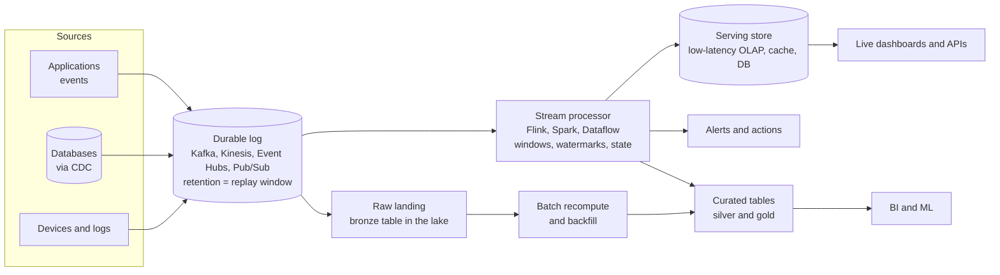
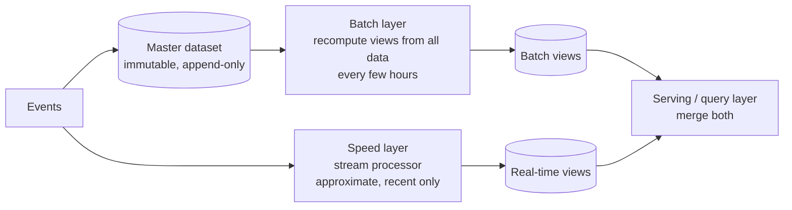
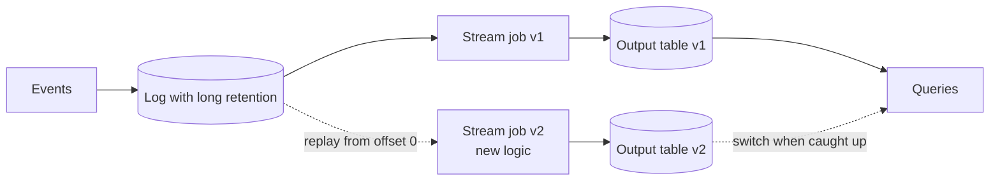

# Streaming Analytics (Lambda vs Kappa)

A reference design for turning event streams into fresh metrics, alerts and tables you can trust, and the two classic ways to reconcile "fast" with "correct": the Lambda and Kappa architectures, plus the lakehouse-era hybrid most teams now build.

---

## Table of Contents

1. [When to use this pattern](#when-to-use-this-pattern)
2. [The reference design](#the-reference-design)
3. [Lambda architecture](#lambda-architecture)
4. [Kappa architecture](#kappa-architecture)
5. [The lakehouse hybrid](#the-lakehouse-hybrid)
6. [Choosing between them](#choosing-between-them)
7. [AWS implementation](#aws-implementation)
8. [Azure implementation](#azure-implementation)
9. [GCP implementation](#gcp-implementation)
10. [Design considerations](#design-considerations)
11. [Production checklist](#production-checklist)

---

## When to use this pattern

Use streaming analytics when a **decision changes** because data is minutes old instead of hours old:

- fraud and abuse scoring while a transaction is still in flight;
- operational dashboards (orders per minute, error rates, stock-outs);
- alerting on thresholds or anomalies;
- fresh features for models at inference time;
- user-facing counters and leaderboards.

Do not use it because "real time" sounds better. If nobody acts on the number within the hour, a micro-batch every 15 minutes is cheaper, simpler and easier to test. See [Batch vs streaming](../../learn/concepts/batch-vs-streaming.md) for that argument in full.

---

## The reference design

The reference streaming analytics design. Every event lands in a durable, replayable log. A stream processor computes windows for live serving and alerts, while the raw stream is also landed in the lake so any result can be recomputed in batch.

The components:

| Component | Job | Key decisions |
|---|---|---|
| **Durable log** | Ordered, replayable record of every event | Partition key, partition count, **retention** (decides how far back you can replay) |
| **Stream processor** | Windows, joins, enrichment, aggregation | Event-time windows, watermark delay, late-data policy, checkpointing |
| **Raw landing** | Every event, unmodified, in cheap storage | File size, partitioning by event date, table format |
| **Serving store** | Answers dashboard and API queries in milliseconds | Upserts by window and key; pre-aggregated or raw |
| **Batch recompute** | Corrects late or buggy results from complete data | How often; which results it overwrites |

The concepts behind each are on [Queues vs streams](../../learn/concepts/queues-vs-streams.md) and [Stream processing: windows and watermarks](../../learn/concepts/stream-processing-windows-and-watermarks.md).

---

## Lambda architecture

Proposed by Nathan Marz around 2011, when stream processors could not be trusted to be correct.

Lambda: two paths over the same events. The batch layer is slow but complete and correct; the speed layer covers only the gap since the last batch run, and queries merge the two.

**How it works:** all data goes into an immutable master dataset. A batch layer periodically recomputes complete, accurate views from all of it. A speed layer processes only recent events, quickly and approximately. A serving layer answers queries by combining the latest batch view with the real-time view for the period since.

**Strengths:**

- Correctness does not depend on the stream processor. Any streaming bug is overwritten by the next batch run.
- Reprocessing history is just a batch job.

**Weaknesses:**

- **The same logic, written twice**, usually in two frameworks (for example Spark batch and a streaming engine). The two copies drift, and "why do the dashboard and the report disagree?" becomes a permanent question.
- Two systems to run, monitor and pay for.
- The merge logic in the serving layer is subtle.

---

## Kappa architecture

Proposed by Jay Kreps in 2014, once logs like Kafka and engines with exactly-once state made streaming trustworthy.

Kappa: one streaming path. To change logic or fix a bug, run a new version of the job from the start of the log into a new output, and switch readers over once it catches up.

**How it works:** there is only a stream. The log is kept long enough (or tiered to cheap storage) to replay. Reprocessing means starting a new version of the job at the beginning of the log, writing to a new output, and switching consumers once it has caught up.

**Strengths:**

- **One codebase**, one engine, one definition of every metric.
- Reprocessing uses the same code path as normal processing, so it is tested every day.

**Weaknesses:**

- Needs long log retention, which costs money (tiered storage in Kafka, or reading history from the lake, eases this).
- Replaying months of data through a stream processor can be slower and costlier than one big batch job.
- Some workloads are naturally batch: large historical joins, model training, heavy backfills.

---

## The lakehouse hybrid

Most teams now build something between the two. The ideas that make it possible:

- **Unified engines.** Spark Structured Streaming, Flink, Apache Beam / Dataflow and Databricks Lakeflow declarative pipelines run the **same code** over a bounded (batch) or unbounded (stream) source. Lambda's "two codebases" problem largely disappears.
- **Table formats with streaming reads and writes.** Delta Lake, Apache Iceberg and Apache Hudi tables accept streaming appends and upserts, and can be read as a stream. The lake table **is** the replayable log for anything older than the message bus retention.
- **Medallion layers.** Stream into bronze; incrementally process into silver and gold. A batch recompute is the same job run over a date range.

In practice:

1. Land every event in a **bronze** table continuously (Firehose, Kafka Connect, Event Hubs Capture, a streaming job).
2. Run **one** set of transformations, written once, incrementally: every minute for the live tables, or as a backfill over history when logic changes.
3. Serve live dashboards from a low-latency store or directly from gold tables, and let the daily run over complete data correct the small number of late events.

This keeps Kappa's single codebase and Lambda's cheap, complete batch correction.

---

## Choosing between them

| Question | Leans Lambda | Leans Kappa | Leans hybrid |
|---|---|---|---|
| Is there already a mature batch platform? | Yes, add a speed layer | | Yes, and a lakehouse table format |
| Does logic change often? | | Yes: one codebase matters | Yes |
| Must historical results be exactly correct? | Yes | Possible with care | Yes, batch correction |
| How far back must you reprocess? | Years | Within log retention | Years, from the lake |
| Team size | Large enough to run two stacks | Strong streaming skills | Most teams |

The common answer today is the hybrid. Pure Lambda is mostly found in older systems; pure Kappa fits event-driven products where the log is the system of record.

---

## AWS implementation

| Component | Service |
|---|---|
| Durable log | Amazon Kinesis Data Streams or Amazon MSK (Kafka) |
| Raw landing | Amazon Data Firehose to S3, as Parquet or into Apache Iceberg tables |
| Stream processor | Amazon Managed Service for Apache Flink; AWS Glue streaming jobs (Spark) |
| Serving store | Amazon Redshift streaming ingestion and materialized views; Amazon OpenSearch Service; DynamoDB for per-key counters |
| Batch recompute | AWS Glue, Amazon EMR, Amazon Athena over the S3 tables |
| Catalog | AWS Glue Data Catalog, Lake Formation for permissions |

A minimal, mostly managed path: Kinesis Data Streams → Firehose to S3 as Iceberg → Athena for queries, plus Managed Flink for live windows written to Redshift or DynamoDB.

---

## Azure implementation

| Component | Service |
|---|---|
| Durable log | Azure Event Hubs (Kafka-compatible endpoint) |
| Raw landing | Event Hubs Capture to ADLS Gen2; Fabric Eventstream to a lakehouse |
| Stream processor | Azure Stream Analytics; Spark Structured Streaming in Fabric or Azure Databricks |
| Serving store | Fabric Real-Time Intelligence (Eventhouse, KQL); Azure Data Explorer; Cosmos DB |
| Batch recompute | Fabric Data Engineering / Spark; Azure Databricks |
| Catalog | Microsoft Purview; Unity Catalog on Azure Databricks |

---

## GCP implementation

| Component | Service |
|---|---|
| Durable log | Pub/Sub; Google Cloud Managed Service for Apache Kafka |
| Raw landing | BigQuery subscriptions (Pub/Sub writes straight to a table); Dataflow to Cloud Storage |
| Stream processor | Dataflow (Apache Beam), the same pipeline in batch or streaming mode |
| Serving store | BigQuery (streaming ingestion, continuous queries); Bigtable for per-key lookups |
| Batch recompute | Dataflow batch; BigQuery scheduled queries |
| Catalog | Dataplex Universal Catalog |

Dataflow is the cleanest example of the unified model: one Beam pipeline, run with a bounded source for backfills and an unbounded one for live data.

---

## Design considerations

### Event time and late data

Every window must use **event time**, with a watermark delay chosen from the measured lateness distribution. Decide per output whether late events are dropped, update an earlier result, or wait for batch correction, and count them either way. Detail in [Stream processing: windows and watermarks](../../learn/concepts/stream-processing-windows-and-watermarks.md).

### Exactly-once, end to end

The processor's checkpoints give exactly-once **state**. Output is only exactly-once if the sink is transactional (Kafka transactions, a table-format commit) or idempotent (upsert by window and key). Give every event a unique id at the source so duplicates can be removed anywhere downstream.

### Partitioning and hot keys

Partition the log by a key that spreads load and keeps related events in order (`customer_id`, `device_id`). A single hot key caps throughput at one partition. Partition count also caps consumer parallelism and is awkward to change later; size for growth. See [Replication and sharding](../../learn/concepts/replication-and-sharding.md).

### Schema evolution

Streams live for years and producers change. Use a schema registry with compatibility rules, and treat each topic as a contract. See [Data contracts](../../learn/concepts/data-contracts.md).

### State size

Windows, joins and deduplication keep state. State grows with the number of keys times the window plus allowed lateness. Set TTLs, and monitor checkpoint size and duration as first-class metrics.

### Cost

Streaming components run 24 hours a day. Shards, brokers and processing units bill continuously whether or not traffic arrives. Compare against a 5- or 15-minute micro-batch before committing, and revisit after launch.

---

## Production checklist

- [ ] A written reason the use case needs streaming, with the freshness target
- [ ] Unique event id and event-time timestamp on every event
- [ ] Partition key chosen for spread and ordering; partition count sized for 2-3x growth
- [ ] Log retention covers the longest replay you need, or history is replayable from the lake
- [ ] Event-time windows, a watermark from measured lateness, an idleness timeout
- [ ] A defined late-data policy, with a metric counting late events
- [ ] Checkpointing to durable storage; tested restore from checkpoint
- [ ] Idempotent or transactional sinks
- [ ] Raw events landed unmodified in the lake
- [ ] A batch reconciliation comparing streaming outputs to complete data, with an alert threshold
- [ ] Schema registry with compatibility enforcement
- [ ] Consumer lag, checkpoint duration and late-event rate on a dashboard with alerts
- [ ] A runbook for replaying from a given offset or date
- [ ] Monthly cost reviewed against the micro-batch alternative

---

## Related

- [Build a streaming pipeline](../hands-on-projects/build-streaming-pipeline.md) - this pattern in miniature, with a reconciliation step
- [Lakehouse architecture](./lakehouse-architecture.md) - the storage layer the hybrid relies on
- [Data pipeline and ETL](./data-pipeline-etl.md) - the batch side
- [Messaging and queue services across clouds](../service-comparison-messaging-queues.md) - the log options compared
- [Event-driven architecture](https://cloud.noblerworks.com/resources/architecture-patterns/event-driven-architecture/) - the application-side pattern on Cloud Zero to Hero

## Official docs

- **[📖 Apache Flink: Stateful stream processing](https://nightlies.apache.org/flink/flink-docs-stable/docs/concepts/stateful-stream-processing/)** - state, checkpoints and exactly-once in a stream processor
- **[📖 Apache Beam: Programming guide](https://beam.apache.org/documentation/programming-guide/)** - the unified batch and streaming model behind Dataflow
- **[📖 Amazon Redshift: Streaming ingestion](https://docs.aws.amazon.com/redshift/latest/dg/materialized-view-streaming-ingestion.html)** - Kinesis and MSK directly into materialized views
- **[📖 Google Cloud: BigQuery subscriptions](https://cloud.google.com/pubsub/docs/bigquery)** - Pub/Sub writing straight into BigQuery tables
