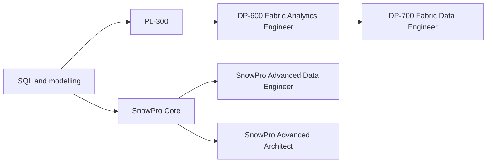

# Certification Roadmap - Analytics Engineer

An analytics engineer sits between data engineering and analysis. They own the layer of clean, tested, documented models that analysts and dashboards read from, usually written as SQL in version control. The core tools are a warehouse, a transformation tool such as dbt, and a BI tool.

This roadmap lists only certifications that have a guide in this repo. There is no dbt-specific exam here, so the dbt skill comes from practice: read [Analytics engineering and dbt](../learn/concepts/analytics-engineering-and-dbt.md) and build [a dbt project](./hands-on-projects/build-dbt-project.md).

## The path

The diagram shows two lanes, Microsoft and Snowflake. Pick one lane first; you do not need both.

### Step 0 - Skills before any exam

- Strong SQL, including window functions. See the [SQL interview guide](./interview-prep/sql-interview-guide.md).
- Dimensional modelling and slowly changing dimensions: [Data modeling for analytics](../learn/concepts/data-modeling-for-analytics.md), [Slowly changing dimensions](../learn/concepts/slowly-changing-dimensions.md).
- ELT thinking: [ETL vs ELT](../learn/concepts/etl-vs-elt.md).
- Tests and lineage: [Data quality and lineage](../learn/concepts/data-quality-and-lineage.md), [Data contracts](../learn/concepts/data-contracts.md).

### Lane A - Microsoft Fabric

| Step | Cert | What it adds |
|---|---|---|
| 1 | [PL-300 Power BI Data Analyst](../exams/azure/pl-300/README.md) | The reporting and modelling layer from the analyst side |
| 2 | [DP-600 Fabric Analytics Engineer](../exams/azure/dp-600/README.md) | Semantic models, warehouses and lakehouses; SQL, DAX and PySpark |
| 3 (optional) | [DP-700 Fabric Data Engineer](../exams/azure/dp-700/README.md) | The ingestion and pipeline side of the same platform |

[DP-900](../exams/azure/dp-900/README.md) is a fine vocabulary warm-up before step 1.

### Lane B - Snowflake

| Step | Cert | What it adds |
|---|---|---|
| 1 | [SnowPro Core](../exams/snowflake/snowpro-core/README.md) | Architecture, virtual warehouses, loading and sharing basics |
| 2 | [SnowPro Advanced Data Engineer](../exams/snowflake/snowpro-advanced-data-engineer/README.md) | Pipelines on Snowflake: Snowpipe, streams, tasks, dynamic tables |
| 2 (alternative) | [SnowPro Advanced Architect](../exams/snowflake/snowpro-advanced-architect/README.md) | Designing accounts, security and performance at scale |

The Advanced guides in this repo list an active SnowPro Core as a prerequisite. Snowflake's blog says "being SnowPro Core Certified is a prerequisite for all advanced exams" ([May 2023 post](https://www.snowflake.com/en/blog/updated-snowpro-advanced-data-scientist-certification/)), but the current Advanced pages and the FAQ answer do not state it, so confirm it on the exam registration page before you book.

### Other warehouses

For BigQuery, Redshift or Databricks, this repo's closest guides are [GCP Professional Data Engineer](../exams/gcp/data-engineer/README.md), [AWS DEA-C01](../exams/aws/associate/data-engineer-dea-c01/README.md) and [Databricks Data Engineer Associate](../exams/databricks/data-engineer-associate/README.md). They lean toward data engineering rather than analytics engineering. Use the [warehouse comparison](./service-comparison-warehouses.md) to choose.

## Tools you learn by doing

| Tool | Where to learn it here |
|---|---|
| dbt | [Analytics engineering and dbt](../learn/concepts/analytics-engineering-and-dbt.md), [Build a dbt project](./hands-on-projects/build-dbt-project.md) |
| Orchestration | [ETL and orchestration comparison](./service-comparison-etl-orchestration.md) |
| BI and semantic layers | [BI tools comparison](./service-comparison-bi-tools.md), [Semantic layer](./architecture-patterns/semantic-layer.md) |

## Interview prep

[Analytics engineer interview guide](./interview-prep/analytics-engineer-interview.md), then [Data modeling and pipeline design](./interview-prep/data-modeling-system-design-interview.md).

## Related

- [Data analyst roadmap](./certification-roadmap-data-analyst.md) - the step before this one
- [Data engineer roadmap](./certification-roadmap-data-engineer.md) - the step after, if you move toward pipelines and platforms
