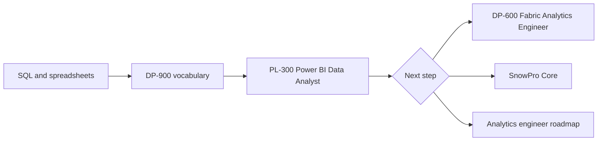

# Certification Roadmap - Data Analyst

A data analyst answers business questions with data: pull it with SQL, shape it, chart it, and explain what it means. This roadmap lists only the certifications that have a study guide in this repo. It is short on purpose. For an analyst, the portfolio matters more than the badge, and most of the work is SQL and judgment, which no exam fully tests.

If you have never written a query, start with [Data from Scratch](../learn/data-from-scratch.md) and the [day-one pages](../learn/day-one/README.md), then come back.

## The path

The diagram shows one main line (SQL, vocabulary, a BI tool exam) and three ways to go deeper.

### Step 0 - Skills before any exam

- SQL: joins, grouping, window functions. See [SQL joins](../learn/concepts/sql-joins-explained.md) and [window functions](../learn/concepts/window-functions-explained.md), then the [SQL interview guide](./interview-prep/sql-interview-guide.md).
- How data is modelled for reporting: [Data modeling for analytics](../learn/concepts/data-modeling-for-analytics.md).
- A spreadsheet, and one BI tool.

### Step 1 - Vocabulary: DP-900

[Azure Data Fundamentals (DP-900)](../exams/azure/dp-900/README.md) covers core data concepts: relational and non-relational data, analytics workloads. It is optional if you already work with data, and a gentle first exam if you do not.

### Step 2 - The analyst exam: PL-300

[Power BI Data Analyst (PL-300)](../exams/azure/pl-300/README.md) is the one analyst-tier certification in this repo. It covers preparing data, modelling it, visualizing it and managing the result. Pair it with the [BI tools comparison](./service-comparison-bi-tools.md) so you know where Power BI sits next to Looker, Tableau and the others.

### Step 3 - Pick a direction

| If you want | Next | Why |
|---|---|---|
| Deeper Microsoft-stack work | [DP-600 Fabric Analytics Engineer](../exams/azure/dp-600/README.md) | Semantic models, warehouses, lakehouses, SQL and DAX |
| A warehouse skill that travels across clouds | [SnowPro Core](../exams/snowflake/snowpro-core/README.md) | Snowflake is common in analytics jobs; see the [warehouse comparison](./service-comparison-warehouses.md) |
| To own the transformation layer | [Analytics engineer roadmap](./certification-roadmap-analytics-engineer.md) | Moves you from reading tables to building them |

## What this roadmap does not cover

Some analyst-focused certifications from other vendors have no guide in this repo (Databricks Data Analyst is on the [TODO](../TODO.md) list as a candidate). This page does not recommend a cert it cannot point to.

## Build proof as you go

- Rebuild a public dataset as a small star schema: [Design a star schema](./hands-on-projects/design-star-schema.md).
- Publish one dashboard with a clear question, a chart per answer and a note on data quality.
- Write down every metric definition. See [Semantic layer](./architecture-patterns/semantic-layer.md).

## Related

- [Data engineer roadmap](./certification-roadmap-data-engineer.md) - if you find you like the pipelines more than the charts
- [Study strategies](./study-strategies.md) and [Exam day checklist](./exam-day-checklist.md)
