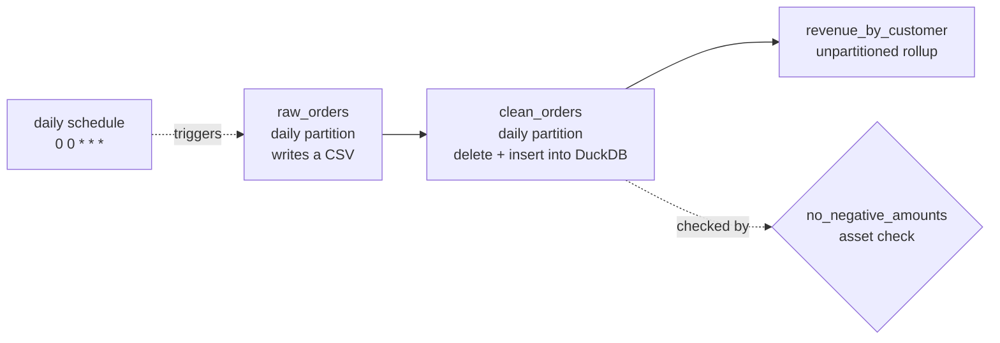

# Hands-On Project: Orchestrate a Pipeline with Dagster

Build a small daily pipeline as three software-defined assets in Dagster, with daily partitions, a data-quality check, a schedule, and safe reruns. You will run it, rerun a day to prove it is idempotent, and make a check fail on purpose to see what Dagster does with it. Everything runs locally with DuckDB.

**Why Dagster here and not Airflow?** Both orchestrate pipelines; the comparison is in [ETL and orchestration services](../service-comparison-etl-orchestration.md). Dagster runs a whole pipeline from one command with no database or scheduler to set up, which keeps this lab to the orchestration ideas themselves. Airflow is the more widely deployed tool, so the last section maps each step onto Airflow. **That mapping is not run.**

**Estimated Time:** 2-3 hours
**Difficulty:** Intermediate
**Prerequisites:** Python 3.10+, SQL. Read [Data pipelines and orchestration](../../learn/concepts/data-pipelines-and-orchestration.md) first; an idea of what a DAG is helps.
**Cost:** Free. Local only.
**Tested:** 2026-11-07 on Python 3.12 with Dagster 1.13.29, `dagster-webserver` 1.13.29 and DuckDB 2.0.0. The materialize commands, the schedule listing and the check were run. The web UI was **started** (`dagster dev` answered `/server_info` and returned HTTP 200 on `/`), but no page in it was clicked through; the UI descriptions below are from the Dagster docs, not from this run.

---

## What you will build



Three assets in a chain. The first two are partitioned by day, so one day can be run or rerun alone. An asset check watches `clean_orders`. A schedule runs the chain each day. Dagster builds this graph from the `deps` you declare.

---

## Step 1: Install

```bash
mkdir dagster-lab && cd dagster-lab
uv venv --python 3.12 .venv && source .venv/bin/activate        # or: python3 -m venv .venv
uv pip install dagster dagster-webserver duckdb               # or: pip install ...
dagster --version
```

```text
dagster, version 1.13.29
```

Dagster stores run history in a folder named by `DAGSTER_HOME`. Point it somewhere disposable:

```bash
export DAGSTER_HOME=$PWD/dagster_home && mkdir -p $DAGSTER_HOME
```

## Step 2: Define the assets

Save as `definitions.py`:

```python
import csv
import random
from pathlib import Path

import dagster as dg
import duckdb

DATA = Path("data")
DB = "warehouse.duckdb"

daily = dg.DailyPartitionsDefinition(start_date="2026-11-01")


@dg.asset(partitions_def=daily)
def raw_orders(context: dg.AssetExecutionContext) -> dg.MaterializeResult:
    """Pretend extract: write one CSV per day. Replaces the day, so reruns are safe."""
    day = context.partition_key
    DATA.mkdir(exist_ok=True)
    rng = random.Random(day)  # same day, same data: idempotent
    path = DATA / f"orders_{day}.csv"
    with path.open("w", newline="") as f:
        w = csv.writer(f)
        w.writerow(["order_id", "customer", "amount"])
        for i in range(50):
            amount = round(rng.uniform(5, 100), 2)
            if i == 7:
                amount = -1  # a bad row for the check to catch
            w.writerow([f"{day}-{i}", f"c{rng.randint(1, 8)}", amount])
    return dg.MaterializeResult(metadata={"rows": 50, "path": str(path)})


@dg.asset(deps=[raw_orders], partitions_def=daily)
def clean_orders(context: dg.AssetExecutionContext) -> dg.MaterializeResult:
    """Delete the day's rows, then insert them again: delete+insert by partition."""
    day = context.partition_key
    con = duckdb.connect(DB)
    con.execute(
        "create table if not exists clean_orders "
        "(day date, order_id varchar, customer varchar, amount double)"
    )
    con.execute("delete from clean_orders where day = ?", [day])
    con.execute(
        "insert into clean_orders "
        "select cast(? as date), order_id, customer, amount "
        "from read_csv_auto(?) where amount > 0",
        [day, str(DATA / f"orders_{day}.csv")],
    )
    n = con.execute("select count(*) from clean_orders where day = ?", [day]).fetchone()[0]
    return dg.MaterializeResult(metadata={"rows_loaded": n})


@dg.asset(deps=[clean_orders])
def revenue_by_customer() -> dg.MaterializeResult:
    """Unpartitioned rollup over every loaded day."""
    con = duckdb.connect(DB)
    con.execute(
        "create or replace table revenue_by_customer as "
        "select customer, count(*) orders, round(sum(amount), 2) revenue "
        "from clean_orders group by 1"
    )
    n = con.execute("select count(*) from revenue_by_customer").fetchone()[0]
    return dg.MaterializeResult(metadata={"customers": n})


@dg.asset_check(asset=clean_orders)
def no_negative_amounts() -> dg.AssetCheckResult:
    con = duckdb.connect(DB, read_only=True)
    bad = con.execute("select count(*) from clean_orders where amount <= 0").fetchone()[0]
    return dg.AssetCheckResult(passed=bad == 0, metadata={"bad_rows": bad})


daily_job = dg.define_asset_job(
    "daily_job", selection=[raw_orders, clean_orders, revenue_by_customer], partitions_def=daily
)

daily_schedule = dg.build_schedule_from_partitioned_job(daily_job)

defs = dg.Definitions(
    assets=[raw_orders, clean_orders, revenue_by_customer],
    asset_checks=[no_negative_amounts],
    jobs=[daily_job],
    schedules=[daily_schedule],
)
```

Read it through before running it:

- **An asset is a thing you want to exist** (a file, a table), written as a function that produces it. `deps=[raw_orders]` says what it needs first. This is the opposite of a task-first tool: you describe the outputs, and the runs follow.
- **`raw_orders` is idempotent.** It seeds its random generator with the partition date, so the same day always writes the same file, and it overwrites that day's file.
- **`clean_orders` uses delete-then-insert by partition.** It removes that day's rows and inserts them again, so a rerun replaces rather than duplicates. This is the standard idempotent load pattern: see [Idempotency explained](https://cloud.noblerworks.com/learn/concepts/idempotency-explained/).
- **One row in every file (the eighth) has an amount of -1**, a deliberate bad row. `clean_orders` filters it out, which is why 50 rows in become 49.
- **`no_negative_amounts` is an asset check** that reads the loaded table.

## Step 3: Run one day

```bash
dagster asset materialize -f definitions.py --select raw_orders,clean_orders --partition 2026-11-01
```

The CLI prints a line per event. The ones that matter (timestamps and run ids trimmed):

```text
raw_orders - STEP_SUCCESS - Finished execution of step "raw_orders" in 67ms.
clean_orders - STEP_SUCCESS - Finished execution of step "clean_orders" in 271ms.
clean_orders_no_negative_amounts - ASSET_CHECK_EVALUATION - Asset check 'no_negative_amounts' on 'clean_orders' passed.
RUN_SUCCESS - Finished execution of run for "__ASSET_JOB".
```

Run two more days and then the unpartitioned rollup, which reads every loaded day:

```bash
for d in 2026-11-02 2026-11-03; do
  dagster asset materialize -f definitions.py --select raw_orders,clean_orders --partition $d
done
dagster asset materialize -f definitions.py --select revenue_by_customer
```

All three runs ended in `RUN_SUCCESS`. Look at the data:

```bash
python - <<'PY'
import duckdb
c = duckdb.connect("warehouse.duckdb", read_only=True)
print(c.sql("select day, count(*) from clean_orders group by 1 order by 1").fetchall())
print(c.sql("select * from revenue_by_customer order by revenue desc limit 3").fetchall())
PY
```

```text
[(datetime.date(2026, 11, 1), 49), (datetime.date(2026, 11, 2), 49), (datetime.date(2026, 11, 3), 49)]
[('c6', 24, 1298.64), ('c4', 21, 1143.12), ('c7', 22, 1041.61)]
```

49 rows per day: 50 generated minus the one bad row.

## Step 4: Rerun a day (the idempotency test)

```bash
dagster asset materialize -f definitions.py --select raw_orders,clean_orders --partition 2026-11-02
```

It ended in `RUN_SUCCESS`, and re-running the day count query still gave 49 for 2026-11-02, not 98. That is what a safe retry or backfill must do. If a rerun doubled the rows, every orchestrator retry would corrupt the table; see [Failing and late pipelines](../troubleshooting/failing-and-late-pipelines.md).

## Step 5: Make the check fail on purpose

Temporarily remove the `where amount > 0` filter from `clean_orders` so the bad row reaches the table, then rerun day 1:

```bash
sed -i 's/ where amount > 0",/",/' definitions.py
dagster asset materialize -f definitions.py --select clean_orders --partition 2026-11-01
```

```text
clean_orders_no_negative_amounts - ASSET_CHECK_EVALUATION - Asset check 'no_negative_amounts' on 'clean_orders' did not pass.
RUN_SUCCESS - Finished execution of run for "__ASSET_JOB".
```

The check **did not pass, and the run still reported `RUN_SUCCESS`.** By default a failed asset check is recorded and shown but does not stop the run or downstream assets. This is the most important thing to learn here: a green run is not a good dataset. To make a check stop the pipeline, mark it as blocking in the check definition (`blocking=True` on `@dg.asset_check`) per the Dagster docs. We did **not** run that variant. Restore the filter before continuing:

```bash
sed -i 's|from read_csv_auto(?)",|from read_csv_auto(?) where amount > 0",|' definitions.py
grep -n "read_csv_auto" definitions.py
```

## Step 6: Schedules and the UI

`build_schedule_from_partitioned_job` created a schedule from the job. List it:

```bash
dagster schedule list -f definitions.py
```

```text
Schedule: daily_job_schedule [STOPPED]
Cron Schedule: 0 0 * * *
```

Schedules are created stopped. Something has to run the Dagster **daemon** and you have to turn the schedule on; `dagster dev` runs the webserver and daemon together. Start it and open the UI:

```bash
dagster dev -f definitions.py -p 3000
# browse to http://localhost:3000
```

We confirmed the server starts and answers. In the UI (per the Dagster docs, not walked through here) the Assets page shows the lineage graph, the partition status per asset, the check results, and a button to materialize missing partitions, which is how you backfill.

## Step 7: What a backfill is

A backfill runs the pipeline for many partitions: "load the last 90 days". With partitioned assets it is one action over a date range, and each partition's run is idempotent by Step 4. The failure mode is the same as any: a backfill that is not idempotent doubles the data. Plan it as in [Failing and late pipelines](../troubleshooting/failing-and-late-pipelines.md). We did not run a backfill command in this lab.

---

## The same pipeline in Airflow (not run)

| This lab (Dagster) | Airflow equivalent |
|---|---|
| Asset | A task, usually inside a DAG; Airflow 3 also has assets (datasets) for data-aware scheduling |
| `deps=[...]` | Task dependencies (`>>`) |
| Daily partition | A scheduled interval; the run's logical date plays the partition key |
| `dagster asset materialize` | `airflow dags test` or a triggered DAG run |
| Asset check | A check task, or a provider operator such as a SQL check operator |
| Schedule | The DAG's `schedule` argument |
| Reruns and backfills | Clear tasks, or the `backfill` command/UI |

Treat this as a map, not a tested port: check the Airflow docs for the release you run, because task authoring and the scheduler changed between 2.x and 3.x. The concepts that transfer are the same: declare dependencies, make each run idempotent by partition, and treat a quality check as a gate you must opt into.

## Clean up

```bash
deactivate; cd .. && rm -rf dagster-lab
```

## Extensions

- Make the check **blocking** and show that `revenue_by_customer` no longer builds when it fails.
- Add a **sensor** that triggers the job when a new file appears.
- Run `dbt build` from Dagster as an asset: see [Build a dbt project](./build-dbt-project.md).
- Run the same idea on Airflow in Docker using the official quickstart. Not run here.

## Related

- [Data pipelines and orchestration](../../learn/concepts/data-pipelines-and-orchestration.md) - DAGs, retries, backfills, the silent zero
- [ETL and orchestration services compared](../service-comparison-etl-orchestration.md) - Dagster, Airflow, Glue, Data Factory and more
- [Build a data pipeline](./build-data-pipeline.md) - the pipeline this lab orchestrates, built by hand
- [Failing and late pipelines](../troubleshooting/failing-and-late-pipelines.md) - when a run goes wrong

## Official docs

- **[📖 Dagster: Documentation](https://docs.dagster.io/)** - assets, partitions, asset checks, schedules and the CLI
- **[📖 Apache Airflow: Documentation](https://airflow.apache.org/docs/)** - DAGs, scheduling, backfills and assets
- **[📖 DuckDB documentation](https://duckdb.org/docs/)** - the local engine used here
