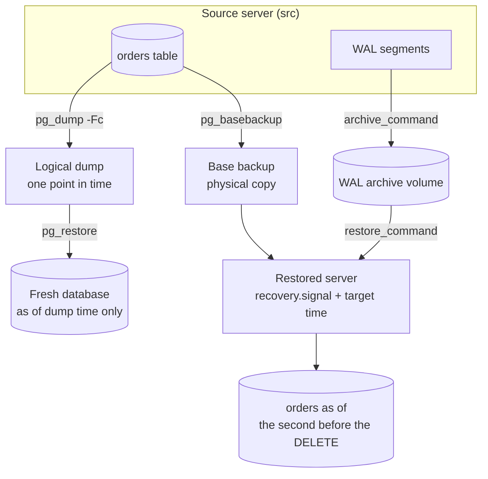

# Hands-On Project: Backup and Restore Drill (PostgreSQL)

Run a real disaster and recover from it. You will take a logical backup with `pg_dump` and a physical base backup with `pg_basebackup`, archive the write-ahead log, let someone delete every row, then rewind a new server to the second before the mistake. Then you will time and write down what you did, which is the point of a drill.

**Estimated Time:** 2-3 hours
**Difficulty:** Intermediate
**Prerequisites:** Docker, basic SQL. Read [Backup and point-in-time restore](../../learn/concepts/backup-and-point-in-time-restore.md) first; this project is its hands-on companion.
**Cost:** Free. Local containers and Docker volumes.
**Tested:** 2026-11-07 on PostgreSQL 17.11 (`postgres:17` image). Every command and every log line below comes from that run. **Not covered:** managed services (RDS, Cloud SQL, Azure Database for PostgreSQL), tools such as pgBackRest or WAL-G, and restoring across major versions.

---

## What you will build



Two kinds of backup of the same server. The physical base backup plus the archived WAL can replay to any chosen time. The logical dump restores only the moment it was taken.

---

## Step 1: Start a server that archives its WAL

Create volumes for the archive and the base backup, and make them writable by the `postgres` user in the container:

```bash
docker volume create arch && docker volume create base
docker run --rm -v arch:/arch -v base:/base postgres:17 chown postgres:postgres /arch /base

docker run -d --name src -e POSTGRES_PASSWORD=pw -v arch:/arch postgres:17 \
  -c wal_level=replica -c archive_mode=on \
  -c "archive_command=test ! -f /arch/%f && cp %p /arch/%f" \
  -c archive_timeout=30
sleep 6
```

`archive_command` runs for each finished WAL segment. `%p` is the segment's path and `%f` its file name. The `test ! -f` part refuses to overwrite a segment already archived, as the PostgreSQL manual recommends. `archive_timeout=30` forces a segment switch at least every 30 seconds so a quiet server still archives.

Create some data and confirm archiving is on:

```bash
S="docker exec src psql -U postgres -v ON_ERROR_STOP=1"
$S -c "create table orders(id serial primary key, customer text, amount numeric, created_at timestamptz default now())"
$S -c "insert into orders(customer,amount) select 'c'||g, g from generate_series(1,1000) g"
$S -c "show archive_mode" -t
```

```text
CREATE TABLE
INSERT 0 1000
 on
```

## Step 2: Take the two backups

**Logical backup.** `-Fc` is the custom format that `pg_restore` reads:

```bash
docker exec src bash -c "pg_dump -U postgres -Fc -f /tmp/shop.dump postgres && ls -l /tmp/shop.dump"
docker cp src:/tmp/shop.dump ./shop.dump
```

```text
-rw-r--r-- 1 root root 9043 Nov  7 16:52 /tmp/shop.dump
```

**Physical backup.** `-X stream` includes the WAL needed to make the copy consistent; `-c fast` asks for an immediate checkpoint:

```bash
docker exec src bash -c "PGPASSWORD=pw pg_basebackup -U postgres -D /tmp/base -Fp -X stream -c fast -v 2>&1 | tail -2"
```

```text
pg_basebackup: renaming backup_manifest.tmp to backup_manifest
pg_basebackup: base backup completed
```

Copy it into the `base` volume, where it will survive the source container:

```bash
docker exec src tar -C /tmp/base -cf - . | \
  docker run --rm -i -v base:/base postgres:17 bash -c "tar -C /base -xf - && chown -R postgres:postgres /base"
```

(In this lab we copy the backup into a volume. Production copies it to storage in another failure domain, such as object storage in another region.)

## Step 3: Keep working, record the time, then break it

More legitimate data arrives after the backups. Note the moment right after it:

```bash
$S -c "insert into orders(customer,amount) select 'late'||g, g from generate_series(1,500) g"
sleep 2
T=$($S -tAc "select to_char(now(),'YYYY-MM-DD HH24:MI:SS.US OF')")
echo "TARGET $T" | tee target.txt
$S -c "select count(*) from orders" -t
```

```text
INSERT 0 500
TARGET 2026-11-07 16:52:49.972221 +00
  1500
```

Now the disaster, a `DELETE` with no `WHERE`. Force the WAL segment to archive so the archive holds it:

```bash
sleep 2
$S -c "delete from orders"
$S -c "select pg_switch_wal()" -t
sleep 3
$S -c "select count(*) from orders" -t
docker exec src ls /arch
```

```text
DELETE 1500
 0/4035BF0

     0
000000010000000000000001
000000010000000000000002
000000010000000000000003
000000010000000000000003.00000028.backup
000000010000000000000004
```

The table is empty, and the archive holds the segments, including a `.backup` label file for our base backup. In real life you do not get to record the target time first: you find it in logs, application records or the first alert, and then choose a time just before it. The time you record is only as good as your clocks.

## Step 4: Restore to the second before the mistake

Build a new data directory from the base backup, tell PostgreSQL where the archive is and where to stop, and mark it as a recovery:

```bash
T=$(sed 's/^TARGET //' target.txt)
docker volume create restored
docker run --rm -v base:/base:ro -v restored:/pgdata postgres:17 bash -c "
  cp -a /base/. /pgdata/ && cd /pgdata && touch recovery.signal
  cat >> postgresql.auto.conf <<CONF
restore_command = 'cp /arch/%f %p'
recovery_target_time = '$T'
recovery_target_action = 'promote'
CONF
  chmod 700 /pgdata"

docker run -d --name rest -e POSTGRES_PASSWORD=pw \
  -v restored:/var/lib/postgresql/data -v arch:/arch:ro postgres:17
sleep 8
docker logs rest 2>&1 | grep -E "recovery|restored log|redo|ready to accept|stopping"
docker exec rest psql -U postgres -tc "select count(*), pg_is_in_recovery() from orders"
```

The server log tells the story, in order:

```text
LOG:  starting backup recovery with redo LSN 0/3000028, checkpoint LSN 0/3000080, on timeline ID 1
LOG:  restored log file "000000010000000000000003" from archive
LOG:  starting point-in-time recovery to 2026-11-07 16:52:49.972221+00
LOG:  redo starts at 0/3000028
LOG:  restored log file "000000010000000000000004" from archive
LOG:  completed backup recovery with redo LSN 0/3000028 and end LSN 0/3000120
LOG:  consistent recovery state reached at 0/3000120
LOG:  database system is ready to accept read-only connections
LOG:  recovery stopping before commit of transaction 742, time 2026-11-07 16:52:52.366731+00
LOG:  redo done at 0/4035BB0
LOG:  archive recovery complete
LOG:  database system is ready to accept connections
```

The result:

```text
  1500 | f
```

**1,500 rows, and `pg_is_in_recovery()` is false: the server was promoted.** The line that matters is `recovery stopping before commit of transaction 742`: transaction 742 was the `DELETE`, and replay stopped just before it. The 500 "late" rows, written after the base backup, came back too, because they were in the archived WAL. That is the entire advantage over a plain backup.

## Step 5: Compare with the logical restore

`pg_dump` restores into a fresh database at the moment of the dump, nothing later:

```bash
docker exec rest psql -U postgres -c "create database shop_logical"
docker cp shop.dump rest:/tmp/shop.dump
docker exec rest pg_restore -U postgres -d shop_logical --exit-on-error /tmp/shop.dump
docker exec rest psql -U postgres -d shop_logical -tc "select count(*) from orders"
```

```text
CREATE DATABASE
  1000
```

Only **1,000 rows**: the dump was taken before the 500 late rows existed. A logical dump is portable (other versions, other machines, single tables) and is a good second copy, but it cannot do point-in-time recovery.

| | `pg_dump` (logical) | `pg_basebackup` + WAL archive (physical) |
|---|---|---|
| Restores to | The moment of the dump | Any chosen moment since the base backup |
| Cost of restore | Re-runs the inserts and rebuilds indexes | Copy files, then replay WAL |
| Portable across major versions | Yes (to a newer one) | No, same major version |
| Can restore one table | Yes | No, whole cluster |
| Use for | Migrations, small databases, a second copy | Disaster recovery |

---

## Step 6: Write the drill report

A drill that is not written down did not happen. Fill in:

| Question | Our run |
|---|---|
| What was the recovery target and where did it come from? | `2026-11-07 16:52:49.972221 +00`, noted by hand before the `DELETE` |
| How much data was lost (RPO)? | None in this run: every commit before the target was in the archive. In real life, up to the last archived segment, so `archive_timeout` sets the worst case |
| How long did restoring take (RTO)? | Seconds, on 1,500 rows. **Time it on your real data size**; this number is why drills exist |
| Which steps needed a human to remember something? | The target time, the volume permissions, `recovery.signal` |
| What would have broken it? | A gap in the archive; an `archive_command` that failed silently; the archive on the same disk as the database |

## Things the drill teaches that reading does not

- **Archiving can silently fail.** If `archive_command` fails, PostgreSQL retries and keeps WAL on the primary, filling its disk. Watch `pg_stat_archiver` (`failed_count`, `last_failed_time`); not run here.
- **The archive is half the backup.** Lose a segment in the middle and recovery stops there.
- **Recovery creates a new timeline.** The restored server wrote its own history from the target onward. Another restore from the same archive can choose differently via `recovery_target_timeline`.
- **Test restores on a schedule, to a scratch server.** The cheap, automatable version of this lab is the backup system's own restore job plus a row-count check.

## Clean up

```bash
docker rm -f src rest
docker volume rm arch base restored
rm -f shop.dump target.txt
```

## Extensions

- Use `recovery_target_name` with a restore point created by `pg_create_restore_point()` instead of a clock time.
- Add a second `pg_basebackup` and restore from the later one; see how much less WAL replays.
- Run the same drill on a managed database and compare: RDS restores to a new instance; see [Backup and point-in-time restore](../../learn/concepts/backup-and-point-in-time-restore.md). Not run here.
- Study how real teams lost backups: [GitLab database incident, 2017](../postmortem-gitlab-database-2017.md).

## Related

- [Backup and point-in-time restore](../../learn/concepts/backup-and-point-in-time-restore.md) - the concept page
- [Postmortem: GitLab database incident 2017](../postmortem-gitlab-database-2017.md) - five backup methods, none worked
- [Replication lag](../troubleshooting/replication-lag.md) - replicas use the same WAL
- [Transactions and ACID](../../learn/concepts/transactions-and-acid.md) - why a write-ahead log exists

## Official docs

- **[📖 PostgreSQL: Continuous Archiving and Point-in-Time Recovery (PITR)](https://www.postgresql.org/docs/current/continuous-archiving.html)** - archiving, base backups and recovery settings
- **[📖 PostgreSQL: pg_basebackup](https://www.postgresql.org/docs/current/app-pgbasebackup.html)** - physical base backups
- **[📖 PostgreSQL: pg_dump](https://www.postgresql.org/docs/current/app-pgdump.html)** and **[📖 pg_restore](https://www.postgresql.org/docs/current/app-pgrestore.html)** - logical backups
- **[📖 PostgreSQL: Recovery Target settings](https://www.postgresql.org/docs/current/runtime-config-wal.html#RUNTIME-CONFIG-WAL-RECOVERY-TARGET)** - `recovery_target_time`, `recovery_target_action`
