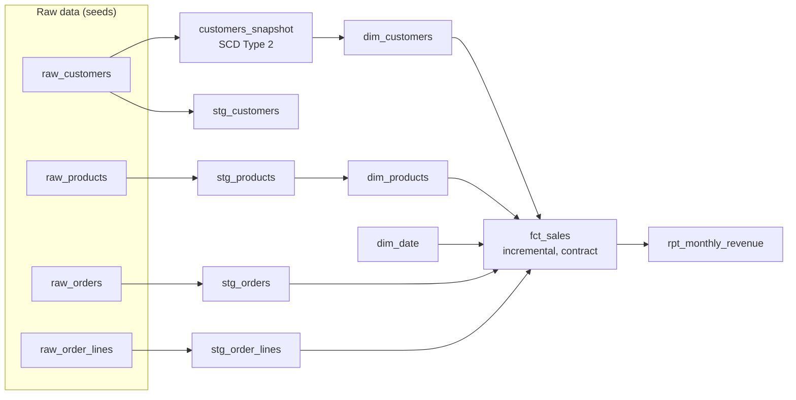

# Hands-On Project: Build a dbt Project

Build a tested star schema with dbt: staging models over raw data, a Type 2 customer dimension from a snapshot, an incremental fact table with an enforced contract, generic, singular and unit tests, docs with lineage, and a CI command that only builds what changed.

**Estimated Time:** 4-5 hours
**Difficulty:** Intermediate
**Prerequisites:** SQL, Python 3.10+, git. Read [Analytics engineering and dbt](../../learn/concepts/analytics-engineering-and-dbt.md). The design thinking behind the model is in [Design a star schema](./design-star-schema.md).
**Cost:** Free. Runs locally on DuckDB; the last step shows how to point it at a cloud warehouse.
**Tested:** 2026-10-21 with dbt Core 1.12, dbt-duckdb and dbt_utils 1.4 (`dbt build`: 28 passed). dbt v2 is the default for new installs; see [Analytics engineering and dbt](../../learn/concepts/analytics-engineering-and-dbt.md#dbt-versions-and-products) before mixing the two.

---

## What you will build



The project's DAG: raw seeds, a staging model per source, a snapshot for customer history, conformed dimensions, one incremental fact, and a reporting model on top. dbt derives this graph from the `ref` calls in the SQL.

---

## Step 1: Install and initialize

```bash
mkdir dbt-lab && cd dbt-lab
python3 -m venv .venv && source .venv/bin/activate
pip install "dbt-core>=1.10,<2" dbt-duckdb
dbt --version          # this lab was tested with dbt Core 1.12 and dbt-duckdb

dbt init shop          # choose duckdb when asked
cd shop
git init
```

Edit `~/.dbt/profiles.yml` (dbt created it) so the profile points at a local file:

```yaml
shop:
  target: dev
  outputs:
    dev:
      type: duckdb
      path: shop.duckdb
      threads: 4
```

Delete the example models dbt generated (`rm -r models/example`) and remove the `example:` block under `models:` in `dbt_project.yml`. Replace that block with layer defaults:

```yaml
models:
  shop:
    staging:
      +materialized: view
    marts:
      +materialized: table
```

Add the `dbt_utils` package in `packages.yml`:

```yaml
packages:
  - package: dbt-labs/dbt_utils
    version: [">=1.3.0", "<2.0.0"]
```

```bash
dbt deps
dbt debug        # "All checks passed!"
```

---

## Step 2: Generate raw data as seeds

Seeds are CSV files dbt loads as tables. Real projects get raw data from a loader (Fivetran, Airbyte, a [pipeline](./build-data-pipeline.md)); seeds keep this lab self-contained.

```python
# make_seeds.py  - run from the shop/ folder
import csv, random
from datetime import date, timedelta
random.seed(7)

def write(name, header, rows):
    with open(f"seeds/{name}.csv", "w", newline="") as f:
        w = csv.writer(f); w.writerow(header); w.writerows(rows)

segments, countries = ["hobbyist", "commuter", "pro"], ["GB", "DE", "FR", "NL"]
write("raw_customers", ["customer_id", "name", "email", "country", "segment"],
      [[f"C-{i}", f"Customer {i}", f"c{i}@example.com",
        random.choice(countries), random.choice(segments)] for i in range(1, 201)])

cats = ["drivetrain", "brakes", "wheels", "cockpit"]
write("raw_products", ["product_id", "name", "category", "list_price"],
      [[f"P-{i}", f"Part {i}", random.choice(cats), round(random.uniform(5, 300), 2)]
       for i in range(1, 41)])

orders, lines, start = [], [], date(2026, 1, 1)
for o in range(1, 3001):
    d = start + timedelta(days=random.randint(0, 290))
    status = random.choices(["complete", "cancelled", "returned"], [90, 7, 3])[0]
    orders.append([f"O-{o}", f"C-{random.randint(1, 200)}", d.isoformat(), status,
                   round(random.choice([0, 0, 4.99, 9.99]), 2)])
    for n in range(1, random.randint(1, 4) + 1):
        lines.append([f"O-{o}", n, f"P-{random.randint(1, 40)}", random.randint(1, 3),
                      round(random.uniform(5, 300), 2)])
write("raw_orders", ["order_id", "customer_id", "order_date", "status", "shipping_fee"], orders)
write("raw_order_lines", ["order_id", "line_no", "product_id", "quantity", "unit_price"], lines)
```

```bash
python make_seeds.py
dbt seed
```

**Checkpoint:** `dbt seed` reports four tables loaded.

---

## Step 3: Staging models

One model per raw table, in `models/staging/`. Rename, cast, nothing else.

```sql
-- models/staging/stg_orders.sql
select
    order_id,
    customer_id,
    cast(order_date as date)            as order_date,
    lower(status)                       as status,
    cast(shipping_fee as decimal(10,2)) as shipping_fee
from {{ ref('raw_orders') }}
```

```sql
-- models/staging/stg_order_lines.sql
select
    order_id,
    cast(line_no as integer)               as line_no,
    product_id,
    cast(quantity as integer)              as quantity,
    cast(unit_price as decimal(10,2))      as unit_price,
    cast(quantity * unit_price as decimal(12,2)) as line_revenue
from {{ ref('raw_order_lines') }}
```

```sql
-- models/staging/stg_products.sql
select product_id, name as product_name, category,
       cast(list_price as decimal(10,2)) as list_price
from {{ ref('raw_products') }}
```

Write `stg_customers.sql` the same way (select and rename the five columns).

In a real project the raw tables would be declared as **sources** in YAML and referenced with `{{ source('shop', 'raw_orders') }}`. Seeds are referenced with `ref`, which is why this lab uses `ref` throughout.

```bash
dbt run --select staging
```

---

## Step 4: Customer history with a snapshot

A **snapshot** compares the source to what it saw last time and keeps Type 2 history. Create `snapshots/customers_snapshot.yml`:

```yaml
snapshots:
  - name: customers_snapshot
    relation: ref('raw_customers')
    config:
      unique_key: customer_id
      strategy: check
      check_cols: [country, segment]
```

`strategy: check` creates a new version when any listed column changes. (The alternative, `timestamp`, uses an `updated_at` column, and is preferred when the source has a reliable one.)

```bash
dbt snapshot
```

Now **simulate a change**. Edit `seeds/raw_customers.csv`, change `C-1`'s country to something else and its segment to `pro`, then:

```bash
dbt seed --select raw_customers
dbt snapshot
```

Query it (`duckdb shop.duckdb`, or `dbt show`):

```bash
dbt show --inline "select customer_id, country, segment, dbt_valid_from, dbt_valid_to
                   from {{ ref('customers_snapshot') }} where customer_id = 'C-1'"
```

**Checkpoint:** two rows for C-1. The old one has a `dbt_valid_to`; the new one has none.

In production a snapshot runs on a schedule, and it only sees changes between runs. See [Slowly changing dimensions](../../learn/concepts/slowly-changing-dimensions.md) for why CDC is better when intermediate states matter.

---

## Step 5: Dimensions

```sql
-- models/marts/dim_customers.sql
select
    {{ dbt_utils.generate_surrogate_key(['customer_id', 'dbt_valid_from']) }} as customer_key,
    customer_id,
    name,
    email,
    country,
    segment,
    -- the first version a snapshot ever sees is treated as valid from the start of time
    case when dbt_valid_from = min(dbt_valid_from) over (partition by customer_id)
         then date '1900-01-01'
         else cast(dbt_valid_from as date) end                as valid_from,
    coalesce(cast(dbt_valid_to as date), date '9999-12-31')   as valid_to,
    dbt_valid_to is null                                      as is_current
from {{ ref('customers_snapshot') }}
```

```sql
-- models/marts/dim_products.sql
select
    {{ dbt_utils.generate_surrogate_key(['product_id']) }} as product_key,
    product_id, product_name, category, list_price
from {{ ref('stg_products') }}
```

```sql
-- models/marts/dim_date.sql
select
    cast(strftime(d, '%Y%m%d') as integer) as date_key,
    cast(d as date)                        as date_day,
    year(d)                                as year,
    month(d)                               as month,
    strftime(d, '%Y-%m')                   as year_month,
    dayofweek(d) in (0, 6)                 as is_weekend
from generate_series(date '2025-01-01', date '2027-12-31', interval 1 day) as t(d)
```

Why the `case` on `valid_from`: the snapshot started today, so without it every customer's first version would begin today, after all the 2026 orders, and the fact table's range join would find no customer. Backdating the first version a snapshot ever saw is the usual fix on first load. Versions created by later snapshot runs keep their real start date.

---

## Step 6: An incremental fact with a contract

The grain is **one row per order line**. Order-level shipping is allocated across lines by revenue, so it sums back exactly (see [Design a star schema](./design-star-schema.md) step 4). Cancelled orders are excluded.

```sql
-- models/marts/fct_sales.sql
{{ config(
    materialized='incremental',
    unique_key=['order_id', 'line_no'],
    on_schema_change='fail'
) }}

with lines as (
    select l.*, o.customer_id, o.order_date, o.shipping_fee,
           sum(l.line_revenue) over (partition by l.order_id) as order_revenue
    from {{ ref('stg_order_lines') }} l
    join {{ ref('stg_orders') }} o using (order_id)
    where o.status <> 'cancelled'
    
      -- reprocess a 3-day lookback so late-arriving lines are not skipped
      and o.order_date >= (select max(order_date) from {{ this }}) - interval 3 day
    
)
select
    lines.order_id,
    lines.line_no,
    lines.order_date,
    cast(strftime(lines.order_date, '%Y%m%d') as integer)            as date_key,
    c.customer_key,
    p.product_key,
    lines.quantity,
    lines.line_revenue                                               as revenue,
    cast(lines.shipping_fee * lines.line_revenue
         / nullif(lines.order_revenue, 0) as decimal(12,2))          as allocated_shipping
from lines
join {{ ref('dim_customers') }} c
  on c.customer_id = lines.customer_id
 and lines.order_date >= c.valid_from and lines.order_date < c.valid_to
join {{ ref('dim_products') }} p on p.product_id = lines.product_id
```

Two things to notice: the customer join is a **range join** that picks the version valid on the order date, and the incremental filter has a **lookback** so a late line for a three-day-old order is still picked up and merged by `unique_key`.

Now declare and **enforce** the model's shape in `models/marts/_marts.yml`:

```yaml
models:
  - name: fct_sales
    description: One row per order line of a non-cancelled order.
    config:
      contract:
        enforced: true
    columns:
      - name: order_id
        data_type: varchar
        constraints: [{ type: not_null }]
      - name: line_no
        data_type: integer
      - name: order_date
        data_type: date
      - name: date_key
        data_type: integer
        data_tests:
          - relationships: { to: ref('dim_date'), field: date_key }
      - name: customer_key
        data_type: varchar
        data_tests:
          - not_null
          - relationships: { to: ref('dim_customers'), field: customer_key }
      - name: product_key
        data_type: varchar
        data_tests:
          - relationships: { to: ref('dim_products'), field: product_key }
      - name: quantity
        data_type: integer
      - name: revenue
        data_type: decimal(12,2)
        data_tests:
          - dbt_utils.accepted_range: { min_value: 0 }
      - name: allocated_shipping
        data_type: decimal(12,2)
    data_tests:
      - dbt_utils.unique_combination_of_columns:
          combination_of_columns: [order_id, line_no]

  - name: dim_customers
    columns:
      - name: customer_key
        data_tests: [unique, not_null]
      - name: segment
        data_tests:
          - accepted_values: { values: [hobbyist, commuter, pro] }

  - name: dim_products
    columns:
      - name: product_key
        data_tests: [unique, not_null]
```

With the contract enforced, if someone changes the SQL so a column disappears or changes type, the build fails before the table is replaced. See [Data contracts](../../learn/concepts/data-contracts.md).

---

## Step 7: Singular and unit tests

A **singular test** for a business rule: revenue in the fact must match the raw lines of non-cancelled orders.

```sql
-- tests/assert_fct_sales_reconciles_to_source.sql
with fact as (select sum(revenue) as r from {{ ref('fct_sales') }}),
src as (
    select sum(l.quantity * l.unit_price) as r
    from {{ ref('raw_order_lines') }} l
    join {{ ref('raw_orders') }} o using (order_id)
    where lower(o.status) <> 'cancelled'
)
select fact.r as fact_revenue, src.r as source_revenue
from fact, src
where abs(fact.r - src.r) > 0.01
```

And one for the allocation rule: per order, allocated shipping must add back up to the fee.

```sql
-- tests/assert_shipping_allocates_exactly.sql
select f.order_id
from {{ ref('fct_sales') }} f
join {{ ref('stg_orders') }} o using (order_id)
group by f.order_id, o.shipping_fee
having abs(sum(f.allocated_shipping) - o.shipping_fee) > 0.02
```

A **unit test** checks logic on fixed inputs, without touching real data. Add to `_marts.yml`:

```yaml
unit_tests:
  - name: shipping_is_split_by_revenue
    model: fct_sales
    overrides:
      macros:
        is_incremental: false
    given:
      - input: ref('stg_orders')
        rows:
          - { order_id: O-9, customer_id: C-9, order_date: 2026-05-01, status: complete, shipping_fee: 10.00 }
      - input: ref('stg_order_lines')
        rows:
          - { order_id: O-9, line_no: 1, product_id: P-1, quantity: 1, unit_price: 30.00, line_revenue: 30.00 }
          - { order_id: O-9, line_no: 2, product_id: P-2, quantity: 1, unit_price: 10.00, line_revenue: 10.00 }
      - input: ref('dim_customers')
        rows:
          - { customer_key: k9, customer_id: C-9, valid_from: 1900-01-01, valid_to: 9999-12-31 }
      - input: ref('dim_products')
        rows:
          - { product_key: p1, product_id: P-1 }
          - { product_key: p2, product_id: P-2 }
    expect:
      rows:
        - { order_id: O-9, line_no: 1, allocated_shipping: 7.50 }
        - { order_id: O-9, line_no: 2, allocated_shipping: 2.50 }
```

---

## Step 8: Build everything

```bash
dbt build
```

`dbt build` runs seeds, snapshots, models and tests **in DAG order**, and skips anything downstream of a failed test. Expect everything to pass. Then break something on purpose to see the safety net work:

1. In `stg_order_lines.sql`, change `cast(line_no as integer)` to `1 as line_no`.
2. `dbt build` - the `unique_combination_of_columns` test on `fct_sales` fails, and `rpt_monthly_revenue` (next step) is skipped rather than built on bad data.
3. Revert.

---

## Step 9: A reporting model and docs

```sql
-- models/marts/rpt_monthly_revenue.sql
select d.year_month, p.category, c.segment,
       count(distinct f.order_id) as orders,
       sum(f.revenue)             as revenue
from {{ ref('fct_sales') }} f
join {{ ref('dim_date') }} d      using (date_key)
join {{ ref('dim_products') }} p  using (product_key)
join {{ ref('dim_customers') }} c using (customer_key)
group by all
```

Add `description:` lines to the models and key columns in `_marts.yml`, then:

```bash
dbt docs generate
dbt docs serve        # opens a site with every model, column, test and the lineage graph
```

---

## Step 10: Build only what changed (CI)

In CI you do not rebuild the whole project for every pull request. dbt compares the current code to the manifest from production and selects what changed plus everything downstream.

```bash
# Save the "production" state once
dbt build && mkdir -p prod-state && cp target/manifest.json prod-state/

# Change one model, then build only the changed models and their children
dbt build --select state:modified+ --state prod-state
```

In a real pipeline the production manifest is downloaded from storage, the build runs in a disposable CI schema, and the pull request cannot merge until it passes.

---

## Step 11 (optional): Point it at a cloud warehouse

Install the adapter for your platform (`dbt-snowflake`, `dbt-bigquery`, `dbt-databricks`, `dbt-redshift`, `dbt-fabric`), add a second output to `profiles.yml`, and run with `--target`. Two things will need attention:

- **SQL dialect.** `strftime`, `generate_series` and `group by all` are DuckDB spellings. Use `dbt_utils.date_spine` and cross-database macros, or adjust per platform.
- **Seeds are for small reference data.** On a warehouse, load the raw tables with a real loader and declare them as `sources` with freshness checks.

---

## Deliverables

- A git repository with the project, a README stating the grain of `fct_sales` and the shipping allocation rule.
- A screenshot of the lineage graph from `dbt docs serve`.
- Evidence that a deliberate break was caught by a test and blocked downstream models.

## Extensions

- Add **source freshness** checks (`loaded_at_field`, `warn_after`, `error_after`) once you load data from a real source.
- Add a **semantic model and metrics** for revenue, so every BI tool shares one definition.
- Orchestrate `dbt build` after the loader finishes, with Airflow, Dagster or the dbt platform scheduler. See [Data pipelines and orchestration](../../learn/concepts/data-pipelines-and-orchestration.md).
- Run the same project with **SQLMesh** or **Dataform** and compare.

## Related

- [Analytics engineering and dbt](../../learn/concepts/analytics-engineering-and-dbt.md) - the concepts behind every step
- [Design a star schema](./design-star-schema.md) - the design method before the code
- [Data quality and lineage](../../learn/concepts/data-quality-and-lineage.md) - where tests fit in the bigger picture
- [Fabric Analytics Engineer (DP-600)](../../exams/azure/dp-600/) - an analytics engineering certification

## Official docs

- **[📖 dbt: Snapshots](https://docs.getdbt.com/docs/build/snapshots)** - YAML snapshot configuration and strategies
- **[📖 dbt: Unit tests](https://docs.getdbt.com/docs/build/unit-tests)** - fixed-input tests for model logic
- **[📖 dbt: Model contracts](https://docs.getdbt.com/docs/collaborate/govern/model-contracts)** - enforced column names, types and constraints
- **[📖 dbt-duckdb adapter](https://github.com/duckdb/dbt-duckdb)** - the adapter used for the local build
